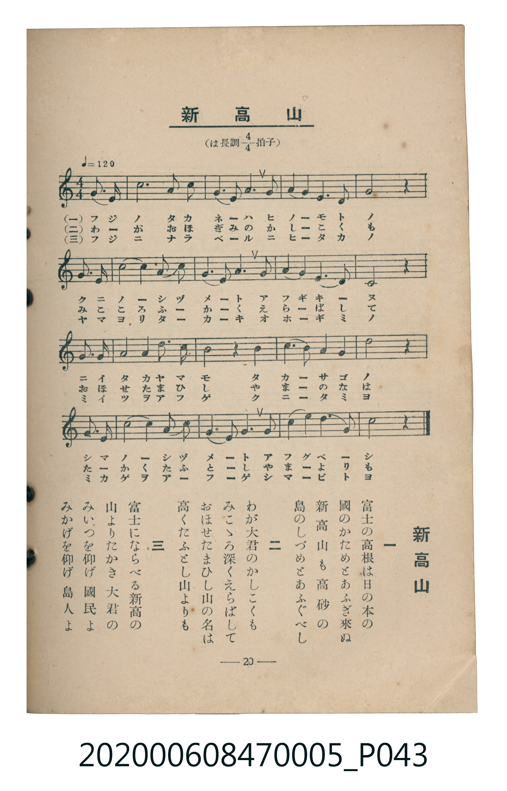

# 新高山

> Re:Shoka 使用 AI 辨識樂譜，可能會有錯誤。歡迎回報。

<audio controls src="niitakayama.mp3"></audio>

- 臺灣教育會公認《新定兒童唱歌》尋常科第五學年用（2020.006.0847.0005）

## 說明

原書資訊與歌詞全文（對應 P043.jpg，書頁 p. 20，第二學期第 6 首）：
調性與拍號：は長調四分之四拍子（C 大調 4/4 拍），♩= 120

## 跨冊／重複收錄參照

> 同名異曲（各冊收錄之不同詞曲版本）

- **[同名異曲]** 楊金土手抄《唱歌帖》第 10 冊・X（2020.006.0843）：[**〈新高山 (新高山／玉山)〉**](../../../shokacho/vol_10/p202_niitakayama/index.md)（`C` / `3/4` — [原始 TMD](../../../shokacho/vol_10/p202_niitakayama/niitakayama.tmd)）
- 總表：[跨冊重複與同名歌曲總索引](../../../duplicate_songs.md)

## 歌詞

```text
一　富士の高根は日の本の
國のかためとあふぎ來ぬ
新高山も高砂の
島のしづめとあふぐべし

二　わが大君のかしこくも
みこゝろ深くえらばして
おほせたまひし山の名は
高くたふとし山よりも

三　富士にならべる新高の
山よりたかき　大君の
みいつを仰げ　國民よ
みかげを仰げ　島人よ
```

## ABC

```abc
X:1
T:新高山
M:4/4
L:1/16
Q:1/4=120
K:C
V:V1 name="Piano" snm="Pia"
[V:V1]
G6 G2 c8 | A6 c2 G4 E4 | G6 A2 G6 E2 | G12 z4 |
E6 G2 c4 e4 | d6 c2 A4 G4 | A6 c2 G4 E2 D2 | C12 z4 |
D6 E2 G4 G4 | A6 c2 G8 | A6 A2 G4 c4 | d12 z4 |
e6 d2 c8 | d6 c2 A4 G4 | E6 G2 c4 d2 B2 | c12 z4 |
```

## TMD 檔案連結

- [主旋律 TMD 檔案](niitakayama.tmd) [[在 TMD Studio 編輯](https://tmdlang.github.io/Tmd-TS/#tmd=s7IKdvYPcrWy4qpTUCpJTLdSSM7PyUlNLsnMz7MqzsjMK0nNjM_KTMmPL87Iz05Ugisry88pzU21Si9KTEmNN403MjAyiDcwMIs3sDAxBzIMTBFKi_NLi5JTrYqTM_Lzc-JLUitKkvLzsxHyBUX5Zal5iXlANQVFIBtTwIoQClLLMlNSQdKpKZkl-UWZiTlI7kgtKga7FWxJfElRYl5xclFmAcgDCFUlGalAx-YllpQWpSpxaWkpPJu24eXqGU83blTQ0uJStFUwNDLgsrdVcOayMdE3sQPpe9G-63nj4mdTZ75o2vRsTvPT1jUvVvU-bugC6ny6btbT1knPVy99OmXjs7U9jxu6n27ofrpjx_PlE5-vWfNk15Sna3c83bnl-ZQV7_d0gEJGDxgyeqCQATIMTN_v6VTi4tLXUrClFuBSUFB42jf_2ewdLza3v1jR9aKjHeiuFyvnPW1d8WxaO9AVTzf0PmvvVAgwMDHWyypIf7-nB6j45YJGhQI9BSMDIBfs8B6gw5_NmQ9kK5gpvFw2DejS93tmgUx_sWr_s4blIHO7e1_MnA8Ufdy4_uXU7UDxp7NnP-1oe7KzG8gAyj5dOwFon7PC0yXLgZIKwOBUAIqCTep5NHMlJKhBRj7Z0fC4oeHp-p6ni1c_blwHjI5nC3YCTX02fSmQ-2zOGiAJ9ticbiDrcSOQnP-4qfFx44rHjU2PG7c-bux7sq_tceMakCJ4fD5uagIyni8AqoDo3rwNrHv648alqLonPG4EWjcd4pZdwFhseNzU_7ixB-jwpxNmw6wE6pv8uLEfaCxI3ePG_SB-09zHTb3Ptm8ESTR2PG7qfNy4Aax0GURR1-PG3Y8bgWbMf9y473HjJqAcyGmN655O6AX6EKQI6EiwbqAKoFuAjgKraAIa1gWyCxJAnUgBBESrwDbtfNzUDfEuzItwjSDTgG4GJtMGuC_gzm553LjkcdOkJ7uBTp0EUjGn-9mGiUCdcBVArZNQVGze9mTXLqgKylMpFCho6XNx-WVmliRmJ1Ym5iZaBWQm5uU71BjUKFSDLFKwsdCyAzOwZREFUELd0fBiYY-ChonC0w39z9c36MDTtSYWDUDroIZpADVqWik8bp4KEnjctAPI7AMxFRRqgNz9ENHVQNFeIKO5HyzcPAksDFT4uHkRhNkBFofqBAGoFTUKpgq6QGiqYBgHZugChczANFAAJGcMFoKoMoPSxnARCDQAqQEnANwBsKuHogBoWg_xSDfEG4-b90BCYDUkBPYDRRZCPAoWhnp7KpC5DqL6cdNacBj0YAkDkB_hYWAMImoUjCDhARQCBQfItxgBYwQUMiQxGHZ0UpYOuiH-XQKJfLD_Qb5aAvHvPFiMoyePpq0gxhaIYmzJwAgasSCfYfEscsKApAJwWMGDiegAAJa4lKWD7QifImUEiGjTLtzJYAM0GTTPRGhATwYQvwC9hJQZsKUDlPQCVGAOSgiYAVHLxaVrp4BUbigAucpcXAA)]
- [鋼琴伴奏 TMD 檔案](niitakayama_piano.tmd) [[在 TMD Studio 編輯](https://tmdlang.github.io/Tmd-TS/#tmd=s7IKdvYPcrWy4tLSUng2bcPL1TOebtz4fk_Hy-49zydsebJny9Ol_c87O97v6VTQ0uJStFUwNDLgsrdVcOayMdE3seOqU1B60b7reePiZ1Nnvmja9GxO89PWNS9W9T5u6AIa93TdrKetk56vXvp0ysZna3seN3Q_3dD9dMeO58snPl-z5smuKU_X7ni6c8vzKSuAVhoZGBnoGRiY6RlYmJgDGQamQFuVuLj8MjNLErMTKxNzE60CMhPz8oM8HGoMahSquRSAwMZCyw7M0NdSsEUHCiBbdjS8WNijoGGi8HRD__P1DToKAQYmxnpZBemaWDRo6YMNq1EwVdAFQlMFwzgwQxcoZAamgQIgOWOwEESVGZQ2hotAoAFIDRd-1-3qIcd1INvhrjMGETUKRhCXAoVADgW5A8PJRkAhQxIduKOTHAcaQQMEZC8WpyAHKCT0wD6Be4Jo5z2dPZus8INYA7QNKX6xBSBKQAMVmINCENONtViSqQ9KMjVBJNMXfV1PZ215uqDp-az2Jzu7gV541t37dO2Ep9uXPevshuS593t6nk7c86y983lfJyRHIuXOzqfbe59uXvFsw-Kn3YsQnjKMV4g2jIVRNQomQIYJEh9d3jQeyDKNjwUzDIC-IM4YKB-uG1kHwhS4NCFziHSOGUjWLD4Xj8dwuggYO7p2CkgRpIDJVebiAgA)]

## 分析

```text
================================================================================
📊 TMD Song Profile: [ 新高山 ]
================================================================================
⏱  Duration:       0:32 (32.0s), 16 measures total
🎼 Key & Tempo:    首調基準 C, != 120.0 BPM, <4/4>
   - 分析範圍：      由實際發聲的音符與和弦推測調性；播放脈絡另行呈現
🎤 人聲音域:    C4 (MIDI 60) – E5 (MIDI 76) [跨度: 16 個半音 / 1.3 個八度, 難度: moderate]
   - 最低音:  C4 in [Niitakayama #1 @ m.8, 0:14]
   - 最高音: E5 in [Niitakayama #1 @ m.5, 0:09]
   - 適合: soprano, mezzo-soprano, contralto, tenor, baritone, bass
🏛  結構:      Niitakayama (32.0s)
⚡ 編曲密度:        Peak 1 軌道同時演奏
🗝  調性診斷：       C 大調（純淨自然大調，未偵測到可信轉調）
   - 風格氣質:    純淨自然大調（陽光明朗、易唱易記，無明顯調外色彩）
   - 轉調歷程:    全曲維持單一推測調性（未偵測到可信轉調）
   - 核心骨幹音:  G, C, D, A, E
   - 調性數值:    C 大調 [相關度: 0.86, 穩定度: Moderate, 自然音純度: 100.0%]
   - 候選調性 (K-S): C 大調 (0.86), G 大調 (0.81), E 小調 (0.57)
   - 五度圈歷程:   +0
   - 各段落調性細節:
     • [Niitakayama #1]: C 大調 (r: 0.86, 自然音純度: 100.0%)

  [ 五度圈游移軌跡 ]
              [C ]*
         F            G  
      Bb               D  
      Eb               A  
         Ab           E  
            Db       B  
               F# 
     (* = active key center)

  [ 十二半音累積音高分佈 ]
     C  : █████████████████████     25.8%
     C# :                            0.0%
     D  : ████████████              15.0%
     D# :                            0.0%
     E  : ███████████               13.3%
     F  :                            0.0%
     F# :                            0.0%
     G  : ████████████████████████  30.0%
     G# :                            0.0%
     A  : ████████████              15.0%
     A# :                            0.0%
     B  : █                          0.8%
--------------------------------------------------------------------------------
Assignment 軌道音域：
  - Piano         : C4 – E5 (16 個半音 / 1.3 個八度, 51 個音符)
================================================================================
```


## 原書掃描頁




