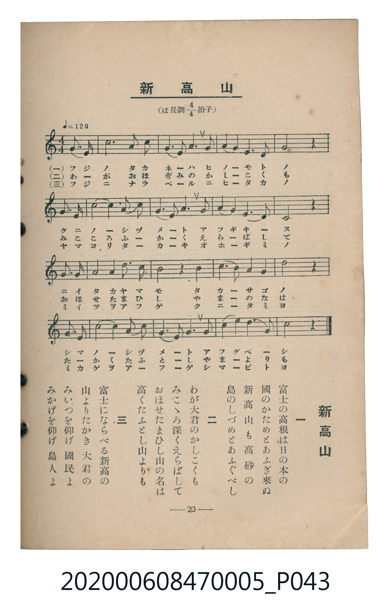

# 新高山

> Re:Shōka 使用 AI 協助辨識與重建樂譜，可能會有錯誤。歡迎回報。

- **鋼琴伴奏版**：<br><audio controls src="niitakayama.mp3"></audio>
- **NEUTRINO 歌聲合成版**：<br><audio controls src="niitakayama_neutrino.mp3"></audio>

- 臺灣教育會公認《新定兒童唱歌》尋常科第五學年用（2020.006.0847.0005）

## 說明

原書資訊與歌詞全文（對應 P043.jpg，書頁 p. 20，第二學期第 6 首）：
調性與拍號：は長調四分之四拍子（C 大調 4/4 拍），♩= 120


## 歌詞

```text
一　富士の高根は日の本の
國のかためとあふぎ來ぬ
新高山も高砂の
島のしづめとあふぐべし

二　わが大君のかしこくも
みこゝろ深くえらばして
おほせたまひし山の名は
高くたふとし山よりも

三　富士にならべる新高の
山よりたかき　大君の
みいつを仰げ　國民よ
みかげを仰げ　島人よ
```

## ABC

```abc
X:1
T:新高山
M:4/4
L:1/16
Q:1/4=120
K:C
V:V1 name="Piano" snm="Pia"
[V:V1]
G6 G2 c8 | A6 c2 G4 E4 | G6 A2 G6 E2 | G12 z4 |
w: 1.~フ ジ ノ | タ カ ネ ハ | ヒ ノ モ ト | ノ
w: 2.~わ が お | ほ ぎ み の | か し こ く | も
w: 3.~フ ジ ニ | ナ ラ ベ ル | ニ ヒ タ カ | ノ
E6 G2 c4 e4 | d6 c2 A4 G4 | A6 c2 G4 E2 D2 | C12 z4 |
w: 1.~ク ニ ノ _ | カ タ メ ト | ア フ ギ _ キ | ヌ
w: 2.~み こ こ _ | ろ ふ か く | え ら ば _ し | て
w: 3.~ヤ マ ヨ _ | リ タ カ キ | オ ホ ギ _ ミ | ノ
D6 E2 G4 G4 | A6 c2 G8 | A6 A2 G4 c4 | d12 z4 |
w: 1.~ニ イ タ カ | ヤ マ モ | タ カ サ ゴ | ノ
w: 2.~お ほ せ た | ま ひ し | や ま _ の | な
w: 3.~ミ イ ツ ヲ | ア フ ゲ | ク ニ _ タ | ミ
e6 d2 c8 | d6 c2 A4 G4 | E6 G2 c4 d2 B2 | c12 z4 |
w: 1.~シ マ ノ | シ ヅ メ ト | ア フ グ _ ベ | シ
w: 2.~た か く | た ふ と し | や ま よ _ り | も
w: 3.~ミ カ ゲ | ヲ ア フ ゲ | シ マ ビ _ ト | ヨ
```

## TMD 檔案連結

- [主旋律 TMD 檔案](niitakayama.tmd) [[在 TMD Studio 編輯](https://tmdlang.github.io/Tmd-TS/#tmd=s7IKdvYPcrWy4qpTUCpJTLdSSM7PyUlNLsnMz7MqzsjMK0nNjM_KTMmPL87Iz05Ugisry88pzU21Si9KTEmNN403MjAyiDcwMIs3sDAxBzIMTBFKi_NLi5JTrYqTM_Lzc-JLUitKkvLzsxHyBUX5Zal5iXlANQVFIBtTwIoQClLLMlNSQdKpKZkl-UWZiTlI7kgtKga7FWxJfElRYl5xclFmAcgDCFUlGalAx-YllpQWpSJEgUalZ-ZZlSRmlifmxeenpWUmg83W0lJ4Nm3Dy9Uznm7cqKClxaVoq2BoZMBlb6vgzGVjom9iBzLhRfuu542Ln02d-aJp07M5zU9b17xY1fu4oQuo8-m6WU9bJz1fvfTplI3P1vY8buh-uqH76Y4dz5dPfL5mzZNdU56u3fF055bnU1a839MBCjk9YMjpgUIOyDAwfb-nU4mLS19LwZZagEtBQeFp3_xns3e82Nz-YkXXi452oLterJz3tHXFs2ntQFc83dD7rL1TIcDAxFgvqyD9_Z4eoOKXCxoVCvQUjAyAXLDDe4AOfzZnPpCtYKbwctk0oEvf75kFMv3Fqv3PGpaDzO3ufTFzPlD0ceP6l1O3A8Wfzp79tKPtyc5uIAMo-3TtBKB9zgpPlywHSioAg1MBKAo2qefRzJWQoAYZ-WRHw-OGhqfre54uXv24cR0wOp4t2Ak09dn0pUDuszlrgCTYY3O6gazHjUBy_uOmxseNKx43Nj1u3Pq4se_JvrbHjWtAiuDx-bipCch4vgCoAqJ78zaw7umPG5ei6p7wuBFo3XSIW3YBY7HhcVP_48YeoMOfTpgNsxKob_Ljxn6gsSB1jxv3g_hNcx839T7bvhEk0djxuKnzceMGsNJlEEVdjxt3P24EmjH_ceO-x42bgHIgpzWuezqhF-hDkCKgI8G6gSqAbgE6CqyiCWhYF8guSAB1IgUQEK0C27TzcVM3xLswL8I1gkwDuhmYTBvgvoA7u-Vx45LHTZOe7AY6dRJIxZzuZxsmAnXCVQC1TkJRsXnbk127oCooT6VQoKClz8Xll5lZkpidWJmYm2gVkJmYl-9Qo2tYUw2ySMHGQssOzMCWRRRACXVHw4uFPQoaJgpPN_Q_X9-gA0_Xmlg0AK2DGqYB1KhppfC4eSpI4HHTDiCzD8RUUKgBcvdDRFcDRXuBjOZ-sHDzJLAwUOHj5kUQZgdYHKoTBKBW1CiYKugCoamCYRyYoQsUMgPTQAGQnDFYCKLKDEobw0Ug0ACkBmyejyHInqlgUZhrYcaCnAsRh7gXyAI6GCwDdDFYBupkCBvmZoQ98Qh7jEDmgXQDVTb2gBIwwp7G3VBxoGmNIDuBaQoq0w2VmQ7Ek6HsfrDbmrDbY4zuH4gJEFdD7HzcvBKIZ4JZq6EyUHuA_kL2NXb_4E84u3ooSjhN6yEJoBsS_Y-b90BSzmpIytkPFFkISSBgYWhymQpkroOofty0FuzuHixpB5Q24GnHGETUKBhB0hFQCJSMQKkEI0EZAYUMkYIBLfkAnQwJPIibEckHFLiggIQ4GpJEIDKwJANxN0QVzNk4kw84aYASwGR4YoCYBkqaIPGt0AQDSiKQ5AOyD2R2J5C9AapqOlhmGXZ7wMlnCdR184B4BcKe5lUI_4D9BnIzxAVQmebZCP80zycr-ezopKzc6YakkyWQwgacbiBeAqcTkI_ASQa9OGraCmJsgSjGVuwYgX1gDE4RWBIJJIggQpBSB5zG4MkLa8KB5TqoayF5DhLUyFEASSwYJRLQySDWFqgOPOUOtKwBlTPAKhPMmg_R1bgPKrMJnDAQ9rRAxWHysPIIEtEgEVCiR084IFOh_mkGmfC4eRPUPOQEDxKD2YPIOrCkBfENxCSQDCgBEpFwgC0jysqd7YgUglRhQUSbduEudjZAix1ggQrXgF7sQNIAMCkgVVrYyh2U8gmowBxU8OBJQEDbEMkEueSBibfiLXmgJQLc5bgTEDRigaULpGyB2gMXB5U8oIiCJCLUBARs3EAjt4tgxQVLQKDkjZRMwMkIJL4IWrlBZNFDAFpBQitiWMmFsKeWi0vXTgGpXaQA5CpzAQA)]
- [鋼琴伴奏 TMD 檔案](niitakayama_piano.tmd) [[在 TMD Studio 編輯](https://tmdlang.github.io/Tmd-TS/#tmd=s7IKdvYPcrWy4tLSUng2bcPL1TOebtz4fk_Hy-49zydsebJny9Ol_c87O97v6VTQ0uJStFUwNDLgsrdVcOayMdE3seOqU1B60b7reePiZ1Nnvmja9GxO89PWNS9W9T5u6AIa93TdrKetk56vXvp0ysZna3seN3Q_3dD9dMeO58snPl-z5smuKU_X7ni6c8vzKSuAVhoZGBnoGRiY6RlYmJgDGQamQFuVuLj8MjNLErMTKxNzE60CMhPz8oM8HGp0DWuquRSAwMZCyw7M0NdSsEUHCiBbdjS8WNijoGGi8HRD__P1DToKAQYmxnpZBemaWDRo6YMNq1EwVdAFQlMFwzgwQxcoZAamgQIgOWOwEESVGZQ2hotAoAFIDdg8H8MahcfNU8Gij5t2ANl9cGMfN-2Hiq8GiveCWM39EJnmSRAZoOrHzYug7A6wDEw_CMYj7DECmQfSDVTZ2APEXQh7GndDxYGmNYLsfNy4DirTDZWZDsSToex-sNuasNtjjO4fiAkQV0PsfNy8EohnglmroTJQe4D-QvY1dv_gj9VdPeTEKijW4LFqDCJqFIwgMQwUAkUwKP4wotoIKGSI5EC0iG1aD_VWN1rEgrwN8uJ-oPhCsIoOqAwsMqcC2aBIAKlaCw6IHuwBDopYcKSBomYyPJogpoESDUh8KzQqQZEHiViQfSCzO4HsDVBV08Eyy7DbA47YJVDXzQPiFQh7mlch_AP2G8jNEBdAZZpnI_zTPJ-siN3RSU7EGoHNNwbHF5YohHgAIgTJreAUAI98rNEKS61NS6CpFeJp9ACCRCVGTm7aCmZtgerAk1-heRSUPx83zgaz5kN0Ne6DymwCRxvCnhaoOEwelo8h0QASASVJ9GgFmQr1TzPIhMfNm6DmISdHkBjMHkTChkU8xDcQk0AyoORBRLQ-nT2brPwKiR5gLCGVw9gyLErGBiowB-VYPHHbtB3qflAMImdZmHgr3iwLzUrA0g2hB3vcQsMcmC0hmRJqD1wclGVBYQiJX9S4fdwEy75dBMtiWNyCUh5SDIJjGCS-CFpeQ2TRQwBa5kPrFliWR9hTi6Ua9kGphk0Q1fCLvq6ns7Y8XdD0fFb7k53dwKh_1t37dO2Ep9uXPevshrQp3u_peTpxz7P2zud9nZAWB1Lro_Pp9t6nm1c827D4afciRGIwjFeINoyFUTUKJkCGCRIfXd40HsgyjY8FMwygoUXYGCgfrhtZB8IUuDQhc4h0jhlI1iw-F4_HcLoIGDu6dgpIERTtA5REFzLCFDIGCylzAQA)]

## 分析

```text
================================================================================
📊 TMD Song Profile: [ 新高山 ]
================================================================================
⏱  Duration:       0:30 (30.0s), 15 measures total
🎼 Key & Tempo:    首調基準 C, != 120.0 BPM, <4/4>
   - 分析範圍：      由實際發聲的音符與和弦推測調性；播放脈絡另行呈現
🎤 人聲音域:    C4 (MIDI 60) – E5 (MIDI 76) [跨度: 16 個半音 / 1.3 個八度, 難度: moderate]
   - 最低音:  C4 in [Niitakayama #1 @ m.8, 0:14]
   - 最高音: E5 in [Niitakayama #1 @ m.5, 0:09]
   - 適合: soprano, mezzo-soprano, contralto, tenor, baritone, bass
🏛  結構:      Niitakayama (30.0s)
⚡ 編曲密度:        Peak 1 軌道同時演奏
🗝  調性診斷：       C 大調（純淨自然大調，未偵測到可信轉調）
   - 風格氣質:    純淨自然大調（陽光明朗、易唱易記，無明顯調外色彩）
   - 轉調歷程:    全曲維持單一推測調性（未偵測到可信轉調）
   - 核心骨幹音:  G, C, D, A, E
   - 調性數值:    C 大調 [相關度: 0.86, 穩定度: Moderate, 自然音純度: 100.0%]
   - 候選調性 (K-S): C 大調 (0.86), G 大調 (0.81), E 小調 (0.57)
   - 五度圈歷程:   +1
   - 各段落調性細節:
     • [Niitakayama #1]: G 調性不明確 (r: 0.84, 自然音純度: 100.0%)

  [ 五度圈游移軌跡 ]
               C  
         F           [G ]*
      Bb               D  
      Eb               A  
         Ab           E  
            Db       B  
               F# 
     (* = active key center)

  [ 十二半音累積音高分佈 ]
     C  : █████████████████████     25.8%
     C# :                            0.0%
     D  : ████████████              15.0%
     D# :                            0.0%
     E  : ███████████               13.3%
     F  :                            0.0%
     F# :                            0.0%
     G  : ████████████████████████  30.0%
     G# :                            0.0%
     A  : ████████████              15.0%
     A# :                            0.0%
     B  : █                          0.8%
--------------------------------------------------------------------------------
Assignment 軌道音域：
  - Piano         : C4 – E5 (16 個半音 / 1.3 個八度, 51 個音符)
================================================================================
```


## 原書掃描頁




