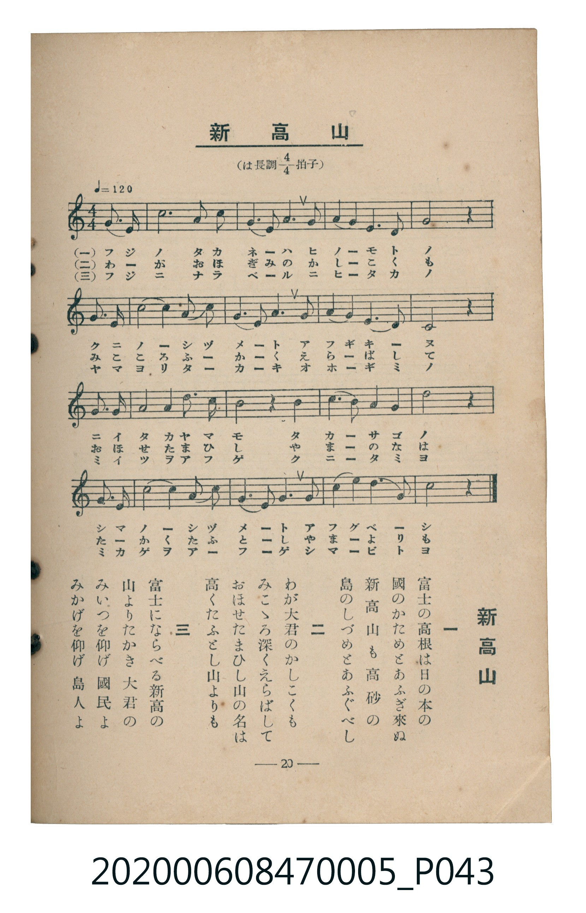

# 新高山

> Re:Shōka 使用 AI 協助辨識與重建樂譜，可能會有錯誤。歡迎回報。

- **鋼琴伴奏版**：<br><audio controls src="niitakayama.mp3"></audio>
- **NEUTRINO 歌聲合成版**：<br><audio controls src="niitakayama_neutrino.mp3"></audio>

- 臺灣教育會公認《新定兒童唱歌》尋常科第五學年用（2020.006.0847.0005）

## 說明

原書資訊與歌詞全文（對應 P043.jpg，書頁 p. 20，第二學期第 6 首）：
調性與拍號：は長調四分之四拍子（C 大調 4/4 拍，弱起 1 拍），♩= 120
註：P043 譜面第 2 行第 1 節印作「ク ニ ノ ー シ ヅ メ ー ト」，底欄全文歌詞印作「國のかためとあふぎ來ぬ」。


## 歌詞

```text
一　富士の高根は日の本の
國のかためとあふぎ來ぬ
新高山も高砂の
島のしづめとあふぐべし

二　わが大君のかしこくも
みこゝろ深くえらばして
おほせたまひし山の名は
高くたふとし山よりも

三　富士にならべる新高の
山よりたかき　大君の
みいつを仰げ　國民よ
みかげを仰げ　島人よ
```

## ABC

<div class="abc-score" data-abc-src="niitakayama.abc" aria-label="五線譜載入中"></div>

[下載 ABC 原始檔](niitakayama.abc)

## TMD 檔案連結

- [主旋律 TMD 檔案](niitakayama.tmd) [[在 TMD Studio 編輯](https://tmdlang.github.io/Tmd-TS/#tmd=s7IKdvYPcrWy4qpTUCpJTLdSSM7PyUlNLsnMz7MqzsjMK0nNjM_KTMmPL87Iz05Ugisry88pzU21Si9KTEmNN403MjAyiDcwMIs3sDAxBzIMTBFKi_NLi5JTrYqTM_Lzc-JLUitKkvLzs9Hl4wsS01OtAgxMjBEyBUX5Zal5iXlA3QVFILekgLUjFKSWZaakgqSLkxPz4stSizLTMlNTEPL5RSUZ-UA3FmRUWmVkFpfkF2UmJ-bEZyfmIXsltagY7F2IO0qKEvOKk4syC0BhgFBVkpEK9G9eYklpUSq6aHoq1BKERFFqOsjMksTM8kQkU4AOSM-ECcfnp6VlJmcm5ihxaWkpPJu24eXqGU83blTQ0uJStFUwNDLgsrdVcOayMdE3sQOZ8KJ91_PGxc-mznzRtOnZnOanrWterOp93NAF1Pl03aynrZOer176dMrGZ2t7Hjd0P93Q_XTHjufLJz5fs-bJrilP1-54unPL8ykr3u_pAEWWHjCy9ECRBWQYmL7f06nExaWvpWBLLcCloKDwtG_-s9k7Xmxuf7Gi60VHO9BdL1bOe9q64tm0dqArnm7ofdbeqQCKcb2sgvT3e3qAil8uaFQo0FMwMgBywQ7vATr82Zz5QLaCmcLLZdOALn2_ZxbI9Ber9j9rWA4yt7v3xcz5QNHHjetfTt0OFH86e_bTjrYnO7uBDKDs07UTgPY5KzxdshwoqQAMTgWgKNCGp3s2vti6XcEQwgUa3PNo5kpIyIMsWLEbaCjIfQov1s55OXcRyBFGCi8WglwG1PR8fcPT3g1P9s553NDzuGm9wuPmbiDuA-I9Co-btgPpViBeCOE3dzxuAFu5a-qzNS2QQIAGCMyMp3O6Hzeue9wIJOc_bmp83LjicWPT48atjxv7nuxre9y4BmjC44YmLpDbnuxoeNzQ8HR9z9PFq4GagAnn2YKdQP8_m74UyH02Zw2QBEcBITNBiuAp73FTE5DxfAFQBUT35m1g3dMfNy5F1T3hcSPQuukQt-wCpreGx039jxt7gEH8dMJsmJVAfZMfN_YDjQWpe9y4H8Rvmvu4qffZ9o0gicaOx02djxs3gJUugyjqety4-3Ej0Iz5jxv3PW7cBJQDOa1x3dMJvUAfghQBHQnWDVQBdAvQUWAVTUDDukB2QQKoEymAgGgV2Kadj5u6Id6FeRGuEWQa0M3AIG6A-wLu7JbHjUseN016shvo1EkgFXO6n22YCNQJVwHUOglFxeZtT3btgqqgPD9BgYKWPheXX2ZmSWJ2YmVibqJVQGZiXr5Dja5hTTXIIgUbQzMtOzALW25WAOWpHQ3AJKygAU382gomCk839AMTsw48L2pi0Qm0GGRqjYKBgi4YotOmYNIYqMIwDiqEDs2AGCxZA1UNgcZQKRgEydXARWAqQapg0AjDDKwuAbvYx7BGIR4qg04_bp4KoZt2AM0DZV7sDn_ctB9Mrgbb-7i5F12-uR-FNwmqDt28x82LUHgdONTB3QcsViAqu2G-McLjmyaYK4BmNvbg8ktjF5jcDVWHbDcwJYPJdShi3VCV0zFMmozCA9kOVNfUhMs3YNMh-qC-MSY-bkCuwOqfZrB_mldCbG-eiSEPijUED-obcByhqAPHMYIHi2uccdO8BErPA_oGf5bb1QPOciTmNIx8BBegckYyRLMHNSOZImUkfFlkOzgwWsEmguo9NHlwYkeoBmUEkDpIJINEYInucdNaNL0gdejJGRENkITxuGkJUhZBTZoQ-V4Yq3Erwlxw4kZRB07GCB40izZ1YqjbgMIDZQ6QectwuROc7SAZD5H4HzevQDe3eRXcxbAECbIfORFDZNei8EC6QObNxlCHkpmb50PV4U7WIBWw8CRQk3SSk6yRUygIwvhGkNQNTNc1CuZoamApEiaOljlAwujJvAZmIKYpmBUEauaH-B8W4igZHa0IRwk5AvEFS3WPm7Yg1OEp-kH5CVa8INI1Rvw2QuILxNoHpTdhLa4RJrcg7IfqQTYPng8bYSkRpA5SEWExDW4_cqqG2QA3tXkT3HZI-IFyPiicYOKYroTZiK3wR4Q1LL1C1KHnJsxUvZpQqgb2GehWWCPzIYU1XJcxjIGSitEUwSB6W4w-BTasAMSsc0ERC0m-CIhevyMnatyFMCR5QYpskEqM4hIlmUOSNtZk3YTqG1BhjK-tguZKUKLGSKqYiRo1hBC2IeuEhAxI3TwM81DaU_DWIa5EjXBjLReXrp0CUr8g2scwVgFdyAhTyBgspMwFAA)]
- [鋼琴伴奏 TMD 檔案](niitakayama_piano.tmd) [[在 TMD Studio 編輯](https://tmdlang.github.io/Tmd-TS/#tmd=s7IKdvYPcrWy4qpTUCpJTLdSyC8qychPL0osyKi0ysgsLskvykxOzInPTsxLVIIrKs4vLUpOjS9ITE-1CjAwMVbi0tJSeDZtw8vVM55u3Ph-T8fL7j3PJ2x5smfL06X9zzs73u_pVNDS4lK0VTA0MuCyt1Vw5rIx0TexAxn4on3X88bFz6bOfNG06dmc5qeta16s6n3c0AU07um6WU9bJz1fvfTplI3P1vY8buh-uqH76Y4dz5dPfL5mzZNdU56u3fF055bnU1YArTQyMDLQMzAw0zOwMDEHMgxMgbYqcXH5ZWaWJGYnVibmJloFZCbm5Qd5ONToGtZUcykAgY2hmZYdmKWvpWCLDhRA1uxoeLGwR0Hj6Z6NL7ZuV9BWMFF4uqH_-foGHQWQ1_WyCtI1sejU0gebWqNgoKALhui0KZg0BqowjIMKoUMzIAZL1kBVQ6AxVAoGQXI1cBGYSpAqGDTCMAOrS8Au9jGsUYiHyqDTj5unQuimHUDzHjf34XD446b9YHI12N7Hzb3o8s39KLxJUHXo5j1uXoTC68ChDu6-pvVQld0w3xjh8U0TzBVAMxt7cPmlsQtM7oaqQ7b7cSPYn43rUMS6oSqnY5g0GYUHsh2orqkJl2_ApkP0QX1jTHzcgFyB1T_NYP80r4TY3jwTQx4Uawge1DfgOEJRB45jBA8W1zjjpnkJlJ4H9A3-LLerB5zlSMxpGPkILkDljGSIZg9qRjJFykj4ssh2cGC0gk183LwQXR6c2BGqQRkBpA4SySARWKJ73LQWTS9IHXpyRkQDJGE8blqClEVQkyZEvhfGatyKMBecuFHUgZMxggfNok2dGOo2oPBAmQNk3jJc7gRnO0jGQyT-x80r0M1tXgV3MSxBguxHTsQQ2bUoPJAukHmzMdShZObm-VB1uJM1SAUsPAnUJJ3kJGvkFAqCML4RJHUD03WNgjmaGliKhImjZQ6QMHoyr4EZiGkKZgWBmvkh_oeFOEpGRyvCUUKOQHzBUt3jpi0IdXiKflB-ghUviHSNEb-NkPgCsfZB6U1Yi2uEyS0I-6F6kM2D58NGWEoEqYNURFhMg9uPnKphNsBNbd4Etx0SfqCcDwonmDimK2E2Yiv8EWENS68Qdei5CTNVryaUqp_Onk23whqZDyms4bqMYQyUVIymCAbR22L0KbBhBSBmnQuKWEjyRUD0-h05UeMuhCHJC1Jkg1RiFJcoyRyStLEm6yZU34AKY3xtFTRXghI1RlLFTNSoIYSwDVknJGRA6uZhmIfSnoK3DnElaoQba7F0C3xQugUmiF7Bi76up7O2PF3Q9HxW-5Od3cD0_qy79-naCU-3L3vW2Q3p47zf0_N04p5n7Z3wTtDT7b1PN694tmHx0-5FyJ0BCASmyXiFaMNYEGUSj-AC2UBWDZQGItN4EBdERpvGx0L0wnIQKSZAZZH1A1VEm4A1GKHZAddiDDYbbB4JToBScD5cK5ozgLGga6eAFBHRPkA5dCEjTCFjsJAyFwA)]

## 分析

```text
================================================================================
📊 TMD Song Profile: [ 新高山 ]
================================================================================
⏱  Duration:       1:36 (96.0s), 48 measures total
🎼 Key & Tempo:    首調基準 C, != 120.0 BPM, <4/4>
   - 分析範圍：      由實際發聲的音符與和弦推測調性；播放脈絡另行呈現
🎤 人聲音域:    C4 (MIDI 60) – E5 (MIDI 76) [跨度: 16 個半音 / 1.3 個八度, 難度: moderate]
   - 最低音:  C4 in [Niitakayama[L1] #1 @ m.9, 0:16]
   - 最高音: E5 in [Niitakayama[L1] #1 @ m.16, 0:30]
   - 適合: soprano, mezzo-soprano, contralto, tenor, baritone, bass
🏛  結構:      Niitakayama[L1] (32.0s) -> Niitakayama[L2] (32.0s) -> Niitakayama[L3] (32.0s)
⚡ 編曲密度:        Peak 1 軌道同時演奏
🗝  調性診斷：       C 大調（純淨自然大調，未偵測到可信轉調）
   - 風格氣質:    純淨自然大調（陽光明朗、易唱易記，無明顯調外色彩）
   - 轉調歷程:    全曲維持單一推測調性（未偵測到可信轉調）
   - 核心骨幹音:  C, G, A, E, D
   - 調性數值:    C 大調 [相關度: 0.88, 穩定度: High, 自然音純度: 100.0%]
   - 候選調性 (K-S): C 大調 (0.88), G 大調 (0.75), A 小調 (0.64)
   - 五度圈歷程:   +0 -> +0 -> +0
   - 各段落調性細節:
     • [Niitakayama[L1] #1]: C 大調 (r: 0.86, 自然音純度: 100.0%)
     • [Niitakayama[L2] #1]: C 大調 (r: 0.88, 自然音純度: 100.0%)
     • [Niitakayama[L3] #1]: C 大調 (r: 0.88, 自然音純度: 100.0%)

  [ 五度圈游移軌跡 ]
              [C ]*
         F            G  
      Bb               D  
      Eb               A  
         Ab           E  
            Db       B  
               F# 
     (* = active key center)

  [ 十二半音累積音高分佈 ]
     C  : ████████████████████████  29.2%
     C# :                            0.0%
     D  : ███████                    8.9%
     D# :                            0.0%
     E  : █████████                 10.6%
     F  :                            0.0%
     F# :                            0.0%
     G  : ███████████████████████   27.5%
     G# :                            0.0%
     A  : ███████████████           17.8%
     A# :                            0.0%
     B  : █████                      5.9%
--------------------------------------------------------------------------------
Assignment 軌道音域：
  - Piano         : C4 – E5 (16 個半音 / 1.3 個八度, 171 個音符)
================================================================================
```


## 原書掃描頁




