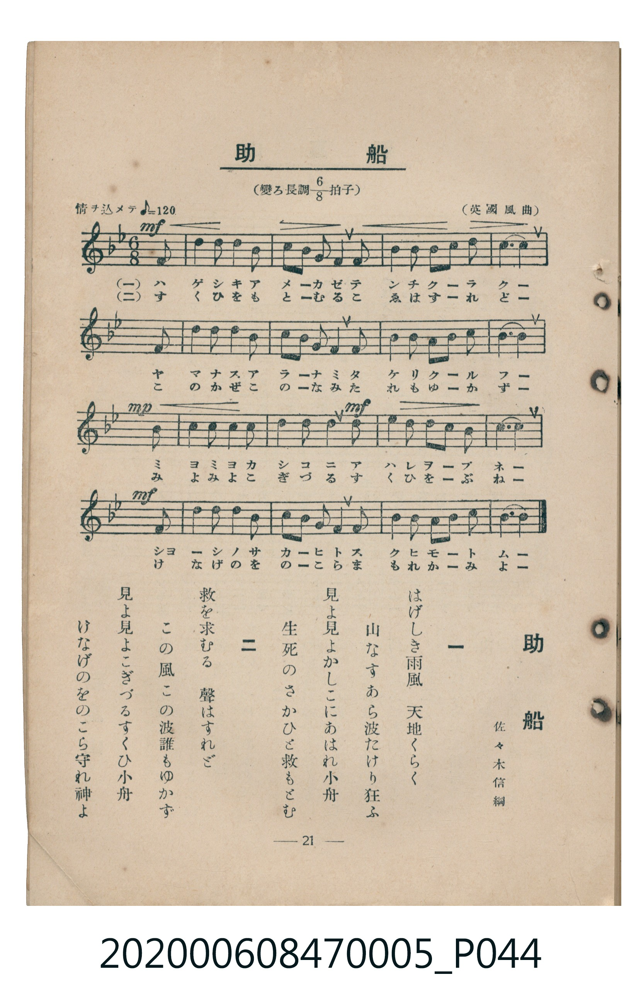

# 助船

<audio controls src="tasukebune.mp3"></audio>

- 佐々木信綱 作詞
- 臺灣教育會公認《新定兒童唱歌》尋常科第五學年用（2020.006.0847.0005）
- 英國風曲

## 說明

原書資訊與歌詞全文（對應 P044.jpg，書頁 p. 21，第二學期第 7 首）：
調性與拍號：變ろ長調八分之六拍子（Bb 大調 6/8 拍），情ヲ込メテ ♪= 120
作詞：佐々木信綱　曲：（英國風曲）

## 歌詞

```text
一　はげしき雨風　天地くらく
山なすあら波たけり狂ふ
見よ見よかしこにあはれ小舟
生死のさかひと救もとむ

二　救を求むる　聲はすれど
この風この波誰もゆかず
見よ見よこぎづるすくひ小舟
けなげのをのこら守れ神よ
```

## 原書掃描頁



## 分析

```text
================================================================================
📊 TMD Song Profile: [ 助船 ]
================================================================================
⏱  Duration:       0:51 (51.0s), 17 measures total
🎼 Key & Tempo:    首調基準 B,, != 60.0 BPM, <6/8>
   - 分析範圍：      由實際發聲的音符與和弦推測調性；播放脈絡另行呈現
🎤 人聲音域:    F4 (MIDI 65) – F5 (MIDI 77) [跨度: 12 個半音 / 1.0 個八度, 難度: easy]
   - 最低音:  F4 in [Tasukebune #1 @ m.1, 0:02]
   - 最高音: F5 in [Tasukebune #1 @ m.12, 0:33]
   - 適合: soprano, mezzo-soprano, contralto, tenor, baritone, bass
🏛  結構:      Tasukebune (51.0s)
⚡ 編曲密度:        Peak 1 軌道同時演奏
🗝  調性診斷：       C 調性不明確（流行色彩大調，未偵測到可信轉調）
   - 風格氣質:    流行大調（略帶和弦色彩音與裝飾副屬和弦）
   - 轉調歷程:    全曲維持單一推測調性（未偵測到可信轉調）
   - 核心骨幹音:  C, A#, D, D#, F
   - 調性數值:    C 調性不明確 [相關度: 0.60, 穩定度: Ambiguous, 自然音純度: 92.7%]
   - 候選調性 (K-S): C 小調 (0.60), F 大調 (0.60), A# 大調 (0.58)
   - 五度圈歷程:   +0
   - 各段落調性細節:
     • [Tasukebune #1]: C 調性不明確 (r: 0.60, 自然音純度: 92.7%, 調外音: A)

  [ 五度圈游移軌跡 ]
              [C ]*
         F            G  
      Bb               D  
      Eb               A  
         Ab           E  
            Db       B  
               F# 
     (* = active key center)

  [ 十二半音累積音高分佈 ]
     C  : ████████████████████████  35.4%
     C# :                            0.0%
     D  : ███████████               15.6%
     D# : ███████                   10.4%
     E  :                            0.0%
     F  : ██████                     9.4%
     F# :                            0.0%
     G  :                            0.0%
     G# :                            0.0%
     A  : █████                      7.3%
     A# : ███████████████           21.9%
     B  :                            0.0%
--------------------------------------------------------------------------------
Assignment 軌道音域：
  - Piano         : F4 – F5 (12 個半音 / 1.0 個八度, 63 個音符)
================================================================================
```

## ABC

```abc
X:1
T:助船
C:TMD (Chen, Chih-Han / aguai)
M:6/8
L:1/16
Q:3/8=40
K:Bb

V:V1 name="Piano" snm="Pia"

[V:V1]
!mf! z10 f2 | d4 d2 c4 c2 | b2 c2 d4 c2 f2 | e4 e2 d2 c2 b2 |
c10 f2 | d4 d2 c4 c2 | b2 c2 d2 c4 f2 | e4 e2 a2 b2 c2 |
!mp! b10 b2 | a4 a2 b4 b2 | !mf! c4 c2 a4 f2 | f4 e2 d2 c2 b2 |
!mf! c10 f2 | d4 d2 c4 c2 | b2 c2 d2 c4 f2 | e4 e2 a2 b2 c2 |
b10 z2 |
```

- [主旋律 TMD 檔案](tasukebune.tmd)
- [鋼琴伴奏 TMD 檔案](tasukebune_piano.tmd)
