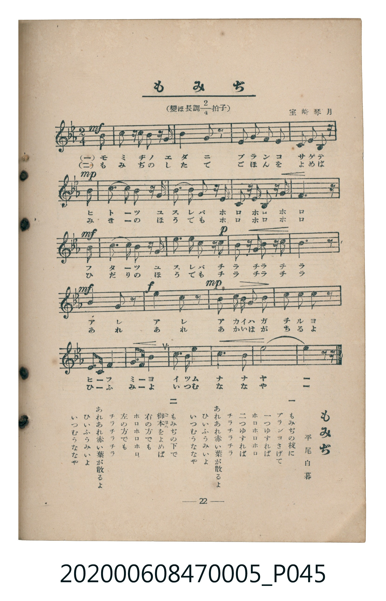

# もみぢ

> Re:Shōka 使用 AI 協助辨識與重建樂譜，可能會有錯誤。歡迎回報。

- **鋼琴伴奏版**：<br><audio controls src="momiji.mp3"></audio>
- **NEUTRINO 歌聲合成版**：<br><audio controls src="momiji_neutrino.mp3"></audio>

- 平尾白暮 作詞
- 室崎琴月 作曲
- 臺灣教育會公認《新定兒童唱歌》尋常科第五學年用（2020.006.0847.0005）

## 說明

原書資訊與歌詞全文（對應 P045.jpg，書頁 p. 22，第二學期第 8 首）：
調性與拍號：變ほ長調四分之二拍子（Eb 大調 2/4 拍）
作詞：平尾白暮　作曲：室崎琴月


## 歌詞

```text
一　もみぢの枝に
ブランコさげて
一つゆすれば
ホロホロホロ
二つゆすれば
チラチラチラ
あれあれ赤い葉が散るよ
ひいふうみいよ
いつむうななや

二　もみぢの下で
御本（ごほん）をよめば
右の方でも
ホロホロホロ
左の方でも
チラチラチラ
あれあれ赤い葉が散るよ
ひいふうみいよ
いつむうななや
```

## ABC

<div class="abc-score" data-abc-src="momiji.abc" aria-label="五線譜載入中"></div>

[下載 ABC 原始檔](momiji.abc)

## TMD 檔案連結

- [主旋律 TMD 檔案](momiji.tmd) [[在 TMD Studio 編輯](https://tmdlang.github.io/Tmd-TS/#tmd=s7IKdvYPcrWy4qpTUCpJTLdSSM7PyUlNLsnMz7MqzsjMK0nNjM_KTMmPL87Iz05Ugisry88pzU21Si9KTEmNN403MjAyiDcwMIs3sDAxBzIMTBFKi_NLi5JTrYqTM_Lzc-JLUitKkvLzsxHyBUX5Zal5iXlANQVFIBtTwIoQClLLMlNSQdKpKZkl-UWZiTlI7kgtKga7FWxJfElRYl5xclFmAcgDCFUlGalAxxbkJOYhGQs0KT0zz6okMRPoN5D_yhPjcxMz84CqUpBVlWTkA71ZkFFplZFZDLI_OTEnPjsxDyk0oLYXJKanWgUYmAA9r6Wl8Lip6XHj_seNixS0tLgUbRUszbjsbRVcdbhsjPRN7EB6X7Tvet64-NnUmS-aNj2b0_y0dc2LVb2PG7qeTdvwdN2sp62Tnq9e-nTKxmdrex43dD_d0P10x47nyyc-X7Pmya4pT9fueLpzy_MpK97v6QCFvh4w9PVAoQ9kGJi-39MJdt3TnZufbtj3fObeZ7PWKTzZO-fFynkQ8XVLnm7pez5hy7M5HSDxZ7M3KXFx6Wsp2FILcCkoKDztm_9s9o4Xm9tfrOh60dEO9AfQ_qetK55Nawe6-umG3mftnQqg8NLLKkh_v6cHqPjlgkaFAj0FIyMgF-zRHqBHn82ZD2QrWCi8XDYN6LP3e2aBTH-xav-zhuUgc7t7X8ycDxR9sa7rcePul1O3A6Wezp79tKPtyc5uoBFABU_XTgBa6Zqk8HTJcqCsAjAKFIDCQNNARkFCBmgCcng9bmiAhAxIHCm8uMA6djQA5eFR_Lhx3bN5cx83rgbJPW6e9rh55ePmzY-bNj9unPq4cdLjxmUwTY1LHje1PW6c-bip53HjBojy2Y-b1yKTYLW7gPJY1DaCjUaQYNHGJrASEPli65LHjS0vJnY-bux5NnXx46bux00dEEWbgBKPG7c-bgSaCXR0C1wCKAq0Ceg2oMQqEGpqgXgS6AZUTz7Z0f24cTk4bvctfDZnDTBMHzdOAQb646bJwLB83DQJaOjjpkaoc5_2AwNg3bNpO4GagMbg9u3T7cswFdLLq0AJytM7FCho6XNx-ebnZmZlWgVkJublO9QY1FSDrFCwMTTTsgOzsOUzhad7Nr7Yuh2YnEHJfkfDi4U9ChqwvKGJRT3QIqhZCFCdm1YLDLhFCjVAcj4oDJtARB-QaFqhABZtAAl0I7SAxKaBxFaCiM0glUACKNq0FcTeBBRsgyqF2lijYKCgC4YgGmylKZBRo2AGJE2BgsZAjCyCUIwQMYbSNQpGYJ6RgiFMDdgSH8MahXioThAN8hRINchbIF4TUBTkMSAJ9BlEpgEs042kC-I5kOhKMLkZRAL9B5YBehDEg_gQrgNiuxGa7U1NED2N-0E8YJEOtLdxHZicDpUBu6txOartjVPAorvBZkwGk5OgtneAeY1A2Q1ItuNOH5DSEJwsTBSebuh_vr5BB1544k8g1bkFoGQxCYg7gHgPELcA8TKwO3aCFD1uXgPEE8DZE5Im1kLZCBZUFBnAUwTYBlBMGgHj0gQYj6B4roHGvRk0xg3AIrD0AaEh8Q-DqPEPcjEo1sAhBXQxKMaXQUNvJ1g9zNkg1mygPMSJIHUgHjIbIoOwCTWuYfHaByYh8QqKM5AMJG2AYhaSCsizCX-87ugkM17B2X0q0GX78cdrNTgBNIIdB87ojfAsD2RBRXHELNAOUG4FxSso1gzjwAFjDo1aEA0yHSQFyt6QqIXRNRDluOJ3KjgPgMOeYPw2QsN2JVgdiIfMhsjgjt9N4DhcALavCxzH-GKYHLvwxjCwNUJBDDctgsUlGAAjBSGKIgzO50Dxx02rgXgJUK4fSK8Buxgc46tBBLAmwIxiUIYFQXgxDLYEEsugbA0XBdkBjlRzeMYGiZtAVWEW4yAHQUwBORVeNOIRRXY-iAeSh3gBpHo1mAQV-uiRDIo8sIlNPQgT8Yg-buwGNQmAeD2YB5IHyS0EqwZVJJBimqiieQpZEQwq48CRCMq8U2ERCa68YaLQ6AIFzhKQGCiLLwDiLhAHSICUAyVgGlDjFhQ5uuCcCwkESA0Mijx4xoQU08bAmAPFH6RSBsUivkIZFDKg-IFkYGimBVfNMBlQ_EBMB_EhGRzobpBikKtBAiAS4nj8-RYUNaBIAtfX4NwKK7GhMuBIgloG5INEgU4At_KAzFVgARAJcgtIGtWyWi4uXTsFSJtNAchS5gIA)]
- [鋼琴伴奏 TMD 檔案](momiji_piano.tmd) [[在 TMD Studio 編輯](https://tmdlang.github.io/Tmd-TS/#tmd=s7IKdvYPcrWy4qpTUCpJTLdSyC8qychPL0osyKi0ysgsLskvykxOzInPTsxLVIIrKs4vLUpOjS9ITE-1CjAwMVXi0tJSeNzU9Lhx_-PGRe_3dLzs3vN8wpYne7Y8Xdr_vLPj_Z5OBS0tLkVbBUszLntbBVcdLhsjfRM7kIEv2nc9b1z8bOrMF02bns1pftq65sWq3scNXc-mbXi6btbT1knPVy99OmXjs7U9jxu6n27ofrpjx_PlE5-vWfNk15Sna3c83bnl-ZQVQCuNDIwM9AwMzPQMLEzMgQwDU6CtYCc_3bn56YZ9z2fufTZrncKTvXNerJwHEV-35OmWPqA7n83pAIk_m71JiYvLNz83MyvTKiAzMS8_yMOhxqCmmksBCGwMzbTswCx9LQVbdKDwdM_GF1u3v-hoB7lsR8OLhT0KGqCg0csqSNfEol5LH2xWjYKBgi4Ygujq3LRaBVMgo0bBDEiaAgWNgRhZBKEYIWIMpWsUjMA8IwVDmBqwJT6GNQrxUJ0g-nHzIrDqx83zwbwmoOjj5j4Q2bQCKtMAlulG0gUSnQYWXQkmN4PIJhAJlGnaCuZtAoq3IXRAbDdCs72pCaKncT-I17gIZG_jOjA5HSoDdlfjclTbG6eARXeDzZgMJidBbe8A8xqBshuQbMcdW-Dk0wOOJBOFpxv6n69v0FEgKrqqcwtqwcFsBAxoE2AggyKhBhoxZtDoMACLwCIPQkMiBwZRI-dxM8gjj5vB3mhuAUfHMqjXdoLVP25eA8QTwKzZQHmQnrVgdSAeMhsig7AJNSJggd4HJiGBDgpQkAwk4kDBDoki8mzCH-g7OskLdGC-AKVyUJCDAtQwDuxmc2iog-hqYLyApEDZAhLqMLoGohxX0E8Fpx1wsBAM-kaot1eC1YF4yGyIDO6g3wQO3gVg-7rAwY8v8MmxC2_gP509m-zAB6VyEIQXLArVQFFI-IPyAlwUlD3AwW0Ozw0gcROoKsyC6XETqDCCBTQ8s-MRfdy0GoiXAGX6wTyQPCg4GsGqV4NJUDGGHvygYAWb2NSDMBGP6OPGbiBuAeL1YB5IHiS3EKwaVDRCCh6iCpsp5AQ9KOx0wUke4kZIkQ8KW3iKhhQ9xsCABQUvpBYABTK-ggbkcFDwQVI-NLWD6wKYDCj4IKaD-JCc8bh5AUjx4-YusACIBGkDSeNL8KCQA4UhuIIAJ3NYKQSVAYch1DIgHyQKdEJTA0jx48ZVYAEQCXILSBrVslrUGtsHuca2QFTYLybsfTGx8_mW2S8Xz36ys_vl3I6n25cDq4Bn3b1P1054un3Zs85uSHMFs2aGZgGTeIVok1gFQyBlGAtK0nA-qIhBlzWNB7JM42HyyLUHXArOAEYZRB9cO1gX1GgU9chmAR2Frg-b2aCSEeg8YGEI0Y-kCc00qCfAiiE5HN1uaAZHsxUlKKAG4lADpeDyWMMAZAowYnXtFCBxG-0DFEfiGYF5ylwA)]

## 分析

```text
================================================================================
📊 TMD Song Profile: [ もみぢ ]
================================================================================
⏱  Duration:       0:26 (26.2s), 21 measures total
🎼 Key & Tempo:    首調基準 E,, != 96.0 BPM, <2/4>
   - 分析範圍：      由實際發聲的音符與和弦推測調性；播放脈絡另行呈現
🎤 人聲音域:    D#4 (MIDI 63) – D#5 (MIDI 75) [跨度: 12 個半音 / 1.0 個八度, 難度: easy]
   - 最低音:  D#4 in [Momiji #1 @ m.5, 0:05]
   - 最高音: D#5 in [Momiji #1 @ m.10, 0:12]
   - 適合: soprano, mezzo-soprano, contralto, tenor, baritone, bass
🏛  結構:      Momiji (26.2s)
⚡ 編曲密度:        Peak 1 軌道同時演奏
🗝  調性診斷：       A# 調性不明確（純淨自然大調，未偵測到可信轉調）
   - 風格氣質:    純淨自然大調（陽光明朗、易唱易記，無明顯調外色彩）
   - 轉調歷程:    全曲維持單一推測調性（未偵測到可信轉調）
   - 核心骨幹音:  A#, D#, C, F, G
   - 調性數值:    A# 調性不明確 [相關度: 0.87, 穩定度: Ambiguous, 自然音純度: 96.2%]
   - 候選調性 (K-S): A# 大調 (0.87), D# 大調 (0.86), G 小調 (0.66)
   - 五度圈歷程:   -2
   - 各段落調性細節:
     • [Momiji #1]: A# 調性不明確 (r: 0.87, 自然音純度: 96.2%, 調外音: G#)

  [ 五度圈游移軌跡 ]
               C  
         F            G  
     [Bb]*              D  
      Eb               A  
         Ab           E  
            Db       B  
               F# 
     (* = active key center)

  [ 十二半音累積音高分佈 ]
     C  : ██████████████            15.2%
     C# :                            0.0%
     D  : ████████                   8.3%
     D# : ███████████████████       20.5%
     E  :                            0.0%
     F  : █████████████             13.6%
     F# :                            0.0%
     G  : ████████████              12.9%
     G# : ████                       3.8%
     A  :                            0.0%
     A# : ████████████████████████  25.8%
     B  :                            0.0%
--------------------------------------------------------------------------------
Assignment 軌道音域：
  - Piano         : D#4 – D#5 (12 個半音 / 1.0 個八度, 67 個音符)
================================================================================
```


## 原書掃描頁




