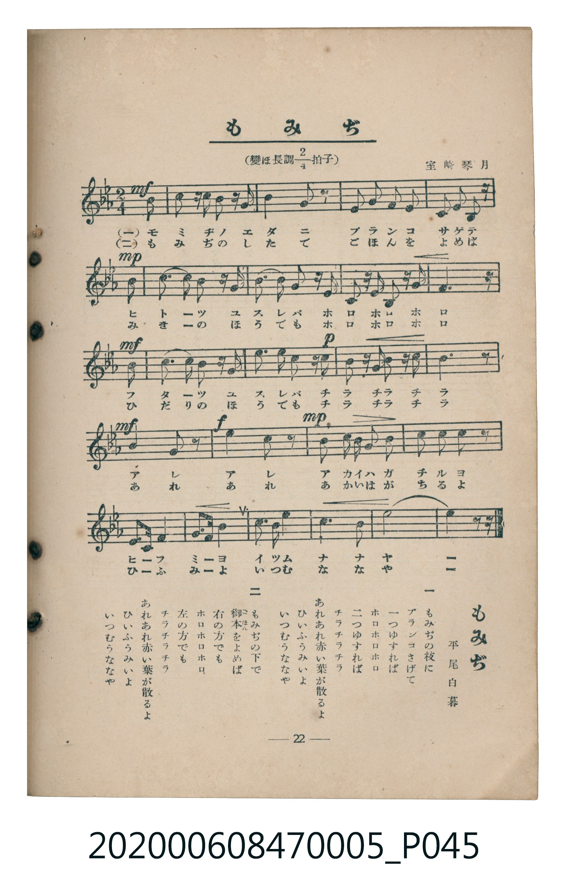

# もみぢ

> Re:Shōka 使用 AI 協助辨識與重建樂譜，可能會有錯誤。歡迎回報。

- **鋼琴伴奏版**：<br><audio controls src="momiji.mp3"></audio>
- **NEUTRINO 歌聲合成版**：<br><audio controls src="momiji_neutrino.mp3"></audio>

- 平尾白暮 作詞
- 室崎琴月 作曲
- 臺灣教育會公認《新定兒童唱歌》尋常科第五學年用（2020.006.0847.0005）

## 說明

原書資訊與歌詞全文（對應 P045.jpg，書頁 p. 22，第二學期第 8 首）：
調性與拍號：變ほ長調四分之二拍子（Eb 大調 2/4 拍）
作詞：平尾白暮　作曲：室崎琴月


## 歌詞

```text
一　もみぢの枝に
ブランコさげて
一つゆすれば
ホロホロホロ
二つゆすれば
チラチラチラ
あれあれ赤い葉が散るよ
ひいふうみいよ
いつむうななや

二　もみぢの下で
御本（ごほん）をよめば
右の方でも
ホロホロホロ
左の方でも
チラチラチラ
あれあれ赤い葉が散るよ
ひいふうみいよ
いつむうななや
```

## ABC

```abc
X:1
T:もみぢ
M:2/4
L:1/16
Q:1/4=96
K:Eb
V:V1 name="Piano" snm="Pia"
[V:V1]
!mf! z4 z2 B2 | c2 B z G z B2 | c2 B4 z2 | c2 B2 G2 B2 |
w: 1.~モ | ミ ヂ ノ エ | ダ ニ | ブ ラ ン コ
w: 2.~も | み ぢ の し | た で | ご ほ ん を
F2 G F E2 z2 | !mp! F2 F G A z c2 | B3 c B2 G z | B z G z B z G z |
w: 1.~サ ゲ テ _ | ヒ ト _ ツ ユ | ス レ バ ホ | ロ ホ ロ ホ
w: 2.~よ め ば _ | み ぎ _ の ほ | う で も ホ | ロ ホ ロ ホ
F6 z2 | !mf! G2 G A B z e2 | !p! d3 c d2 B z | c z B z c z B z |
w: 1.~ロ | フ タ _ ツ ユ | ス レ バ チ | ラ チ ラ チ
w: 2.~ロ | ひ だ _ り ほ | う で も チ | ラ チ ラ チ
e6 z2 | !mf! c4 E2 z2 | !f! d4 F2 z2 | !mp! e2 d c B2 G2 |
w: 1.~ラ | ア レ | ア レ | ア カ イ ハ ガ
w: 2.~ラ | あ れ | あ れ | あ か い は が
A2 F2 E2 z2 | G3 A B4 | c3 d e4 | B2 G E F2 B2 |
w: 1.~チ ル ヨ | ヒ イ フ | ミ イ ヨ | イ ツ ムウ ナ ナ
w: 2.~ち る よ | ひ い ふ | み い よ | い つ むう な な
E6 z2 |
w: 1.~ヤ
w: 2.~や
```

## TMD 檔案連結

- [主旋律 TMD 檔案](momiji.tmd) [[在 TMD Studio 編輯](https://tmdlang.github.io/Tmd-TS/#tmd=s7IKdvYPcrWy4qpTUCpJTLdSSM7PyUlNLsnMz7MqzsjMK0nNjM_KTMmPL87Iz05Ugisry88pzU21Si9KTEmNN403MjAyiDcwMIs3sDAxBzIMTBFKi_NLi5JTrYqTM_Lzc-JLUitKkvLzsxHyBUX5Zal5iXlANQVFIBtTwIoQClLLMlNSQdKpKZkl-UWZiTlI7kgtKga7FWxJfElRYl5xclFmAcgDCFUlGalAxxbkJOYhGQs0KT0zz6okMRPoN5D_yhPjcxMz84CqUpS4tLQUHjc1PW7c_7hxkYKWFpeirYKlGZe9rYKrDpeNkb6JHcicF-27njcufjZ15oumTc_mND9tXfNiVe_jhq5n0zY8XTfraeuk56uXPp2y8dnanscN3U83dD_dseP58onP16x5smvK07U7nu7c8nzKivd7OkDBpwcMPj1Q8AEZBqbv93SCXfp05-anG_Y9n7n32ax1Ck_2znmxch5EfN2Sp1v6nk_Y8mxOB0j82exNSlxc-loKttQCXAoKCk_75j-bvePF5vYXK7pedLQD_QG0_2nrimfT2oGufrqh91l7p0KAgYmpXlZB-vs9PUDFLxc0KhToKRgZAblgj_YAPfpsznwgW8FC4eWyaUCfvd8zC2T6i1X7nzUsB5nb3fti5nyg6It1XY8bd7-cuh0o9XT27KcdbU92dgONACp4unYC0ErXJIWnS5YDZRWAUaAAFAaaBjIKEjJAE5DD63FDAyRkQOJI4cUF1rGjASgPj-LHjeuezZv7uHE1SO5x87THzSsfN29-3LT5cePUx42THjcug2lqXPK4qe1x48zHTT2PGzdAlM9-3LwWmQSr3QWUx6K2EWw0ggSLNjaBlYDIF1uXPG5seTGx83Fjz7Opix83dT9u6oAo2gSUeNy49XEj0Eygo1vgEkBRoE1AtwElVoFQUwvEk0A3oHryyY7ux43LwXG7b-GzOWuAYfq4cQow0B83TQaG5eOmSUBDHzc1Qp37tB8YAOueTdsJ1AQ0Brdvn25fhqmQXl4FSlCe3qFAQUufi8s3PzczK9MqIDMxL9-hxqCmGmSFgo2hmZYdmIUtnyk83bPxxdbtwOQMSvY7Gl4s7FHQgOUNTSzqgRZBzUKA6ty0WmDALVKoAZLzQWHYBCL6gETTCgWwaANIoBuhBSQ2DSS2EkRsBqkEEkDRpq0g9iagYBtUKdTGGgUDBV0wBNFgK02BjBoFMyBpChQ0BmJkEYRihIgxlK5RMALzjBQMYWrAlvgY1ijEQ3WCaJCnQKpB3gLxmoCiII8BSaDPIDINYJluJF0Qz4FEV4LJzSAS6D-wDNCDIB7Eh3AdENuN0GxvaoLoadwP4gGLdKC9jevA5HSoDNhdjctRbW-cAhbdDTZjMpicBLW9A8xrBMpuQLIdd_qAlIbgZGGi8HRD__P1DTrwwhN_AqnOLQAli0lA3AHEe4C4BYiXgd2xE6TocfMaIJ4Azp6QNLEWykawoKLIAJ4iwDaAYtIIGJcmwHgExXMNNO7NoDFuABaBpQ8IDYl_GESNf5CLQbEGDimgi0ExvgwaejvB6mHOBrFmA-UhTgSpA_GQ2RAZhE2ocQ2L1z4wCYlXUJyBZCBpAxSzkFRAnk3443VHJ5nxCs7uU4Eu248_XqvBCaAR7DhwRm-EZ3kgCyqKI2aBdoByKyheQbFmGAcOGHNo1IJokOkgKVD2hkQtjK6BKMcVv1PBeQAc9gTjtxEativB6kA8ZDZEBnf8bgLH4QKwfV3gOMYXw-TYhTeGga0RCmK4aREsLsEAGCkIURRhcD4Hij9uWg3ES4By_UB6DdjF4BhfDSKANQFmFIMyLAjCi2GwJZBYBmVruCjIDnCkmsMzNkjcBKoKsxgHOQhiCsip8KIRjyiy80E8kDzECyDVq8EkqNBHj2RQ5IFNbOpBmIhH9HFjN6hJAMTrwTyQPEhuIVg1qCKBFNNEFc1TyIpgUBkHjkRQ5p0Ki0hw5Q0ThUYXKHCWgMRAWXwBEHeBOEACpBwoAdOAGregyNEF51xIIEBqYFDkwTMmpJg2BsYcKP4glTIoFvEVyqCQAcUPJANDMy24aobJgOIHYjqID8ngQHeDFINcDRIAkRDH48-3oKgBRRK4vgbnVliJDZUBRxLUMiAfJAp0AriVB2SuAguASJBbQNKoltVycenaKUDabApAljIXAA)]
- [鋼琴伴奏 TMD 檔案](momiji_piano.tmd) [[在 TMD Studio 編輯](https://tmdlang.github.io/Tmd-TS/#tmd=s7IKdvYPcrWy4tLSUnjc1PS4cf_jxkXv93S87N7zfMKWJ3u2PF3a_7yz4_2eTgUtLS5FWwVLMy57WwVXHS4bI30TO646BaUX7bueNy5-NnXmi6ZNz-Y0P21d82JV7-OGrmfTNjxdN-tp66Tnq5c-nbLx2dqexw3dTzd0P92x4_nyic_XrHmya8rTtTue7tzyfMoKoJVGBkYGegYGZnoGFibmQIaBKdBWJZANT3dufrph3_OZe5_NWqfwZO-cFyvnQcTXLXm6pQ_ozmdzOkDiz2ZvUuLi8s3PzczKtArITMzLD_JwqDGoqeZSAAIbQzMtOzBLX0vBFh0oPN2z8cXW7S862kEu29HwYmGPgkaAgYmpXlZBuiYW9Vr6YLNqFAwUdMEQRFfnptUqmAIZNQpmQNIUKGgMxMgiCMUIEWMoXaNgBOYZKRjC1IAt8TGsUYiH6gTRj5sXgVU_bp4P5jUBRR8394HIphVQmQawTDeSLpDoNLDoSjC5GUQ2gUigTNNWMG8TULwNoQNiuxGa7U1NED2N-0G8xkUgexvXgcnpUBmwuxqXo9reOAUsuhtsxmQwOQlqeweY1wiU3YBkO-7YAiefHnAkmSg83dD_fH2DjgJR0VWdW1ALDmYjYECbAAMZFAk10Igxg0aHAVgEFnkQGhI5MIgaOY-bQR553Az2RnMLODqWQb22E6z-cfMaIJ4AZs0GyoP0rAWrA_GQ2RAZhE2oEQEL9D4wCQl0UICCZCARBwp2SBSRZxP-QN_RSV6gA_MFKJWDghwUoIZxYDebQ0MdRFcD4wUkBcoWkFCH0TUQ5biCfio47YCDhWDQN0K9vRKsDsRDZkNkcAf9JnDwLgDb1wUOfnyBT45deAP_6ezZZAc-KJWDILxgUagGikLCH5QX4KKg7AEObnN4bgCJm0BVYRZMj5tAhREsoOGZHY_o46bVQLwEKNMP5oHkQcHRCFa9GkyCijH04AcFK9jEph6EiXhEHzd2A3ELEK8H80DyILmFYNWgohFS8BBV2EwhJ-hBYacLTvIQN0KKfFDYwlM0pOgxBgYsKHghtQAokPEVNCCHg4IPkvKhqR1cF8BkQMEHMR3Eh-SMx80LQIofN3eBBUAkSBtIGl-CB4UcKAzBFQQ4mcNKIagMOAyhlgH5IFGgE5oaQIofN64CC4BIkFtA0qiW1aLW2D7INbYFosJ-MWHvi4mdz7fMfrl49pOd3S_ndjzdvhxYBTzr7n26dsLT7cuedXZDmiuYNTM0C5jEK0SbxCoYAinDWFCShvNBRQy6rGk8kGUaD5NHrj3gUnAGMMog-uDawbqgRqOoRzYL6Ch0fdjMBpWMQOcBC0OIfiRNaKZBPQFWDMnh6HZDMziarShBATUQhxooBZfHGgYgU4ARq2unAInbaB-gOBLPCMxT5gIA)]

## 分析

```text
================================================================================
📊 TMD Song Profile: [ もみぢ ]
================================================================================
⏱  Duration:       0:26 (26.2s), 21 measures total
🎼 Key & Tempo:    首調基準 E,, != 96.0 BPM, <2/4>
   - 分析範圍：      由實際發聲的音符與和弦推測調性；播放脈絡另行呈現
🎤 人聲音域:    D#4 (MIDI 63) – D#5 (MIDI 75) [跨度: 12 個半音 / 1.0 個八度, 難度: easy]
   - 最低音:  D#4 in [Momiji #1 @ m.5, 0:05]
   - 最高音: D#5 in [Momiji #1 @ m.10, 0:12]
   - 適合: soprano, mezzo-soprano, contralto, tenor, baritone, bass
🏛  結構:      Momiji (26.2s)
⚡ 編曲密度:        Peak 1 軌道同時演奏
🗝  調性診斷：       A# 調性不明確（純淨自然大調，未偵測到可信轉調）
   - 風格氣質:    純淨自然大調（陽光明朗、易唱易記，無明顯調外色彩）
   - 轉調歷程:    全曲維持單一推測調性（未偵測到可信轉調）
   - 核心骨幹音:  A#, D#, C, F, G
   - 調性數值:    A# 調性不明確 [相關度: 0.87, 穩定度: Ambiguous, 自然音純度: 96.2%]
   - 候選調性 (K-S): A# 大調 (0.87), D# 大調 (0.86), G 小調 (0.66)
   - 五度圈歷程:   -2
   - 各段落調性細節:
     • [Momiji #1]: A# 調性不明確 (r: 0.87, 自然音純度: 96.2%, 調外音: G#)

  [ 五度圈游移軌跡 ]
               C  
         F            G  
     [Bb]*              D  
      Eb               A  
         Ab           E  
            Db       B  
               F# 
     (* = active key center)

  [ 十二半音累積音高分佈 ]
     C  : ██████████████            15.2%
     C# :                            0.0%
     D  : ████████                   8.3%
     D# : ███████████████████       20.5%
     E  :                            0.0%
     F  : █████████████             13.6%
     F# :                            0.0%
     G  : ████████████              12.9%
     G# : ████                       3.8%
     A  :                            0.0%
     A# : ████████████████████████  25.8%
     B  :                            0.0%
--------------------------------------------------------------------------------
Assignment 軌道音域：
  - Piano         : D#4 – D#5 (12 個半音 / 1.0 個八度, 67 個音符)
================================================================================
```


## 原書掃描頁




