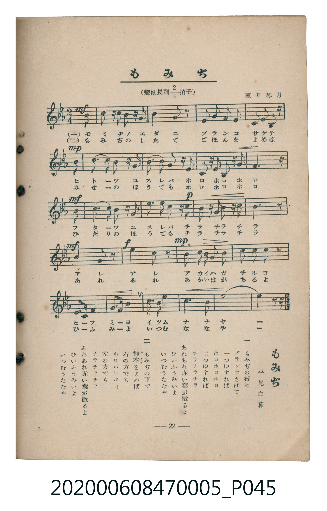

# もみぢ

<audio controls src="momiji.mp3"></audio>

- 平尾白暮 作詞
- 室崎琴月 作曲
- 臺灣教育會公認《新定兒童唱歌》尋常科第五學年用（2020.006.0847.0005）

- note

原書資訊與歌詞全文（對應 P045.jpg，書頁 p. 22，第二學期第 8 首）：
調性與拍號：變ほ長調四分之二拍子（Eb 大調 2/4 拍）
作詞：平尾白暮　作曲：室崎琴月

## 歌詞

```text
一　もみぢの枝に
ブランコさげて
一つゆすれば
ホロホロホロ
二つゆすれば
チラチラチラ
あれあれ赤い葉が散るよ
ひいふうみいよ
いつむうななや

二　もみぢの下で
御本（ごほん）をよめば
右の方でも
ホロホロホロ
左の方でも
チラチラチラ
あれあれ赤い葉が散るよ
ひいふうみいよ
いつむうななや
```

## 原書掃描頁



## 調性分析

```text
================================================================================
📊 TMD Song Profile: [ もみぢ ]
================================================================================
⏱  Duration:       0:26 (26.2s), 21 measures total
🎼 Key & Tempo:    首調基準 E,, != 96.0 BPM, <2/4>
   - 分析範圍：      由實際發聲的音符與和弦推測調性；播放脈絡另行呈現
🎤 人聲音域:    D#4 (MIDI 63) – D#5 (MIDI 75) [跨度: 12 個半音 / 1.0 個八度, 難度: easy]
   - 最低音:  D#4 in [Momiji #1 @ m.5, 0:05]
   - 最高音: D#5 in [Momiji #1 @ m.10, 0:12]
   - 適合: soprano, mezzo-soprano, contralto, tenor, baritone, bass
🏛  結構:      Momiji (26.2s)
⚡ 編曲密度:        Peak 1 軌道同時演奏
🗝  調性診斷：       A# 調性不明確（純淨自然大調，未偵測到可信轉調）
   - 風格氣質:    純淨自然大調（陽光明朗、易唱易記，無明顯調外色彩）
   - 轉調歷程:    全曲維持單一推測調性（未偵測到可信轉調）
   - 核心骨幹音:  A#, D#, C, F, G
   - 調性數值:    A# 調性不明確 [相關度: 0.87, 穩定度: Ambiguous, 自然音純度: 96.2%]
   - 候選調性 (K-S): A# 大調 (0.87), D# 大調 (0.86), G 小調 (0.66)
   - 五度圈歷程:   -2
   - 各段落調性細節:
     • [Momiji #1]: A# 調性不明確 (r: 0.87, 自然音純度: 96.2%, 調外音: G#)

  [ 五度圈游移軌跡 ]
               C  
         F            G  
     [Bb]*              D  
      Eb               A  
         Ab           E  
            Db       B  
               F# 
     (* = active key center)

  [ 十二半音累積音高分佈 ]
     C  : ██████████████            15.2%
     C# :                            0.0%
     D  : ████████                   8.3%
     D# : ███████████████████       20.5%
     E  :                            0.0%
     F  : █████████████             13.6%
     F# :                            0.0%
     G  : ████████████              12.9%
     G# : ████                       3.8%
     A  :                            0.0%
     A# : ████████████████████████  25.8%
     B  :                            0.0%
--------------------------------------------------------------------------------
Assignment 軌道音域：
  - Piano         : D#4 – D#5 (12 個半音 / 1.0 個八度, 67 個音符)
================================================================================
```

## ABC

```abc
X:1
T:もみぢ
C:TMD (Chen, Chih-Han / aguai)
M:2/4
L:1/16
Q:1/4=96
K:Eb

V:V1 name="Piano" snm="Pia"

[V:V1]
!mf! z4 z2 b2 | c2 b z g z b2 | c2 b4 z2 | c2 b2 g2 b2 |
f2 g f e2 z2 | !mp! f2 f g a z c2 | b3 c b2 g z | b z g z b z g z |
f6 z2 | !mf! g2 g a b z e2 | !p! d3 c d2 b z | c z b z c z b z |
e6 z2 | !mf! c4 e2 z2 | !f! d4 f2 z2 | !mp! e2 d c b2 g2 |
a2 f2 e2 z2 | g3 a b4 | c3 d e4 | b2 g e f2 b2 |
e6 z2 |
```

- [主旋律 TMD 檔案](momiji.tmd)
- [鋼琴伴奏 TMD 檔案](momiji_piano.tmd)
