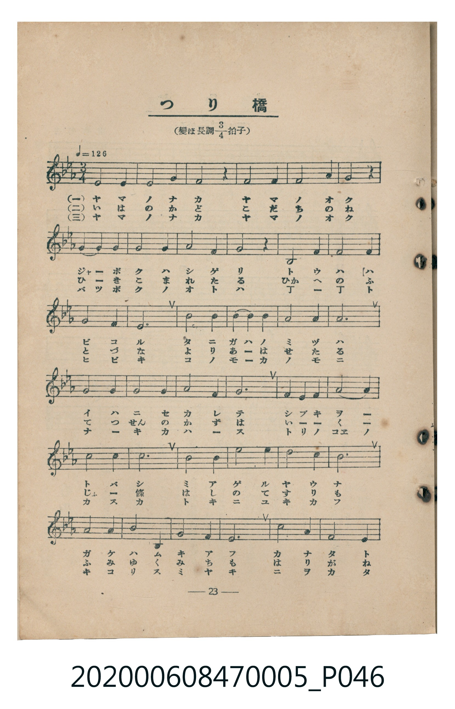
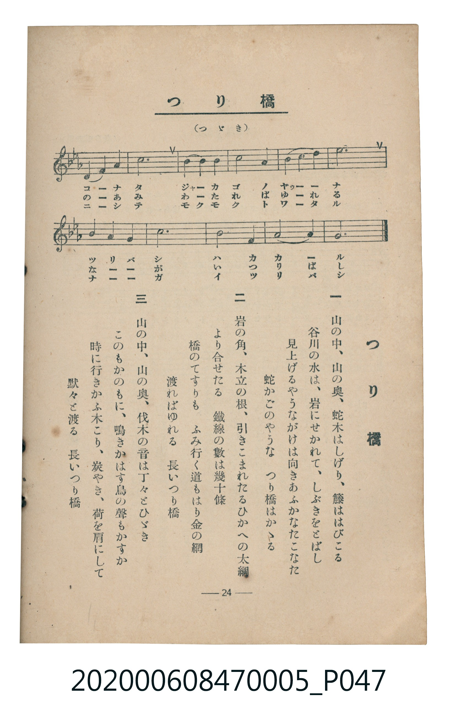

# つり橋

> Re:Shōka 使用 AI 協助辨識與重建樂譜，可能會有錯誤。歡迎回報。

<audio controls src="tsuribashi.mp3"></audio>

- 臺灣教育會公認《新定兒童唱歌》尋常科第五學年用（2020.006.0847.0005）

## 說明

原書資訊與歌詞全文（對應 P046.jpg – P047.jpg，書頁 pp. 23–24，第二學期第 9 首）：
調性與拍號：變ほ長調四分之三拍子（Eb 大調 3/4 拍），♩= 126


## 歌詞

```text
一　山の中、山の奧、蛇木はしげり、籐ははびこる
谷川の水は、岩にせかれて、しぶきをとばし
見上げるやうながけは向きあふかなたとこなた
蛇かごのやうな　つり橋はかゝる

二　岩の角、木立の根、引きこまれたるひかへの太綱
より合せたる　鐵線の數は幾十條
橋のてすりも　ふみ行く道もはり金の網
渡ればゆれる　長いつり橋

三　山の中、山の奧、伐木の音は丁々とひゞき
このもかのもに、鳴きかはす鳥の聲もかすか
時に行きかふ木こり、炭やき、荷を肩にして
默々と渡る　長いつり橋
```

## ABC

```abc
X:1
T:つり橋
M:3/4
L:1/16
Q:1/4=126
K:Eb
V:V1 name="Piano" snm="Pia"
[V:V1]
E8 E4 | G8 G4 | B8 z4 | G8 G4 |
w: 1.~ヤ マ | ノ ナ | カ | ヤ マ
w: 2.~い は | の か | ど | こ だ
w: 3.~ヤ マ | ノ ナ | カ | ヤ マ
B8 B4 | c8 z4 | E4 F4 G4 | B8 B4 |
w: 1.~ノ オ | ク | ジャ _ ボ | ク ハ
w: 2.~ち の | ね | ひ _ き | こ ま
w: 3.~ノ オ | ク | バ _ ツ | ボ ク
c8 B4 | G8 z4 | C8 E4 | G8 F4 |
w: 1.~シ ゲ | リ | ト ウ | ハ ハ
w: 2.~れ た | る | ひか へ | の ふ
w: 3.~ノ オ | ト | ハ ト | ウ ト
E8 E4 | D12 | e8 d4 | c4 d4 c4 |
w: 1.~ビ コ | ル | タ ニ | ガ ハ ノ
w: 2.~と づ | な | よ り | あ は せ
w: 3.~ウ ヒ | ビ | キ コ | ノ モ カ
B8 G4 | F12 | G8 G4 | F8 G4 |
w: 1.~ミ ヅ | ハ | イ ハ | ニ セ
w: 2.~た る | _ | て つ | せ ん
w: 3.~ノ モ | ニ | ナ キ | カ ハ
A8 F4 | E12 | F8 F4 | G4 A4 F4 |
w: 1.~カ レ | テ | シ ブ | キ ヲ _
w: 2.~の か | ず | い く | じふ じょう _
w: 3.~ス ト | リ | コ ヱ | モ _ _
G8 B4 | c12 | B8 B4 | e8 d4 |
w: 1.~ト バ | シ | ミ ア | ゲ ル
w: 2.~は し | の | て す | り も
w: 3.~カ ス | カ | ト キ | ニ ユ
c8 B4 | G12 | F8 G4 | A8 C4 |
w: 1.~ヤ ウ | ナ | ガ ケ | ハ ム
w: 2.~ふ み | ゆ | く み | ち も
w: 3.~キ カ | フ | キ コ | リ ス
E8 F4 | G12 | c8 G4 | F8 E4 |
w: 1.~キ ア | フ | カ ナ | タ ト
w: 2.~は り | が | ね の | あ み
w: 3.~ミ ヤ | キ | ニ ヲ | カ タ
D4 E4 F4 | B12 | B4 c4 B4 | c8 e4 |
w: 1.~コ _ ナ | タ | ジャ _ カ | ゴ ノ
w: 2.~わ _ た | れ | ば _ ゆ | れ る
w: 3.~ニ _ シ | テ | モ _ ク | モ ク
d4 c4 B4 | e12 | G4 A4 B4 | c12 |
w: 1.~ヤ _ ウ | ナ | ツ リ バ | シ
w: 2.~な _ が | い | な _ が | い
w: 3.~ト _ ワ | タ | ナ _ ガ | イ
B8 G4 | F8 B4 | E12 |
w: 1.~ハ カ | カ _ | ル
w: 2.~つ り | ば _ | し
w: 3.~ツ リ | バ _ | シ
```

## TMD 檔案連結

- [主旋律 TMD 檔案](tsuribashi.tmd) [[在 TMD Studio 編輯](https://tmdlang.github.io/Tmd-TS/#tmd=s7IKdvYPcrWy4qpTUCpJTLdSSM7PyUlNLsnMz7MqzsjMK0nNjM_KTMmPL87Iz05Ugisry88pzU21Si9KTEmNN403MjAyiDcwMIs3sDAxBzIMTBFKi_NLi5JTrYqTM_Lzc-JLUitKkvLzsxHyBUX5Zal5iXlANQVFIBtTwIoQClLLMlNSQdKpKZkl-UWZiTlI7kgtKga7FWxJfElRYl5xclFmAcgDCFUlGalAx4IlC_KLgEZraSk8blzyuKnr2cpuBS0tLkVbBUMjMy57WwVXHS4bY30TO5DeF-27njcufjZ15oumTc_mND9tXfNiVe_jhq5n0zY8XTfraeuk56uXPp2y8dnanscN3U83dD_dseP58onP16x5smvK07U7nu7c8nzKivd7OkChowcMHT1Q6AAZBqbv93QqcXHpaynYUgtwKSgoPO2b_2z2jheb21-s6HrR0Q5014uV8562rng2rR3oiqcbep-1dyoEGJiY6WUVpCs8apgM4piDOO_39AB1vlzQqFBQoKdgZAyUMzIBCoL90gP0y7M584FsBUuFl8umAR3_fs8skIUvVu1_1rAcZFV374uZ84GiL9Z1PW7c_XLqdqDU09mzn3a0PdnZ_WRHJ1DB07UTgK5wTVJ4umQ5UFYBGMoKQGGwaT2PZq6ERAHI2Cc7Gh43NDzduPFx47onO9Y-bmiEsJ8uXQ5kv5jd_mzOiseN6x83Tn_cOAkYiUDB5xsngEWAaPPjxsmPm7rB7tuw_en2uUCdzzZsAckBDdq08nHj6seNsx83dj9u6nncuAwoCDZo2-PG3sdNkx43Ao3eABQB618GdDvQQ0BLgKpbHje2PW5c9bgRqG0i0LinE4Bk7-PGpseNW0HGgaTmg_VPhrDBRsxuB8tNAboCYURDAzz5gd0MNH0uyM1g3-8CJqcGsEPXvVg-Ceg-oHefrwYqXPdswU6QH_ZMBdsLtGUf2A_zQc5r3AS2ZwconJaser5tI8isx00dQFueTugA-xisrqHh5YStz7fPAhk3Fah6_dOd-572Nj5bNBekAeygdaBgaZwJCtmmJrBbgf7b_2Ih0Kr-l6DABfp4PVD2ZTswANY937YJrHPHQrBjNjxuagMxIFZN3f64EehpqF-hsduJJ3af7JkAjt11L-cDI3L9kx2NjxtawYG66XHTPKC_wd4C-R0YnEB3gJ0LYqwGan65GRjNwJCBBOrMl5uXgsIQpBOiciaQBLt1JkgD2EMQ1VvBdgJ9Bk5LTWvBMQXM6o0vercDE8WLJkiqASaTZSD9L3fPgLgK7GlsHgUqojxPQ4GClj4XV0hxaVFmUiKwTLYKyEzMy3eoMaipBlmjYGOiZQdmYCtOFEA5eEfDs3VbFTTMFJ5u6H--vkEHXgZoYtEAtAxqmAZQo6aVwuPmJSCBx83zFBRqgFQfhNcF5jWtBvFAACSFTWHTKojC9TCFUAtqFAwVdIG4RsEYSBsDaVMgbYDGNwXSZhBxsC4fQ4g9umBrILaA2F1Qx-gqxENdgqYC6AyIK8AqIGYZAUUaW0CyjetBso3rwOxuMHslzKzGyWDRBWD2QjB7HZi9FtksY-q4C39E7uqhKCKbdjxuXgy0eA8Qz0FEyuPmfkgUbYdE2CZI9AHjDRGzHRCpZRAeUD1IG1AQKTKNMCINRIMiExSpZvFIsW2EHJsQV4GCBeYmELsf6iJQEG2CugcWiB1g0WVQp0BVI0XpJnAk9SJF3j6waT1g9nwwuxsevaByEyyxAykNbEWJ1wlgS1rAFs4BWw5OL8gxCHYUxHkQJ3WArVkGYxOIWWANSVEWnQyJn82Q-EHOlE37IZHVDeGtgcY3yPEgpfMhsq1IEYs1k5qD4k8XJBAHpMzBMWwOxJAYB8W8EUQBUjYFhz3QTRAnQbSD3AMKEnAmA7oGZCfCLSCZVnggwk0Dx-oKcMQsBUcSKC1ATIOkBXA2a2wCZ2RgVQfmgU0DxnMNWC3cLFCEAqMFFCmPmyeB7QK5E2IaKEvDXNwHxIvAmReRnReB2aDkAjIPb5QCWz-UZVZoYQrJm6DoA0XwbqRS93EzMDJBcm3I0Q3JxM3TILy1IDYwQ4MyPTxOYQUsKMZAtAkkS4LjGhQOIHEQ3xgog5pVIcUXOG-CQwHkIFgBB3IOxDWw0ATnXqBLIA4BuQM1RsGZo3EJOLZmg02bjJQFIcXwLDAbUjxDimqw7Y0zQHkURDUB21cgK5HzaxfYsLVIToMUJzsRORNcnEATHjDCQeyNYPFFxEQusIFPWX6FlKfAggURZ9AIhObIpkUQKWDcgRQCIxwkB0kTsGIYWAWj5VZQzMJKX1AcwEpjpEyLKJZRMys4IwEdBIs4cBRCsiTQLRCngFRAsgM4IUCLYFBoo0YsuAhvnA6PTLBZ0OieCTYLEkNNYPGtYPH9YHFo4kHKquD4A8YcjA1xFyTbg2MYkhCbwW6BZmCIG6cSlU1b11KWTYF5EBQlG1FqxgXw3IeISqB7kLIpNAdDW1HQMhq5QkXOnMDKE5I7IbkSEgigqITlYmAJjZRL14ADAZKcIZURuPECDRxIGQYNHHgGgTRUIGUzqLpCRCbYBEj0QJo_0GgDRzK05AXVrJBIBtsBbSA1wXQiRSdyCQvOgpCohZb94LIArAYSzZCoBdf_0IQAMo1AVdqMGaHgTi6REQqsQ0GlJVKYIEUbogUFSWRNWyAxB2zrQvMnRC88a6DnUGA9CmoqQbImJIuawbMsMJsCVUAFwHkWJY9CyylEVEEiENZ-grsIXrDhz6ZNkJiFtIcQMbgBrKcNLgqpQyF1LiimQWxQSYxa5EJqg-1gm-A1ALgwhTWWkNmQwgbMhqY5oNsJZdTV4Hg1JTNegc03cJJDKuQQ8QrNt6BciZQ5gREJkoO3ppCKWROMYhaWFcFRhx5zQMtBdmOWr-AogEYconSDspAyIZbAB1ediCwIijaI6HSMyIGUtuDqGVyFQ2wBV6dAV4HYoBYuotIG6a7l4tK1U0B0OxWAPGUuAA)]
- [鋼琴伴奏 TMD 檔案](tsuribashi_piano.tmd) [[在 TMD Studio 編輯](https://tmdlang.github.io/Tmd-TS/#tmd=s7IKdvYPcrWy4tLSUnjcuORxU9ezld3v93S87N7zfMKWJ3u2PF3a_7yz4_2eTgUtLS5FWwVDIzMue1sFVx0uG2N9EzuuOgWlF-27njcufjZ15oumTc_mND9tXfNiVe_jhq5n0zY8XTfraeuk56uXPp2y8dnanscN3U83dD_dseP58onP16x5smvK07U7nu7c8nzKCqCdRgZGBnoGBmZ6BhYm5kCGgSnQWiUurpDi0qLMpMTijEyrgMzEvPwgD4cag5pqLgUgsDHRsgMz9LUUbNGBAsiOHQ3P1m1V0DBTeLqh__n6Bh2FAAMTM72sgnRNLBq09MGG1SgYKugCcY2CMZA2BtKmQNoAjW8KpM0g4mBdPoY1Co-blwBFHjfPA8o9bu4Ds7tA7KbVQHY8WBRDRdMqsIr1EBUQs4yAIo0tINnG9SDZxnVgdjeYvRJmVuNksOgCMHshmL0OzF6LbJYxddyFP5x39ZAXzkYY4QmiQeEMCm-zeKSIMEIO6KYdj5sXg108B-7Kx839YPZ2sOs3gX2yCu6_DrDoMjC7H6YaKbQ3gcOvFylc94FN6wGz54PZ3fCQ3wSKDJDEDqTo2YoS5BPAlrSALZwDthwclciBC3YUxHkQJ3WArVkGYxMI9B2dlCRuc1Dg6oIE4oCUOTj4zYEYEh2gaDGCKEBK3uCAadoMdjEo6YC0P27aD3YvOHE2rQH7BeRLkJr5YJlWuA_hpoGDfAU41JaCQxAUURDTIBEFTp6NTeAM8LhxNpgHNg0YCTVgtXCzQKENDDNQiD1ungS2C-ROiGmgrABzcR8QLwInekQ2WARmg-ISZB7e8H46ezY54Q0rNEChCaJNIGkZHA8gN4LEQXxjoAxqGodkSXCiBrvwcdNueKZ93LwGLN4G9yk42TdPg_r6cTMoQSOHNjhVNS4Bh-RssGmTMYqWWWA2pMiBFD9g2xtngBI3iGpqf9wIshI5oXeBDVuL5DRIPtyJSNLgfAhNFMDIALE3gsUXERPwwJqC3ICHlSqgIIKVMkjpHVHcoKZzcBoE5mBYuIJDGJKam8ApBli8gFRAUhI4nqBFCygwUMMdXDQ1ToeHNdgsaGzMBJsFCcAmsPhWsPh-sDg0bpFSOTh4gQELY0PcBckx4AiApJNmsFugaR_ixqlEpfDWteQENHLKBhbZkKQNSdIQJ4ICGpYFgEUPUhJfA3YiJC1AikBwbQZ1OiRzQp0OT12QmgtS6IAKSURQg02ABB6kPoQGKjgKoEUKqDyHRAHYDmiN2QTTiRTYyEUHOP1CAh5aqIEzElgNJBIgAQ-udaDRBDKNQAHejBnc5gSDG1hwgypOSIKGJGwzeEIHJm6gCqgAOKWjpGxo5kMEISRgYbUpJLE0bQErghTheBN3EyTEIbUjImQ3gPW0wUUhhTakkAfFAKx4QS1HIEXcdrBN8GINXELAqk5kNiSLgtnQtAB0O6HkvRoc3qakhTeoYEYvR2CpGRzK6IEMrPRBKQazAAGHFjSMEdkXykJKx1jCCVx0I1IxKIQhotMxwhFSnICrB3AVArEFXJwDXQVig5omiEoDpLsWs6Htg6Oh_WLP1OezO55NmPZs9uYnO7tBrZDu3qdrJzydM_lFx7xnszc93dMP6Tq839PzrL__-c5V0D7C9o1PN258OWHr8-2znk4AdTWetfS_2LgQqWkSrxBtGAvG2DmgRiFuRSZAjglYEUHzoEoxDDeLB7LN4nOBUmASGNsgEdN4oACIwGoymhK4JIQHswqI8esjxmiYYagWYVVKhOm4nYbdC5i2Qk3F5UwUg7G4GSUaEIbgMRlXWGP6B59K0gIDh0mgdAbMN7p2CoisE-0DlEATMcIQMQaLKHMBAA)]

## 分析

```text
================================================================================
📊 TMD Song Profile: [ つり橋 ]
================================================================================
⏱  Duration:       1:07 (67.1s), 47 measures total
🎼 Key & Tempo:    首調基準 E,, != 126.0 BPM, <3/4>
   - 分析範圍：      由實際發聲的音符與和弦推測調性；播放脈絡另行呈現
🎤 人聲音域:    C4 (MIDI 60) – D#5 (MIDI 75) [跨度: 15 個半音 / 1.2 個八度, 難度: moderate]
   - 最低音:  C4 in [Tsuribashi #1 @ m.11, 0:14]
   - 最高音: D#5 in [Tsuribashi #1 @ m.15, 0:20]
   - 適合: soprano, mezzo-soprano, contralto, tenor, baritone, bass
🏛  結構:      Tsuribashi (67.1s)
⚡ 編曲密度:        Peak 1 軌道同時演奏
🗝  調性診斷：       D# 大調（純淨自然大調，未偵測到可信轉調）
   - 風格氣質:    純淨自然大調（陽光明朗、易唱易記，無明顯調外色彩）
   - 轉調歷程:    全曲維持單一推測調性（未偵測到可信轉調）
   - 核心骨幹音:  G, D#, A#, C, F
   - 調性數值:    D# 大調 [相關度: 0.84, 穩定度: Moderate, 自然音純度: 100.0%]
   - 候選調性 (K-S): D# 大調 (0.84), C 小調 (0.75), A# 大調 (0.73)
   - 五度圈歷程:   -3
   - 各段落調性細節:
     • [Tsuribashi #1]: D# 大調 (r: 0.84, 自然音純度: 100.0%)

  [ 五度圈游移軌跡 ]
               C  
         F            G  
      Bb               D  
     [Eb]*              A  
         Ab           E  
            Db       B  
               F# 
     (* = active key center)

  [ 十二半音累積音高分佈 ]
     C  : ███████████████████       16.7%
     C# :                            0.0%
     D  : ███████                    5.8%
     D# : ██████████████████████    18.8%
     E  :                            0.0%
     F  : █████████████████         14.5%
     F# :                            0.0%
     G  : ████████████████████████  21.0%
     G# : █████                      4.3%
     A  :                            0.0%
     A# : ██████████████████████    18.8%
     B  :                            0.0%
--------------------------------------------------------------------------------
Assignment 軌道音域：
  - Piano         : C4 – D#5 (15 個半音 / 1.2 個八度, 88 個音符)
================================================================================
```


## 原書掃描頁






