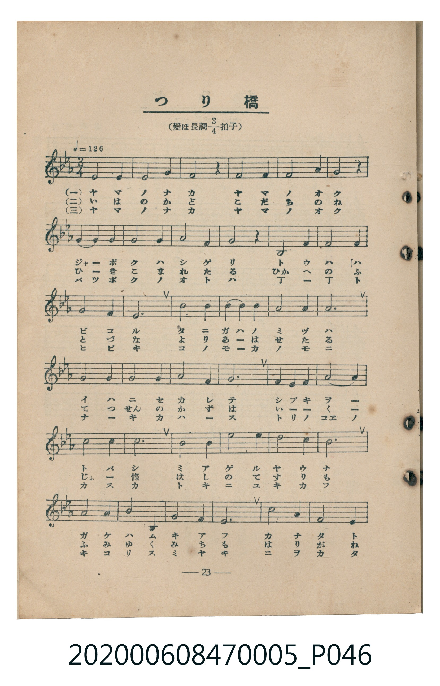
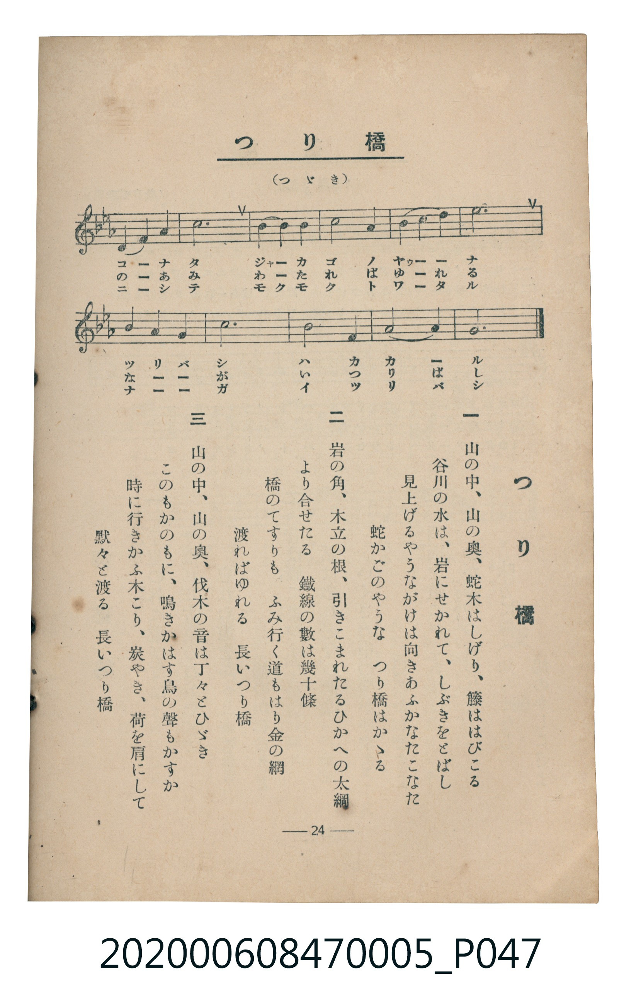

# つり橋

<audio controls src="tsuribashi.mp3"></audio>

- 臺灣教育會公認《新定兒童唱歌》尋常科第五學年用（2020.006.0847.0005）

## 說明

原書資訊與歌詞全文（對應 P046.jpg – P047.jpg，書頁 pp. 23–24，第二學期第 9 首）：
調性與拍號：變ほ長調四分之三拍子（Eb 大調 3/4 拍），♩= 126

## 歌詞

```text
一　山の中、山の奧、蛇木はしげり、籐ははびこる
谷川の水は、岩にせかれて、しぶきをとばし
見上げるやうながけは向きあふかなたとこなた
蛇かごのやうな　つり橋はかゝる

二　岩の角、木立の根、引きこまれたるひかへの太綱
より合せたる　鐵線の數は幾十條
橋のてすりも　ふみ行く道もはり金の網
渡ればゆれる　長いつり橋

三　山の中、山の奧、伐木の音は丁々とひゞき
このもかのもに、鳴きかはす鳥の聲もかすか
時に行きかふ木こり、炭やき、荷を肩にして
默々と渡る　長いつり橋
```

## ABC

```abc
X:1
T:つり橋
C:TMD (Chen, Chih-Han / aguai)
M:3/4
L:1/16
Q:1/4=126
K:Eb
V:V1 name="Piano" snm="Pia"
[V:V1]
E8 E4 | G8 G4 | B8 z4 | G8 G4 |
B8 B4 | c8 z4 | E4 F4 G4 | B8 B4 |
c8 B4 | G8 z4 | C8 E4 | G8 F4 |
E8 E4 | D12 | e8 d4 | c4 d4 c4 |
B8 G4 | F12 | G8 G4 | F8 G4 |
A8 F4 | E12 | F8 F4 | G4 A4 F4 |
G8 B4 | c12 | B8 B4 | e8 d4 |
c8 B4 | G12 | F8 G4 | A8 C4 |
E8 F4 | G12 | c8 G4 | F8 E4 |
D4 E4 F4 | B12 | B4 c4 B4 | c8 e4 |
d4 c4 B4 | e12 | G4 A4 B4 | c12 |
B8 G4 | F8 B4 | E12 |
```

## TMD 檔案連結

- [主旋律 TMD 檔案](tsuribashi.tmd)
- [鋼琴伴奏 TMD 檔案](tsuribashi_piano.tmd)

## 分析

```text
================================================================================
📊 TMD Song Profile: [ つり橋 ]
================================================================================
⏱  Duration:       1:07 (67.1s), 47 measures total
🎼 Key & Tempo:    首調基準 E,, != 126.0 BPM, <3/4>
   - 分析範圍：      由實際發聲的音符與和弦推測調性；播放脈絡另行呈現
🎤 人聲音域:    C4 (MIDI 60) – D#5 (MIDI 75) [跨度: 15 個半音 / 1.2 個八度, 難度: moderate]
   - 最低音:  C4 in [Tsuribashi #1 @ m.11, 0:14]
   - 最高音: D#5 in [Tsuribashi #1 @ m.15, 0:20]
   - 適合: soprano, mezzo-soprano, contralto, tenor, baritone, bass
🏛  結構:      Tsuribashi (67.1s)
⚡ 編曲密度:        Peak 1 軌道同時演奏
🗝  調性診斷：       D# 大調（純淨自然大調，未偵測到可信轉調）
   - 風格氣質:    純淨自然大調（陽光明朗、易唱易記，無明顯調外色彩）
   - 轉調歷程:    全曲維持單一推測調性（未偵測到可信轉調）
   - 核心骨幹音:  G, D#, A#, C, F
   - 調性數值:    D# 大調 [相關度: 0.84, 穩定度: Moderate, 自然音純度: 100.0%]
   - 候選調性 (K-S): D# 大調 (0.84), C 小調 (0.75), A# 大調 (0.73)
   - 五度圈歷程:   -3
   - 各段落調性細節:
     • [Tsuribashi #1]: D# 大調 (r: 0.84, 自然音純度: 100.0%)

  [ 五度圈游移軌跡 ]
               C  
         F            G  
      Bb               D  
     [Eb]*              A  
         Ab           E  
            Db       B  
               F# 
     (* = active key center)

  [ 十二半音累積音高分佈 ]
     C  : ███████████████████       16.7%
     C# :                            0.0%
     D  : ███████                    5.8%
     D# : ██████████████████████    18.8%
     E  :                            0.0%
     F  : █████████████████         14.5%
     F# :                            0.0%
     G  : ████████████████████████  21.0%
     G# : █████                      4.3%
     A  :                            0.0%
     A# : ██████████████████████    18.8%
     B  :                            0.0%
--------------------------------------------------------------------------------
Assignment 軌道音域：
  - Piano         : C4 – D#5 (15 個半音 / 1.2 個八度, 88 個音符)
================================================================================
```


## 原書掃描頁






