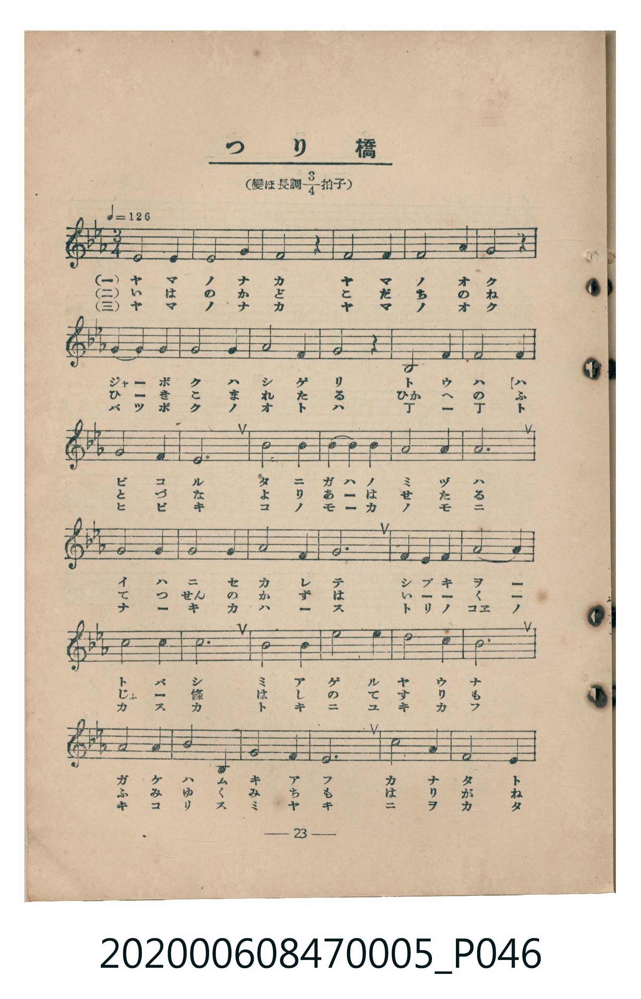
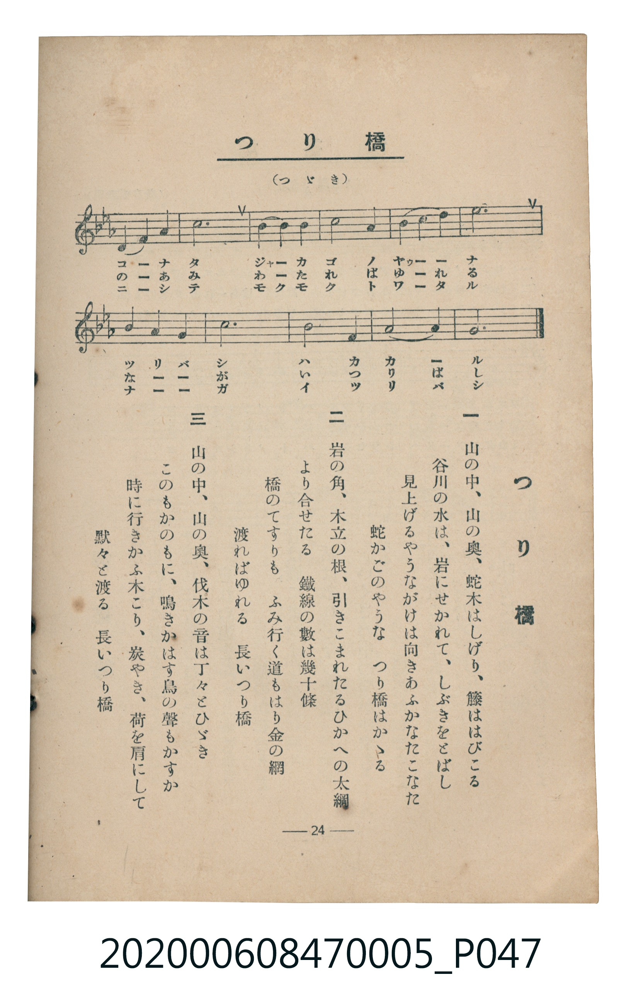

# つり橋

> Re:Shōka 使用 AI 協助辨識與重建樂譜，可能會有錯誤。歡迎回報。

- **鋼琴伴奏版**：<br><audio controls src="tsuribashi.mp3"></audio>
- **NEUTRINO 歌聲合成版**：<br><audio controls src="tsuribashi_neutrino.mp3"></audio>

- 臺灣教育會公認《新定兒童唱歌》尋常科第五學年用（2020.006.0847.0005）

## 說明

原書資訊與歌詞全文（對應 P046.jpg – P047.jpg，書頁 pp. 23–24，第二學期第 9 首）：
調性與拍號：變ほ長調四分之三拍子（Eb 大調 3/4 拍），♩= 126


## 歌詞

```text
一　山の中、山の奧、蛇木はしげり、籐ははびこる
谷川の水は、岩にせかれて、しぶきをとばし
見上げるやうながけは向きあふかなたとこなた
蛇かごのやうな　つり橋はかゝる

二　岩の角、木立の根、引きこまれたるひかへの太綱
より合せたる　鐵線の數は幾十條
橋のてすりも　ふみ行く道もはり金の網
渡ればゆれる　長いつり橋

三　山の中、山の奧、伐木の音は丁々とひゞき
このもかのもに、鳴きかはす鳥の聲もかすか
時に行きかふ木こり、炭やき、荷を肩にして
默々と渡る　長いつり橋
```

## ABC

<div class="abc-score" data-abc-src="tsuribashi.abc" aria-label="五線譜載入中"></div>

[下載 ABC 原始檔](tsuribashi.abc)

## TMD 檔案連結

- [主旋律 TMD 檔案](tsuribashi.tmd) [[在 TMD Studio 編輯](https://tmdlang.github.io/Tmd-TS/#tmd=s7IKdvYPcrWy4qpTUCpJTLdSSM7PyUlNLsnMz7MqzsjMK0nNjM_KTMmPL87Iz05Ugisry88pzU21Si9KTEmNN403MjAyiDcwMIs3sDAxBzIMTBFKi_NLi5JTrYqTM_Lzc-JLUitKkvLzsxHyBUX5Zal5iXlANQVFIBtTwIoQClLLMlNSQdKpKZkl-UWZiTlI7kgtKga7FWxJfElRYl5xclFmAcgDCFUlGalAx4IlC_KLkIwGmpaemWdVkphZnpgXn5-WlpmMYjxQcUY-0JMFGZVWGZnFINuTE3PisxPzkMICandBYnqqVYCBiZkukDBX4tLSUnjcuORxU9ezld0KWlpcirYKhkZmXPa2Cq46XDbG-iZ2IBNetO963rj42dSZL5o2PZvT_LR1zYtVvY8bup5N2_B03aynrZOer176dMrGZ2t7Hjd0P93Q_XTHjufLJz5fs-bJrilP1-54unPL8ykr3u_pAMWAHjAG9EAxAGQYmL7f06nExaWvpWBLLcCloKDwtG_-s9k7Xmxuf7Gi60VHO9BdL1bOe9q64tm0dqArnm7ofdbeqQAKBb2sgnSFRw2TQRxzEOf9nh6gzpcLGhUKCvQUjIyBckYmQEGwX3qAfnk2Zz6QrWCp8HLZNKDj3--ZBbLwxar9zxqWg6zq7n0xcz5Q9MW6rseNu19O3Q6Uejp79tOOtic7u5_s6AQqeLp2AtAVrkkKT5csB8oqAENZASgMNq3n0cyVkCgAGftkR8PjhoanGzc-blz3ZMfaxw2NEPbTpcuB7Bez25_NWfG4cf3jxumPGycBIxEo-HzjBLAIEG1-3Dj5cVM32H0btj_dPheo89mGLSA5oEGbVj5uXP24cfbjxu7HTT2PG5cBBcEGbXvc2Pu4adLjRqDRG4AiYP3LgG4HeghoCVB1y-PGtseNqx43ArVNBBr3dAKQ7H3c2PS4cSvIOJDUfLD-yRA22IjZ7WC5KUBXIIxoaIAnP7CbgabPBbkZ7PtdwOTUAHbouhfLJwHdB_Tu89VAheueLdgJ8sOeqWB7gbbsA_thPsh5jZvA9uwAhdOSVc-3bQSZ9bipA2jL0wkdYB-D1TU0vJyw9fn2WSDjpgJVr3-6c9_T3sZni-aCNIAdtA4ULI0zQSHb1AR2K9B_-18sBFrV_xIUuEAfrwfKvmwHBsC659s2gXXuWAh2zIbHTW0gBsSqqdsfNwI9DfUrNHY78cTukz0TwLG77uV8YESuf7Kj8XFDKzhQNz1umgf0N9hbIL8DgxPoDrBzQYzVQM0vNwOjGRgykECd-XLzUlAYgnRCVM4EkmC3zgRpAHsIonor2E6gz8BpqWktOKaAWb3xRe92YKJ40QRJNcBksgyk_-XuGRBXgT2NzaNARZTnaShQ0NLn4gopLi3KTEoElvtWAZmJefkONQY11SBrFGxMtOzADGzFiQIoB-9oeLZuq4KGmcLTDf3P1zfowMsATSwagJZBDdMAatS0UnjcvAQk8Lh5noJCDZDqg_C6wLym1SAeCICksClsWgVRuB6mEGpBjYKhgi4Q1ygYA2ljIG0KpA3Q-KZA2gwiDtblYwixRxdsDcQWELsL6hhdhXioS9BUAJ0BcQVYBcQsI6BIYwtItnE9SLZxHZjdDWavhJnVOBksugDMXghmrwOz1yKbZUwdd-GPyF09FEVk047HzYuBFu8B4jmISHnc3A-Jou2QCNsEiT5gvCFitgMitQzCA6oHaQMKIkWmEUakgWhQZIIi1SweKbaNkGMT4ipQsMDcBGL3Q10ECqJNUPfAArEDLLoM6hSoaqQo3QSOpF6kyNsHNq0HzJ4PZnfDoxdUboIldiClga0o8ToBbEkL2MI5YMvB6QU5BsGOgjgP4qQOsDXLYGwCMQusISnKopMh8bMZEj_ImbJpPySyuiG8NdD4BjkepHQ-RLYVKWKxZlJzUPzpggTigJQ5OIbNgRgS46CYN4IoQMqm4LAHugniJIh2kHtAQQLOZEDXgOxEuAUk0woPRLhp4FhdAY6YpeBIAqUFiGmQtADOZo1N4IwMrOrAPLBpwHiuAauFmwWKUGC0gCLlcfMksF0gd0JMA2VpmIv7gHgROPMisvMiMBuUXEDm4Y1SYOuHsswKLUwheRMUfaAI3o1U6j5uBkYmSK4NObohmbh5GoS3FsQGZmhQpofHKayABcUYiDaBZElwXIPCASQO4hsDZVCzKqT4AudNcCiAHAQr4EDOgbgGFprg3At0CcQhIHegxig4czQuAcfWbLBpk5GyIKQYngVmQ4pnSFENtr1xBiiPgqgmYPsKZCVyfu0CG7YWyWmQ4mQnImeCixNowgNGOIi9ESy-iJjIBTbwKcuvkPIUWLAg4gwagdAc2bQIIgWMO5BCYISD5CBpAlYMA6tgtNwKillY6QuKA1hpjJRpEcUyamYFZySgg2ARB45CSJYEugXiFJAKSHYAJwRoEQwKbdSIBRfhjdPhkQk2CxrdM8FmQWKoCSy-FSy-HywOTTxIWRUcf8CYg7Eh7oJke3AMQxJiM9gt0AwMceNUorJp61rKsikwD4KiZCNKzbgAnvsQUQl0D1I2heZgaCsKWkYjV6jImRNYeUJyJyRXQgIBFJWwXAwsoZFy6RpwIECSM6QyAjdeoIEDKcOggQPPIJCGCqRsBlVXiMgEmwCJHkjzBxpt4EiGlrygmhUSyWA7oA2kJphOpOhELmHBWRAStdCyH1wWgNVAohkSteD6H5oQQKYRqEqbMSMU3MklMkKBdSiotEQKE6RoQ7SgIImsaQsk5oBtXWj-hOiFZw30HAqsR0FNJUjWhGRRM3iWBWZToAqoADjPouRRaDmFiCpIBMLaT3AXwQs2_Nm0CRKzkPYQIgY3gPW0wUUhdSikzgXFNIgNKolRi1xIbbAdbBO8BgAXprDGEjIbUtiA2dA0B3Q7oYy6GhyvpmTGK7D5Bk5ySIUcIl6h-RaUK5EyJzAiQXLw1hRSMWuCUczCsiI46tBjDmg5yG7M8hUcBdCIQ5RuUBZSJsQS-OCqE5EFQdEGEZ2OETmQ0hZcPYOrcIgt4OoU6CoQG9TCRVTaIN21XFy6dgqIbqcCkKfMBQA)]
- [鋼琴伴奏 TMD 檔案](tsuribashi_piano.tmd) [[在 TMD Studio 編輯](https://tmdlang.github.io/Tmd-TS/#tmd=s7IKdvYPcrWy4qpTUCpJTLdSyC8qychPL0osyKi0ysgsLskvykxOzInPTsxLVIIrKs4vLUpOjS9ITE-1CjAwMdMFEuZKXFpaCo8blzxu6nq2svv9no6X3XueT9jyZM-Wp0v7n3d2vN_TqaClxaVoq2BoZMZlb6vgqsNlY6xvYgcy9kX7rueNi59NnfmiadOzOc1PW9e8WNX7uKHr2bQNT9fNeto66fnqpU-nbHy2tudxQ_fTDd1Pd-x4vnzi8zVrnuya8nTtjqc7tzyfsgJop5GBkYGegYGZnoGFiTmQYWAKtFaJiyukuLQoMymxOCPTKiAzMS8_yMOhxqCmmksBCGxMtOzADH0tBVt0oACyY0fDs3VbFTTMFJ5u6H--vkFHAeRpvayCdE0sGrT0wYbVKBgq6AJxjYIxkDYG0qZA2gCNbwqkzSDiYF0-hjUKj5uXAEUeN88Dyj1u7gOzu0DsptVAdjxYFENF0yqwivUQFRCzjIAijS0g2cb1INnGdWB2N5i9EmZW42Sw6AIweyGYvQ7MXotsljF13IU_nHf1kBfORhjhCaJB4QwKb7N4pIgwQg7oph2PmxeDXTwH7srHzf1g9naw6zeBfbIK7r8OsOgyMLsfphoptDeBw68XKVz3gU3rAbPng9nd8JDfBIoMkMQOpOjZihLkE8CWtIAtnAO2HByVyIELdhTEeRAndYCtWQZjEwj0HZ2UJG5zUODqggTigJQ5OPjNgRgSHaBoMYIoQEre4IBp2gx2MSjpgLQ_btoPdi84cTatAfsF5EuQmvlgmVa4D-GmgYN8BTjUloJDEBRRENMgEQVOno1N4AzwuHE2mAc2DRgJNWC1cLNAoQ0MM1CIPW6eBLYL5E6IaaCsAHNxHxAvAid6RDZYBGaD4hJkHt7wfjp7NjnhDSs0QKEJok0gaRkcDyA3gsRBfGOgDGoah2RJcKIGu_Bx0254pn3cvAYs3gb3KTjZN0-D-vpxMyhBI4c2OFU1LgGH5GywaZMxipZZYDakyIEUP2DbG2eAEjeIamp_3AiyEjmhd4ENW4vkNEg-3IlI0uB8CE0UwMgAsTeCxRcRE_DAmoLcgIeVKqAggpUySOkdUdygpnNwGgTmYFi4gkMYkpqbwCkGWLyAVEBSEjieoEULKDBQwx1cNDVOh4c12CxobMwEmwUJwCaw-Faw-H6wODRukVI5OHiBAQtjQ9wFyTHgCICkk2awW6BpH-LGqUSl8Na15AQ0csoGFtmQpA1J0hAnggIalgWARQ9SEl8DdiIkLUCKQHBtBnU6JHNCnQ5PXZCaC1LogApJRFCDTYAEHqQ-hAYqOAqgRQqoPIdEAdgOaI3ZBNOJFNjIRQc4_UICHlqogTMSWA0kEiABD651oNEEMo1AAd6MGdzmBIMbWHCDKk5IgoYkbDN4QgcmbqAKqAA4paOkbGjmQwQhJGBhtSkksTRtASuCFOF4E3cTJMQhtSMiZDeA9bTBRSGFNqSQB8UArHhBLUcgRdx2sE3wYg1cQsCqTmQ2JIuC2dC0AHQ7oeS9GhzepqSFN6hgRi9HYKkZHMrogQys9EEpBrMAAYcWNIwR2RfKQkrHWMIJXHQjUjEohCGi0zHCEVKcgKsHcBUCsQVcnANdBWKDmiaISgOkuxazoe2Do6H9Ys_U57M7nk2Y9mz25ic7u0GtkO7ep2snPJ0z-UXHvGezNz3d0w_pOrzf0_Osv__5zlXQPsL2jU83bnw5Yevz7bOeTgB1NZ619L_YuBCpaRKvEG0YC8bYOaBGIW5FJkCOCVgRQfOgSjEMN4sHss3ic4FSYBIY2yAR03igAIjAajKaErgkhAezCojx6yPGaJhhqBZhVUqE6bidht0LmLZCTcXlTBSDsbgZJRoQhuAxGVdYY_oHn0rSAgOHSaB0Bsw3unYKiKwT7QOUQBMxwhAxBosocwEA)]

## 分析

```text
================================================================================
📊 TMD Song Profile: [ つり橋 ]
================================================================================
⏱  Duration:       1:07 (67.1s), 47 measures total
🎼 Key & Tempo:    首調基準 E,, != 126.0 BPM, <3/4>
   - 分析範圍：      由實際發聲的音符與和弦推測調性；播放脈絡另行呈現
🎤 人聲音域:    C4 (MIDI 60) – D#5 (MIDI 75) [跨度: 15 個半音 / 1.2 個八度, 難度: moderate]
   - 最低音:  C4 in [Tsuribashi #1 @ m.11, 0:14]
   - 最高音: D#5 in [Tsuribashi #1 @ m.15, 0:20]
   - 適合: soprano, mezzo-soprano, contralto, tenor, baritone, bass
🏛  結構:      Tsuribashi (67.1s)
⚡ 編曲密度:        Peak 1 軌道同時演奏
🗝  調性診斷：       D# 大調（純淨自然大調，未偵測到可信轉調）
   - 風格氣質:    純淨自然大調（陽光明朗、易唱易記，無明顯調外色彩）
   - 轉調歷程:    全曲維持單一推測調性（未偵測到可信轉調）
   - 核心骨幹音:  G, D#, A#, C, F
   - 調性數值:    D# 大調 [相關度: 0.84, 穩定度: Moderate, 自然音純度: 100.0%]
   - 候選調性 (K-S): D# 大調 (0.84), C 小調 (0.75), A# 大調 (0.73)
   - 五度圈歷程:   -3
   - 各段落調性細節:
     • [Tsuribashi #1]: D# 大調 (r: 0.84, 自然音純度: 100.0%)

  [ 五度圈游移軌跡 ]
               C  
         F            G  
      Bb               D  
     [Eb]*              A  
         Ab           E  
            Db       B  
               F# 
     (* = active key center)

  [ 十二半音累積音高分佈 ]
     C  : ███████████████████       16.7%
     C# :                            0.0%
     D  : ███████                    5.8%
     D# : ██████████████████████    18.8%
     E  :                            0.0%
     F  : █████████████████         14.5%
     F# :                            0.0%
     G  : ████████████████████████  21.0%
     G# : █████                      4.3%
     A  :                            0.0%
     A# : ██████████████████████    18.8%
     B  :                            0.0%
--------------------------------------------------------------------------------
Assignment 軌道音域：
  - Piano         : C4 – D#5 (15 個半音 / 1.2 個八度, 88 個音符)
================================================================================
```


## 原書掃描頁






