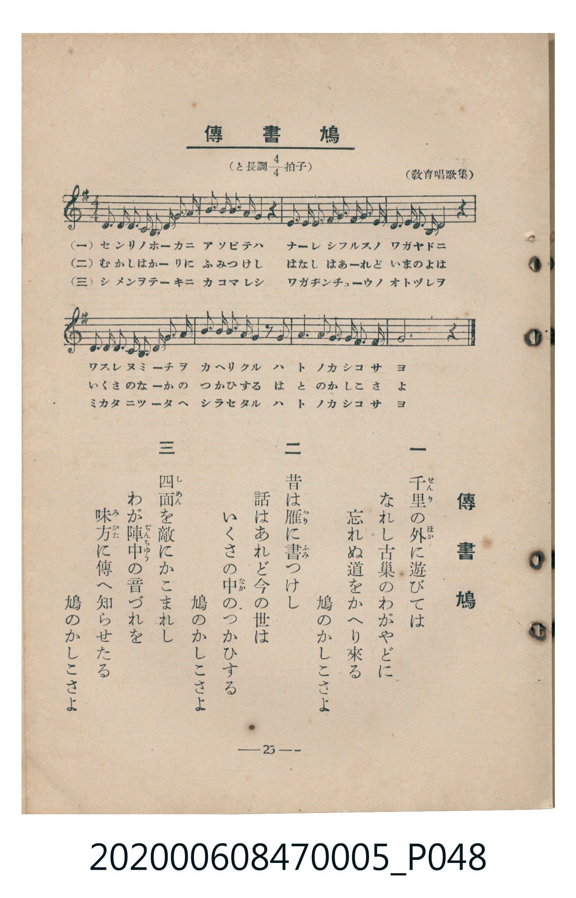

# 傳書鳩

> Re:Shōka 使用 AI 協助辨識與重建樂譜，可能會有錯誤。歡迎[回報](https://github.com/TMDLang/reshoka/issues)。

- **鋼琴伴奏版**：<br><audio controls src="denshobato.mp3"></audio>
- **NEUTRINO 歌聲合成版**：<br><audio controls src="denshobato_neutrino.mp3"></audio>

- 臺灣教育會公認《新定兒童唱歌》尋常科第五學年用（2020.006.0847.0005）

## 說明

原書資訊與歌詞全文（對應 P048.jpg，書頁 p. 25，第二學期第 10 首）：
調性與拍號：と長調四分之四拍子（G 大調 4/4 拍），（教育唱歌集）


## 歌詞

```text
一　千里（せんり）の外（ほか）に遊びては
なれし古巢のわがやどに
忘れぬ道をかへり來る
鳩のかしこさよ

二　昔は雁（かり）に書（ふみ）つけし
話はあれど今の世は
いくさの中（なか）のつかひする
鳩のかしこさよ

三　四面（しめん）を敵にかこまれし
わが陣中（ぢんちゅう）の音づれを
味方（みかた）に傳へ知らせたる
鳩のかしこさよ
```

## ABC

<div class="abc-score" data-abc-src="denshobato.abc" aria-label="五線譜載入中"></div>

[下載 ABC 原始檔](denshobato.abc)

## TMD 檔案連結

- [主旋律 TMD 檔案](denshobato.tmd) [[在 TMD Studio 編輯](https://tmdlang.github.io/Tmd-TS/#tmd=s7IKdvYPcrWy4qpTUCpJTLdSSM7PyUlNLsnMz7MqzsjMK0nNjM_KTMmPL87Iz05Ugisry88pzU21Si9KTEmNN403MjAyiDcwMIs3sDAxBzIMTBFKi_NLi5JTrYqTM_Lzc-JLUitKkvLzsxHyBUX5Zal5iXlANQVFIBtTwIoQClLLMlNSQdKpKZkl-UWZiTlI7kgtKga7FWxJfElRYl5xclFmAcgDCFUlGalAxybmZeYi6wUalZ6ZZ5WbmpmVicVd-UUlGflADxZkVFplZBaDbE5OzInPTsxDCgeovQWJ6alWAQYmFkpcWloKT5s2P5u94-XmlQpaWlyKtgqGBgZc9rYK7lw2JvomdiC9L9p3PW9c_GzqzBdNm57NaX7auubFqt7HDV3Ppm14um7W09ZJz1cvfTpl47O1PY8bup9u6H66Y8fz5ROfr1nzZNeUp2t3PN255fmUFe_3dIDCXQ8Y7nqgcAcyDEzf7-lU4uLS11KwpRbgUlBQeNo3H-ijF5vbX6zoetHRDnTXi5XznraueDatHeiKpxt6n7V3KoD8r5dVkP5-Tw_I-wsaFQr0FIyALuoBO7wH6PBnc-YD2cAAUXi5bBrQqe_3zAIZ_2LV_mcNy0EGd_e-mDkfKPq4ccXLqduB4k9nz37a0fZkZzeQAZR9unYC0EJ3hadLlgMlFYDhqQAUBZvUA5SAhCgk5F7ObgOKc4HMf7Kj4XFDw9Pe5pftIFWPG2c_bpr8uKkLKP-4cd3TJUCnAAV3P27sBousftnY9bhx8-PGZY8b14P0P25c9bip53Hj9Kf9S55uXwTU87ip_3Fjz-OmlseNK4EawGG0fwZY0ZqXjUCzJwENe9y4A2jJk31tj5u6QSqAKQKkFSQx_TFQUePUx00dEAfuAkZ0w7MZU4AWvpzdCHZON8yBq4GhCRbZ-rhxP1hkyePGiUAzwEG3ciNQz-PGJrDdK5_sBrp83ZMd0-AuB7oQ6NSpYNG1YGNWwfwJdArQJKBrNj1unEnYjTs6QYE4e_bLuYvA5kx_3NQIDEeQUU2Tnk0Fum41WB9Q0z5IcIFdAA6plzMXw6xfBAr7xoWPm1ofN4JiCGjdy_nAwF4K0tM0CRyUEzc_m7YTrHo_2EhgkgAFBDBjAcP0-XygUiB3NlAcr6uBEpQnfyhQ0NLn4nJJzQOWg0mJJflWAZmJefkONQY11SBrFGwMzbTswCxsWU8BlAF2NLxY2KOgYaLwdEP_8_UNOvD8oolFA9A2qGGPm3aDWI-bNwPxKgizD4hngxh7QOG7GsTqVlCoAbIXgRU07QWKTAYJt4GIfpAgAgDVNXfBdDevgejYDmROhZi-GsjdCbEGrHY9RMUaIHMJSLgTah8ygLq3RsE0XkEXCM3i0VnGIMIIRBiCiBqQBEjePF7BEKJMF6ZFV8EASkPNAykAYaABCsZg2hjIgojVgFkwERzGgB3nYwgKod1gEVhwQtiQ8ISoBYUnSKwbbDYoRCGikCAFybSByX6oephdkFCFmgEMVYguSLBCxCDhCrEPon49VBUkaEEynXC7UcyGuN8I5J4GiJ7GbiCeDmWvB_Nh7ge5AphZIHY0boWq2Q_EYDsaJ4JJiF4U9wPNAcmAQgXV7Ca42T1gsZVQ9S1QNfuAeB1YvgOqB6v7jUHu3w4NjYXgOICwN0FDFWLHWngYgNSD_AESBcXXPLAMKGxh5qCGP9j9wNAEqYK4GRLPjY-bl0KNWQYNfqiWJlgS6ADiVoTxQCehewF_7t7VQ17uhuWunfCs2NwDxPPh-bMRRGyC5G5gTgfxZkBKgsdNQL2gZIWRu8EZHuInYB6GWAAqJYCBBg5JILEVonIFqmZ0AM_WyHkMnMtAWQ-YdZFzXA00bxrhz9BQkyD5GaQaxIPQYANr4FLoEEt2hmchSPhB4hISgNDkBAxAWHwiJSdoGIJ0ghMNMBQxkxMki8PCEZY8wcUDOPmBghJEgrIYJDCxuxtLNoZnnX4ghhYQwCwEyXwQHigDQLIVSD0o68KyPcgvwBobbDdGUQHPfsAmFFQ_snmgbA2sIcEkyF5QmIAyLRHuBmVfaLiCQuFx034IG5hVHzdD_AOSAYmCwhdiNiy7r4QWvTB5-oR3LReXrp0CotpWAPKUuQA)]
- [鋼琴伴奏 TMD 檔案](denshobato_piano.tmd) [[在 TMD Studio 編輯](https://tmdlang.github.io/Tmd-TS/#tmd=s7IKdvYPcrWy4qpTUCpJTLdSyC8qychPL0osyKi0ysgsLskvykxOzInPTsxLVIIrKs4vLUpOjS9ITE-1CjAwsVDi0tJSeNq0-dnsHS83r3y_p-Nl957nE7Y82bPl6dL-550d7_d0KmhpcSnaKhgaGHDZ2yq4c9mY6JvYgQx80b7reePiZ1Nnvmja9GxO89PWNS9W9T5u6Ho2bcPTdbOetk56vnrp0ykbn63tedzQ_XRD99MdO54vn_h8zZonu6Y8Xbvj6c4tz6esAFppZGBkoGdgYKZnYGFiDmQYmAJtVeLicknNK87IT0osybcKyEzMyw_ycKgxqKnmUgACG0MzLTswS19LwRYdKIAs2dHwYmGPgoaJwtMN_c_XN-gogPyrl1WQrolFg5Y-2LAaBdN4BV0gNItHZxmDCCMQYQgiakASIHnzeAVDiDJdmBZdBQMoDTUPpACEgQYoGINpYyALIlYDZsFEcBgDdpyPYY3C46bdYJHHzZuBeBWU3QfEs6FqHzetBot1g81-3LQIKroXKDYZLNMGJvuh6mF2AdU2d8HMaF4D1bUdyJ4KFVsN5O-E2gdRvx6qag2QvQQs0wm3G8VsiPuNQO5pgOhp7Abi6VD2ejAf5n6QKx43gnwBVN-4FapmPxCD7WicCCYhelHcDzQHJAMKFVSzm-Bm94DFVkLVt0DV7APidWD5DqgerO43Brl_OzQ0FoLjAMLeBA1ViB1r4WEAUg_yB0gUFF_zwDKgsIWZgxr-YPcDQxNE7oCaDdLX-Lh5KdSYZdDgh2ppgiWBDiB7F8J4oJPQvYA_t-zqISe3ICddcOIFpWhgjkBOyDXQJG-EP59ATYJkE5BqEA9Cgw2sgUuhQyy5BJ4ydyLScnMPEM-HqgWGKTyYkGKpeQY0Vz1uAscFMM1jxhIk54CDHB4V0FwHjlVQXINIUMoFqV-Bw91Ycgc8RfYDMTTfAVMmJE1DeKB0BUmtIPWgHAHLTSC_PG6cCbYbIwfCU_XjxhVQ_cjmgXLL40Zw-QC2FxQmoLxAhLtBuQIarqBQeNy0H8IG5oDHzRD_gGRAoqDwhZgNy0UroSUaTJ4-4V2LWbn4IFcuJoi65fnKlU8blz5fvf5FX9eTnd1PZ89-1t37dO2Ep9uXPevshtSTiPwArBqiDWNhVI2CCZBhEgtM7_HAVIopDaxOoo3g0vAaCChqGg8RBjPgGtHMwVQApEAGAf2na6eA8GK0D1AOTQRoL5qIMVhEmQsA)]

## 分析

```text
================================================================================
📊 TMD Song Profile: [ 傳書鳩 ]
================================================================================
⏱  Duration:       0:19 (19.2s), 8 measures total
🎼 Key & Tempo:    首調基準 G, != 100.0 BPM, <4/4>
   - 分析範圍：      由實際發聲的音符與和弦推測調性；播放脈絡另行呈現
🎤 人聲音域:    G3 (MIDI 55) – D5 (MIDI 74) [跨度: 19 個半音 / 1.6 個八度, 難度: challenging]
   - 最低音:  G3 in [Denshobato #1 @ m.1, 0:02]
   - 最高音: D5 in [Denshobato #1 @ m.7, 0:14]
   - 適合: mezzo-soprano, contralto, tenor, baritone, bass
🏛  結構:      Denshobato (19.2s)
⚡ 編曲密度:        Peak 1 軌道同時演奏
🗝  調性診斷：       G 大調（純淨自然大調，未偵測到可信轉調）
   - 風格氣質:    純淨自然大調（陽光明朗、易唱易記，無明顯調外色彩）
   - 轉調歷程:    全曲維持單一推測調性（未偵測到可信轉調）
   - 核心骨幹音:  G, D, A, E, B
   - 調性數值:    G 大調 [相關度: 0.87, 穩定度: Moderate, 自然音純度: 100.0%]
   - 候選調性 (K-S): G 大調 (0.87), D 大調 (0.82), E 小調 (0.57)
   - 五度圈歷程:   +1
   - 各段落調性細節:
     • [Denshobato #1]: G 大調 (r: 0.87, 自然音純度: 100.0%)

  [ 五度圈游移軌跡 ]
               C  
         F           [G ]*
      Bb               D  
      Eb               A  
         Ab           E  
            Db       B  
               F# 
     (* = active key center)

  [ 十二半音累積音高分佈 ]
     C  :                            0.0%
     C# :                            0.0%
     D  : █████████████████████     24.1%
     D# :                            0.0%
     E  : ███████████               12.5%
     F  :                            0.0%
     F# : ████                       4.5%
     G  : ████████████████████████  27.7%
     G# :                            0.0%
     A  : ████████████████          18.7%
     A# :                            0.0%
     B  : ███████████               12.5%
--------------------------------------------------------------------------------
Assignment 軌道音域：
  - Piano         : G3 – D5 (19 個半音 / 1.6 個八度, 47 個音符)
================================================================================
```


## 原書掃描頁




