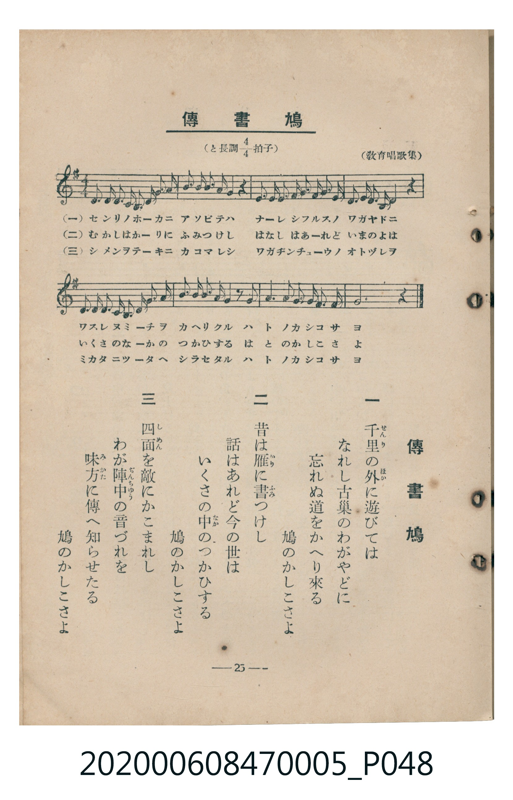

# 傳書鳩

> Re:Shōka 使用 AI 協助辨識與重建樂譜，可能會有錯誤。歡迎回報。

- **鋼琴伴奏版**：<br><audio controls src="denshobato.mp3"></audio>
- **NEUTRINO 歌聲合成版**：<br><audio controls src="denshobato_neutrino.mp3"></audio>

- 臺灣教育會公認《新定兒童唱歌》尋常科第五學年用（2020.006.0847.0005）

## 說明

原書資訊與歌詞全文（對應 P048.jpg，書頁 p. 25，第二學期第 10 首）：
調性與拍號：と長調四分之四拍子（G 大調 4/4 拍），（教育唱歌集）


## 歌詞

```text
一　千里（せんり）の外（ほか）に遊びては
なれし古巢のわがやどに
忘れぬ道をかへり來る
鳩のかしこさよ

二　昔は雁（かり）に書（ふみ）つけし
話はあれど今の世は
いくさの中（なか）のつかひする
鳩のかしこさよ

三　四面（しめん）を敵にかこまれし
わが陣中（ぢんちゅう）の音づれを
味方（みかた）に傳へ知らせたる
鳩のかしこさよ
```

## ABC

<div class="abc-score" data-abc-src="denshobato.abc" aria-label="五線譜載入中"></div>

[下載 ABC 原始檔](denshobato.abc)

## TMD 檔案連結

- [主旋律 TMD 檔案](denshobato.tmd) [[在 TMD Studio 編輯](https://tmdlang.github.io/Tmd-TS/#tmd=s7IKdvYPcrWy4qpTUCpJTLdSSM7PyUlNLsnMz7MqzsjMK0nNjM_KTMmPL87Iz05Ugisry88pzU21Si9KTEmNN403MjAyiDcwMIs3sDAxBzIMTBFKi_NLi5JTrYqTM_Lzc-JLUitKkvLzsxHyBUX5Zal5iXlANQVFIBtTwIoQClLLMlNSQdKpKZkl-UWZiTlI7kgtKga7FWxJfElRYl5xclFmAcgDCFUlGalAxybmZeYi6wUalZ6ZZ5WbmpmVieQuLS2Fp02bn83e8XLzSgUtLS5FWwVDAwMue1sFdy4bE30TO5ABL9p3PW9c_GzqzBdNm57NaX7auubFqt7HDV3Ppm14um7W09ZJz1cvfTpl47O1PY8bup9u6H66Y8fz5ROfr1nzZNeUp2t3PN255fmUFe_3dIACTg8YcHqggAMyDEzf7-lU4uLS11KwpRbgUlBQeNo3H-ijF5vbX6zoetHRDnTXi5XznraueDatHeiKpxt6n7V3KgQYmFjoZRWkv9_TA_L-gkaFAj0FI6CLesAO7wE6_Nmc-UA2MEAUXi6bBnTq-z2zQMa_WLX_WcNykMHdvS9mzgeKPm5c8XLqdqD409mzn3a0PdnZDWQAZZ-unQC00F3h6ZLlQEkFYHgqAEXBJvUAJSAhCgm5l7PbgOJcIPOf7Gh43NDwtLf5ZTtI1ePG2Y-bJj9u6gLKP25c93QJ0ClAwd2PG7vBIqtfNnY9btz8uHHZ48b1IP2PG1c9bup53Dj9af-Sp9sXAfU8bup_3NjzuKnlceNKoAZwGO2fAVa05mUj0OxJQMMeN-4AWvJkX9vjpm6QCmCKAGkFSUx_DFTUOPVxUwfEgbuAEd3wbMYUoIUvZzeCndMNc-BqYGiCRbY-btwPFlnyuHEi0Axw0K3cCNTzuLEJbPfKJ7uBLl_3ZMc0uMuBLgQ6dSpYdC3YmFUwfwKdAjQJ6JpNjxtnEnbjjk5QIM6e_XLuIrA50x83NQLDEWRU06RnU4GuWw3WB9S0DxJcYBeAQ-rlzMUw6xeBwr5x4eOm1seNoBgCWvdyPjCwl4L0NE0CB-XEzc-m7QSr3g82EpgkQAEBzFjAMH0-H6gUyJ0NFMfraqAE5ckfChS09Lm4XFLzgAVZUmJJvlVAZmJevkONQU01yBoFG0MzLTswC1vWUwBlgB0NLxb2KGiYKDzd0P98fYMOPL9oYtEAtA1q2OOm3SDW4-bNQLwKwuwD4tkgxh5Q-K4GsboVFGqA7EVgBU17gSKTQcJtIKIfJIgAQHXNXTDdzWsgOrYDmVMhpq8GcndCrAGrXQ9RsQbIXAIS7oTahwyg7q1RMI1X0AVCs3h0ljGIMAIRhiCiBiQBkjePVzCEKNOFadFVMIDSUPNACkAYaICCMZg2BrIgYjVgFkwEhzFgx_kYgkJoN1gEFpwQNiQ8IWpB4QkS6wabDQpRiCgkSEEybWCyH6oeZhckVKFmAEMVogsSrBAxSLhC7IOoXw9VBQlakEwn3G4UsyHuNwK5pwGip7EbiKdD2evBfJj7Qa4AZhaIHY1boWr2AzHYjsaJYBKiF8X9QHNAMqBQQTW7CW52D1hsJVR9C1TNPiBeB5bvgOrB6n5jkPu3Q0NjITgOIOxN0FCF2LEWHgYg9SB_gERB8TUPLAMKW5g5qOEPdj8wNEGqIG6GxHPj4-alUGOWQYMfqqUJlgQ6gLgVYTzQSehewJ-7d_WQl7thuWsnPCs29wDxfHj-bAQRmyC5G5jTQbwZkJLgcRNQLyhZYeRucIaH-AmYhyEWgEoJYKCBQxJIbIWoXIGqGR3AszVyHgPnMlDWA2Zd5BxXA82bRvgzNNQkSH4GqQbxIDTYwBq4FDrEkp3hWQgSfpC4hAQgNDkBAxAWn0jJCRqGIJ3gRAMMRczkBMnisHCEJU9w8QBOfqCgBJGgLAYJTOzuxpKN4VmnH4ihBQQwC0EyH4QHygCQbAVSD8q6sGwP8guwxgbbjVFUwLMfsAkF1Y9sHihbA2tIMAmyFxQmoExLhLtB2RcarqBQeNy0H8IGZtXHzRD_gGRAoqDwhZgNy-4roUUvTJ4-4V3LxaVrp4CothWAPGUuAA)]
- [鋼琴伴奏 TMD 檔案](denshobato_piano.tmd) [[在 TMD Studio 編輯](https://tmdlang.github.io/Tmd-TS/#tmd=s7IKdvYPcrWy4tLSUnjatPnZ7B0vN698v6fjZfee5xO2PNmz5enS_uedHe_3dCpoaXEp2ioYGhhw2dsquHPZmOib2HHVKSi9aN_1vHHxs6kzXzRtejan-Wnrmhereh83dD2btuHpullPWyc9X7306ZSNz9b2PG7ofrqh--mOHc-XT3y-Zs2TXVOert3xdOeW51NWAK00MjAy0DMwMNMzsDAxBzIMTIG2KnFxuaTmFWfkJyWW5FsFZCbm5Qd5ONQY1FRzKQCBjaGZlh2Ypa-lYIsOFECW7Gh4sbBHQcNE4emG_ufrG3QUAgxMLPSyCtI1sWjQ0gcbVqNgGq-gC4Rm8egsYxBhBCIMQUQNSAIkbx6vYAhRpgvToqtgAKWh5oEUgDDQAAVjMG0MZEHEasAsmAgOY8CO8zGsUXjctBss8rh5MxCvgrL7gHg2VO3jptVgsW6w2Y-bFkFF9wLFJoNl2sBkP1Q9zC6g2uYumBnNa6C6tgPZU6Fiq4H8nVD7IOrXQ1WtAbKXgGU64XajmA1xvxHIPQ0QPY3dQDwdyl4P5sPcD3LF40aQL4DqG7dC1ewHYrAdjRPBJEQvivuB5oBkQKGCanYT3OwesNhKqPoWqJp9QLwOLN8B1YPV_cYg92-HhsZCcBxA2JugoQqxYy08DEDqQf4AiYLiax5YBhS2MHNQwx_sfmBoglRB3AyJ58bHzUuhxiyDBj9USxMsCXQAcSvCeKCT0L2AP7fs6iEntyAnXXDiBaVoYI5ATsg10CRvhD-fQE2CZBOQahAPQoMNrIFLoUMsuQSeMnci0nJzDxDPh6oFhik8mJBiqXkGNFc9bgLHBTDNY8YSJOdAghwWFdBcB45VUFyDSFDKBalfgcPdWHIHPEX2AzE03wFTJiRNQ3igdAVJrSD1oBwBy00gvzxunAm2GyMHwlP148YVUP3I5oFyy-NGcPkAthcUJqC8QIS7QbkCGq6gUHjctB_CBuaAx80Q_4BkQKKg8IWYDctFK6ElGkyePuFdi1m5-CBXLiaIuuX5ypVPG5c-X73-RV_Xk53dT2fPftbd-3TthKfblz3r7IbUk4j8AKwaog1jYVSNggmQYRILTO_xwFSKKQ2sTqKN4NLwGggoahoPEQYz4BrRzMFUAKRABgH9p2ungPBitA9QDk0EaC-aiDFYRJkLAA)]

## 分析

```text
================================================================================
📊 TMD Song Profile: [ 傳書鳩 ]
================================================================================
⏱  Duration:       0:19 (19.2s), 8 measures total
🎼 Key & Tempo:    首調基準 G, != 100.0 BPM, <4/4>
   - 分析範圍：      由實際發聲的音符與和弦推測調性；播放脈絡另行呈現
🎤 人聲音域:    G3 (MIDI 55) – D5 (MIDI 74) [跨度: 19 個半音 / 1.6 個八度, 難度: challenging]
   - 最低音:  G3 in [Denshobato #1 @ m.1, 0:02]
   - 最高音: D5 in [Denshobato #1 @ m.7, 0:14]
   - 適合: mezzo-soprano, contralto, tenor, baritone, bass
🏛  結構:      Denshobato (19.2s)
⚡ 編曲密度:        Peak 1 軌道同時演奏
🗝  調性診斷：       G 大調（純淨自然大調，未偵測到可信轉調）
   - 風格氣質:    純淨自然大調（陽光明朗、易唱易記，無明顯調外色彩）
   - 轉調歷程:    全曲維持單一推測調性（未偵測到可信轉調）
   - 核心骨幹音:  G, D, A, E, B
   - 調性數值:    G 大調 [相關度: 0.87, 穩定度: Moderate, 自然音純度: 100.0%]
   - 候選調性 (K-S): G 大調 (0.87), D 大調 (0.82), E 小調 (0.57)
   - 五度圈歷程:   +1
   - 各段落調性細節:
     • [Denshobato #1]: G 大調 (r: 0.87, 自然音純度: 100.0%)

  [ 五度圈游移軌跡 ]
               C  
         F           [G ]*
      Bb               D  
      Eb               A  
         Ab           E  
            Db       B  
               F# 
     (* = active key center)

  [ 十二半音累積音高分佈 ]
     C  :                            0.0%
     C# :                            0.0%
     D  : █████████████████████     24.1%
     D# :                            0.0%
     E  : ███████████               12.5%
     F  :                            0.0%
     F# : ████                       4.5%
     G  : ████████████████████████  27.7%
     G# :                            0.0%
     A  : ████████████████          18.7%
     A# :                            0.0%
     B  : ███████████               12.5%
--------------------------------------------------------------------------------
Assignment 軌道音域：
  - Piano         : G3 – D5 (19 個半音 / 1.6 個八度, 47 個音符)
================================================================================
```


## 原書掃描頁




