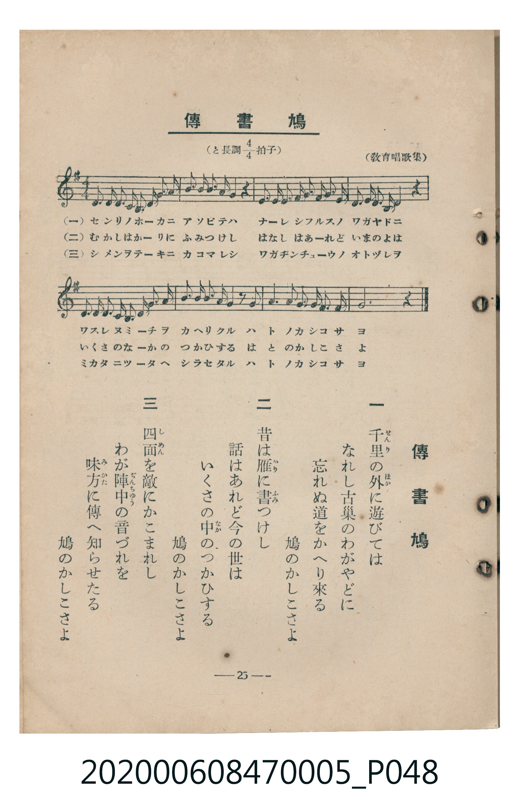

# 傳書鳩

<audio controls src="denshobato.mp3"></audio>

- 臺灣教育會公認《新定兒童唱歌》尋常科第五學年用（2020.006.0847.0005）

## 說明

原書資訊與歌詞全文（對應 P048.jpg，書頁 p. 25，第二學期第 10 首）：
調性與拍號：と長調四分之四拍子（G 大調 4/4 拍），（教育唱歌集）

## 歌詞

```text
一　千里（せんり）の外（ほか）に遊びては
なれし古巢のわがやどに
忘れぬ道をかへり來る
鳩のかしこさよ

二　昔は雁（かり）に書（ふみ）つけし
話はあれど今の世は
いくさの中（なか）のつかひする
鳩のかしこさよ

三　四面（しめん）を敵にかこまれし
わが陣中（ぢんちゅう）の音づれを
味方（みかた）に傳へ知らせたる
鳩のかしこさよ
```

## ABC

```abc
X:1
T:傳書鳩
C:TMD (Chen, Chih-Han / aguai)
M:4/4
L:1/16
Q:1/4=100
K:G
V:V1 name="Piano" snm="Pia"
[V:V1]
D3 E D3 E D2 B,2 A,2 G,2 | E3 F G2 E2 D4 z4 | D2 G2 G3 A B3 B A2 G2 | A3 B A2 E2 D4 z4 |
A3 B A3 E G2 F2 E2 D2 | B3 A G2 E2 D4 z4 | d3 B G4 A2 B2 A2 F2 | G12 z4 |
```

## TMD 檔案連結

- [主旋律 TMD 檔案](denshobato.tmd)
- [鋼琴伴奏 TMD 檔案](denshobato_piano.tmd)

## 分析

```text
================================================================================
📊 TMD Song Profile: [ 傳書鳩 ]
================================================================================
⏱  Duration:       0:19 (19.2s), 8 measures total
🎼 Key & Tempo:    首調基準 G, != 100.0 BPM, <4/4>
   - 分析範圍：      由實際發聲的音符與和弦推測調性；播放脈絡另行呈現
🎤 人聲音域:    G3 (MIDI 55) – D5 (MIDI 74) [跨度: 19 個半音 / 1.6 個八度, 難度: challenging]
   - 最低音:  G3 in [Denshobato #1 @ m.1, 0:02]
   - 最高音: D5 in [Denshobato #1 @ m.7, 0:14]
   - 適合: mezzo-soprano, contralto, tenor, baritone, bass
🏛  結構:      Denshobato (19.2s)
⚡ 編曲密度:        Peak 1 軌道同時演奏
🗝  調性診斷：       G 大調（純淨自然大調，未偵測到可信轉調）
   - 風格氣質:    純淨自然大調（陽光明朗、易唱易記，無明顯調外色彩）
   - 轉調歷程:    全曲維持單一推測調性（未偵測到可信轉調）
   - 核心骨幹音:  G, D, A, E, B
   - 調性數值:    G 大調 [相關度: 0.87, 穩定度: Moderate, 自然音純度: 100.0%]
   - 候選調性 (K-S): G 大調 (0.87), D 大調 (0.82), E 小調 (0.57)
   - 五度圈歷程:   +1
   - 各段落調性細節:
     • [Denshobato #1]: G 大調 (r: 0.87, 自然音純度: 100.0%)

  [ 五度圈游移軌跡 ]
               C  
         F           [G ]*
      Bb               D  
      Eb               A  
         Ab           E  
            Db       B  
               F# 
     (* = active key center)

  [ 十二半音累積音高分佈 ]
     C  :                            0.0%
     C# :                            0.0%
     D  : █████████████████████     24.1%
     D# :                            0.0%
     E  : ███████████               12.5%
     F  :                            0.0%
     F# : ████                       4.5%
     G  : ████████████████████████  27.7%
     G# :                            0.0%
     A  : ████████████████          18.7%
     A# :                            0.0%
     B  : ███████████               12.5%
--------------------------------------------------------------------------------
Assignment 軌道音域：
  - Piano         : G3 – D5 (19 個半音 / 1.6 個八度, 47 個音符)
================================================================================
```


## 原書掃描頁




