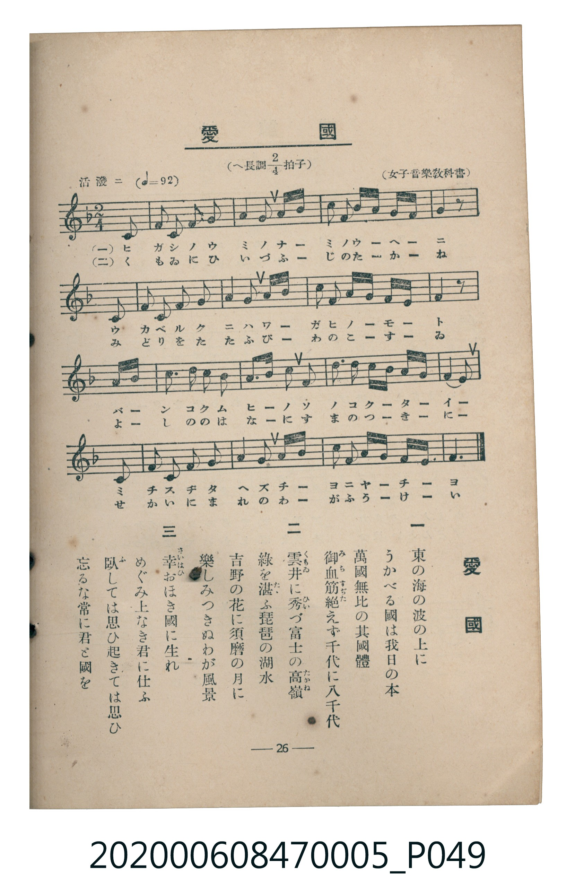

# 愛國

<audio controls src="aikoku.mp3"></audio>

- 臺灣教育會公認《新定兒童唱歌》尋常科第五學年用（2020.006.0847.0005）

- note

原書資訊與歌詞全文（對應 P049.jpg，書頁 p. 26，第三學期第 1 首）：
調性與拍號：へ長調四分之二拍子（F 大調 2/4 拍），活潑ニ（♩= 92），（女子音樂教科書）

## 歌詞

```text
一　東の海の波の上に
うかべる國は我日の本
萬國無比の其國體
御血筋（みちすぢ）絶（た）えず千代に八千代

二　雲井（くもゐ）に秀（ひい）づ富士の高嶺（たかね）
綠を湛（たゝ）ふ琵琶の湖水
吉野の花に須磨の月に
樂しみつきぬわが風景

三　幸（さいはひ）おほき國に生れ
めぐみ上なき君に仕ふ
臥（ふ）しては思ひ起きては思ひ
忘るな常に君と國を
```

## 原書掃描頁



## 調性分析

```text
================================================================================
📊 TMD Song Profile: [ 愛國 ]
================================================================================
⏱  Duration:       0:22 (22.2s), 17 measures total
🎼 Key & Tempo:    首調基準 F, != 92.0 BPM, <2/4>
   - 分析範圍：      由實際發聲的音符與和弦推測調性；播放脈絡另行呈現
🎤 人聲音域:    C4 (MIDI 60) – F5 (MIDI 77) [跨度: 17 個半音 / 1.4 個八度, 難度: challenging]
   - 最低音:  C4 in [Aikoku #1 @ m.1, 0:00]
   - 最高音: F5 in [Aikoku #1 @ m.15, 0:18]
   - 適合: soprano, mezzo-soprano, contralto, tenor, baritone, bass
🏛  結構:      Aikoku (22.2s)
⚡ 編曲密度:        Peak 1 軌道同時演奏
🗝  調性診斷：       F 大調（純淨自然大調，未偵測到可信轉調）
   - 風格氣質:    純淨自然大調（陽光明朗、易唱易記，無明顯調外色彩）
   - 轉調歷程:    全曲維持單一推測調性（未偵測到可信轉調）
   - 核心骨幹音:  F, G, A, C, A#
   - 調性數值:    F 大調 [相關度: 0.90, 穩定度: High, 自然音純度: 100.0%]
   - 候選調性 (K-S): F 大調 (0.90), C 大調 (0.64), D 小調 (0.60)
   - 五度圈歷程:   -1
   - 各段落調性細節:
     • [Aikoku #1]: F 大調 (r: 0.90, 自然音純度: 100.0%)

  [ 五度圈游移軌跡 ]
               C  
        [F ]*          G  
      Bb               D  
      Eb               A  
         Ab           E  
            Db       B  
               F# 
     (* = active key center)

  [ 十二半音累積音高分佈 ]
     C  : ████████████████          15.6%
     C# :                            0.0%
     D  : ███████                    7.4%
     D# :                            0.0%
     E  : ████                       4.1%
     F  : ████████████████████████  23.8%
     F# :                            0.0%
     G  : ███████████████████       18.9%
     G# :                            0.0%
     A  : ██████████████████        18.0%
     A# : ████████████              12.3%
     B  :                            0.0%
--------------------------------------------------------------------------------
Assignment 軌道音域：
  - Piano         : C4 – F5 (17 個半音 / 1.4 個八度, 69 個音符)
================================================================================
```

## ABC

```abc
X:1
T:愛國
C:TMD (Chen, Chih-Han / aguai)
M:2/4
L:1/16
Q:1/4=92
K:F

V:V1 name="Piano" snm="Pia"

[V:V1]
z4 z2 c2 | f3 f g2 a2 | b2 d2 c2 a f | g3 a g f g a |
f4 z2 c2 | f3 g a2 c2 | d2 b2 g2 e f | g3 a g e d e |
c4 z4 | b3 b a2 c a | g3 a b2 g2 | a3 a g a b g |
f3 e d2 c2 | f3 g a2 b2 | c2 f2 d2 c b | a3 b c f g e |
f6 z2 |
```

- [主旋律 TMD 檔案](aikoku.tmd)
- [鋼琴伴奏 TMD 檔案](aikoku_piano.tmd)
