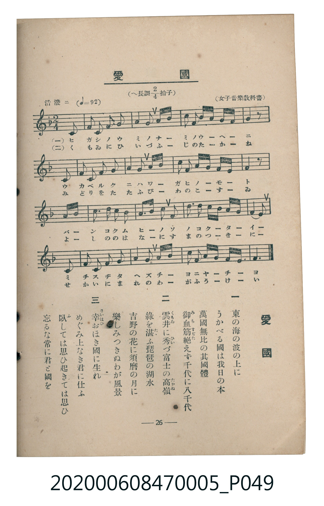

# 愛國

> Re:Shōka 使用 AI 協助辨識與重建樂譜，可能會有錯誤。歡迎[回報](https://github.com/TMDLang/reshoka/issues)。

- **鋼琴伴奏版**：<br><audio controls src="aikoku.mp3"></audio>
- **NEUTRINO 歌聲合成版**：<br><audio controls src="aikoku_neutrino.mp3"></audio>

- 臺灣教育會公認《新定兒童唱歌》尋常科第五學年用（2020.006.0847.0005）

## 說明

原書資訊與歌詞全文（對應 P049.jpg，書頁 p. 26，第三學期第 1 首）：
調性與拍號：へ長調四分之二拍子（F 大調 2/4 拍），活潑ニ（♩= 92），（女子音樂教科書）


## 歌詞

```text
一　東の海の波の上に
うかべる國は我日の本
萬國無比の其國體
御血筋（みちすぢ）絶（た）えず千代に八千代

二　雲井（くもゐ）に秀（ひい）づ富士の高嶺（たかね）
綠を湛（たゝ）ふ琵琶の湖水
吉野の花に須磨の月に
樂しみつきぬわが風景

三　幸（さいはひ）おほき國に生れ
めぐみ上なき君に仕ふ
臥（ふ）しては思ひ起きては思ひ
忘るな常に君と國を
```

## ABC

<div class="abc-score" data-abc-src="aikoku.abc" aria-label="五線譜載入中"></div>

[下載 ABC 原始檔](aikoku.abc)

## TMD 檔案連結

- [主旋律 TMD 檔案](aikoku.tmd) [[在 TMD Studio 編輯](https://tmdlang.github.io/Tmd-TS/#tmd=s7IKdvYPcrWy4qpTUCpJTLdSSM7PyUlNLsnMz7MqzsjMK0nNjM_KTMmPL87Iz05Ugisry88pzU21Si9KTEmNN403MjAyiDcwMIs3sDAxBzIMTBFKi_NLi5JTrYqTM_Lzc-JLUitKkvLzsxHyBUX5Zal5iXlANQVFIBtTwIoQClLLMlNSQdKpKZkl-UWZiTlI7kgtKga7FWxJfElRYl5xclFmAcgDCFUlGalAx2bmFqSi6gYalp6ZZ1WSmAn0HsiL5YnxuYmZeTmJeSnIqkoy8oE-LciotMrILAY5ITkxJz47MQ8pQKAOKEhMT7UKMDCxVOLS0lJ41jL76ZxuBS0tLkVbBUsjLntbBTcuGyN9EzuQvhftu543Ln42deaLpk3P5jQ_bV3zYlXv44auZ9M2PF0362nrpOerlz6dsvHZ2p7HDd1PN3Q_3bHj-fKJz9esebJrytO1O57u3PJ8yor3ezpAga8HDHw9UOADGQam7_d0KnFx6Wsp2FILcCkoKDztm_9s9o4Xm9tfrOh60dEOdNeLlfOetq54Nq0d6IqnG3qftXcqgPyul1WQ_n5PD1DxywWNCgV6CkZmQC7I4Ts6gQ5_Nmc-kK1gqPBy2TSgS9_vmQUy_cWq_c8aloPM7e59MXM-UPRx446XU7cDxZ_Onv20o-3Jzu4nu3qAsk_XTgDa56bwdMlyoKQCMDgVgKJgk3qebdn9bO_Ex83dQBWPZq4EhTpEAuTCpZuBWl_O3_xsRRMw1IFhCXQhUJYLZP2THQ2PGxqezd34uHHds63bQeTmRUDyyY6ux42rQSoeN7Y9bux-3LjzcVM3MFYfN65_1jHx2fSlIKVz1oC9MGENUOJ5y8Jn66cARZ-2bgNyX66eAg68fQtfLGx4vhbksMeN-x83LnzcOPNx4yKg_c-3bgMLAv3c-bgRyJj1tLf5ye7FQHuftq6GsCFu3AVMCQ0vZ296smsqWEf_46amx03A0ADqW_18eQNYcNPjxhawyNKn63ueLl4NdMnL1TOebtsFsQTsh7UgbwNNfL5tweOmSc92zobKNc0F69z6fAIQbQP5bOe0Zxu2gD0wofNlex9Q6EUXMIxWv1zQ8XzxCrDfgTrBAQQM1seN08GeW_K4sfdx45rHTf2PG3teLlrxbOZ6aCh3An3wdCcw2IG6pgJdCgxGoJPBtgIDejdQHzhsVz-fAnRNDzjcmxofN04AGguOilUgFRNmA1U82Q3UvxUc7u1LweZtBRsDdMEyUOQ0zAUa_AIUlUCnIETAftk_AxiJQMOAWQoUyiDzVoDsbZoEkqY8u0CBgpY-F5djZnZ-dqlVQGZiXr5Dja5hTTXIDgUbQzMtOzALWz5VeLpnI9DtwOwAzjYNLxb2KGjA8pYmFvVAm6BmoYLHzZMUFGqAgbgGzGvaDhTpAzGWgYWb54OUgASau0DEHrgoRBykDiT6uHkGmAZJdiOZDjIGanWNgoGCLhiCaNN4IFEDzOQgAUMFIyBpDBYxAZJmIAVgEUOgCEgOxDYCqzOG60I2CGyDj2GNAogHgiAa5DeQkSDPgcRgvgOxlkFkgD4BqQOLAX0I0QsTh8hA1II8CJHpRrYBYg7EdiM02xv7obY3QW2fABRbDZbZBJFpbAHzloLJrQjbG0F2gcTWATHYhY0gW0Eya1Fs2I-w3Rjd9qlIdoD466H2AjMSVGY3mNcLdyvMdpAbQWKrQWUamLUP6pMeFL83gm3HnUbBVVEPOGmaKDzd0P98fYMOvALAn0gfN62GJLGZQAxkPm5aD0l5wMT1uLkfRAAFYOkRmniB0Q2OMHB6XARPjx2oKR6eHCGpCJSiIKmtBpzuQOkPlOLM49ESH1DALB5E1kDSHCwBgkMNnv5ADoekHIjLQeG0HhJ64JQDcjyIBIlBwxuWOqHOB7EWQXV0IIU3kj3AlPa4cSVEV1MXEIPSOSSlgGQgKQaUnh43bkayBxLHkFQ1GcyaCZWZgN0eYJoCFq1QXfvhqWEH1J5VYB4k_YBIWPoBpUpY-lkCZsFSLyyNI-zBn3p2dJKXeponQBIEKCFsBqWezeBoAAXpAkRSASYecNkGCoG9iBINohasuQnoaUgqaloCMxFMAQtAeDoCpRhQuoGkI1D5BEs0sLRUA5aDJCOQqBE89UESFUYpBvIAJIRA7gfFMrIHYKkFVkJB4nAvnA_3AtD5EDlQLMAgpGxDSklNsFQGrBvh6WMdOL4gqRQS05AYhcQjKN1AygWI6iXQFIAoPWAmItkFTk2QFACyCVjpglmgcqkLuZwEllKQMgphJkglQi1IJawMRdgFCiVwiYs_TQEbi2SmqUZw1DftBDKbQIz9kBJpBoi9C5QogArgNeQKSDrpBmJg4IATYiO8RAJLEiiRQGkHWNIAScM4IAGpEk3gSckEyANVh-DyCFYfgiCoSEJOSKBCGhQ0EGeDWNBEAa7QQC4HJQmIKoj4CmgygbgdJouQQWRh5OJoHVLEgmyAZH2QDKSAABVysCIIIg6pTEBJAlawTITKQKosDHvACQia9JqAroMWQDB71oJ5kAoWZCfMHlhxtAKIwYUvLBmDi01Ue2q5uHTtFCBNMgUgS5kLAA)]
- [鋼琴伴奏 TMD 檔案](aikoku_piano.tmd) [[在 TMD Studio 編輯](https://tmdlang.github.io/Tmd-TS/#tmd=s7IKdvYPcrWy4qpTUCpJTLdSyC8qychPL0osyKi0ysgsLskvykxOzInPTsxLVIIrKs4vLUpOjS9ITE-1CjAwsVTi0tJSeNYy--mc7vd7Ol5273k-YcuTPVueLu1_3tnxfk-ngpYWl6KtgqURl72tghuXjZG-iR3IsBftu543Ln42deaLpk3P5jQ_bV3zYlXv44auZ9M2PF0362nrpOerlz6dsvHZ2p7HDd1PN3Q_3bHj-fKJz9esebJrytO1O57u3PJ8ygqgjUYGRgZ6BgZmegYWJuZAhoEp0FIlLi7HzOz87FKrgMzEvPwgD4caXcOaai4FILAxNNOyA7P0tRRs0YHC0z0bX2zd_qKjHWTVjoYXC3sUNED-1MsqSNfEol5LH2xWjYKBgi4YgmjTeCBRo2AIFjBUMAKSxmAREyBpBlIAFjEEioDkQGwjsDpjuC5kg8A2-BjWKIB4IAiiHzdPAhv5uGkNWOxx03agWB-YtQwi0zwfrA4s1twF1QsTh8hA1D5ungGV6Ua2AWIOxHYjNNsb-6G2N0HMamwB4tVg1iaIDFAExJsFJrcibG8E2QUSWwfEYBc2gmwFyaxFsWE_wnZjdNunItkB4q-H2vu4EeRPkMxuMK8X7laY7SA3gsRWA3EbmLUP6pMeFL83gm3HnVDASbEHnD5MFJ5u6H--vkFHgaiUAolgUGRDEkINOEmAkgYoMZjHo6ULoIBZPIisgSQHWNoAewieNB43QT3WPBOIwRHRtB7iMXCkPm4GBcLjZpAYNChgCQeYkGCJZBFURwdSUCDZA0wEjxtXQnQ1dQExKAlCIhEkA4lMUFQ_btyMZA8k-CERPhnMmgnVAYk-DHuA0f24cQJU1354RO2A6loF5kGiFkTCohaUYGBRuwTMgiUsWPJD2IM_Ynd0khOxoCgERSQkYkF5GRaLsMitActB4hUkagRPDpBYxsjxj5shwQCKHFCQPm7aDI5YkMwCqDgoEmD5HBTce-F8mOrHTeC8BKRBwQKDkHIAKWqbYNH-uHE6PMLWgQMQkmwgQQ8JYkjAgiISkocgqpdAowSR02AmItkFjl5IlIBsetwILoPAebgLpUzZBM3PCDNBKhFqQSph5Q3CLlAogUsn_JH8dPZsSnMvKFqBuRJIGsYBCUjJbgKPZRMgD1Sqg_MurFgHQVD2RY5jUFkDcvVOIAYlcnh8gcvlx027wLEFUQURXwGNwW4gBid1sCxCBpHckbPuOqQwB9kAySYgGUhmAhUIsOwKEYeUiaDYgmXCiVAZWNZFswcct9BU0QR0HTSzwuxZC-ZB6gmQnTB7YFl3BRCDCypYCgMXMaj21KLW7j4otbsFonJ_tmX3s70TX_R1vWzvfbKzG1haP-vufbp2wtPty551dkMaKZj1NzCm4hWiDWOBORFIm8bHgjI2kGUSC5MAlcNQKSQ1UEkgZQANC2QxiD6oOUi6jIAso1gYhWYywiASHIBdBLeboAyoDXiMgfoMGPq6dgqQCIj2AYoj8YBeQOIZg3nKXAA)]

## 分析

```text
================================================================================
📊 TMD Song Profile: [ 愛國 ]
================================================================================
⏱  Duration:       0:20 (20.9s), 16 measures total
🎼 Key & Tempo:    首調基準 F, != 92.0 BPM, <2/4>
   - 分析範圍：      由實際發聲的音符與和弦推測調性；播放脈絡另行呈現
🎤 人聲音域:    C4 (MIDI 60) – F5 (MIDI 77) [跨度: 17 個半音 / 1.4 個八度, 難度: challenging]
   - 最低音:  C4 in [Aikoku #1 @ m.1, 0:00]
   - 最高音: F5 in [Aikoku #1 @ m.15, 0:18]
   - 適合: soprano, mezzo-soprano, contralto, tenor, baritone, bass
🏛  結構:      Aikoku (20.9s)
⚡ 編曲密度:        Peak 1 軌道同時演奏
🗝  調性診斷：       F 大調（純淨自然大調，未偵測到可信轉調）
   - 風格氣質:    純淨自然大調（陽光明朗、易唱易記，無明顯調外色彩）
   - 轉調歷程:    全曲維持單一推測調性（未偵測到可信轉調）
   - 核心骨幹音:  F, G, A, C, A#
   - 調性數值:    F 大調 [相關度: 0.90, 穩定度: High, 自然音純度: 100.0%]
   - 候選調性 (K-S): F 大調 (0.90), C 大調 (0.64), D 小調 (0.60)
   - 五度圈歷程:   -1
   - 各段落調性細節:
     • [Aikoku #1]: F 大調 (r: 0.86, 自然音純度: 100.0%)

  [ 五度圈游移軌跡 ]
               C  
        [F ]*          G  
      Bb               D  
      Eb               A  
         Ab           E  
            Db       B  
               F# 
     (* = active key center)

  [ 十二半音累積音高分佈 ]
     C  : ████████████████          15.6%
     C# :                            0.0%
     D  : ███████                    7.4%
     D# :                            0.0%
     E  : ████                       4.1%
     F  : ████████████████████████  23.8%
     F# :                            0.0%
     G  : ███████████████████       18.9%
     G# :                            0.0%
     A  : ██████████████████        18.0%
     A# : ████████████              12.3%
     B  :                            0.0%
--------------------------------------------------------------------------------
Assignment 軌道音域：
  - Piano         : C4 – F5 (17 個半音 / 1.4 個八度, 69 個音符)
================================================================================
```


## 原書掃描頁




