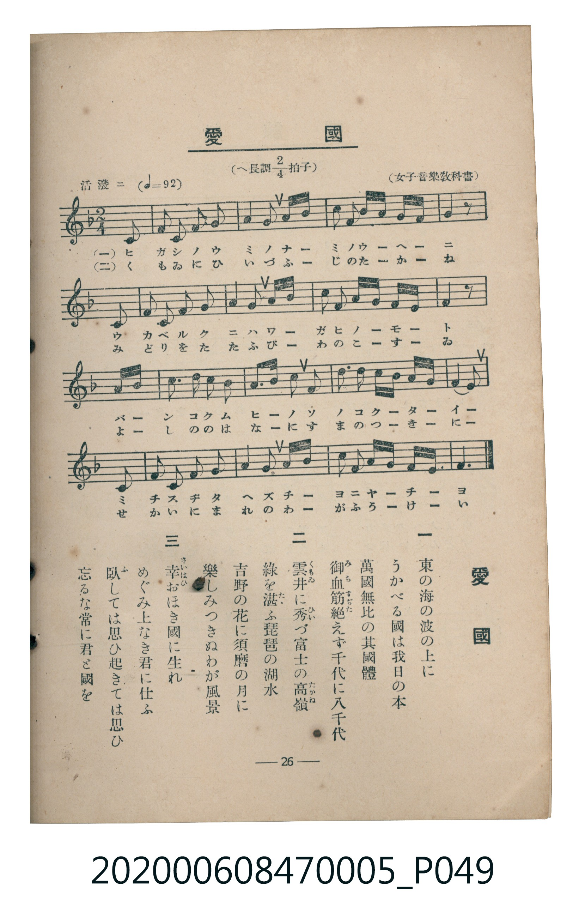

# 愛國

> Re:Shōka 使用 AI 協助辨識與重建樂譜，可能會有錯誤。歡迎回報。

- **NEUTRINO 歌聲合成版**：<br><audio controls src="aikoku_neutrino.mp3"></audio>
- **鋼琴伴奏版**：<br><audio controls src="aikoku.mp3"></audio>


- 臺灣教育會公認《新定兒童唱歌》尋常科第五學年用（2020.006.0847.0005）

## 說明

原書資訊與歌詞全文（對應 P049.jpg，書頁 p. 26，第三學期第 1 首）：
調性與拍號：へ長調四分之二拍子（F 大調 2/4 拍），活潑ニ（♩= 92），（女子音樂教科書）


## 歌詞

```text
一　東の海の波の上に
うかべる國は我日の本
萬國無比の其國體
御血筋（みちすぢ）絶（た）えず千代に八千代

二　雲井（くもゐ）に秀（ひい）づ富士の高嶺（たかね）
綠を湛（たゝ）ふ琵琶の湖水
吉野の花に須磨の月に
樂しみつきぬわが風景

三　幸（さいはひ）おほき國に生れ
めぐみ上なき君に仕ふ
臥（ふ）しては思ひ起きては思ひ
忘るな常に君と國を
```

## ABC

```abc
X:1
T:愛國
M:2/4
L:1/16
Q:1/4=92
K:F
V:V1 name="Piano" snm="Pia"
[V:V1]
z4 z2 C2 | F3 F G2 A2 | B2 d2 c2 A F | G3 A G F G A |
w: 1.~ヒ | ガ シ ノ ウ | ミ ノ ナ _ _ | ミ ノ ウ _ ヘ _
w: 2.~く | も ゐ に ひ | い づ ふ _ _ | じ の た _ か _
w: 3.~さ | い は ひ お | ほ き く _ _ | に に う _ ま _
F4 z2 C2 | F3 G A2 c2 | d2 B2 G2 E F | G3 A G E D E |
w: 1.~ニ ウ | カ ベ ル ク | ニ ハ ワ _ _ | ガ ヒ ノ _ モ _
w: 2.~ね み | ど り を た | た ふ び _ _ | わ の こ _ す _
w: 3.~れ め | ぐ み う へ | な き き _ _ | み に つ _ か _
C4 z4 | B3 B A2 c A | G3 A B2 G2 | A3 A G A B G |
w: 1.~ト | バ _ ン コ ク | ム ヒ _ ノ | ソ ノ コ ク タ _
w: 2.~ゐ | よ _ し の の | は な _ に | す ま の つ き _
w: 3.~ふ | ふ し て は お | も ひ お き | て は お も ひ _
F3 E D2 C2 | F3 G A2 B2 | c2 f2 d2 c B | A3 B c F G E |
w: 1.~イ _ _ ミ | チ ス ヂ タ | ヘ ズ チ _ _ | ヨ ニ ヤ _ チ _
w: 2.~に _ _ た | の し み つ | き ぬ わ _ _ | が ふ う _ け _
w: 3.~_ _ _ わ | す る な つ | ね に き _ _ | み と く _ に _
F6 z2 |
w: 1.~ヨ
w: 2.~い
w: 3.~を
```

## TMD 檔案連結

- [主旋律 TMD 檔案](aikoku.tmd) [[在 TMD Studio 編輯](https://tmdlang.github.io/Tmd-TS/#tmd=s7IKdvYPcrWy4qpTUCpJTLdSSM7PyUlNLsnMz7MqzsjMK0nNjM_KTMmPL87Iz05Ugisry88pzU21Si9KTEmNN403MjAyiDcwMIs3sDAxBzIMTBFKi_NLi5JTrYqTM_Lzc-JLUitKkvLzsxHyBUX5Zal5iXlANQVFIBtTwIoQClLLMlNSQdKpKZkl-UWZiTlI7kgtKga7FWxJfElRYl5xclFmAcgDCFUlGalAx2bmFqSi6gYalp6ZZ1WSmAn0HsiL5YnxuYmZeTmJeSlKXFpaCs9aZj-d062gpcWlaKtgacRlb6vgxmVjpG9iBzLjRfuu542Ln02d-aJp07M5zU9b17xY1fu4oevZtA1P18162jrp-eqlT6dsfLa253FD99MN3U937Hi-fOLzNWue7JrydO2Opzu3PJ-y4v2eDlDo6QFDTw8UekCGgen7PZ1KXFz6Wgq21AJcCgoKT_vmP5u948Xm9hcrul50tAPd9WLlvKetK55Nawe64umG3mftnQoBBiaWelkF6e_39AAVv1zQqFCgp2BkBuSCHL6jE-jwZ3PmA9kKhgovl00DuvT9nlkg01-s2v-sYTnI3O7eFzPnA0UfN-54OXU7UPzp7NlPO9qe7Ox-sqsHKPt07QSgfW4KT5csB0oqAINTASgKNqnn2Zbdz_ZOfNzcDVTxaOZKUKhDJEAuXLoZqPXl_M3PVjQBQx0YlkAXAmW5QNY_2dHwuKHh2dyNjxvXPdu6HURuXgQkn-zoety4GqTicWPb48bux407Hzd1A2P1ceP6Zx0Tn01fClI6Zw3YCxPWACWetyx8tn4KUPRp6zYg9-XqKeDA27fwxcKG52tBDnvcuP9x48LHjTMfNy4C2v986zawINDPnY8bgYxZT3ubn-xeDLT3aetqCBvixl3AlNDwcvamJ7umgnX0P25qetwEDA2gvtXPlzeABTc9bmwBiyx9ur7n6eLVQJe8XD3j6bZdEEvAflgL8jbQxOfbFjxumvRs52yoXNNcsM6tzycA0TaQz3ZOe7ZhC9gDEzpftvcBhV50AcNo9csFHc8XrwD7HagTHEDAYH3cOB3suSWPG3sfN6553NT_uLHn5aIVz2auh4ZyJ9AHT3cCgx2oayrQpcBgBDoZbCswoHcD9YHDdvXzKUDX9IDDvanxceMEoLHgqFgFUjFhNlDFk91A_VvB4d6-FGzeVrAxQBcsA0VOw1ygwS9AUQl0CkIE7Jf9M4CRCDQMmKVAoQwybwXI3qZJIGnKswsUKGjpc3E5ZmbnZ5daBWQm5uU71BjUVIOsULAxNNOyA7OwZVOFp3s2Ap0OzA3gXNPwYmGPggYsa2liUQ-0CGoWKnjcPElBoQYYhmvAvKbtQJE-EGMZWLh5PkgJSKC5C0TsgYtCxEHqQKKPm2eAaZBkN5LpIGOgVtcoGCjogiGINo0HEjXAPA4SMFQwApLGYBETIGkGUgAWMQSKgORAbCOwOmO4LmSDwDb4GNYogHggCKJBfgMZCfIcSAzmOxBrGUQG6BOQOrAY0IcQvTBxiAxELciDEJluZBsg5kBsN0KzvbEfansT1PYJQLHVYJlNEJnGFjBvKZjcirC9EWQXSGwdEINd2AiyFSSzFsWG_QjbjdFtn4pkB4i_HmovMB9BZXaDeb1wt8JsB7kRJLYaVKSBWfugPulB8Xsj2HbcaRRcE_WAk6aJwtMN_c_XN-jAy3_8ifRx02pIEpsJxEDm46b1kJQHTFyPm_tBBFAAlh6hiRcY3eAIA6fHRfD02IGa4uHJEZKKQCkKktpqwOkOlP5AKc48Hi3xAQXM4kFkDSTNwRIgONTg6Q_kcEjKgbgcFE7rIaEHTjkgx4NIkBg0vGGpE-p8EGsRVEcHUngj2QNMaY8bV0J0NXUBMSidQ1IKSAaSYkDp6XHjZiR7IHEMSVWTwayZUJkJ2O0BpilgyQrVtR-eGnZA7VkF5kHSD4iEpR9QqoSlnyVgFiz1wtI4wh78qWdHJ3mpp3kCJEGAEsJmUOrZDI4GUJAuQCQVYOIBl22gENiLKNEgasGam4CehqSipiUwE8EUsACEpyNQigGlG0g6ApVPsEQDS0s1YDlIMgKJGsFTHyRRYZRiIA9AQgjkflAsI3sAllpgJRQkDvfC-XAvAJ0PkQPFAgxCyjaklNQES2XAqhGePtaB4wuSSiExDYlRSDyC0g2kXICoXgJNAYjSA2Yikl3g1ARJASCbgHUumAUql7qQy0lgKQUpoxBmglQi1IJUwspQhF2gUAKXuPjTFLCtSGaaagRHfdNOILMJxNgPKZFmgNi7QIkCqABeQ66ApJNuIAYGDjghNsJLJLAkgRIJlHaAJQ2QNIwDEpAq0QSelEyAPFB1CC6PYPUhCIKKJOSEBCqkQUEDcTaIBU0U4AoN5HJQkoCogoivgCYTiNthsggZRBZGLo7WIUUsyAZI1gfJQAoIUCEHK4Ig4pDKBJQkYAXLRKgMpMrCsAecgKBJrwnoOmgBBLNnLZgHqWBBdsLsgRVHK4AYXPjCkjG42ES1p5aLS9dOAdIiUwCylLkA)]
- [鋼琴伴奏 TMD 檔案](aikoku_piano.tmd) [[在 TMD Studio 編輯](https://tmdlang.github.io/Tmd-TS/#tmd=s7IKdvYPcrWy4tLSUnjWMvvpnO73ezpedu95PmHLkz1bni7tf97Z8X5Pp4KWFpeirYKlEZe9rYIbl42RvokdV52C0ov2Xc8bFz-bOvNF06Znc5qftq55sar3cUPXs2kbnq6b9bR10vPVS59O2fhsbc_jhu6nG7qf7tjxfPnE52vWPNk15enaHU93bnk-ZQXQRiMDIwM9AwMzPQMLE3Mgw8AUaKkSF5djZnZ-dqlVQGZiXn6Qh0ONQU01lwIQ2BiaadmBWfpaCrboQOHpno0vtm5_0dEOsmlHw4uFPQoaAQYmlnpZBemaWNRr6YPNqlEwUNAFQxBtGg8kahQMwQKGCkZA0hgsYgIkzUAKwCKGQBGQHIhtBFZnDNeFbBDYBh_DGgUQDwRB9OPmSWAjHzetAYs9btoOFOsDs5ZBZJrng9WBxZq7oHph4hAZiNrHzTOgMt3INkDMgdhuhGZ7Yz_U9iao7ROAYqvBMpsgMo0tYN5SMLkVYXsjyC6Q2DogBruwEWQrSGYtig37EbYbo9s-FckOEH891N7HjSB_gmR2g3m9cLfCbAe5ESS2GojbwKx9UJ_0oPi9EWw77oQCTok94PRhovB0Q__z9Q06CkSlFEgEgyIbkhBqwEkClDRAicE8Hi1dAAXM4kFkDSQ5wNIG2EPwpPG4Ceqx5plADI6IpvUQj4Ej9XEzKBAeN4PEoEEBSzjAhARLJIugOjqQggLJHmAieNy4EqKrqQuIQUkQEokgGUhkgqL6ceNmJHsgwQ-J8Mlg1kyozATs9gCj-3EjRA6UDGARtQNqzyowDxK1IBIWtaAEA4vaJWAWLGHBkh_CHvwRu6OTnIgFRSEoIiERC8rLsFiERW4NWA4SryBRI3hygMQyRo5_3AwLosfNoCB93LQZHLEgmQVQcVAkwPI5KFD3wvkw1Y-bwHkJSIOCBQYh5QBS1DbBov1x43R4hK0DByAk2UCCHhLEkIAFRSQkD0FUL4FGCSKnwUxEsgscvZAoAdn0uBFcBoHzcBdymQLM0ZD8jDATpBKhFqQSVt4g7AKFErh0wh_JT2fPpjT3gqIVmCuBpGEckICU7CbwWDYB8kClOjjvwop1EARlX-Q4BpU1IFfvBLJBfofHF7hcfty0CxxbEFUQ8RXQGOwGYnBSB8siZBDJHTnrrkMKc5ANkGwCkoFkJlCBAMuuEHFImQiKLVgmnAiVgZS8GPaA4xaaKpqAroNmVpg9a8E8SD0BshNmDyzrrgBicEEFS2HgIgbVnlrUyt0HuXK3QNTtz7bsfrZ34ou-rpftvU92dgML62fdvU_XTni6fdmzzm5IEwWz-gZGVLxCtGEsMCMCadP4WFC-BrJMYmESoGIYKoWkBioJpAygQYEsBtEHNQdJlxGQZRQLo9BMRhhEggOwi-B2E5QBtQGPMVCfAQNf104BEv7RPkBxJB7QC0g8YzBPmQsA)]

## 分析

```text
================================================================================
📊 TMD Song Profile: [ 愛國 ]
================================================================================
⏱  Duration:       0:22 (22.2s), 17 measures total
🎼 Key & Tempo:    首調基準 F, != 92.0 BPM, <2/4>
   - 分析範圍：      由實際發聲的音符與和弦推測調性；播放脈絡另行呈現
🎤 人聲音域:    C4 (MIDI 60) – F5 (MIDI 77) [跨度: 17 個半音 / 1.4 個八度, 難度: challenging]
   - 最低音:  C4 in [Aikoku #1 @ m.1, 0:00]
   - 最高音: F5 in [Aikoku #1 @ m.15, 0:18]
   - 適合: soprano, mezzo-soprano, contralto, tenor, baritone, bass
🏛  結構:      Aikoku (22.2s)
⚡ 編曲密度:        Peak 1 軌道同時演奏
🗝  調性診斷：       F 大調（純淨自然大調，未偵測到可信轉調）
   - 風格氣質:    純淨自然大調（陽光明朗、易唱易記，無明顯調外色彩）
   - 轉調歷程:    全曲維持單一推測調性（未偵測到可信轉調）
   - 核心骨幹音:  F, G, A, C, A#
   - 調性數值:    F 大調 [相關度: 0.90, 穩定度: High, 自然音純度: 100.0%]
   - 候選調性 (K-S): F 大調 (0.90), C 大調 (0.64), D 小調 (0.60)
   - 五度圈歷程:   -1
   - 各段落調性細節:
     • [Aikoku #1]: F 大調 (r: 0.90, 自然音純度: 100.0%)

  [ 五度圈游移軌跡 ]
               C  
        [F ]*          G  
      Bb               D  
      Eb               A  
         Ab           E  
            Db       B  
               F# 
     (* = active key center)

  [ 十二半音累積音高分佈 ]
     C  : ████████████████          15.6%
     C# :                            0.0%
     D  : ███████                    7.4%
     D# :                            0.0%
     E  : ████                       4.1%
     F  : ████████████████████████  23.8%
     F# :                            0.0%
     G  : ███████████████████       18.9%
     G# :                            0.0%
     A  : ██████████████████        18.0%
     A# : ████████████              12.3%
     B  :                            0.0%
--------------------------------------------------------------------------------
Assignment 軌道音域：
  - Piano         : C4 – F5 (17 個半音 / 1.4 個八度, 69 個音符)
================================================================================
```


## 原書掃描頁




