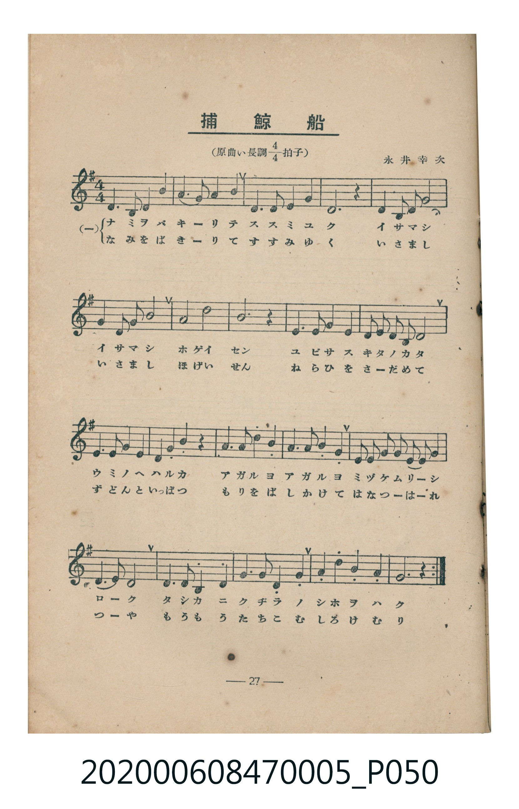
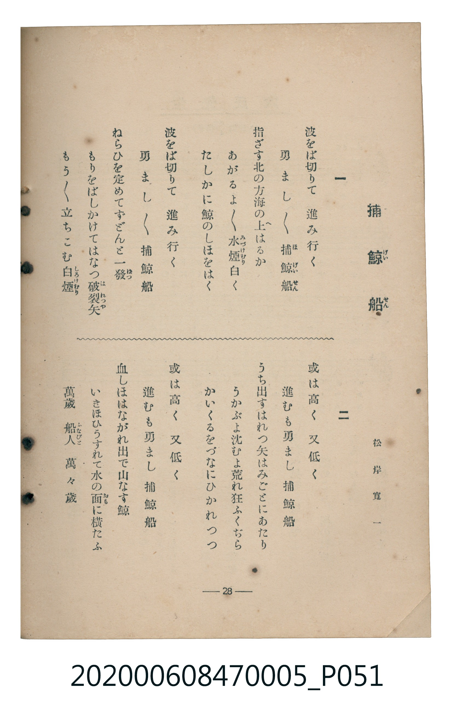

# 捕鯨船

<audio controls src="hogeisen.mp3"></audio>

- 松岸寬一 作詞
- 永井幸次 作曲
- 臺灣教育會公認《新定兒童唱歌》尋常科第五學年用（2020.006.0847.0005）

## 說明

原書資訊與歌詞全文（對應 P050.jpg – P051.jpg，書頁 pp. 27–28，第三學期第 2 首）：
調性與拍號：原曲い長調四分之四拍子（譜面移調為ト長調 G 大調 4/4 拍）
作詞：松岸寬一　作曲：永井幸次

## 歌詞

```text
一　波をば切りて　進み行く
勇まし／＼　捕鯨船（ほげいせん）
指ざす北の方海の上（へ）はるか
あがるよ／＼水煙（みづけむり）白く
たしかに鯨のしほをはく
波をば切りて　進み行く
勇まし／＼　捕鯨船
ねらひを定めてずどんと一發（ぱつ）
もりをばしかけてはなつ破裂矢（はれつや）
もう／＼立ちこむ白煙（しろけむり）

二　或は高く　又低く
進むも勇まし　捕鯨船
うち出すはれつ矢はみごとにあたり
うかぶよ沈むよ荒れ狂ふくぢら
かいくるをづなにひかれつつ
或は高く　又低く
進むも勇まし　捕鯨船
血しほはながれ出で山なす鯨
いきほひうすれて水の面（おも）に横たふ
萬歳　船人（ふなびと）　萬々歳
```

## ABC

```abc
X:1
T:捕鯨船
M:4/4
L:1/16
Q:1/4=108
K:G
V:V1 name="Piano" snm="Pia"
[V:V1]
D6 B,2 D4 G4 | A6 B2 A4 G4 | E6 D2 E4 G4 | D12 z4 |
D6 B,2 D4 E4 | G6 E2 G4 A4 | B4 G4 d8 | A12 z4 |
D6 D2 E4 D4 | G4 G2 E2 D2 B,2 D4 | E6 E2 D4 E4 | G4 A4 G4 z4 |
G6 G2 B4 G4 | G6 G2 B4 G4 | D2 D2 E2 E2 D2 B,2 D2 E2 | G4 E4 D8 |
D6 B,2 D4 E4 | G6 A2 G4 E4 | G4 B4 A4 E4 | G12 z4 |
```

## TMD 檔案連結

- [主旋律 TMD 檔案](hogeisen.tmd) [[在 TMD Studio 編輯](https://tmdlang.github.io/Tmd-TS/#tmd=s7IKdvYPcrWy4tLSUnjWO_Xl-hUvOnYqaGlxKdoqGBpYcNnbKrhz2Zjom9hx1SkovWjf9bxx8bOpM180bXo2p_lp65oXq3ofN3Q9m7bh6bpZT1snPV-99OmUjc_W9jxu6H66ofvpjh3Pl098vmbNk11Tnq7d8XTnludTVrzf02FkYGSgZ2BgpmdgYWIOZBiYvt_TqQSy4dncfU837Xi6fs2THQ0KT_bOebFyHkR8w44nu6Y-3bnj2ZqFIPFnszcpcXHpaynYUgtwKSgoPO2b_2z2jheb21-s6HrR0Q70B9D-p60rnk1rB7r66YbeZ-2dCgEGpgZ6WQXpCo8aJoM4hiDO-z09QJ0vFzQqFBToKRiZA-WMLICCIL_v6AT6_dmc-UC2gpHCy2XTgJ59v2cWyMIXq_Y_a1gOsqq798XM-UBRsBM2PW5seTl1O1D26ezZTzvanuzsBjKAap6unQB0yIu1c17OXfR8-W6ggudNux43d0AUK7grPF2yHMQARpgCUDnQIpAtkHAEGo4cuo8bGiDhCBJHCl0usA6w_LPNix43TXrcuOFpR_vjpq7HjcuAgi8bgK7b_2Jhz-PGfpBSoBAQPe1uf9y473Hj9Pd7-t_v2QPSDEtNQAc_btz9uBFoUMvjxtmPmyZDnQXR-awHqHPa48aZT3umP25c92zazmdbtwMZT3Z0gXXuAKp-3Lj-cVP348ZuhLbHjU2PG3tAok0dEDufbdjyvHUmWM_-x41LHzdOfNzUAHQ2UP_zmXtRXPu4cT7QqUDzHjeuBjoSaBuYuxvs2_UoSqkTBshWr33cBPTQJqCpwDzzuKkRZGTjrMeNK4Eh87hxBTDon8_cA_bGxseNS1DC6nFTE8gNYPfAPDARrB_o6FVA1c8XbHmxuOn5_EVg_cBAA7pwyeOmFgxTGtsgjny-GmjEwseNk4FhBQwlWABOf9zUixyAkESxC5itG551ACNr_cvVM4B-B3m6v-PJ3j6UcACFDkhjEzxAcAVFG9Dup-27gJEPdyzQ7WDfAKNwCjA0gBEEjun5QHeg6QQ6fBsw8p9t6gDb1vGidxLQiOfdQNVbQW5rBEYcsq9BGoAJsB-cZoAhCEwhwCADGg-MS6AIOKQalyDFPNU8-mIh0HZw-oLGEzDd9oD9vfzpRmAkA0VmAvUguxXoUGAEADUAHQf060yw-5YBkzgwrQLzPjiSgAmhCZw5Vj9bATQCmKS3Itk5Yc2ztZtBjI6dT3btAmsABgtQ3WZgsIK0gdU8bmgFKgNpo7wEhQIFLX0uLo_89NTM4tQ8q4DMxLx8hxqDGoVqkC0KNhZadmAGtrJbAVxcAsOrR0HDVOHphv7n6xt04AWuJhYNQLughj1u7gKxHjfPB-JNIMYEBYUahcdNayHCe4B4FYjRBhHeCRYGUiAdQGIZRHg9SBgBQEJLICq3AhXNAzG2K8CsrVEwjVfQBULjeAjLEIhrgIU8WAxMQ0TMIMqAasAsiCBULwQaIAvBjAMrrgFnPtzhtauHvPDC5i-gd5tng9igAIQogITBbgjzcfNmuBgoxEAik8FmQEIUGt6Pm_YDJfqA9GowGxFeIJ-D_QVigMKnBhhOkAAxhYYELPywhAss_MBciGGGIBEgHxZkhEJrRyeZoQX1LSh19YEYMyCB0A9irwZ5GUjAQmsRJGTXQKWaV-ATBhvZChTfCKQXgFMpOLUC4wMebND0A_EqLF3AwxBEQ8IJEryG8DDFJgI0ARKOyAEHZBMIOWADhMx8CUoQQA8hMhcoLICJApLmwAH3uLkbKfs9bm4C4pUgBjCoQcLApAlJmJCcDQx0LHkVJZEh0gkkTWHNWdDQMULogAiBAgsUsCiqkNIjVy0Xl66dAqyQUwCylbkA)]
- [鋼琴伴奏 TMD 檔案](hogeisen_piano.tmd) [[在 TMD Studio 編輯](https://tmdlang.github.io/Tmd-TS/#tmd=s7IKdvYPcrWy4tLSUnjWO_Xl-hUvOna-39PxsnvP8wlbnuzZ8nRp__POjvd7OhW0tLgUbRUMDSy47G0V3LlsTPRN7LjqFJRetO963rj42dSZL5o2PZvT_LR1zYtVvY8bup5N2_B03aynrZOer176dMrGZ2t7Hjd0P93Q_XTHjufLJz5fs-bJrilP1-54unPL8ykrgFYaGRgZ6BkYmOkZWJiYAxkGpkBblUA2PJu77-mmHU_Xr3myo0Hhyd45L1bOg4hv2PFk19SnO3c8W7MQJP5s9iYlLi6P_PTUzOLUPKuAzMS8_CAPhxqDGoVqLgUgsLHQsgMz9LUUbNGBAshJOxpeLOxR0DBVeLqh__n6Bh2FAANTA72sgnRNLBq09MGG1SiYxivoAqFxPIRlCMQ1CkYQMTANETGDKAOqAbMgglC9EGiALAQzDqy4hgu_w3f1kONwkBPAFoAYIIfWAB0McZkp1Ekwj2BxIMwjYC7EMEOQCJAPczshZ-_oJMfZ0ICEWAULILgfQDTEnRDvGcL9hE0EaALEH8gOB7IJuPzp7NnkBjgizCDhizW6oS41QuiACIEcDvIkiiqkuOGqRc8BPig5wASRA552tz_vmf18wZZnW1c92dkN9NGz7t6nayc83b7sWWc3JO8juTxeIdowFkaBXA1kmcYjiZgAGSbYVIAYBphGoBoM1Y3HIpgxKAJgBi6joWZiMRqLcwjxUZ2L225cHsKqA-gOUIzp2inAIk0Bja3MBQA)]

## 分析

```text
================================================================================
📊 TMD Song Profile: [ 捕鯨船 ]
================================================================================
⏱  Duration:       0:44 (44.4s), 20 measures total
🎼 Key & Tempo:    首調基準 G, != 108.0 BPM, <4/4>
   - 分析範圍：      由實際發聲的音符與和弦推測調性；播放脈絡另行呈現
🎤 人聲音域:    B3 (MIDI 59) – D5 (MIDI 74) [跨度: 15 個半音 / 1.2 個八度, 難度: moderate]
   - 最低音:  B3 in [Hogeisen #1 @ m.1, 0:00]
   - 最高音: D5 in [Hogeisen #1 @ m.7, 0:14]
   - 適合: soprano, mezzo-soprano, contralto, tenor, baritone, bass
🏛  結構:      Hogeisen (44.4s)
⚡ 編曲密度:        Peak 1 軌道同時演奏
🗝  調性診斷：       G 大調（純淨自然大調，未偵測到可信轉調）
   - 風格氣質:    純淨自然大調（陽光明朗、易唱易記，無明顯調外色彩）
   - 轉調歷程:    全曲維持單一推測調性（未偵測到可信轉調）
   - 核心骨幹音:  G, D, E, A, B
   - 調性數值:    G 大調 [相關度: 0.87, 穩定度: High, 自然音純度: 100.0%]
   - 候選調性 (K-S): G 大調 (0.87), D 大調 (0.73), E 小調 (0.61)
   - 五度圈歷程:   +1
   - 各段落調性細節:
     • [Hogeisen #1]: G 大調 (r: 0.87, 自然音純度: 100.0%)

  [ 五度圈游移軌跡 ]
               C  
         F           [G ]*
      Bb               D  
      Eb               A  
         Ab           E  
            Db       B  
               F# 
     (* = active key center)

  [ 十二半音累積音高分佈 ]
     C  :                            0.0%
     C# :                            0.0%
     D  : ███████████████████████   29.6%
     D# :                            0.0%
     E  : ██████████████            18.4%
     F  :                            0.0%
     F# :                            0.0%
     G  : ████████████████████████  30.9%
     G# :                            0.0%
     A  : █████████                 11.8%
     A# :                            0.0%
     B  : ███████                    9.2%
--------------------------------------------------------------------------------
Assignment 軌道音域：
  - Piano         : B3 – D5 (15 個半音 / 1.2 個八度, 74 個音符)
================================================================================
```


## 原書掃描頁






