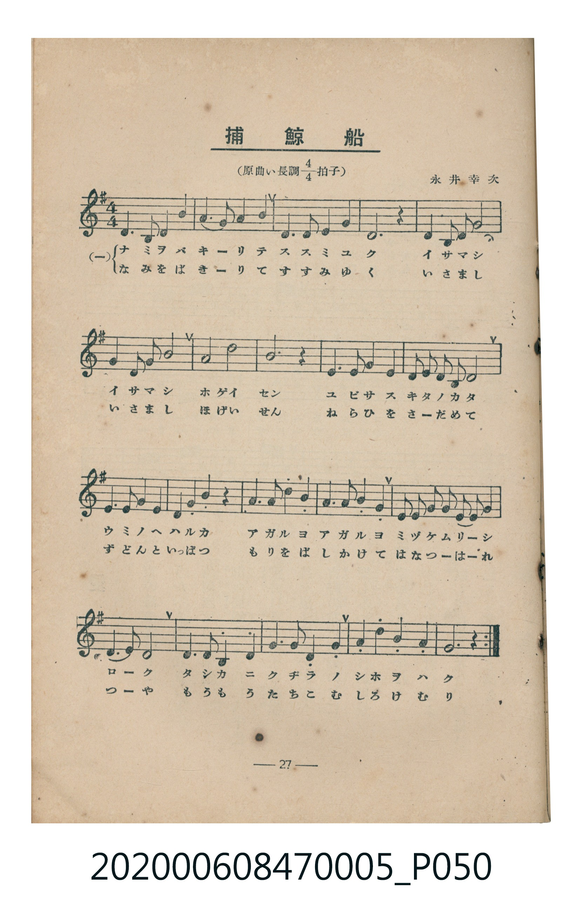
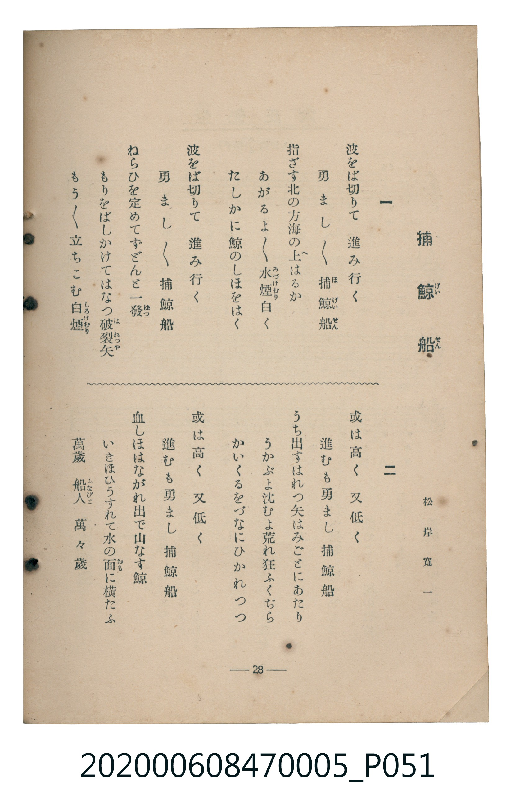

# 捕鯨船

> Re:Shōka 使用 AI 協助辨識與重建樂譜，可能會有錯誤。歡迎回報。

- **NEUTRINO 歌聲合成版**：<br><audio controls src="hogeisen_neutrino.mp3"></audio>
- **鋼琴伴奏版**：<br><audio controls src="hogeisen.mp3"></audio>


- 松岸寬一 作詞
- 永井幸次 作曲
- 臺灣教育會公認《新定兒童唱歌》尋常科第五學年用（2020.006.0847.0005）

## 說明

原書資訊與歌詞全文（對應 P050.jpg – P051.jpg，書頁 pp. 27–28，第三學期第 2 首）：
調性與拍號：原曲い長調四分之四拍子（譜面移調為ト長調 G 大調 4/4 拍）
作詞：松岸寬一　作曲：永井幸次


## 歌詞

```text
一　波をば切りて　進み行く
勇まし／＼　捕鯨船（ほげいせん）
指ざす北の方海の上（へ）はるか
あがるよ／＼水煙（みづけむり）白く
たしかに鯨のしほをはく
波をば切りて　進み行く
勇まし／＼　捕鯨船
ねらひを定めてずどんと一發（ぱつ）
もりをばしかけてはなつ破裂矢（はれつや）
もう／＼立ちこむ白煙（しろけむり）

二　或は高く　又低く
進むも勇まし　捕鯨船
うち出すはれつ矢はみごとにあたり
うかぶよ沈むよ荒れ狂ふくぢら
かいくるをづなにひかれつつ
或は高く　又低く
進むも勇まし　捕鯨船
血しほはながれ出で山なす鯨
いきほひうすれて水の面（おも）に横たふ
萬歳　船人（ふなびと）　萬々歳
```

## ABC

```abc
X:1
T:捕鯨船
M:4/4
L:1/16
Q:1/4=108
K:G
V:V1 name="Piano" snm="Pia"
[V:V1]
D6 B,2 D4 G4 | A6 B2 A4 G4 | E6 D2 E4 G4 | D12 z4 |
w: 1.~ナ ミ ヲ バ | キ _ リ テ | ス ス ミ ユ | ク
w: 2.~な み を ば | き _ り て | す す み ゆ | く
D6 B,2 D4 E4 | G6 E2 G4 A4 | B4 G4 d8 | A12 z4 |
w: 1.~イ サ マ シ | イ サ マ シ | ホ ゲ イ | セ
w: 2.~い さ ま し | い さ ま し | ほ げ い | せ
D6 D2 E4 D4 | G4 G2 E2 D2 B,2 D4 | E6 E2 D4 E4 | G4 A4 G4 z4 |
w: 1.~ユ ビ サ ス | キ タ _ ノ カ タ | ウ ミ ノ ヘ | ハ ル カ
w: 2.~ね ら ひ を | さ _ _ だ め て | ず ど ん と | いっ ぱ つ
G6 G2 B4 G4 | G6 G2 B4 G4 | D2 D2 E2 E2 D2 B,2 D2 E2 | G4 E4 D8 |
w: 1.~ア ガ ル ヨ | ア ガ ル ヨ | ミ ヅ ケ ム リ _ シ _ | ロ _ ク
w: 2.~も り を ば | し か け て | は な つ _ は _ れ _ | つ _ や
D6 B,2 D4 E4 | G6 A2 G4 E4 | G4 B4 A4 E4 | G12 z4 |
w: 1.~タ シ カ ニ | ク ヂ ラ ノ | シ ホ ヲ ハ | ク
w: 2.~も う も う | た ち こ む | し ろ け む | り
```

## TMD 檔案連結

- [主旋律 TMD 檔案](hogeisen.tmd) [[在 TMD Studio 編輯](https://tmdlang.github.io/Tmd-TS/#tmd=s7IKdvYPcrWy4qpTUCpJTLdSSM7PyUlNLsnMz7MqzsjMK0nNjM_KTMmPL87Iz05Ugisry88pzU21Si9KTEmNN403MjAyiDcwMIs3sDAxBzIMTBFKi_NLi5JTrYqTM_Lzc-JLUitKkvLzsxHyBUX5Zal5iXlANQVFIBtTwIoQClLLMlNSQdKpKZkl-UWZiTlI7kgtKga7FWxJfElRYl5xclFmAcgDCFUlGalAx5bnFwGt1dJSeNY79eX6FS86dipoaXEp2ioYGlhw2dsquHPZmOib2IF0vWjf9bxx8bOpM180bXo2p_lp65oXq3ofN3Q9m7bh6bpZT1snPV-99OmUjc_W9jxu6H66ofvpjh3Pl098vmbNk11Tnq7d8XTnludTVrzf0wEKFz1guOiBwgXIMDB9v6cT7K5nc_c93bTj6fo1T3Y0KDzZO-fFynkQ8Q07nuya-nTnjmdrFoLEn83epMTFpa-lYEstwKWgoPC0b_6z2TtebG5_saLrRUc70B9A-5-2rng2rR3o6qcbep-1dyoEGJga6GUVpCs8apgM4hiCOO_39AB1vlzQqFBQoKdgZA6UM7IACoL8vqMT6Pdnc-YD2QpGCi-XTQN69v2eWSALX6za_6xhOciq7t4XM-cDRcFO2PS4seXl1O1A2aezZz_taHuysxvIAKp5unYC0CEv1s55OXfR8-W7gQqeN-163NwBUazgrvB0yXIQAxhhCkDlQItAtkDCEWg4cug-bmiAhCNIHCl0ucA6wPLPNi963DTpceOGpx3tj5u6HjcuAwq-bAC6bv-LhT2PG_vBYdbd_rhx3-PG6e_39L_fswekDZaOgE593Lj7cSPQiJbHjbMfN02GOuhZD1DPtMeNM5_2TH_cuO7ZtJ3Ptm4HMp7s6ALr2QFU97hx_eOm7seN3SANjxubHjf2gPhNHRB7nm3Y8rx1Jlj1_seNSx83Tnzc1AB0JFDn85l7oW573Dgf6DCgGY8bVwOdBLQBzN0N9tV6qCJKfQmxaO3jJqCTNwFNAuaEx02NIGMaZz1uXAn09ePGFcAAfT5zD9i5Gx83LoGGw-OmJpCNYNthDp0I1gl03CqguucLtrxY3PR8_iKwTmCAAN2z5HFTC5L-xjaIk56vBmpe-LhxMjAcgCEAC5zpj5t6kQMHEr27gBm04VkHMArWv1w9A-hHIPdpf8eTvX1Q_4L8D9LSBPc4ppfbgPY9bd8FjEa404AuBbsdGCVTgL4GBjs45uYD7YbrATpzGzAan23qANvQ8aJ3ElDz826guq0glzQCowPiO5BSYMLpB8c7MIyAsQwMFKCRwLgBioDDonEJOA4p8sqLhQ3QdAENd2BK6wH7bPnTjcDoAorMBKqGuAnoIGCAApUCHQH0zUywO5YBkyMwdQFzJTjQgVHaBE7Cq5-tAGoGJsKtYHsmrHm2djPQdqC9T3btAisFehmoYjMwsEAagFIT1jxuaAUqA2mgvFSDAgUtfS4uj_z01Mzi1DyrgMzEvHyHGoOaapAlCjYWWnZgBrbiVAFcgjUAc4KChqnC0w39z9c36MDLQE0sGoBWQQ173NwFYj1ung_Em0CMCQoKNcBUuxYivAeIV4EYbRDhnWBhIAXSASSWQYTXg4QRACS0BKJyK1DRPBBjuwLM2hoF03gFXSA0joewDIG4BljugsXANETEDKIMqAbMgghC9UKgAbIQzDiw4hqwVT6GQKcAvQiShvkRxJoA1gfyJcQckCdBZBtUfCdEFOpPkMwyqMx6JNvB9oC9ClEN8SuItR3hAiOgikaQ6UDxxv1AuUlg1gaI3sZemAuaQK4EJlOo-EyojplgXSB5qNsa-zFd0NgCVT0ViPeBWdPBLsCfZnb1kJdmsMUtKJxng9igRARRAEkHuyHMx82b4WKgVAMSmQw2A5KqoGnucRMwiJr7gPRqMBuRZkCxD45bEAOURmqAaQWSKEyhoQFLQ1jSBiwNgbkQwwxBIkA-LNkgpRhcMQr2I4gHTkVQVZA0sBsWj0B_wuMFnGpAYhCfQlIUIuWBPAiSRXgXNdXgiFUgDbINWGmDSYgqiDjIdRCXT0ZKHZBUDiyygWyIy0E6QTJTYeobFwBFG2Hpj0C62dFJZrqBxjsoH_aBGDMgyaEfxF4NinwgAUs3iyBpbA1UqnkFPmGwka1A8Y1AGugVYHYGl13AaIMnIGhpAol0WCkBT00gGpJiIAnNEJ66sIkATYCkKOQkBGQjpyFY3EN8C2LNgKYKUA4GOR8UEyASVo4sgsYTxHMgNSsIyWDxOLbyZxY0lldCUwawLoOmAGBduRgssBFMgpI0zDlNUEu7MAotUDIE8buBeCKYBSu21oMLO4g5IB5Ifw_hJAVsOpNZfYHKDGBMg0tmeNoBlhuQYgmcoh43dyPVUo-bm4B4JYgBTIMgYWDpBSm7IBUgMDViqdJQyiFEUQLJeFgrIGiyMULogAiBUhEoxaGoQiqykCouePUEr3YgvoOIQbwHSgzdUBmIKpgPIUULRAaUIKCFF7QKBCVCrBUaUrKBFXDA5iyS_dB00dgGZYNYkNgHVZUg_kIgBiezpgaoDCjFAJu5YFlwioHJgKs9VPtrubh07RRgTSEFIFuZCwA)]
- [鋼琴伴奏 TMD 檔案](hogeisen_piano.tmd) [[在 TMD Studio 編輯](https://tmdlang.github.io/Tmd-TS/#tmd=s7IKdvYPcrWy4tLSUnjWO_Xl-hUvOna-39PxsnvP8wlbnuzZ8nRp__POjvd7OhW0tLgUbRUMDSy47G0V3LlsTPRN7LjqFJRetO963rj42dSZL5o2PZvT_LR1zYtVvY8bup5N2_B03aynrZOer176dMrGZ2t7Hjd0P93Q_XTHjufLJz5fs-bJrilP1-54unPL8ykrgFYaGRgZ6BkYmOkZWJiYAxkGpkBblUA2PJu77-mmHU_Xr3myo0Hhyd45L1bOg4hv2PFk19SnO3c8W7MQJP5s9iYlLi6P_PTUzOLUPKuAzMS8_CAPhxqDmmouBSCwsdCyAzP0tRRs0YECyEU7Gl4s7FHQMFV4uqH_-foGHYUAA1MDvayCdE0sGrT0wYbVKJjGK-gCoXE8hGUIxDUKRhAxMA0RMYMoA6oBsyCCUL0QaIAsBDMOrLgGbJWPYY3C4-YusPTj5vlAvAnMmgDW97hpLdScx82rwGQbVHwnRBRIg3SBZJZBZdYj2Q62Byi2BKp6K1DdPDBrO8IFRkAVjSDTgeKN-4Fyk8CsDRC9jb0wFzSBXPm4EWpP40yojplgXSB5qNsa-zFd0NgCVT0ViPeBWdPBLsAfebt6yIk8UDSAAxnEAEVWDTDSILFjCnUWLDKxRBIsMsFciGGGIBEgHxZ_SFGHK2iBvNlgHjg6oaogkbEbFqDNmxEBBI4-kNhksFmQqEUkgcdN4CBu7gOyVkN5yNGHI3iBNMi2x42QKIWogoiDXAdx-WSkaIIkt8dNnUA2xOUgnSCZqTD1jQuAoo2whEAgAnd0khOB0GwFCXRYdoHHJoiGxBgkog3hsYtNBGgCJEaRoxDIRo5DWNiDsl8fmDUDGiugpPy4eTU4JEAkLEMtgobTGphs8wpCMmDTW4EyG4E0MAwhGRojI86ChvJKaMw8boTqb2x53LgYLLARTIKSFMw5TVBLuzByLygZgPjdQDwRzILl3_XgXA8xB8QD6e8hHKVPZ88mN08ishUkEWItFaFRaITQARECxSgo9lFUIWVfpNIUXmbCy0JQGIGyDCTAIVH5uLkbKgNR9bi5CYhXglmgRACSAUUONCNDy2VQgsBayiJFISyzP25CynCwOGpsg7JBLEhMgMpvEH8hEIOjvKkBKgOKvcdNvWBZcOzBZMBlMar9tej1pA9yPWmCqCefdrc_75n9fMGWZ1tXPdnZDYzQZ929T9dOeLp92bPObkgDASni4hWiDWNhFCjSgCzTeCQREyDDBJsKEMMA0whUg6G68VgEMwZFAMzAZTTUTCxGY3EOIT6qc3HbjctDWHUA3QGKMF07BVicRfsAZVD4RmC-MhcA)]

## 分析

```text
================================================================================
📊 TMD Song Profile: [ 捕鯨船 ]
================================================================================
⏱  Duration:       0:44 (44.4s), 20 measures total
🎼 Key & Tempo:    首調基準 G, != 108.0 BPM, <4/4>
   - 分析範圍：      由實際發聲的音符與和弦推測調性；播放脈絡另行呈現
🎤 人聲音域:    B3 (MIDI 59) – D5 (MIDI 74) [跨度: 15 個半音 / 1.2 個八度, 難度: moderate]
   - 最低音:  B3 in [Hogeisen #1 @ m.1, 0:00]
   - 最高音: D5 in [Hogeisen #1 @ m.7, 0:14]
   - 適合: soprano, mezzo-soprano, contralto, tenor, baritone, bass
🏛  結構:      Hogeisen (44.4s)
⚡ 編曲密度:        Peak 1 軌道同時演奏
🗝  調性診斷：       G 大調（純淨自然大調，未偵測到可信轉調）
   - 風格氣質:    純淨自然大調（陽光明朗、易唱易記，無明顯調外色彩）
   - 轉調歷程:    全曲維持單一推測調性（未偵測到可信轉調）
   - 核心骨幹音:  G, D, E, A, B
   - 調性數值:    G 大調 [相關度: 0.87, 穩定度: High, 自然音純度: 100.0%]
   - 候選調性 (K-S): G 大調 (0.87), D 大調 (0.73), E 小調 (0.61)
   - 五度圈歷程:   +1
   - 各段落調性細節:
     • [Hogeisen #1]: G 大調 (r: 0.87, 自然音純度: 100.0%)

  [ 五度圈游移軌跡 ]
               C  
         F           [G ]*
      Bb               D  
      Eb               A  
         Ab           E  
            Db       B  
               F# 
     (* = active key center)

  [ 十二半音累積音高分佈 ]
     C  :                            0.0%
     C# :                            0.0%
     D  : ███████████████████████   29.6%
     D# :                            0.0%
     E  : ██████████████            18.4%
     F  :                            0.0%
     F# :                            0.0%
     G  : ████████████████████████  30.9%
     G# :                            0.0%
     A  : █████████                 11.8%
     A# :                            0.0%
     B  : ███████                    9.2%
--------------------------------------------------------------------------------
Assignment 軌道音域：
  - Piano         : B3 – D5 (15 個半音 / 1.2 個八度, 74 個音符)
================================================================================
```


## 原書掃描頁






