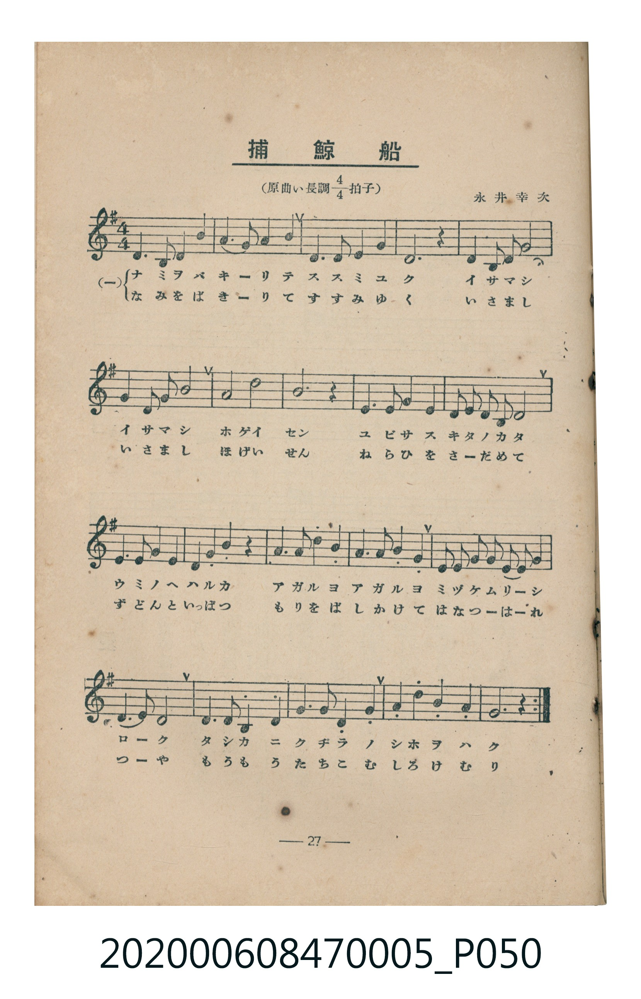
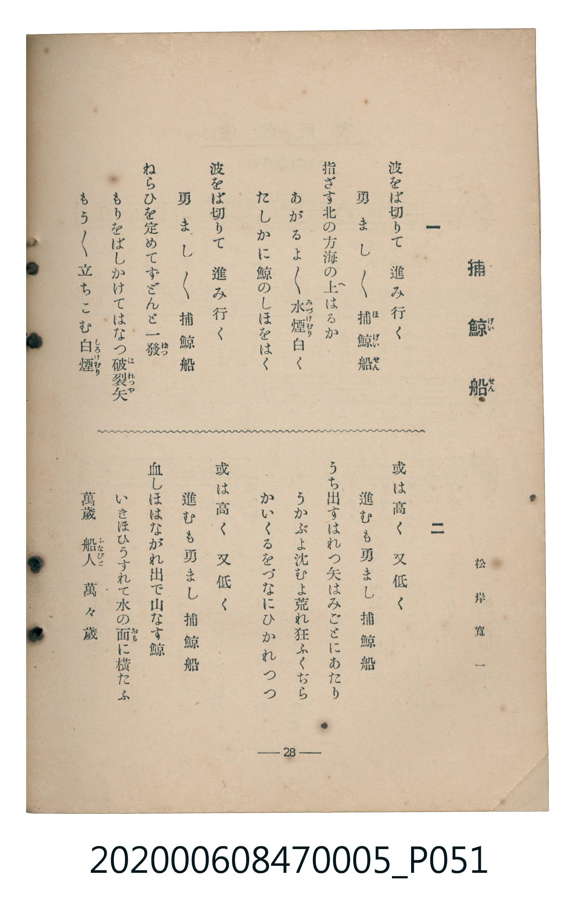

# 捕鯨船

> Re:Shōka 使用 AI 協助辨識與重建樂譜，可能會有錯誤。歡迎[回報](https://github.com/TMDLang/reshoka/issues)。

- **鋼琴伴奏版**：<br><audio controls src="hogeisen.mp3"></audio>
- **NEUTRINO 歌聲合成版**：<br><audio controls src="hogeisen_neutrino.mp3"></audio>

- 松岸寬一 作詞
- 永井幸次 作曲
- 臺灣教育會公認《新定兒童唱歌》尋常科第五學年用（2020.006.0847.0005）

## 說明

原書資訊與歌詞全文（對應 P050.jpg – P051.jpg，書頁 pp. 27–28，第三學期第 2 首）：
調性與拍號：原曲い長調四分之四拍子（譜面移調為ト長調 G 大調 4/4 拍）
作詞：松岸寬一　作曲：永井幸次


## 歌詞

```text
一　波をば切りて　進み行く
勇まし／＼　捕鯨船（ほげいせん）
指ざす北の方海の上（へ）はるか
あがるよ／＼水煙（みづけむり）白く
たしかに鯨のしほをはく
波をば切りて　進み行く
勇まし／＼　捕鯨船
ねらひを定めてずどんと一發（ぱつ）
もりをばしかけてはなつ破裂矢（はれつや）
もう／＼立ちこむ白煙（しろけむり）

二　或は高く　又低く
進むも勇まし　捕鯨船
うち出すはれつ矢はみごとにあたり
うかぶよ沈むよ荒れ狂ふくぢら
かいくるをづなにひかれつつ
或は高く　又低く
進むも勇まし　捕鯨船
血しほはながれ出で山なす鯨
いきほひうすれて水の面（おも）に横たふ
萬歳　船人（ふなびと）　萬々歳
```

## ABC

<div class="abc-score" data-abc-src="hogeisen.abc" aria-label="五線譜載入中"></div>

[下載 ABC 原始檔](hogeisen.abc)

## TMD 檔案連結

- [主旋律 TMD 檔案](hogeisen.tmd) [[在 TMD Studio 編輯](https://tmdlang.github.io/Tmd-TS/#tmd=s7IKdvYPcrWy4qpTUCpJTLdSSM7PyUlNLsnMz7MqzsjMK0nNjM_KTMmPL87Iz05Ugisry88pzU21Si9KTEmNN403MjAyiDcwMIs3sDAxBzIMTBFKi_NLi5JTrYqTM_Lzc-JLUitKkvLzsxHyBUX5Zal5iXlANQVFIBtTwIoQClLLMlNSQdKpKZkl-UWZiTlI7kgtKga7FWxJfElRYl5xclFmAcgDCFUlGalAx5bnFyFZCzQoPTPPqiQxE-g1kPfKE-NzEzPzchLzUpBVlWTkA31ZkFFplZFZDLI-OTEnPjsxDykwoJYXJKanWgUYmBroAglDJS4tLYVnvVNfrl_xomOngpYWl6KtgqGBBZe9rYI7l42JvokdyIAX7bueNy5-NnXmi6ZNz-Y0P21d82JV7-OGrmfTNjxdN-tp66Tnq5c-nbLx2dqexw3dTzd0P92x4_nyic_XrHmya8rTtTue7tzyfMqK93s6QDGgB4wBPVAMABkGpu_3dIKd-Gzuvqebdjxdv-bJjgaFJ3vnvFg5DyK-YceTXVOf7tzxbM1CkPiz2ZuUuLj0tRRsqQW4FBQUnvbNfzZ7x4vN7S9WdL3oaAf6A2j_09YVz6a1A139dEPvs_ZOBVCg6WUVpCs8apgM4hiCOO_39AB1vlzQqFBQoKdgZA6UM7IACoL8vqMT6Pdnc-YD2QpGCi-XTQN69v2eWSALX6za_6xhOciq7t4XM-cDRcFO2PS4seXl1O1A2aezZz_taHuysxvIAKp5unYC0CEv1s55OXfR8-W7gQqeN-163NwBUazgrvB0yXIQAxhhCkDlQItAtkDCEWg4cug-bmiAhCNIHCl0ucA6wPLPNi963DTpceOGpx3tj5u6HjcuAwq-bAC6bv-LhT2PG_vBYdbd_rhx3-PG6e_39L_fswekDZaOgE593Lj7cSPQiJbHjbMfN02GOuhZD1DPtMeNM5_2TH_cuO7ZtJ3Ptm4HMp7s6ALr2QFU97hx_eOm7seN3SANjxubHjf2gPhNHRB7nm3Y8rx1Jlj1_seNSx83Tnzc1AB0JFDn85l7oW573Dgf6DCgGY8bVwOdBLQBzN0N9tV6qCJKfQmxaO3jJqCTNwFNAuaEx02NIGMaZz1uXAn09ePGFcAAfT5zD9i5Gx83LoGGw-OmJpCNYNthDp0I1gl03CqguucLtrxY3PR8_iKwTmCAAN2z5HFTC5L-xjaIk56vBmpe-LhxMjAcgCEAC5zpj5t6kQMHEr27gBm04VkHMArWv1w9A-hHIPdpf8eTvX1Q_4L8D9LSBPc4ppfbgPY9bd8FjEa404AuBbsdGCVTgL4GBjs45uYD7YbrATpzGzAan23qANvQ8aJ3ElDz826guq0glzQCowPiO5BSYMLpB8c7MIyAsQwMFKCRwLgBioDDonEJOA4p8sqLhQ3QdAENd2BK6wH7bPnTjcDoAorMBKqGuAnoIGCAApUCHQH0zUywO5YBkyMwdQFzJTjQgVHaBE7Cq5-tAGoGJsKtYHsmrHm2djPQdqC9T3btAisFehmoYjMwsEAagFIT1jxuaAUqA2mgvFSDAgUtfS4uj_z01Mzi1DyrgMzEvHyHGoOaapAlCjYWWnZgBrbiVAFcgjUAc4KChqnC0w39z9c36MDLQE0sGoBWQQ173NwFYj1ung_Em0CMCQoKNcBUuxYivAeIV4EYbRDhnWBhIAXSASSWQYTXg4QRACS0BKJyK1DRPBBjuwLM2hoF03gFXSA0joewDIG4BljugsXANETEDKIMqAbMgghC9UKgAbIQzDiw4hqwVT6GQKcAvQiShvkRxJoA1gfyJcQckCdBZBtUfCdEFOpPkMwyqMx6JNvB9oC9ClEN8SuItR3hAiOgikaQ6UDxxv1AuUlg1gaI3sZemAuaQK4EJlOo-EyojplgXSB5qNsa-zFd0NgCVT0ViPeBWdPBLsCfZnb1kJdmsMUtKJxng9igRARRAEkHuyHMx82b4WKgVAMSmQw2A5KqoGnucRMwiJr7gPRqMBuRZkCxD45bEAOURmqAaQWSKEyhoQFLQ1jSBiwNgbkQwwxBIkA-LNkgpRhcMQr2I4gHTkVQVZA0sBsWj0B_wuMFnGpAYhCfQlIUIuWBPAiSRXgXNdXgiFUgDbINWGmDSYgqiDjIdRCXT0ZKHZBUDiyygWyIy0E6QTJTYeobFwBFG2Hpj0C62dFJZrqBxjsoH_aBGDMgyaEfxF4NinwgAUs3iyBpbA1UqnkFPmGwka1A8Y1AGugVYHYGl13AaIMnIGhpAol0WCkBT00gGpJiIAnNEJ66sIkATYCkKOQkBGQjpyFY3EN8C2LNgKYKUA4GOR8UEyASVo4sgsYTxHMgNSsIyWDxOLbyZxY0lldCUwawLoOmAGBduRgssBFMgpI0zDlNUEu7MAotUDIE8buBeCKYBSu21oMLO4g5IB5Ifw_hJAVsOpNZfYHKDGBMg0tmeNoBlhuQYgmcoh43dyPVUo-bm4B4JYgBTIMgYWDpBSm7IBUgMDViqdJQyiFEUQLJeFgrIGiyMULogAiBUhEoxaGoQiqykCouePUEr3YgvoOIQbwHSgzdUBmIKpgPIUULRAaUIKCFF7QKBCVCrBUaUrKBFXDA5iyS_dB00dgGZYNYkNgHVZUg_kIgBiezpgaoDCjFAJu5YFlwioHJgKs9VPtrubh07RRgTSEFIFuZCwA)]
- [鋼琴伴奏 TMD 檔案](hogeisen_piano.tmd) [[在 TMD Studio 編輯](https://tmdlang.github.io/Tmd-TS/#tmd=s7IKdvYPcrWy4qpTUCpJTLdSyC8qychPL0osyKi0ysgsLskvykxOzInPTsxLVIIrKs4vLUpOjS9ITE-1CjAwNdAFEoZKXFpaCs96p75cv-JFx873ezpedu95PmHLkz1bni7tf97Z8X5Pp4KWFpeirYKhgQWXva2CO5eNib6JHcjUF-27njcufjZ15oumTc_mND9tXfNiVe_jhq5n0zY8XTfraeuk56uXPp2y8dnanscN3U83dD_dseP58onP16x5smvK07U7nu7c8nzKCqCVRgZGBnoGBmZ6BhYm5kCGgSnQVrC7n83d93TTjqfr1zzZ0aDwZO-cFyvnQcQ37Hiya-rTnTuerVkIEn82e5MSF5dHfnpqZnFqnlVAZmJefpCHQ41BTTWXAhDYWGjZgRn6Wgq26EAB5KIdDS8W9ihomCo83dD_fH2DjgIohPSyCtI1sWjQ0gcbVqNgGq-gC4TG8RCWIRDXKBhBxMA0RMQMogyoBsyCCEL1QqABshDMOLDiGrBVPoY1Co-bu8DSj5vnA_EmMGsCWN_jprVQcx43rwKTbVDxnRBRIA3SBZJZBpVZj2Q72B6g2BKo6q1AdfPArO0IFxgBVTSCTAeKN-4Hyk0CszZA9Db2wlzQBHLl40aoPY0zoTpmgnWB5KFua-zHdEFjC1T1VCDeB2ZNB7sAf-Tt6iEn8kDRAA5kEAMUWTXASIPEjinUWbDIxBJJsMgEcyGGGYJEgHxY_CFFHa6gBfJmg3ng6ISqgkTGbliANm9GBBA4-kBik8FmQaIWkQQeN4GDuLkPyFoN5SFHH47gBdIg2x43QqIUogoiDnIdxOWTkaIJktweN3UC2RCXg3SCZKbC1DcuAIo2whICgQjc0UlOBEKzFSTQYdkFHpsgGhJjkIg2hMcuNhGgCZAYRY5CIBs5DmFhD8p-fWDWDGisgJLy4-bV4JAAkbAMtQgaTmtgss0rCMmATG_aBcQbgWxgGEIyNEZGnAUN5ZXQmHncCNXf2PK4cTFYYCOYBCUpmHOaoJZ2YeReUDIA8buBeCKYBcu_68G5HmIOiAfS30M4Sp_Onk1unkRkK0gixFoqQqPQCKEDIgSKUVDso6hCyr5IpSm8zISXhaAwAmUZSIBDovJxczdUBqLqcdMOoNhKsAwoEYBkQJEDzcjQchmUILCWskhRCMvsj5uQMhwsjhrboGwQCxIToPIbxF8IxOAob2qAyoBi73FTL1gWHHswGXBZjGp_LXo96YNcT5og6smn3e3Pe2Y_X7Dl2dZVT3Z2AyP0WXfv07UTnm5f9qyzG9JAQIq4eIVow1gYBYo0IMs0HknEBMgwwaYCxDDANALVYKhuPBbBjEERADNwGQ01E4vRWJxDiI_qXNx24_IQVh1Ad4AiTNdOARZn0T5AGRS-EZivzAUA)]

## 分析

```text
================================================================================
📊 TMD Song Profile: [ 捕鯨船 ]
================================================================================
⏱  Duration:       0:44 (44.4s), 20 measures total
🎼 Key & Tempo:    首調基準 G, != 108.0 BPM, <4/4>
   - 分析範圍：      由實際發聲的音符與和弦推測調性；播放脈絡另行呈現
🎤 人聲音域:    B3 (MIDI 59) – D5 (MIDI 74) [跨度: 15 個半音 / 1.2 個八度, 難度: moderate]
   - 最低音:  B3 in [Hogeisen #1 @ m.1, 0:00]
   - 最高音: D5 in [Hogeisen #1 @ m.7, 0:14]
   - 適合: soprano, mezzo-soprano, contralto, tenor, baritone, bass
🏛  結構:      Hogeisen (44.4s)
⚡ 編曲密度:        Peak 1 軌道同時演奏
🗝  調性診斷：       G 大調（純淨自然大調，未偵測到可信轉調）
   - 風格氣質:    純淨自然大調（陽光明朗、易唱易記，無明顯調外色彩）
   - 轉調歷程:    全曲維持單一推測調性（未偵測到可信轉調）
   - 核心骨幹音:  G, D, E, A, B
   - 調性數值:    G 大調 [相關度: 0.87, 穩定度: High, 自然音純度: 100.0%]
   - 候選調性 (K-S): G 大調 (0.87), D 大調 (0.73), E 小調 (0.61)
   - 五度圈歷程:   +1
   - 各段落調性細節:
     • [Hogeisen #1]: G 大調 (r: 0.87, 自然音純度: 100.0%)

  [ 五度圈游移軌跡 ]
               C  
         F           [G ]*
      Bb               D  
      Eb               A  
         Ab           E  
            Db       B  
               F# 
     (* = active key center)

  [ 十二半音累積音高分佈 ]
     C  :                            0.0%
     C# :                            0.0%
     D  : ███████████████████████   29.6%
     D# :                            0.0%
     E  : ██████████████            18.4%
     F  :                            0.0%
     F# :                            0.0%
     G  : ████████████████████████  30.9%
     G# :                            0.0%
     A  : █████████                 11.8%
     A# :                            0.0%
     B  : ███████                    9.2%
--------------------------------------------------------------------------------
Assignment 軌道音域：
  - Piano         : B3 – D5 (15 個半音 / 1.2 個八度, 74 個音符)
================================================================================
```


## 原書掃描頁






