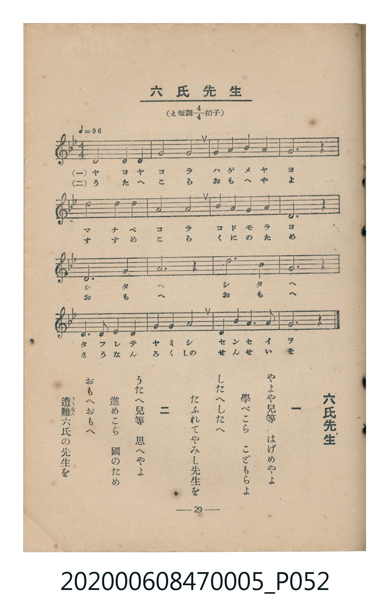

# 六氏先生

> Re:Shōka 使用 AI 協助辨識與重建樂譜，可能會有錯誤。歡迎回報。

- **NEUTRINO 歌聲合成版**：<br><audio controls src="rokushi_sensei_neutrino.mp3"></audio>
- **鋼琴伴奏版**：<br><audio controls src="rokushi_sensei.mp3"></audio>


- 臺灣教育會公認《新定兒童唱歌》尋常科第五學年用（2020.006.0847.0005）

## 說明

原書資訊與歌詞全文（對應 P052.jpg，書頁 p. 29，第三學期第 3 首）：
調性與拍號：と短調四分之四拍子（G 小調 4/4 拍），♩= 96


## 歌詞

```text
一　やよや兒等　はげめやよ
學べこら　こどもらよ
したへしたへ
たふれてやみし先生を

二　うたへ兒等　思へやよ
進めこら　國のため
おもへおもへ
遭難六氏の先生を
```

## ABC

```abc
X:1
T:六氏先生
M:4/4
L:1/16
Q:1/4=96
K:Gm
V:V1 name="Piano" snm="Pia"
[V:V1]
!mp! D8 D4 D4 | G8 G8 | !p! G4 A4 B4 A4 | G12 z4 |
w: 1.~ヤ ヨ ヤ | コ ラ | ハ ゲ メ ヤ | ヨ
w: 2.~う た へ | こ ら | お も へ や | よ
!mp! d8 d4 d4 | A8 A8 | !p! B4 A4 G4 A4 | D12 z4 |
w: 1.~マ ナ ベ | コ ラ | コ ド モ ラ | ヨ
w: 2.~す す め | こ ら | く に の た | め
!mf! D12 G4 | A12 z4 | !f! d12 B4 | G12 z4 |
w: 1.~シ タ | ヘ | シ タ | ヘ
w: 2.~お も | へ | お も | へ
!mf! D6 D2 E4 D4 | G4 G4 A8 | D4 B4 A6 A2 | G12 z4 |
w: 1.~タ フ レ テ | ヤ ミ シ | セ ン セ イ | ヲ
w: 2.~さ う な ん | ろ く しの | せ ん せ い | を
```

## TMD 檔案連結

- [主旋律 TMD 檔案](rokushi_sensei.tmd) [[在 TMD Studio 編輯](https://tmdlang.github.io/Tmd-TS/#tmd=s7IKdvYPcrWy4qpTUCpJTLdSSM7PyUlNLsnMz7MqzsjMK0nNjM_KTMmPL87Iz05Ugisry88pzU21Si9KTEmNN403MjAyiDcwMIs3sDAxBzIMTBFKi_NLi5JTrYqTM_Lzc-JLUitKkvLzs9Hl4wsS01OtAgxMjRAyBUX5Zal5iXlA3QVFILekgLUjFKSWZaakgqSLkxPz4stSizLTMlNTkFyZWlQM9gnEipKixLzi5KLMApD3EKryi0oy8oE-KciotMrILC7JL8pMTsyJz07MQ_JwSUYq0L8Q6Up0YajfcjLTUpGNzUzPzLMqScwsBzouPy0tMzkzMUeJS0tL4Wnr2mcb-p-2djyfMl9BS4tL0VbB0ozL3lbBSYcrO7XSVsE9l8vGRN_EDmTYi_ZdzxsXP5s680XTpmdzmp-2rnmxqvdxQ9ezaRuerpv1tHXS89VLn07Z-Gxtz-OG7qcbup_u2PF8-cTna9Y82TXl6dodT3dueT5lxfs9HaA40gPGkR4ojoAMA9P3ezqVuLj0tRRsqQW4FBQUnvbNfzZ7x4vN7S9WdL3oaAe668XKeU9bVzyb1g50xdMNvc_aOxVAEa2XVZD-fk8PUPHLBY0KBXoKRpZALsjhOzqBDn82Zz6QrWCs8HLZNKBL3--ZBTL9xar9zxqWg8zt7n0xcz5Q9HHjiufz1wLFn86e_bSj7cnObiADKPt07QSgfe4KTzf0AyUVgMGpABQFm9TzaOZKcJCDTHyyo-FxQ8PjppbHTR1AEhSgaztBIo3rHzdOetzUCJECe23tjseNOx83Tn7cBFEx-XHjysdNTSAuRMXjxumPG-c_bgSqgzIgokDW1sdNPY8bl4FMa9wPlIZE_-OmSRBX7AJGH9DENoguuCueNcwFmQZ3wsuGTSAnwZzwdE7348Z1ID1NjRCbukDuAdkPZYA1Na59OXsxJNUBlSNsBspRHulQoKClz8UVlJ9dCiw3glPzilMzrQIyE_PyHWoMaqpBNinYWGjZgRnYkpwCOOIbXizsUdAwAUXa8_UNOvB0oolFA9A-kGE1CtW5BbUKxvEKumAIZoCJGgUzmCCcAVQNVAzmmoMIQxgDSTEIGoCEwOb7GNYoPG5eAhV_3LwCTIL4QPGmzXDxlXAbHjf3g0SaNoHFFyKrB-uGQbC1EDuMgHKNbTCzGueDyR0QPY2TYeJNnQg7GrvAIk1wlcA0AnVTB4Yd-EN9Vw_5oQ4LdCiugQQmCMIZkCCHBzQi7GsQkYYtyOfBgxbs1eaZ-IIcLPq4GRRAj5sXwWUJBTnITEiQg1jATIQ3yMHR2rgaTK4Dk6CIAtkO0kdKkO_oJC_I05ASOjxdIwU6PBwVqkFKkURB4Y8_jTdtR5J73LQfGnwz0L1GvEqkgAZFIUIHKNWCREHpFs1sYlXiD2BgFUBpAAMpE_SiBJF2IUkCLAdP2WCKQBiDwgqUOKcC8RowC5TrYSXM42ZwzoeHL0jHbrA4OHmD2SB6CVgHqHzBFd5TISqBZcrjxlVgPaAkDTKvFywOScrAOgqUjqFWNc6GK4SwQXQLWNMkDKtqubh07RRQynsFoIAyFwA)]
- [鋼琴伴奏 TMD 檔案](rokushi_sensei_piano.tmd) [[在 TMD Studio 編輯](https://tmdlang.github.io/Tmd-TS/#tmd=s7IKdvYPcrWy4qpTUCpJTLdSSM7PyUlNLsnMz7MqzsjMK0nNjM_KTMmPL87Iz05Ugisry88pzU21Si9KTEmNN403MjAyiDcwMIs3sDAxBzIMTBFKi_NLi5JTrYqTM_Lzc-JLUitKkvLzs9Hl4wsS01OtAgxMjRAyBUX5Zal5iXlA3QVFILekgLUjFKSWZaakgqSLkxPz4stSizLTMlNTkFyZWlQM8klBZmJefnxicnJ-bkFiXmZuah6SIflFJRn5QI8UZFRaZWQWl-QXZSYn5sRnJ-Yh-bckIxXoXYh0Jbow1Gs5mWmpSlxaWgpPW9c-29D_tLXj-ZT57_d0vOze83zClid7tjxd2v-8s-P9nk4FLS0uRVsFSzMue1sFJx2u7NRKWwX3XC4bE30TO5DhL9p3PW9c_GzqzBdNm57NaX7auubFqt7HDV3Ppm14um7W09ZJz1cvfTpl47O1PY8bup9u6H66Y8fz5ROfr1nzZNeUp2t3PN255fmUFUCrQfGiB4wXPVC8ABkGpkDblbi4PPNKivKtAkDBEuThUGNQU82lAAQ2Flp2YEaNQnVuQa2CcbyCLhACKRMQC8ytUTADUWDCHCIPEgTLGSLEgBRUJQwagNRx1aJY7oNsuQm65fEK0cbxubEKRkAWiAcyEChmBhKDysaCrQYyDVGEEOpALAOIvUH52aXANB2cmlecmkm056HeRvY7CMIZQNVAxYjggIcBVu-DzPcxrFF43LwEKv64eQWYBPGB4k2b4eIr4TY8bu4HiTRtAosvRFYP1g2DYGshdhgB5RrbYGY1zgeTOyB6GifDxJs6EXY0doFFmuAqHze1QN3UgWEHSkDBwgmKaxDpAimBgEIJHjaI4IKmHFyhNA8eGmDXNc_EF0pg0cfNID89bl4ElyUUSiAzIaEEYj1uasQbSuCYaFwNJteBSVDYgmwH6cMRSmlIyQmeepDCCe51hWqQUiRRUJDhT0lN25HkHjfth_p4BrpriFeJFDagUEfoAKUNkCgodaCZTaxKbGFCzfIFESwg74GSwFQgXgNmgbIDLOs9bgZnCXiQgHTsBouDExGYDaKXgHWAMh6uIJoKUQnMbI8bV4H1gBIOyLxesDgkwUyHpBaoVY2z4QohbBDdAtY0CcMq7EUXjqITUWoiWOjlIYQFEQWpMsQsXmHFJsRQ7Nrh5S1SwQs1CmYymiKEiQjH4TQRqBhJEmgwqIzH7UaqVxe6dgrgmkoByEAJ_2gfoG5MQSOwoDIXAA)]

## 分析

```text
================================================================================
📊 TMD Song Profile: [ 六氏先生 ]
================================================================================
⏱  Duration:       0:40 (40.0s), 16 measures total
🎼 Key & Tempo:    首調基準 B,, != 96.0 BPM, <4/4>
   - 分析範圍：      由實際發聲的音符與和弦推測調性；播放脈絡另行呈現
🎤 人聲音域:    D4 (MIDI 62) – D5 (MIDI 74) [跨度: 12 個半音 / 1.0 個八度, 難度: easy]
   - 最低音:  D4 in [RokushiSensei #1 @ m.1, 0:00]
   - 最高音: D5 in [RokushiSensei #1 @ m.5, 0:10]
   - 適合: soprano, mezzo-soprano, contralto, tenor, baritone, bass
🏛  結構:      RokushiSensei (40.0s)
⚡ 編曲密度:        Peak 1 軌道同時演奏
🗝  調性診斷：       D 大調（流行色彩大調，未偵測到可信轉調）
   - 風格氣質:    流行大調（略帶和弦色彩音與裝飾副屬和弦）
   - 轉調歷程:    全曲維持單一推測調性（未偵測到可信轉調）
   - 核心骨幹音:  D, G, A, A#, D#
   - 調性數值:    D 大調 [相關度: 0.78, 穩定度: Moderate, 自然音純度: 91.5%]
   - 候選調性 (K-S): D 大調 (0.78), G 大調 (0.70), G 小調 (0.68)
   - 五度圈歷程:   +2
   - 各段落調性細節:
     • [RokushiSensei #1]: D 大調 (r: 0.78, 自然音純度: 91.5%, 調外音: D#, A#)

  [ 五度圈游移軌跡 ]
               C  
         F            G  
      Bb              [D ]*
      Eb               A  
         Ab           E  
            Db       B  
               F# 
     (* = active key center)

  [ 十二半音累積音高分佈 ]
     C  :                            0.0%
     C# :                            0.0%
     D  : ████████████████████████  35.6%
     D# : █                          1.7%
     E  :                            0.0%
     F  :                            0.0%
     F# :                            0.0%
     G  : █████████████████████     30.5%
     G# :                            0.0%
     A  : █████████████████         25.4%
     A# : █████                      6.8%
     B  :                            0.0%
--------------------------------------------------------------------------------
Assignment 軌道音域：
  - Piano         : D4 – D5 (12 個半音 / 1.0 個八度, 38 個音符)
================================================================================
```


## 原書掃描頁




