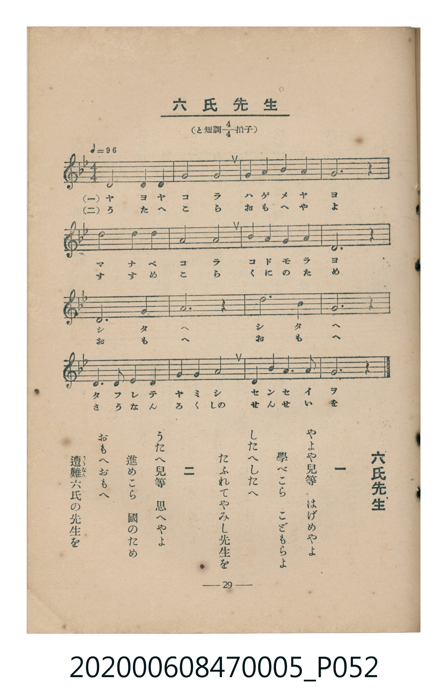

# 六氏先生

<audio controls src="rokushi_sensei.mp3"></audio>

- 臺灣教育會公認《新定兒童唱歌》尋常科第五學年用（2020.006.0847.0005）

## 說明

原書資訊與歌詞全文（對應 P052.jpg，書頁 p. 29，第三學期第 3 首）：
調性與拍號：と短調四分之四拍子（G 小調 4/4 拍），♩= 96

## 歌詞

```text
一　やよや兒等　はげめやよ
學べこら　こどもらよ
したへしたへ
たふれてやみし先生を

二　うたへ兒等　思へやよ
進めこら　國のため
おもへおもへ
遭難六氏の先生を
```

## ABC

```abc
X:1
T:六氏先生
M:4/4
L:1/16
Q:1/4=96
K:Gm
V:V1 name="Piano" snm="Pia"
[V:V1]
d8 d4 d4 | g8 g8 | a4 a4 b4 a4 | g12 z4 |
b8 b4 b4 | g8 g8 | a4 g4 f4 g4 | d12 z4 |
d12 g4 | g12 z4 | d'12 b4 | g12 z4 |
g6 a2 b4 g4 | a4 a4 b8 | d4 g4 a6 a2 | g12 z4 |
```

## TMD 檔案連結

- [主旋律 TMD 檔案](rokushi_sensei.tmd) [[在 TMD Studio 編輯](https://tmdlang.github.io/Tmd-TS/#tmd=s7IKdvYPcrWy4tLSUnjauvbZhv6nrR3Pp8xX0NLiUrRVsDTjsrdVcNLhyk6ttFVwz-WyMdE3seOqU1B60b7reePiZ1Nnvmja9GxO89PWNS9W9T5u6Ho2bcPTdbOetk56vnrp0ykbn63tedzQ_XRD99MdO54vn_h8zZonu6Y8Xbvj6c4tz6eseL-nw8jAyEDPwMBMz8DCxBzIMDB9v6dTiYtLX0vBllqAS0FB4Wnf_Gezd7zY3P5iRdeLjnagu16snPe0dcWzae1AVzzd0PusvVMhwMDUSC-rIP39nh6g4pcLGhUK9BSMLIFckMN3dAId_mzOfCBbwVjh5bJpQJe-3zMLZPqLVfufNSwHmdvd-2LmfKDo48YVz-evBYo_nT37aUfbk53dQAZQ9unaCUD73BWebugHSioAg1MBKAo2qefRzJXgIAeZ-GRHw-OGhsdNLY-bOoAkKEDXdoJEGtc_bpz0uKkRIgX22todjxt3Pm6c_LgJomLy48aVj5uaQFyIiseN0x83zn_cCFQHZUBEgaytj5t6HjcuA5nWuB8oDYn-x02TIK7YBYw-oIltEF1wVzxrmAsyDe6Elw2bQE6COeHpnO7HjetAepoaITZ1gdwDsh_KAGtqXPty9mJIqgMqR9gMlKM80qFAQUufiysoP7u0OCMzODWvODXTKiAzMS_focagRqEaZJWCjYWWHZiBLc0pgGO-4cXCHgUNE1CsPV_foANPKJpYNAAthBqmAdSoaaXwuHkJSAAYDM0rQASQV6PwuGkzTHAlhAEUa-4H8ps2gQQXIlSCdMEA1PAaYALUBUMQDcI1CmZQERhdo2AOJEHYMA7KQCgCQQOQCDiacft8Vw9lPp8H82QXiJiJ0-cgscfNnSBiEVQGl8_BvgFBMANM4PI8iGcKpRFBRqzfd3RS5Pem7QjHP27aD_HQDIQYyNcElGDENsyLWCJSwRgWLvCwITm6gUUUZV4GegEUe1OBeA2I0QbxEjAdP26eD_Ij1MMgv-8GCYKiHcQCUUvAaoGpH8P7EG-YQ3wF8T9K2obEOCiQQJIgYRCJzfu1XFy6dgoo5YECUECZiwsA)]
- [鋼琴伴奏 TMD 檔案](rokushi_sensei_piano.tmd) [[在 TMD Studio 編輯](https://tmdlang.github.io/Tmd-TS/#tmd=s7IKdvYPcrWy4tLSUnjauvbZhv6nrR3Pp8x_v6fjZfee5xO2PNmz5enS_uedHe_3dCpoaXEp2ipYmnHZ2yo46XBlp1baKrjnctmY6JvYcdUpKL1o3_W8cfGzqTNfNG16Nqf5aeuaF6t6Hzd0PZu24em6WU9bJz1fvfTplI3P1vY8buh-uqH76Y4dz5dPfL5mzZNdU56u3fF055bnU1YArTYyMDLQMzAw0zOwMDEHMgxMgbYrcXEF5WeXFmdkBqfmFadmWgVkJublB3k41BjUKFRzKQCBjYWWHZihr6Vgiw4UQPbsaHixsEdBw0Th6Yb-5-sbdBQCDEyN9LIK0jWxaNDSBxtWo2CsoAuGIBqEaxTMoCIwukbBHEiCsGEclIFQBIIGIBEu_I7b1UOO48AWgiCYASZwuQ_EM4XSCF8R67wdnZSEHcw1WIJFwRjmBbg3SA68p7Nnk-M6iC3mEEshzkOJSEjYgfwAkgQJg0hsrqvFmjx9UJKnCSJ5vmhqfb6y7cX-vc8a5j7ZCcwM_S9W7Qd64ll379O1E55uX_assxuS997v6Xm-peHp_q0vuuY-3bjx6fZpyBkVKaDjFaKNc2PhNNCR8UCmWTyQjWBB1UGVYaoyAHoFmq6AwoaxMAqXaUZAphFOGxCmEbQV7m4cFiKMwustLLrx-BQYabp2CijxpoBNQJmLCwA)]

## 分析

```text
================================================================================
📊 TMD Song Profile: [ 六氏先生 ]
================================================================================
⏱  Duration:       0:40 (40.0s), 16 measures total
🎼 Key & Tempo:    首調基準 B,, != 96.0 BPM, <4/4>
   - 分析範圍：      由實際發聲的音符與和弦推測調性；播放脈絡另行呈現
🎤 人聲音域:    D5 (MIDI 74) – D6 (MIDI 86) [跨度: 12 個半音 / 1.0 個八度, 難度: easy]
   - 最低音:  D5 in [RokushiSensei #1 @ m.1, 0:00]
   - 最高音: D6 in [RokushiSensei #1 @ m.11, 0:25]
   - 適合: soprano, tenor
🏛  結構:      RokushiSensei (40.0s)
⚡ 編曲密度:        Peak 1 軌道同時演奏
🗝  調性診斷：       G 小調（純淨自然小調，未偵測到可信轉調）
   - 風格氣質:    純淨自然小調（陰鬱抒情、旋律集中，無明顯調外色彩）
   - 轉調歷程:    全曲維持單一推測調性（未偵測到可信轉調）
   - 核心骨幹音:  G, D, A#, A, F
   - 調性數值:    G 小調 [相關度: 0.88, 穩定度: High, 自然音純度: 100.0%]
   - 候選調性 (K-S): G 小調 (0.88), G 大調 (0.73), D 大調 (0.49)
   - 五度圈歷程:   +1
   - 各段落調性細節:
     • [RokushiSensei #1]: G 小調 (r: 0.88, 自然音純度: 100.0%)

  [ 五度圈游移軌跡 ]
               C  
         F           [G ]*
      Bb               D  
      Eb               A  
         Ab           E  
            Db       B  
               F# 
     (* = active key center)

  [ 十二半音累積音高分佈 ]
     C  :                            0.0%
     C# :                            0.0%
     D  : █████████████             23.7%
     D# :                            0.0%
     E  :                            0.0%
     F  : █                          1.7%
     F# :                            0.0%
     G  : ████████████████████████  44.9%
     G# :                            0.0%
     A  : ████████                  14.4%
     A# : ████████                  15.3%
     B  :                            0.0%
--------------------------------------------------------------------------------
Assignment 軌道音域：
  - Piano         : D5 – D6 (12 個半音 / 1.0 個八度, 38 個音符)
================================================================================
```


## 原書掃描頁




