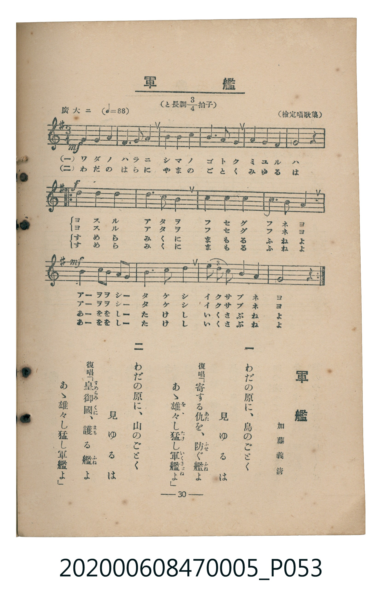

# 軍艦

<audio controls src="gunkan.mp3"></audio>

- 加藤義清 作詞
- 臺灣教育會公認《新定兒童唱歌》尋常科第五學年用（2020.006.0847.0005）

## 說明

原書資訊與歌詞全文（對應 P053.jpg，書頁 p. 30，第三學期第 4 首）：
調性與拍號：と長調四分之三拍子（G 大調 3/4 拍），廣大ニ（♩= 88）
作詞：加藤義清　曲：（檢定唱歌集）

## 跨冊／重複收錄參照

> 同名異曲（各冊收錄之不同詞曲版本）

- **[同名異曲]** 楊金土手抄《唱歌帖》第 8 冊・VIII（2020.006.0843）：[**〈軍艦〉**](../../../shokacho/vol_08/p012_gunkan/index.md)（`G` / `3/4` — [原始 TMD](../../../shokacho/vol_08/p012_gunkan/gunkan.tmd)）
- **[同名異曲]** 楊金土手抄《唱歌帖》第 2 冊・II（2020.006.0843）：[**〈軍艦〉**](../../../shokacho/vol_02/p074_gunkan/index.md)（`G` / `4/4` — [原始 TMD](../../../shokacho/vol_02/p074_gunkan/gunkan.tmd)）
- 總表：[跨冊重複與同名歌曲總索引](../../../duplicate_songs.md)

## 歌詞

```text
一　わだの原に、島のごとく
見ゆるは
復唱「寄する仇（あた）を、防（ふせ）ぐ艦（ふね）よ
あゝ雄々（をゝ）し猛（たけ）し軍艦（いくさぶね）よ」

二　わだの原に、山のごとく
見ゆるは
復唱「皇御國（すめらみくに）、護（まも）る艦（ふね）よ
あゝ雄々し猛し軍艦よ」
```

## ABC

```abc
X:1
T:軍艦
M:3/4
L:1/16
Q:1/4=88
K:G
V:V1 name="Piano" snm="Pia"
[V:V1]
!mf! D2 D2 D2 E2 D2 B,2 | D4 G4 E4 | D4 B,4 D4 | E4 D4 D4 |
D8 z4 | !f! B4 B4 B4 | A4 G4 E4 | D4 G4 A4 |
B6 A2 A4 | !mf! A4 A2 G2 E2 D2 | G4 A4 B4 | [BcBA]4 G4 A4 |
G8 z4 |
```

## TMD 檔案連結

- [主旋律 TMD 檔案](gunkan.tmd) [[在 TMD Studio 編輯](https://tmdlang.github.io/Tmd-TS/#tmd=s7IKdvYPcrWy4qpTUCpJTLdSSM7PyUlNLsnMz7MqzsjMK0nNjM_KTMmPL87Iz05Ugisry88pzU21Si9KTEmNN403MjAyiDcwMIs3sDAxBzIMTBFKi_NLi5JTrYqTM_Lzc-JLUitKkvLzsxHyBUX5Zal5iXlANQVFIBtTwIoQClLLMlNSQdKpKZkl-UWZiTlI7kgtKga7FWxJfElRYl5xclFmAcgDCFUlGalAx-Zm5mSWJBZVKnFpaSm82N37onOZgpYWl6KtgoUFl72tgjuXjbG-iR1I14v2Xc8bFz-bOvNF06Znc5qftq55sar3cUPXs2kbnq6b9bR10vPVS59O2fhsbc_jhu6nG7qf7tjxfPnE52vWPNk15enaHU93bnk-ZcX7PR2gcNEDhoseKFyADAPT93s6we562rXgxfQlz_etfLajVeHJ3jkvVs5T4uLS11KwpRbgUlBQeNo3_9nsHS82t79Y0fWiox3oXqA9T1tXPJvWDnTd0w29z9o7FQIMTI31sgrS3-_pASp-uaBRoUBPwdgAyAV5aEcn0EPP5swHshVMFF4umwb0wfs9s0Cmv1i1_1nDcpC53b0vZs4Hij5uXPFy6nag-NPZs592tD3Z2Q3UD5R9unYC0D53hadLlgMlFYDBrAAUBZvU83T3YqDw4-ZuoIpHM1eCYgMoATIfEixAY5ED63FDw7PZm4CCQOXPVi0CRQc4Il7ObgNpA-vb0QBU9bip_3HjgseN64CB8Lhx9eOGxqebtwG5jxunAJ35uLEfpBSkrqHhxbLux01tj5u6HzeuR4g-3bcSaPTjhp6n61seN84ESj_ZDQq2x41NjxuBvu183DQJaOrLGUDXAAW3Pm6cDRJsnABMWDCRtWBlHQhDEQhoStPcl7NbHje0glQDzWqaC9Y__XkP0CCgfqCzJ0JEIKkVLAh0CtBfUx83Av0CNf1xQy_E37uAyRGbvzduJMvfz2e1P9238OkcUMyAA6DxcRPQNfvBLlgNsruh8cXa7WDZfY-bmsCu6SbZ9xAfw30J9RBQD-V5AAoUtPS5uNxL87IT86wCMhPz8h1qDGoUqkF2KNhYaNmBGdjyngI4BzS8WNijoGGq8HRD__P1DTrwDKOJRQPQJqhh1blptQqPm9cDcQMQ9wFxPxCvBOJuhRqFx03bgaHSPA9E9CmABbaA2B1Aomk9WKB5PkhgGYhYDRHoB5kNAVCLgN4A2WMaD0VmYNI4HigBpHUVDIEYKKYL4wNldCGsGog4mA0VAFMgaADigtMU7mDZ1QMOFhNSgwUcKitAvtyJ8FnTIpDAfpDAJohXp4IEdoOIDXABkHQvRDfC-0DzjEEeg-IaBSMs3gbxQeI1YDUgNphHwIs7OsnzIjjmmxY9bt4D9g8YA6MbxAf5FeTNpo0gApgEQAJLwFH-uGkrUMk0iCfBXgb6E3t0gxxvBPQUJLZr4N6DBICxtom2sTYsGCDeBrEQMVvLxaVrpwDJEQpAljIXAA)]
- [鋼琴伴奏 TMD 檔案](gunkan_piano.tmd) [[在 TMD Studio 編輯](https://tmdlang.github.io/Tmd-TS/#tmd=s7IKdvYPcrWy4tLSUnixu_dF57L3ezpedu95PmHLkz1bni7tf97Z8X5Pp4KWFpeirYKFBZe9rYI7l42xvokdV52C0ov2Xc8bFz-bOvNF06Znc5qftq55sar3cUPXs2kbnq6b9bR10vPVS59O2fhsbc_jhu6nG7qf7tjxfPnE52vWPNk15enaHU93bnk-ZQXQRiMDIwM9AwMzPQMLE3Mgw8AUaKkSyIanXQteTF_yfN_KZztaFZ7snfNi5TwlLi730rzsxDyrgMzEvPwgD4cagxqFai4FILCx0LIDM_S1FGzRgQLI4h0NLxb2KGiYKjzd0P98fYOOQoCBqbFeVkG6JhYNWvpgw4Cm56bVKpjGQ5EZmDSOB0oAaV0FQyAGiunC-EAZXQirBiIOZkMFwBQIGoC4XPhdu6sH7FoTEl0LdKwxyB1QXKNghMWVID5IvAasBsQG8wi4aEcnWS4ChR_IeCOgtZDgq4E7AOJEY20TbWNtmEMhDgOxEEFVixrxPigRb4KI-JezW57t2Pd09-KX07ue7OwGOvlZd-_TtROebl_2rLMbkq7RnGYYrxBtGAvGQFshHBOwG5ElgCJAvmk8JOKBMqbxsUC31SAFO4p6kBqgALJBEM1QU8D64bohSQwqCpGCKQRSqLZDTQPZDQwVXTsFSMAooLCUuQA)]

## 分析

```text
================================================================================
📊 TMD Song Profile: [ 軍艦 ]
================================================================================
⏱  Duration:       0:26 (26.6s), 13 measures total
🎼 Key & Tempo:    首調基準 G, != 88.0 BPM, <3/4>
   - 分析範圍：      由實際發聲的音符與和弦推測調性；播放脈絡另行呈現
🎤 人聲音域:    B3 (MIDI 59) – C5 (MIDI 72) [跨度: 13 個半音 / 1.1 個八度, 難度: moderate]
   - 最低音:  B3 in [Gunkan #1 @ m.1, 0:01]
   - 最高音: C5 in [Gunkan #1 @ m.12, 0:22]
   - 適合: soprano, mezzo-soprano, contralto, tenor, baritone, bass
🏛  結構:      Gunkan (26.6s)
⚡ 編曲密度:        Peak 1 軌道同時演奏
🗝  調性診斷：       G 調性不明確（純淨自然大調，未偵測到可信轉調）
   - 風格氣質:    純淨自然大調（陽光明朗、易唱易記，無明顯調外色彩）
   - 轉調歷程:    全曲維持單一推測調性（未偵測到可信轉調）
   - 核心骨幹音:  D, B, A, G, E
   - 調性數值:    G 調性不明確 [相關度: 0.80, 穩定度: Ambiguous, 自然音純度: 100.0%]
   - 候選調性 (K-S): G 大調 (0.80), D 大調 (0.80), B 小調 (0.69)
   - 五度圈歷程:   +1
   - 各段落調性細節:
     • [Gunkan #1]: G 調性不明確 (r: 0.80, 自然音純度: 100.0%)

  [ 五度圈游移軌跡 ]
               C  
         F           [G ]*
      Bb               D  
      Eb               A  
         Ab           E  
            Db       B  
               F# 
     (* = active key center)

  [ 十二半音累積音高分佈 ]
     C  : ██                         2.5%
     C# :                            0.0%
     D  : ████████████████████████  26.2%
     D# :                            0.0%
     E  : █████████                 10.0%
     F  :                            0.0%
     F# :                            0.0%
     G  : █████████████████         18.7%
     G# :                            0.0%
     A  : ██████████████████        20.0%
     A# :                            0.0%
     B  : █████████████████████     22.5%
--------------------------------------------------------------------------------
Assignment 軌道音域：
  - Piano         : B3 – C5 (13 個半音 / 1.1 個八度, 43 個音符)
================================================================================
```


## 原書掃描頁




