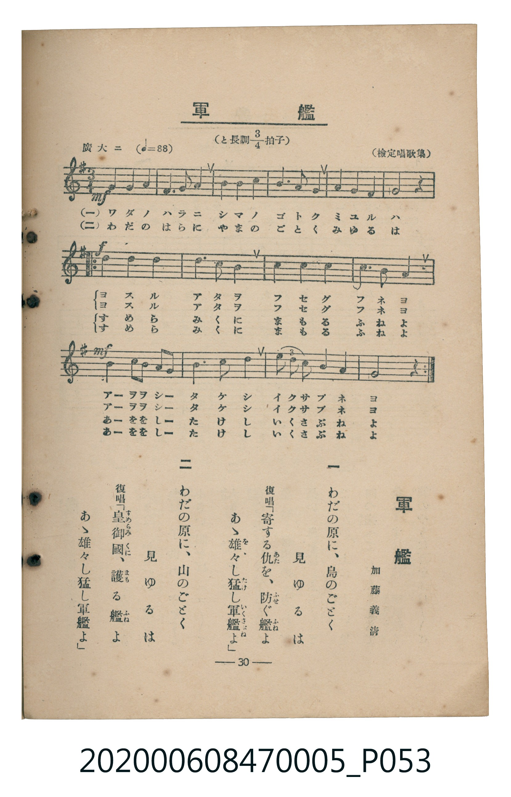

# 軍艦

> Re:Shōka 使用 AI 協助辨識與重建樂譜，可能會有錯誤。歡迎回報。

- **鋼琴伴奏版**：<br><audio controls src="gunkan.mp3"></audio>
- **NEUTRINO 歌聲合成版**：<br><audio controls src="gunkan_neutrino.mp3"></audio>

- 加藤義清 作詞
- 臺灣教育會公認《新定兒童唱歌》尋常科第五學年用（2020.006.0847.0005）

## 說明

原書資訊與歌詞全文（對應 P053.jpg，書頁 p. 30，第三學期第 4 首）：
調性與拍號：と長調四分之三拍子（G 大調 3/4 拍），廣大ニ（♩= 88）
作詞：加藤義清　曲：（檢定唱歌集）


## 歌詞

```text
一　わだの原に、島のごとく
見ゆるは
復唱「寄する仇（あた）を、防（ふせ）ぐ艦（ふね）よ
あゝ雄々（をゝ）し猛（たけ）し軍艦（いくさぶね）よ」

二　わだの原に、山のごとく
見ゆるは
復唱「皇御國（すめらみくに）、護（まも）る艦（ふね）よ
あゝ雄々し猛し軍艦よ」
```

## ABC

<div class="abc-score" data-abc-src="gunkan.abc" aria-label="五線譜載入中"></div>

[下載 ABC 原始檔](gunkan.abc)

## TMD 檔案連結

- [主旋律 TMD 檔案](gunkan.tmd) [[在 TMD Studio 編輯](https://tmdlang.github.io/Tmd-TS/#tmd=s7IKdvYPcrWy4qpTUCpJTLdSSM7PyUlNLsnMz7MqzsjMK0nNjM_KTMmPL87Iz05Ugisry88pzU21Si9KTEmNN403MjAyiDcwMIs3sDAxBzIMTBFKi_NLi5JTrYqTM_Lzc-JLUitKkvLzsxHyBUX5Zal5iXlANQVFIBtTwIoQClLLMlNSQdKpKZkl-UWZiTlI7kgtKga7FWxJfElRYl5xclFmAcgDCFUlGalAx-Zm5mSWJBZVIsSBhqVn5lnlpmZmZWJxGVS6PLW4JLUoLz43NSc_BahbS0vhxe7eF53LFLS0uBRtFSwsuOxtFdy5bIz1TexAml-073reuPjZ1JkvmjY9m9P8tHXNi1W9jxu6nk3b8HTdrKetk56vXvp0ysZna3seN3Q_3dD9dMeO58snPl-z5smuKU_X7ni6c8vzKSve7-kAhaoeMFT1QKEKZBiYvt_TCXbe064FL6Yveb5v5bMdrQpP9s55sXKeEheXvpaCLbUAl4KCwtO--c9m73ixuf3Fiq4XHe1A9wLtedq64tm0dqDrnm7ofdbeqRBgYGqsl1WQ_n5PD1DxywWNCgV6CsYGQC7IQzs6gR56Nmc-kK1govBy2TSgD97vmQUy_cWq_c8aloPM7e59MXM-UPRx44qXU7cDxZ_Onv20o-3Jzm6gfqDs07UTgPa5KzxdshwoqQAMZgWgKNiknqe7FwOFHzd3A1U8mrkSFBtACZD5kGABGoscWI8bGp7N3gQUBCp_tmoRKDrAEfFydhtIG1jfjgagqsdN_Y8bFzxuXAcMhMeNqx83ND7dvA3Ifdw4BejMx439YC8s637c1Pa4qftx43pwgO1bCTTucUPP0_UtjxtnAiWe7AYF1ePGpseNQB92Pm6aBDTp5QygC4CCWx83zgYJNk4AJiaYyFqwsg6QcSBtTXNfzm553NAKkgZqbpoL1jD9eQ9QJ1AD0G0TISKQJAkWBNoNdPzUx41AB0ONe9zQC_HcLmCaw-a5jRuJ9tzzWe1P9y18OgcU5GBfNj5uArpgP9jW1SD7GhpfrN0Olt33uKkJ7IJuwl6EeAvuFairgYooT81QoKClz8XlXpqXnZhnFZCZmJfvUGNQUw2yQsHGQssOzMCWiRTASbnhxcIeBQ1Thacb-p-vb9CBp3xNLBqAFkENq85Nq1V43LweiBuAuA-I-4F4JRB3K9QoPG7aDgyF5nkgok8BLLAFxO4AEk3rwQLN80ECy0DEaohAP8hsCIBaVAOxxzQeiszApHE8UAJI6yoYAjFQTBfGB8roQlg1EHEwGyoApkDQAMQFm-9jCLIXnyd0wb4AkX1gQ0D-APE6QCTQJ2AxoFdAYsvA5GqoWD_UNrDlENuMQPqBNjQuAOJ1QAy0uakTSK8Gm9wC0t-4D0yug5jSOAXMWwEmQSaCxPaD7W4Dk91QMZBLELbhj_JdPeAoNyE1ysExvgIUgzsRsda0CCSwHySwCRKNU0ECu0HEBrgASLoXohsRtUDzjEGRBsU1CkZYohTEB4nXgNWA2GAeUvSBAwfoJKTABzoKJAYOKKCzIBEyFSy2G0xuQBIDqYG4DSWiGmeCVTaCyU7koAdHBCjSIGLgCGtqQomOrRBzG9cCxUBJhVCU7OgkL0rAubBp0ePmPWCPgjEw1YL4oGAARUvTRhABzI4ggSXgRPu4aStQyTRIpIDDARgv2LMeKLCNgJEAyXk18OiARJixtom2sTYs2iDRBGJhyWWQKEFyIySiIGl5I5iEiS0BuhHkRJD6adDogUQXKIqw5KlGSOBPguDG6dBIAOfKxolgEiYGrUTAYtugUQSxFRRNCLNrubh07RQghaoCkKXMBQA)]
- [鋼琴伴奏 TMD 檔案](gunkan_piano.tmd) [[在 TMD Studio 編輯](https://tmdlang.github.io/Tmd-TS/#tmd=s7IKdvYPcrWy4tLSUnixu_dF57L3ezpedu95PmHLkz1bni7tf97Z8X5Pp4KWFpeirYKFBZe9rYI7l42xvokdV52C0ov2Xc8bFz-bOvNF06Znc5qftq55sar3cUPXs2kbnq6b9bR10vPVS59O2fhsbc_jhu6nG7qf7tjxfPnE52vWPNk15enaHU93bnk-ZQXQRiMDIwM9AwMzPQMLE3Mgw8AUaKkSyIanXQteTF_yfN_KZztaFZ7snfNi5TwlLi730rzsxDyrgMzEvPwgD4cag5pqLgUgsLHQsgMz9LUUbNGBAsjeHQ0vFvYoaJgqPN3Q_3x9g45CgIGpsV5WQbomFg1a-mDDahSqc9NqFUzjocgMTBrHAyWAtK6CIRADxXRhfKCMLoRVAxEHs6ECYAoEDUBcsPk-hjUKj5vXA3EDEPcBcT8QrwTibqCGx03bgSofN88Dk31gQx43bQHzOkBk03qIWPN8sNgyMLkaKtYPtQ1sOcQ2I5B-oA2NC4B4HRADbW7qBNKrwSa3gPQ37gOT6yCmNE4B81aASZCJILH9YLvbwGQ3VAzkEoRt-GNiVw84JkxIjAlgRBiDwhiKaxSMsMQAiA8SrwGrAbHBPKTQBvulaSdyWDUtAouB_dW8CRp-U8Fiu8HkBiQxkJpeqDlI4do4E6yyEUx2IocUONxAYQwRA4dvUxNK6G2FmNu4FigGillCIbijk6wQBKVlUHAYAYMJkpRr4AEGCVJjbRNtY21YwEICEsTCkmwhgQYMLjAGJ1WQKCRxbASTMLElwJT6uAnkycfN06ABCAlQUCBiSaSNkOCZBMGN06HBBE7mjRPBJEysBRi-jxvBkdW4DRqIEFtBAYkwuxa17PBBLjtMEGXHy9ktz3bse7p78cvpXU92dgND-ll379O1E55uX_assxtSMqKFqGG8QrRhLBgDAwvCMQEHLbIEUATIN42HlB1AGdP4WGCQQjwNSd0o6kFqgALIBkE0Q00B64frhpRSUFGIFEwhkEK1HWoayG5goOjaKUDCJdoHKIjEMwLzlLkA)]

## 分析

```text
================================================================================
📊 TMD Song Profile: [ 軍艦 ]
================================================================================
⏱  Duration:       0:26 (26.6s), 13 measures total
🎼 Key & Tempo:    首調基準 G, != 88.0 BPM, <3/4>
   - 分析範圍：      由實際發聲的音符與和弦推測調性；播放脈絡另行呈現
🎤 人聲音域:    B3 (MIDI 59) – C5 (MIDI 72) [跨度: 13 個半音 / 1.1 個八度, 難度: moderate]
   - 最低音:  B3 in [Gunkan #1 @ m.1, 0:01]
   - 最高音: C5 in [Gunkan #1 @ m.12, 0:22]
   - 適合: soprano, mezzo-soprano, contralto, tenor, baritone, bass
🏛  結構:      Gunkan (26.6s)
⚡ 編曲密度:        Peak 1 軌道同時演奏
🗝  調性診斷：       G 調性不明確（純淨自然大調，未偵測到可信轉調）
   - 風格氣質:    純淨自然大調（陽光明朗、易唱易記，無明顯調外色彩）
   - 轉調歷程:    全曲維持單一推測調性（未偵測到可信轉調）
   - 核心骨幹音:  D, B, A, G, E
   - 調性數值:    G 調性不明確 [相關度: 0.80, 穩定度: Ambiguous, 自然音純度: 100.0%]
   - 候選調性 (K-S): G 大調 (0.80), D 大調 (0.80), B 小調 (0.69)
   - 五度圈歷程:   +1
   - 各段落調性細節:
     • [Gunkan #1]: G 調性不明確 (r: 0.80, 自然音純度: 100.0%)

  [ 五度圈游移軌跡 ]
               C  
         F           [G ]*
      Bb               D  
      Eb               A  
         Ab           E  
            Db       B  
               F# 
     (* = active key center)

  [ 十二半音累積音高分佈 ]
     C  : ██                         2.5%
     C# :                            0.0%
     D  : ████████████████████████  26.2%
     D# :                            0.0%
     E  : █████████                 10.0%
     F  :                            0.0%
     F# :                            0.0%
     G  : █████████████████         18.7%
     G# :                            0.0%
     A  : ██████████████████        20.0%
     A# :                            0.0%
     B  : █████████████████████     22.5%
--------------------------------------------------------------------------------
Assignment 軌道音域：
  - Piano         : B3 – C5 (13 個半音 / 1.1 個八度, 43 個音符)
================================================================================
```


## 原書掃描頁




