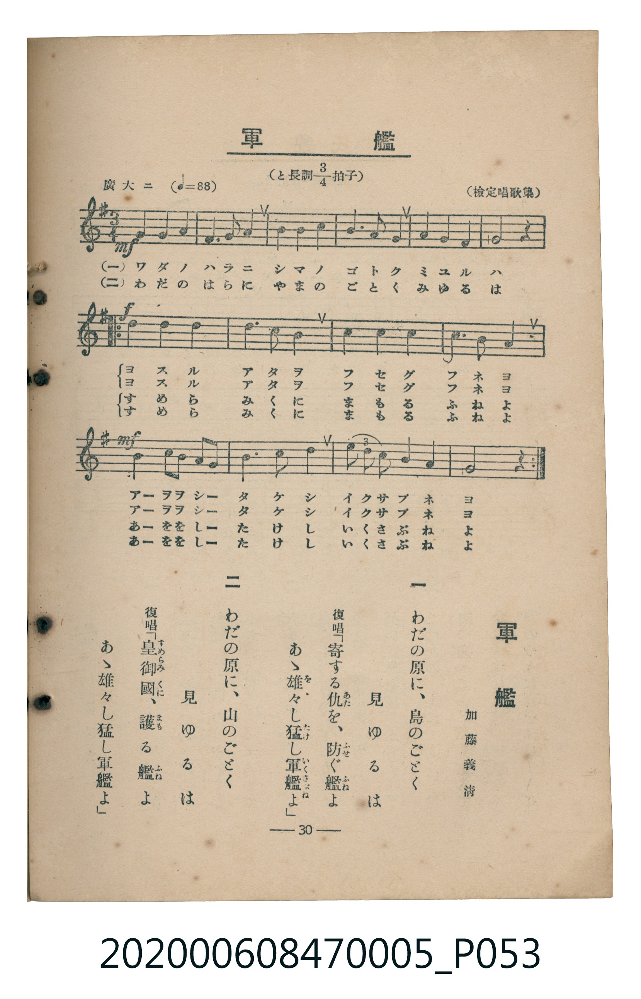

# 軍艦

> Re:Shōka 使用 AI 協助辨識與重建樂譜，可能會有錯誤。歡迎回報。

- **鋼琴伴奏版**：<br><audio controls src="gunkan.mp3"></audio>
- **NEUTRINO 歌聲合成版**：<br><audio controls src="gunkan_neutrino.mp3"></audio>

- lyrics: 加藤義清
- composer: 檢定唱歌集（英國國歌旋律・鳥居忱編）
- 臺灣教育會公認《新定兒童唱歌》尋常科第五學年用（2020.006.0847.0005）

## 說明

原書資訊與歌詞全文（對應 P053.jpg，書頁 p. 30，第三學期第 4 首）：
調性與拍號：と長調四分之三拍子（G 大調 3/4 拍），廣大ニ（♩= 88）
作詞：加藤義清　曲：（檢定唱歌集）
版面校勘：


## 歌詞

```text
1. 全曲共 14 小節（英國國歌 *God Save the King* 旋律）。第 7 至 14 小節（「復唱」）前後印有反覆記號 `||: ... :||`，譜下並以大括號並列兩行相同假名，明示每段主歌後復唱反覆演唱兩遍。
2. 第 8 小節「仇」於五線譜下印作清音「アタヲ」，底欄振假名亦印作「あた」。
3. 第 11 小節譜下配詞印作「アー ヲヲ シー」／「あー をを しー」；第 13 小節第 1 拍為八分音符三連音 `(6 5 4)%(--)`（「イクサ」／「いくさ」）。

一　わだの原に、島のごとく
見ゆるは
復唱「寄する仇（あた）を、防（ふせ）ぐ艦（ふね）よ
あゝ雄々（をゝ）し猛（たけ）し軍艦（いくさぶね）よ」

二　わだの原に、山のごとく
見ゆるは
復唱「皇御國（すめらみくに）、護（まも）る艦（ふね）よ
あゝ雄々し猛し軍艦よ」
```

## ABC

<div class="abc-score" data-abc-src="gunkan.abc" aria-label="五線譜載入中"></div>

[下載 ABC 原始檔](gunkan.abc)

## TMD 檔案連結

- [主旋律 TMD 檔案](gunkan.tmd) [[在 TMD Studio 編輯](https://tmdlang.github.io/Tmd-TS/#tmd=s7IKdvYPcrWy4qpTUCpJTLdSSM7PyUlNLsnMz7MqzsjMK0nNjM_KTMmPL87Iz05Ugisry88pzU21Si9KTEmNN403MjAyiDcwMIs3sDAxBzIMTBFKi_NLi5JTrYqTM_Lzc-JLUitKkvLzs9Hl4wsS01OtAgxMjREyBUX5Zal5iXlA3QVFILekgLUjFKSWZaakgqSLkxPz4stSizLTMlNTEPL5RSUZ-UA3FmRUWmVkFpfkF2UmJ-bEZyfmIXsltagY7F2IO0qKEvOKk4syC0BhgFBVkpEK9G9uZk5mSWJRJbp4eWJJahGyvZnpmXlWuamZWZlYfAyVLk8tBurKi89NzclPARqppaXwYnfvi85lClpaXIq2ChYWXPa2Cu5cNsb6JnYgzTmVQPcXWyk87VrwYvqS5_tWPtvRCjY1OT-3IL84tchK4dmqRU_XzXo6ZeOztT0vZ7e939Pxonvj0zndQAQUeTa9--m-7sfNu19uXvp0Y-vT_Rufb1_xfk8n2JAX7bueNy5-NnXmi6ZNz-Y0P21d82JV7-OGrmfTNoCMbJ30fPVSiMGPG7qfbuh-umPH8-UTn69Z82TXlKdrdzzdueX5FKBhHaC0oAdMC3qgtABkGJiCbeDS11KwpRbgUlBQeNo3_9nsHS82t79Y0fWiox3orhcr5z1tXfFsWjvQFU839D5r71QAJSi9rIL093t6gIpfLmhUKNBTMDYAckEO39EJdPizOfOBbAUThZfLpgFd-n7PLJDpL1btf9awHGRud--LmfOBoo8bV7ycuh0o_nT27KcdbU92dgP1A2Wfrp0AtM9d4emS5UBJBWBkKQBFwSb1PN29GCj8uLkbqOLRzJWgOAVKgMx_sncO0LlAY5Ej83FDw7PZm4CCQOUYMQnW9ryz4-XcRc8WLHzaPQPqUkM9BZCvZ2962rpRwdBE4emG_ufrG9BiXkHLPT9FITixLBWUYhW8M_PStRQgyQFo8uOGJlAQmCu8aN-MYsTjhp6n-1YCHfG4AeSjp529T_f1PO3d8GxO59P-3hfL2l6smAEMHYWEmhorBT09PQWrmpoEoL9frJ3zZAcwfJY92b0UGADPutcAVQG5TzumP21d-WJhz_PZO55O6Hna2P50AtDgnmcz-p4v2fVsff-zdVuf7NgNdDDIHrDNEHue7ZkCYreufNkITJNNIH8b6SmAHG0BdS3QqU92twPd-WzaHmCKfL59FsQRQNcCwxoYuC_nbwaqedy06HHT_sfNm8A-6nm6a-qzNS3PetZDnPJk1zKIepDKxqbHjfOByqD2GUPsMzSEWggx_mVrLyjZwTUBjW_eowAyv3mTwuOm7UAe2KZ-qIkgyaZJQKTwuHE6THI22GBjqMFgDigNPW_a9bR1NTCtAZ3-fM0yYHJ72bAYyFZI0DBTMFUw0VTV0NXVBIY3KJ4eNy153LT-cdNWJOtaHjf2P26cCok8kDfAKW8HMKwaHjcBZRY8blwHzEaPG1c_bmh8unkbkPu4cQowoQP1gTPBsu7HTW2Pm7ofN64HZzloWuh5uh5o9EygBDDIQdaDgwpkB9BrDY0vZwDTMFBw6-PG2SDBxgnAQg0mshasrANkHEhb09yXs1seN7SCpEHhMhesYfrzHqBOoAag2yZCRCBFI1gQ5q1GoIOhxgG9CPHcLmDphM1zGzcS7bnns9qf7lsIzDdgy4C-bHzcBHTBfrCtq8Eh2fhi7Xaw7L7HTU1gF3QT9iLEW3CvQF0NVER5eQgFClr6XFxhwPoMWJNmJublO9QY1FSDbFCwsdCyAzOwlcKgdA1MFcBsCSxSINlPAZjCIKlRB16GamLRCbQQZGqNQnVuWi0w1eqCsREQ1yiYxwMpkACEawwkQdgEzgMpBCmvAasAscBaasBMEDQA8cAW-BjWADPVeiD_cXMDmOwDq3zc3A9W-bh5JRB3Q8SatoNF5iGra9oCVdcBZIPMAemdDxZZBiZXo5inqwB2CcRuI5B-kDgwUYHJdRC1jSBzgPymTiAbqr-pBaxiH4q6KRB1jSuAGGQOSGw_WGcbmIS6G2oezO5aLi7njPyi0mLSI3NXDyQyoUUosNju7VLQgBXsiCjVUQAV3C-2bscft8CoNQU6CYZrwCQoJkGxWAOOURiG8EAxDY51pMhbAfbqTuTAbloEDcD9oBITGgFTwSK7weQGJDGQvl6oOUgR0zgTrLIRGhGIwAUFeD8iYiBR0tSEEuBboerWAsU6wOYSyCSdKOEKqgtxhCuwIlR4tnYR4TwDyRKg4DKEZwsTaDAjF_NgKUhOwpE9wKEJrnYgVQ80jKFh0bQRLqYBrCvAuQBYW2gCVU-Dhi0krEHhiyUDNEJCDlhvQeouaAiCshAoBCfCxTSABTQ06KcCTW_cBg1hiGtAoYySxHXtFMAlVrSPYawCkANJ8th5UIVGKFLYeMpcAA)]
- [鋼琴伴奏 TMD 檔案](gunkan_piano.tmd) [[在 TMD Studio 編輯](https://tmdlang.github.io/Tmd-TS/#tmd=s7IKdvYPcrWy4qpTUCpJTLdSyC8qychPL0osyKi0ysgsLskvykxOzInPTsxLVIIrKs4vLUpOjS9ITE-1CjAwNVbi0tJSeLG790Xnsvd7Ol5273k-YcuTPVueLu1_3tnxfk-ngpYWl6KtgoUFl72tgjuXjbG-iR3IsJxKoOnFVgpPuxa8mL7k-b6Vz3a0gm1Jzs8tyC9OLbJSeLZq0dN1s55O2fhsbc_L2W1A4190b3w6pxuIgCLPpnc_3df9uHn3y81Ln25sfbp_4_PtK4AWgg150b7reePiZ1Nnvmja9GxO89PWNS9W9T5u6Ho2bQPIyNZJz1cvhRj8uKH76Ybupzt2PF8-8fmaNU92TXm6dsfTnVueTwEa1mFkYGSgZ2BgpmdgYWIOZBiYgm3gCkstKgb6PzMxLz_Iw6HGoKaaSwEIbCy07MAMfS0FW3SgADJ-R8OLhT3v98x6smM30HIFDTOFpxv6n69v0FEABaZeVkG6JhadWvpgU2sUqnPTahUMFXTB2AiIaxTM44EUSADCNQaSIGwC54EUgpTXgFWAWGAtNWAmCBqAeGALfAxrFB43rwfyHzc3gMk-sMrHzf1glY-bVwJxN0SsaTtYZB6yuqYtUHUdQDbIHJDe-WCRZWByNYp5ugpgl0DsNgLpB4k_blwAJtdB1DaCzAHymzqBbKj-phawin0o6qZA1DWuAGKQOSCx_WCdbWAS6m6oeTC7a1Fi0wc5Nk2gsQkL93iFaMNYBdP4eKAIiIRhYFBCpExgHJAoSACiDioAV2YAsdY5I7-otJicVLSrB5KKnu5bCUzFTzt7n_Z2KWiYYKQlHYWaGiuFF1u3409UQL-ZAsMChoGOBoePCTj51ICTEgxDeKAkBk5uSKlmBTiMdyLHctMiaMztB4ptgsb8VLDIbjC5AUkMpK8Xag5SimicCVbZCE0BiFgFxXQ_IkVA0kJTE0pMb4WqWwsU6wCbSyB3dqKE674enOFqVVOj8GztIsKZFZIXQcFlCM-PJtBgBuZ-UwUTTVUNXV1NsBQkC-PIl-DQBIUjGINzH0gUGhZNG-FiGo-bloCz3-OmrZpA1dOgYQsJa1D4Ysl5jZCQmwTBjdOhIQjKu6AQnAgX03jc2AIN-qlA0xu3QUMY4hpQKKPkLeREjitzIfIWJM-gZCAjEMsoPhcoaRpvDhMBqTeNB_LQMihyVkOYAcqXODKhrp0COPtH-wDFgByIe7HzoAqNUKSw8ZS5AA)]

## 分析

```text
================================================================================
📊 TMD Song Profile: [ 軍艦 ]
================================================================================
⏱  Duration:       1:30 (90.0s), 44 measures total
🎼 Key & Tempo:    首調基準 G, != 88.0 BPM, <3/4>
   - 分析範圍：      由實際發聲的音符與和弦推測調性；播放脈絡另行呈現
🎤 人聲音域:    F#4 (MIDI 66) – E5 (MIDI 76) [跨度: 10 個半音 / 0.8 個八度, 難度: easy]
   - 最低音:  F#4 in [Verse[L1] #1 @ m.2, 0:02]
   - 最高音: E5 in [Chorus[L1] #1 @ m.13, 0:24]
   - 適合: soprano, mezzo-soprano, contralto, tenor, baritone, bass
🏛  結構:      Verse[L1] (12.3s) -> Chorus[L1] (16.4s) -> Chorus[L1] (16.4s) -> Verse[L2] (12.3s) -> Chorus[L2] (16.4s) -> Chorus[L2] (16.4s)
⚡ 編曲密度:        Peak 1 軌道同時演奏
🗝  調性診斷：       G 大調（純淨自然大調，未偵測到可信轉調）
   - 風格氣質:    純淨自然大調（陽光明朗、易唱易記，無明顯調外色彩）
   - 轉調歷程:    全曲維持單一推測調性（未偵測到可信轉調）
   - 核心骨幹音:  B, C, D, G, A
   - 調性數值:    G 大調 [相關度: 0.82, 穩定度: High, 自然音純度: 100.0%]
   - 候選調性 (K-S): G 大調 (0.82), B 小調 (0.56), C 大調 (0.56)
   - 五度圈歷程:   +1 -> +1 -> +1 -> +1 -> +1 -> +1
   - 各段落調性細節:
     • [Verse[L1] #1]: G 大調 (r: 0.68, 自然音純度: 100.0%)
     • [Chorus[L1] #1]: G 大調 (r: 0.69, 自然音純度: 100.0%)
     • [Chorus[L1] #2]: G 大調 (r: 0.69, 自然音純度: 100.0%)
     • [Verse[L2] #1]: G 大調 (r: 0.68, 自然音純度: 100.0%)
     • [Chorus[L2] #1]: G 大調 (r: 0.69, 自然音純度: 100.0%)
     • [Chorus[L2] #2]: G 大調 (r: 0.69, 自然音純度: 100.0%)

  [ 五度圈游移軌跡 ]
               C  
         F           [G ]*
      Bb               D  
      Eb               A  
         Ab           E  
            Db       B  
               F# 
     (* = active key center)

  [ 十二半音累積音高分佈 ]
     C  : ███████████████████████   21.7%
     C# :                            0.0%
     D  : ███████████████████       18.5%
     D# :                            0.0%
     E  : █                          1.1%
     F  :                            0.0%
     F# : ████                       4.0%
     G  : ███████████████████       18.3%
     G# :                            0.0%
     A  : ██████████████            13.5%
     A# :                            0.0%
     B  : ████████████████████████  23.0%
--------------------------------------------------------------------------------
Assignment 軌道音域：
  - Piano         : F#4 – E5 (10 個半音 / 0.8 個八度, 136 個音符)
================================================================================
```


## 原書掃描頁




