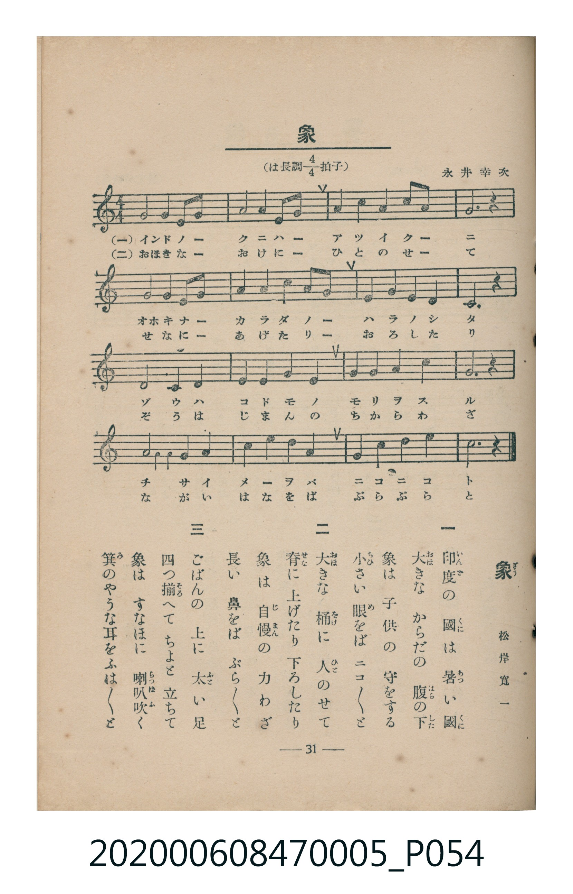

# 象

<audio controls src="zo.mp3"></audio>

- 松岸寬一 作詞
- 永井幸次 作曲
- 臺灣教育會公認《新定兒童唱歌》尋常科第五學年用（2020.006.0847.0005）

## 說明

原書資訊與歌詞全文（對應 P054.jpg，書頁 p. 31，第三學期第 5 首）：
調性與拍號：は長調四分之四拍子（C 大調 4/4 拍）
作詞：松岸寬一　作曲：永井幸次

## 歌詞

```text
一　印度（いんど）の國（くに）は暑い（あつ）國（くに）
大（おほ）きなからだの腹（はら）の下（した）
象は子供の守をする
小（ちひ）さい眼（め）をばニコ／＼と

二　大（おほ）きな桶（をけ）に人（ひと）のせて
脊（せな）に上げたり下ろしたり
象は自慢（じまん）の力わざ
長い鼻をばぶら／＼と

三　ごばんの上に太（ふと）い足
四つ揃（そろ）へてちよと立ちて
象はすなほに喇叭吹（らつぱふ）く
箕（み）のやうな耳をふは／＼と
```

## ABC

```abc
X:1
T:象
M:4/4
L:1/16
Q:1/4=96
K:C
V:V1 name="Piano" snm="Pia"
[V:V1]
E4 E2 E2 G4 G4 | A4 A4 G4 E4 | G4 G4 A4 A2 A2 | G12 z4 |
E4 E2 E2 G4 G4 | A4 A4 G4 E2 E2 | D4 D4 E4 D4 | C12 z4 |
D8 D4 E4 | F4 F4 E4 D4 | E4 E4 G4 A4 | G12 z4 |
c8 A4 G4 | E4 G4 A4 G4 | D4 E4 G4 A4 | c12 z4 |
```

## TMD 檔案連結

- [主旋律 TMD 檔案](zo.tmd) [[在 TMD Studio 編輯](https://tmdlang.github.io/Tmd-TS/#tmd=s7IKdvYPcrWy4tLSUnixcaGClhaXoq2CpRmXva2CM5eNib6JHVedgtKL9l3PGxc_mzrzRdOmZ3Oan7auebGq93FD17NpG56um_W0ddLz1UufTtn4bG3P44bupxu6n-7Y8Xz5xOdr1jzZNeXp2h1Pd255PmXF-z0dRgZGBnoGBmZ6BhYm5kCGgen7PZ1KIBuezd33dNOOp-vXPNnRoPBk75wXK-dBxDfseLJr6tOdO56tWQgSfzZ7kxIXl76Wgi21AJeCgsLTvvnPZu94sbn9xYquFx3tQH8A7X_auuLZtHagq59u6H3W3qkQYGBqopdVkP5-Tw9Q8csFjQoFegrGhkAuyKM7OoEefTZnPpCtYKrwctk0oM_e75kFMv3Fqv3PGpaDzO3ufTFzPlD0ceP6l1O3A8Wfzp79tKPtyc5uIAMo-3TtBKB9zgpPlywHSioAg18BKAo0CWQMJFSAupHD6nFDAyRUQOJIYcUF1gGWf9q74emuZUBzHze2PG6a_LhxJdDAx43rns7pBgv2P25cDRZZ_2zWRKAasGDT48YlQEE0NSBDgSaCDF2yHCzR9bhxN1hz7-PGVY8bux83AdkLgKa_aN0JVrAeKAKx78kOiFnTHzcCwwDJLGDCA6oD-v3Jvtkgd63reNw06XHjzMdN3UgWbugH6wYqBfoVaN5UoFOfz9kDEmxqBImA9Gx43Ax0wub3e4CK9zxuXAEJhl3AZIndxc8WbgMbANQ6ESy4-smuXWBlm4C6Ie5-3Ah01TIk57Z0gVUARVdB9ewAGgo0Yv7jpi6gLx83AY0G-RLIRffli_ZVz1oXgfXPeNy4Dxgf0Mjomv24CRjK0xAagCkE6MWXe3ZDfda4DRyUKD7b0QlS2zgFJA-KWmAgA52y-ukSoMuAVmyFeaLlxbbNSGE5G-j2Jc_6m8GK5gLdC1a0A-hNUAA3AQVXPF_dDQ5sZI-DfQCKGFBU7wbZM639af_apxPAUQ2K-SWPGzcCrQUb14_Q-XzdVLBV-6Eh2tTyuLENaMqLhs1gzwHduR7hM6A2yrM1FCho6XNxReVbBWQm5uU71BjUKFSDzFewsdCyAzOwFSUK4Azd8GJhj4KGiQIw5T1f36ADz_-aWDQAbYEa9rhpCYj1uHkzEHeCGH0gYo-CQg1Qbj1ErhtC9UMoqNwiCK8FTEFNAWoAyQOlIXoQAGpjjYKxgi4QGwMLHV0wrlEwA5IgDOKBZGvgchAZM6gIDBqA1IDTE-7Q2NVDZmisgvhqNpC5FsToQvLxaojcSgjVAKH64D6GBg9UGhiMoADZDtG6n8zQMAaKGAFZIAxSC6JrFAxJDI0dnWSGxj6Ygx83LYN4C-hJkH82Q3jABAOioEkB6GVQOEB50JDcBNG-EyIHDkIs4QDyFwjC_FmjYAIkQRjha0hYIVIGyakCWI6QFw7NjYhw2AqhgOkd5J-FEE8CEwjCr80TIHKQXAMLKgQPJNeBIxwM46DegSUBiLdhXoaIwAIJERBwbYiQqOXi0rVTiMpXAJLKXAA)]
- [鋼琴伴奏 TMD 檔案](zo_piano.tmd) [[在 TMD Studio 編輯](https://tmdlang.github.io/Tmd-TS/#tmd=s7IKdvYPcrWy4tLSUnixceH7PR0vu_c8n7DlyZ4tT5f2P-_seL-nU0FLi0vRVsHSjMveVsGZy8ZE38SOq05B6UX7rueNi59NnfmiadOzOc1PW9e8WNX7uKHr2bQNT9fNeto66fnqpU-nbHy2tudxQ_fTDd1Pd-x4vnzi8zVrnuya8nTtjqc7tzyfsgJoo5GBkYGegYGZnoGFiTmQYWAKtFQJZMOzufuebtrxdP2aJzsaFJ7snfNi5TyI-IYdT3ZNfbpzx7M1C0Hiz2ZvUuLiisq3CshMzMsP8nCoMahRqOZSAAIbCy07MENfS8EWHSiAHLOj4cXCHgUNE4WnG_qfr2_QUQgwMDXRyypI18SiQUsfbFiNgrGCLhAbK5gCaRCuUTADkiAM4oFka-ByEBkzqAgMGoDUcOF3264eWrjNGChiBGSBMEgtiK5RMCTRbTs6yXEbyC4QhNldo2ACJEEY4RKI-xFhR3K4PZ09mxy3GcZBrYAFFcQpMGdARGAORzgOrg3hulpEavRBSY0miNT4bFPn85Urny5ZDsx3z9YufbJnwpOd3UCXP-vufbp2wtPty551dkOyIZIL4xWiDWNhFDDsgAwTJD6UARUGhls8kGUaHwtmGAAdRpwxKNrADGQ9CHOwqcOvF4v5GM6Cux6vb7A6CxjuunYKUfkKcFKZCwA)]

## 分析

```text
================================================================================
📊 TMD Song Profile: [ 象 ]
================================================================================
⏱  Duration:       0:40 (40.0s), 16 measures total
🎼 Key & Tempo:    首調基準 C, != 96.0 BPM, <4/4>
   - 分析範圍：      由實際發聲的音符與和弦推測調性；播放脈絡另行呈現
🎤 人聲音域:    C4 (MIDI 60) – C5 (MIDI 72) [跨度: 12 個半音 / 1.0 個八度, 難度: easy]
   - 最低音:  C4 in [Zo #1 @ m.8, 0:17]
   - 最高音: C5 in [Zo #1 @ m.13, 0:30]
   - 適合: soprano, mezzo-soprano, contralto, tenor, baritone, bass
🏛  結構:      Zo (40.0s)
⚡ 編曲密度:        Peak 1 軌道同時演奏
🗝  調性診斷：       G 大調（純淨自然大調，未偵測到可信轉調）
   - 風格氣質:    純淨自然大調（陽光明朗、易唱易記，無明顯調外色彩）
   - 轉調歷程:    全曲維持單一推測調性（未偵測到可信轉調）
   - 核心骨幹音:  G, E, A, C, D
   - 調性數值:    G 大調 [相關度: 0.78, 穩定度: Moderate, 自然音純度: 96.7%]
   - 候選調性 (K-S): G 大調 (0.78), C 大調 (0.74), E 小調 (0.71)
   - 五度圈歷程:   +1
   - 各段落調性細節:
     • [Zo #1]: G 大調 (r: 0.78, 自然音純度: 96.7%, 調外音: F)

  [ 五度圈游移軌跡 ]
               C  
         F           [G ]*
      Bb               D  
      Eb               A  
         Ab           E  
            Db       B  
               F# 
     (* = active key center)

  [ 十二半音累積音高分佈 ]
     C  : ██████████                13.3%
     C# :                            0.0%
     D  : ██████████                13.3%
     D# :                            0.0%
     E  : ████████████████          21.7%
     F  : ███                        3.3%
     F# :                            0.0%
     G  : ████████████████████████  31.7%
     G# :                            0.0%
     A  : █████████████             16.7%
     A# :                            0.0%
     B  :                            0.0%
--------------------------------------------------------------------------------
Assignment 軌道音域：
  - Piano         : C4 – C5 (12 個半音 / 1.0 個八度, 54 個音符)
================================================================================
```


## 原書掃描頁




