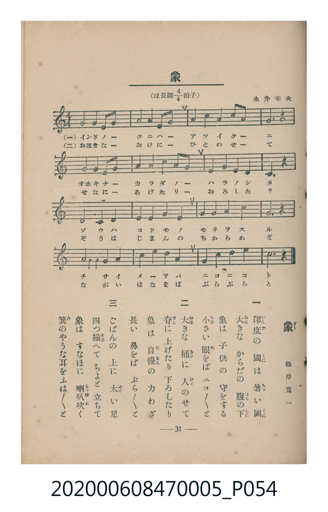

# 象

> Re:Shōka 使用 AI 協助辨識與重建樂譜，可能會有錯誤。歡迎回報。

<audio controls src="zo.mp3"></audio>

- 松岸寬一 作詞
- 永井幸次 作曲
- 臺灣教育會公認《新定兒童唱歌》尋常科第五學年用（2020.006.0847.0005）

## 說明

原書資訊與歌詞全文（對應 P054.jpg，書頁 p. 31，第三學期第 5 首）：
調性與拍號：は長調四分之四拍子（C 大調 4/4 拍）
作詞：松岸寬一　作曲：永井幸次

## 歌詞

```text
一　印度（いんど）の國（くに）は暑い（あつ）國（くに）
大（おほ）きなからだの腹（はら）の下（した）
象は子供の守をする
小（ちひ）さい眼（め）をばニコ／＼と

二　大（おほ）きな桶（をけ）に人（ひと）のせて
脊（せな）に上げたり下ろしたり
象は自慢（じまん）の力わざ
長い鼻をばぶら／＼と

三　ごばんの上に太（ふと）い足
四つ揃（そろ）へてちよと立ちて
象はすなほに喇叭吹（らつぱふ）く
箕（み）のやうな耳をふは／＼と
```

## ABC

```abc
X:1
T:象
M:4/4
L:1/16
Q:1/4=96
K:C
V:V1 name="Piano" snm="Pia"
[V:V1]
E4 E2 E2 G4 G4 | A4 A4 G4 E4 | G4 G4 A4 A2 A2 | G12 z4 |
w: 1.~イ ン ド ノ _ | ク ニ ハ _ | ア ツ イ ク _ | ニ
w: 2.~お ほ き な _ | を け に _ | ひ と の せ _ | て
w: 3.~ご ば ん の _ | う へ に _ | ふ と い あ _ | し
E4 E2 E2 G4 G4 | A4 A4 G4 E2 E2 | D4 D4 E4 D4 | C12 z4 |
w: 1.~オ ホ キ ナ _ | カ ラ ダ ノ _ | ハ ラ ノ シ | タ
w: 2.~せ な _ に _ | あ げ た り _ | お ろ し た | り
w: 3.~よ つ _ そ _ | ろ へ て _ _ | ちょ と た ち | て
D8 D4 E4 | F4 F4 E4 D4 | E4 E4 G4 A4 | G12 z4 |
w: 1.~ゾ ウ ハ | コ ド モ ノ | モ リ ヲ ス | ル
w: 2.~ぞ う は | じ ま ん の | ち か ら わ | ざ
w: 3.~ぞ う は | す な ほ に | らっ ぱ ふ _ | く
c8 A4 G4 | E4 G4 A4 G4 | D4 E4 G4 A4 | c12 z4 |
w: 1.~チ サ イ | メ _ ヲ バ | ニ コ ニ コ | ト
w: 2.~な が い | は な を ば | ぶ ら ぶ ら | と
w: 3.~みの やう な | み み を _ | ふ は ふ は | と
```

## TMD 檔案連結

- [主旋律 TMD 檔案](zo.tmd) [[在 TMD Studio 編輯](https://tmdlang.github.io/Tmd-TS/#tmd=s7IKdvYPcrWy4qpTUCpJTLdSSM7PyUlNLsnMz7MqzsjMK0nNjM_KTMmPL87Iz05Ugisry88pzU21Si9KTEmNN403MjAyiDcwMIs3sDAxBzIMTBFKi_NLi5JTrYqTM_Lzc-JLUitKkvLzsxHyBUX5Zal5iXlANQVFIBtTwIoQClLLMlNSQdKpKZkl-UWZiTlI7kgtKga7FWxJfElRYl5xclFmAcgDCFUlGalAxybmZeaC9GppKbzYuFBBS4tL0VbB0ozL3lbBmcvGRN_EDqThRfuu542Ln02d-aJp07M5zU9b17xY1fu4oevZtA1P18162jrp-eqlT6dsfLa253FD99MN3U937Hi-fOLzNWue7JrydO2Opzu3PJ-y4v2eDlCQ6AGDRA8UJECGgen7PZ1gJz2bu-_pph1P1695sqNB4cneOS9WzoOIb9jxZNfUpzt3PFuzECT-bPYmJS4ufS0FW2oBLgUFhad985_N3vFic_uLFV0vOtqB_gDa_7R1xbNp7UBXP93Q-6y9UyHAwNREL6sg_f2eHqDilwsaFQr0FIwNgVyQR3d0Aj36bM58IFvBVOHlsmlAn73fMwtk-otV-581LAeZ2937YuZ8oOjjxvUvp24Hij-dPftpR9uTnd1ABlD26doJQPucFZ4uWQ6UVAAGvwJQFGgSyBhIqAB1I4fV44YGSKiAxJHCigusAyz_tHfD013LgOY-bmx53DT5ceNKoIGPG9c9ndMNFux_3LgaLLL-2ayJQDVgwabHjUuAgmhqwGG1ZDlYqOtx426wtt7HjaseN3Y_bgKyFwDNfdG6E6xgPVAEYtOTHRBTpj9uBPoebAowsQFVAP37ZN9skFvWdTxumvS4cebjpm6wJRv6wTqAioA-A5oxFeiw53P2gASbGkEiINUbHjcDrd38fg9Q8Z7HjSsgnt4FTIQNWF35bOE2sAFArRPBgquf7NoFVrYJqBvi1seNQPcsAzuxpQssB-SvgqreATQOqHn-46YuoJ8eNwENBfkJyEX46UX7qmeti8A6Zzxu3AcMcWhwd81-3AQMx2kgpcDYB3ro5Z7dUH80bgMHFoo_dnQC_fG4cQpIHhRtwGAEWr_66RKga4CGb4U5ueXFts3gMJsNdOmSZ_3NYOm5QNeBpXcAvQMKyCag4Irnq7vBgQrxINi9oEAHReBukNnT2p_2r306ARyBoPhc8rhxI9AqsEH9ID3P100FG78fGlpNLY8b24D6XzRsBnsF6Kr1CH8ANVCeQaFAQUufiysq3yogMzEv36HGoKYaZLyCjYWWHZiBrUxQAOfMhhcLexQ0TECJ6vn6Bh14RtbEogFoCdSwx01LQKzHzZuBuBPE6AMRexQUaoBy6yFy3RCqH0JB5RZBeC1gCmoKUANIHigN0YMAUBtrFIwVdIHYGFh66IJxjYIZkARhEA8kWwOXg8iYQUVg0ACkBmyajyHIIUuAfJj7Qc6HqII4HyTTDSb7kcQXgUVaQCREN1glxNUIe-IR9hgB5Rq7QCobdwNxLxCvQjJvElhmIphcjRBv3AQWWQEm14HJ2VCZZdjtMQbJTQGr3AA0dzJUH8y8NrDMDgx7tiLZA_ZVYxNUZjqGPfhT0a4eMlPRKkhqmA1krgUxupBSymqI3EoI1QCh-uApBZqsoNLA5AdKSNshWveTmYqMgSJGQBYIg9SC6BoFQ6TQQE9FoPiEuR_kfETsgkIa5DwQ2QAmQWkM4nKEDEgM5GyInv3Y4xecjkBpAJJ-UGMRFGfAghdMzgebBnIFPOU19YJlQDEKkQfZA3MnlnTU1AFWCU7fjXOR_AMxB5KKYOkQZAuw8GwHC0ISEtgJjQuhkpgJlkBx1ElmQtoHi-vHTcsgKQKYPkDO3gzhAcsoEAUtfYCpBRQRUB40EW6CaN8JkQOnPixJCJQkQBCWRGoUTIAkCCMSDCSZIQoj_AXRPqg4yOWwIgfichCvE0xCih5YAoLwIEkPXFgAHQ2RgSUMbAloHsweaIEALbwaZ4B5IFeAig5YoQOOWjAPXBA2gd3RBHVb4zTs9oALIlz2zATzIAl4N5gEuRbkU2BluRgssBFMgsolWOqClb9EJiBgNU9eAmpuRCSgrRAKWDeBgnQhJHUACyVEImmeAJGD1HCwNIbggeQ6cCQgwziod2DFDiS9wNIKRASWuhApCK4NSxICOh6WhMBlOrh2grgdKg5JJkBnI-orWAJDsCGuxp2AYHXX48YeMAmqM0Di4PoSErHQOm0DVGYbWAycdJDYIBlQYYErAe1HVF-QJhTcfLAsmAcmwbbBUgqkNoO4BcHGblctF5eunUJUvgKQVOYCAA)]
- [鋼琴伴奏 TMD 檔案](zo_piano.tmd) [[在 TMD Studio 編輯](https://tmdlang.github.io/Tmd-TS/#tmd=s7IKdvYPcrWy4tLSUnixceH7PR0vu_c8n7DlyZ4tT5f2P-_seL-nU0FLi0vRVsHSjMveVsGZy8ZE38SOq05B6UX7rueNi59NnfmiadOzOc1PW9e8WNX7uKHr2bQNT9fNeto66fnqpU-nbHy2tudxQ_fTDd1Pd-x4vnzi8zVrnuya8nTtjqc7tzyfsgJoo5GBkYGegYGZnoGFiTmQYWAKtFQJZMOzufuebtrxdP2aJzsaFJ7snfNi5TyI-IYdT3ZNfbpzx7M1C0Hiz2ZvUuLiisq3CshMzMsP8nCoMaip5lIAAhsLLTswQ19LwRYdKIDcsqPhxcIeBQ0Thacb-p-vb9BRCDAwNdHLKkjXxKJBSx9sWI2CsYIuEBsrmAJpEK5RMAOSIAzigWRr4HIQGTOoCAwagNSATfMxrFF43LQEyH_cvBmIO4G4D6oKJLMeLNMNJvuRxBeBRVpAJEQ3WCVQBqwWBuMR9hgB5Rq7QCobdwNxLxCvQjJvElhmIphcjRBv3AQWWQEm14HJ2VCZZdjtMQbJTQGr3AA0dzJUH8y8NrDMDgx7tiLZA_ZVYxNUZjqGPfjjdFcPLeLUGChiBGSBMEgtiK5RMERyG3qcgkL3cfNsIGstkAaFPCysQf5-3LwSTDaASVCMg-IOFMMwGZDY46btUD37sYc2OFZBMQKJTdQwBYXg40ZIzM4HmwZyBTwdNPWCZUDhC5EH2QNzJ5ZYbeoAqwSntsa5SP6BmAOJU1iqANmy8HFTO1gQEq1gJzQuhEpiJh8CWbWTnGgFRRMIwqKtRsEESIIwIhIhUY_Irviz6j6o-OMmkA8gUQYS3wzmdYJJSOaERSqEB0kO4OzUtBMqA4ssbJE6D2YPNMtAs3fjDDAP5ApQ5oJlS3Bwg3ngoqIJ7I4mqNsap2G3B5xVcdkzE8yDJKrdYBLkWpBPOx83LgYLbASToJwLi3FYCUVkpD6dPZucSDWMg1oBy56QOITFH0QEFuOIWIVrwxKtzY2wYGgCl0TgMhUkDgpUsDgk6ponQMUhwQyJdAQbJAPKJbgiFVbiPm7sAZOgkg4kDi7lIYENLYk3QGW2gcXA0YnEBsmAMhWuSN2PKHQfN7XAohZkPlgWzAOTYNtgsQcpgyFuQbCx21WLqHJ9kKtcE0SV-2xT5_OVK58uWQ5sWzxbu_TJnglPdnYDo_xZd-_TtROebl_2rLMb0tRAitp4hWjDWBgFzK1AhgkSH8qACgNzajyQZRofC2YYQMOAsDEo2sAMZD0Ic7Cpw68Xi_kYzoK7Hq9vsDoLGOy6dgpR-dE-QDEoywjOMgazlLkA)]

## 分析

```text
================================================================================
📊 TMD Song Profile: [ 象 ]
================================================================================
⏱  Duration:       0:40 (40.0s), 16 measures total
🎼 Key & Tempo:    首調基準 C, != 96.0 BPM, <4/4>
   - 分析範圍：      由實際發聲的音符與和弦推測調性；播放脈絡另行呈現
🎤 人聲音域:    C4 (MIDI 60) – C5 (MIDI 72) [跨度: 12 個半音 / 1.0 個八度, 難度: easy]
   - 最低音:  C4 in [Zo #1 @ m.8, 0:17]
   - 最高音: C5 in [Zo #1 @ m.13, 0:30]
   - 適合: soprano, mezzo-soprano, contralto, tenor, baritone, bass
🏛  結構:      Zo (40.0s)
⚡ 編曲密度:        Peak 1 軌道同時演奏
🗝  調性診斷：       G 大調（純淨自然大調，未偵測到可信轉調）
   - 風格氣質:    純淨自然大調（陽光明朗、易唱易記，無明顯調外色彩）
   - 轉調歷程:    全曲維持單一推測調性（未偵測到可信轉調）
   - 核心骨幹音:  G, E, A, C, D
   - 調性數值:    G 大調 [相關度: 0.78, 穩定度: Moderate, 自然音純度: 96.7%]
   - 候選調性 (K-S): G 大調 (0.78), C 大調 (0.74), E 小調 (0.71)
   - 五度圈歷程:   +1
   - 各段落調性細節:
     • [Zo #1]: G 大調 (r: 0.78, 自然音純度: 96.7%, 調外音: F)

  [ 五度圈游移軌跡 ]
               C  
         F           [G ]*
      Bb               D  
      Eb               A  
         Ab           E  
            Db       B  
               F# 
     (* = active key center)

  [ 十二半音累積音高分佈 ]
     C  : ██████████                13.3%
     C# :                            0.0%
     D  : ██████████                13.3%
     D# :                            0.0%
     E  : ████████████████          21.7%
     F  : ███                        3.3%
     F# :                            0.0%
     G  : ████████████████████████  31.7%
     G# :                            0.0%
     A  : █████████████             16.7%
     A# :                            0.0%
     B  :                            0.0%
--------------------------------------------------------------------------------
Assignment 軌道音域：
  - Piano         : C4 – C5 (12 個半音 / 1.0 個八度, 54 個音符)
================================================================================
```


## 原書掃描頁




