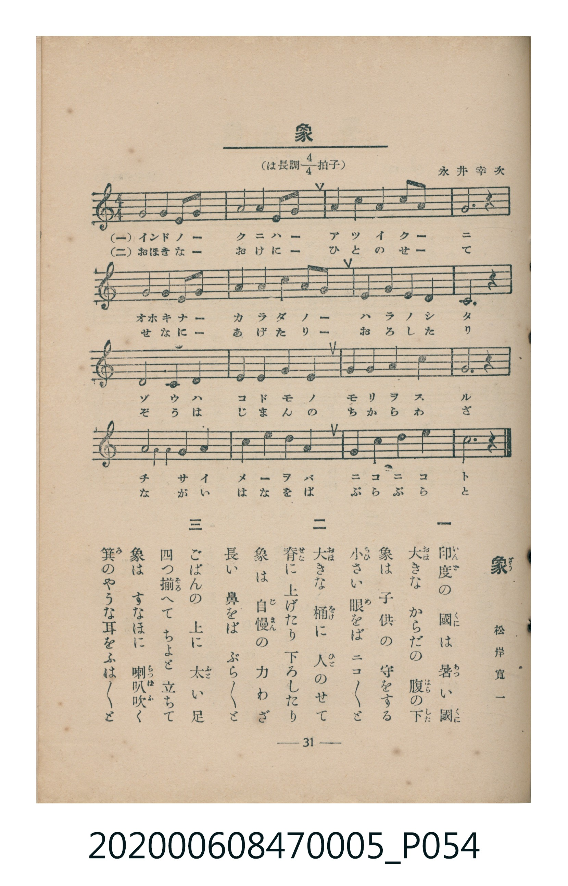

# 象

> Re:Shōka 使用 AI 協助辨識與重建樂譜，可能會有錯誤。歡迎[回報](https://github.com/TMDLang/reshoka/issues)。

- **鋼琴伴奏版**：<br><audio controls src="zo.mp3"></audio>
- **NEUTRINO 歌聲合成版**：<br><audio controls src="zo_neutrino.mp3"></audio>

- 松岸寬一 作詞
- 永井幸次 作曲
- 臺灣教育會公認《新定兒童唱歌》尋常科第五學年用（2020.006.0847.0005）

## 說明

原書資訊與歌詞全文（對應 P054.jpg，書頁 p. 31，第三學期第 5 首）：
調性與拍號：は長調四分之四拍子（C 大調 4/4 拍）
作詞：松岸寬一　作曲：永井幸次


## 歌詞

```text
一　印度（いんど）の國（くに）は暑い（あつ）國（くに）
大（おほ）きなからだの腹（はら）の下（した）
象は子供の守をする
小（ちひ）さい眼（め）をばニコ／＼と

二　大（おほ）きな桶（をけ）に人（ひと）のせて
脊（せな）に上げたり下ろしたり
象は自慢（じまん）の力わざ
長い鼻をばぶら／＼と

三　ごばんの上に太（ふと）い足
四つ揃（そろ）へてちよと立ちて
象はすなほに喇叭吹（らつぱふ）く
箕（み）のやうな耳をふは／＼と
```

## ABC

<div class="abc-score" data-abc-src="zo.abc" aria-label="五線譜載入中"></div>

[下載 ABC 原始檔](zo.abc)

## TMD 檔案連結

- [主旋律 TMD 檔案](zo.tmd) [[在 TMD Studio 編輯](https://tmdlang.github.io/Tmd-TS/#tmd=s7IKdvYPcrWy4qpTUCpJTLdSSM7PyUlNLsnMz7MqzsjMK0nNjM_KTMmPL87Iz05Ugisry88pzU21Si9KTEmNN403MjAyiDcwMIs3sDAxBzIMTBFKi_NLi5JTrYqTM_Lzc-JLUitKkvLzsxHyBUX5Zal5iXlANQVFIBtTwIoQClLLMlNSQdKpKZkl-UWZiTlI7kgtKga7FWxJfElRYl5xclFmAcgDCFUlGalAxybmZeYi6wUalZ6ZZ1WSmAn0HMiD5YnxuYmZeTmJeSnIqkoy8oH-LMiotMrILAY5IDkxJz47MQ8pOKDWFySmp1oFGJiaKHFpaSm82LhQQUuLS9FWwdKMy95WwZnLxkTfxA6k6UX7rueNi59NnfmiadOzOc1PW9e8WNX7uKHr2bQNT9fNeto66fnqpU-nbHy2tudxQ_fTDd1Pd-x4vnzi8zVrnuya8nTtjqc7tzyfsuL9ng5QuOsBw10PFO5AhoHp-z2dYGc9m7vv6aYdT9evebKjQeHJ3jkvVs6DiG_Y8WTX1Kc7dzxbsxAk_mz2JiUuLn0tBVtqAS4FBYWnffOfzd7xYnP7ixVdLzragf4A2v-0dcWzae1AVz_d0PusvVMBFFB6WQXp7_f0ABW_XNCoUKCnYGwI5II8uqMT6NFnc-YD2QqmCi-XTQP67P2eWSDTX6za_6xhOcjc7t4XM-cDRR83rn85dTtQ_Ons2U872p7s7AYygLJP104A2ues8HTJcqCkAjD4FYCiQJNAxkBCBagbOaweNzRAQgUkjhRWXGAdYPmnvRue7loGNPdxY8vjpsmPG1cCDXzcuO7pnG6wYP_jxtVgkfXPZk0EqgELNj1uXAIURFMDDqsly8FCXY8bd4O19T5uXPW4sftxE5C9AGjui9adYAXrgSIQm57sgJgy_XEj0PdgU4CJDagC6N8n-2aD3LKu43HTpMeNMx83dYMt2dAP1gFUBPQZ0IypQIc9n7MHJNjUCBIBqd7wuBlo7eb3e4CK9zxuXAHx9C5gImzA6spnC7eBDQBqnQgWXP1k1y6wsk1A3RC3Pm4EumcZ2IktXWA5IH8VVPUOoHFAzfMfN3UB_fS4CWgoyE9ALsJPL9pXPWtdBNY543HjPmCIQ4O7a_bjJmA4TgMpBcY-0EMv9-yG-qNxGziwUPyxoxPoj8eNU0DyoGgDBiPQ-tVPlwBdAzR8K8zJLS-2bQaH2WygS5c8628GS88Fug4svQPoHVBANgEFVzxf3Q0OVIgHwe4FBTooAneDzJ7W_rR_7dMJ4AgExeeSx40bgVaBDeoH6Xm-birY-P3Q0GpqedzYBtT_omEz2CtAV61H-AOogfIMCgUKWvpcXFH5VgGZiXn5DjUGNdUg4xVsLLTswAxsZYICOGc2vFjYo6BhAkpUz9c36MAzsiYWDUBLoIY9bloCYj1u3gzEnSBGH4jYo6BQA5RbD5HrhlD9EAoqtwjCawFTUFOAGkDyQGmIHgSA2lijYKygC8TGwNJDF4xrFMyAJAiDeCDZGrgcRMYMKgKDBiA1YNN8DEEOWQLkw9wPcj5EFcT5IJluMNmPJL4ILNICIiG6wSohrkbYE4-wxwgo19gFUtm4G4h7gXgVknmTwDITweRqhHjjJrDICjC5DkzOhsosw26PMUhuCljlBqC5k6H6YOa1gWV2YNizFckesK8am6Ay0zHswZ-KdvWQmYpWQVLDbCBzLYjRhZRSVkPkVkKoBgjVB08p0GQFlQYmP1BC2g7Rup_MVGQMFDECskAYpBZE1ygYIoUGeioCxSfM_SDnI2IXFNIg54HIBjAJSmMQlyNkQGIgZ0P07Mcev-B0BEoDkPSDGougOAMWvGByPtg0kCvgKa-pFywDilGIPMgemDuxpKOmDrBKcPpunIvkH4g5kFQES4cgW4CFZztYEJKQwE5oXAiVxEywBIqjTjIT0j5YXD9uWgZJEcD0AXL2ZggPWEaBKGjpA0wtoIiA8qCJcBNE-06IHDj1YUlCoCQBgrAkUqNgAiRBGJFgIMkMURjhL4j2QcVBLocVORCXg3idYBJS9MASEIQHSXrgwgLoaIgMLGFgS0DzYPZACwRo4dU4A8wDuQJUdMAKHXDUgnnggrAJ7I4mqNsap2G3B1wQ4bJnJpgHScC7wSTItSCfAivLxWCBjWASVC7BUhes_CUyAQGrefISUHMjIgFthVDAugkUpAshqQNYKCESSfMEiBykhoOlMQQPJNeBIwEZxkG9Ayt2IOkFllYgIrDUhUhBcG1YkhDQ8bAkBC7TwbUTxO1QcUgyATobUV_BEhiCDXE17gQEq7seN_aASVCdARIH15eQiIXWaRugMtvAYuCkg8QGyYAKC1wJaD-i-oI0oeDmg2XBPDAJtg2WUiC1GcQtCDZ2u2q5uHTtFKLyFYCkMhcA)]
- [鋼琴伴奏 TMD 檔案](zo_piano.tmd) [[在 TMD Studio 編輯](https://tmdlang.github.io/Tmd-TS/#tmd=s7IKdvYPcrWy4qpTUCpJTLdSyC8qychPL0osyKi0ysgsLskvykxOzInPTsxLVIIrKs4vLUpOjS9ITE-1CjAwNVHi0tJSeLFx4fs9HS-79zyfsOXJni1Pl_Y_7-x4v6dTQUuLS9FWwdKMy95WwZnLxkTfxA5k0ov2Xc8bFz-bOvNF06Znc5qftq55sar3cUPXs2kbnq6b9bR10vPVS59O2fhsbc_jhu6nG7qf7tjxfPnE52vWPNk15enaHU93bnk-ZQXQRiMDIwM9AwMzPQMLE3Mgw8AUaCnYrc_m7nu6acfT9Wue7GhQeLJ3zouV8yDiG3Y82TX16c4dz9YsBIk_m71JiYsrKt8qIDMxLz_Iw6HGoKaaSwEIbCy07MAMfS0FW3SgAHLLjoYXC3sUNEwUnm7of76-QUcBFB56WQXpmlg0aOmDDatRMFbQBWJjBVMgDcI1CmZAEoRBPJBsDVwOImMGFYFBA5AasGk-hjUKj5uWAPmPmzcDcScQ90FVgWTWg2W6wWQ_kvgisEgLiIToBqsEyoDVwmA8wh4joFxjF0hl424g7gXiVUjmTQLLTASTqxHijZvAIivA5DowORsqswy7PcYguSlglRuA5k6G6oOZ1waW2YFhz1Yke8C-amyCykzHsAd_nO7qoUWcGgNFjIAsEAapBdE1CoZIbkOPU1DoPm6eDWStBdKgkIeFNcjfj5tXgskGMAmKcVDcgWIYJgMSe9y0HapnP_bQBscqKEYgsYkapqAQfNwIidn5YNNAroCng6ZesAwofCHyIHtg7sQSq00dYJXg1NY4F8k_EHMgcQpLFSBbFj5uagcLQqIV7ITGhVBJzORDIKt2khOtoGgCQVi01SiYAEkQRkQiJOoR2RV_Vt0HFX_cBPIBJMpA4pvBvE4wCcmcsEiF8CDJAZydmnZCZWCRhS1S58HsgWYZaPZunAHmgVwBylywbAkObjAPXFQ0gd3RBHVb4zTs9oCzKi57ZoJ5kES1G0yCXAvyaefjxsVggY1gEpRzYTEOK6GIjNSns2eTE6mGcVArYNkTEoew-IOIwGIcEatwbViitbkRFgxN4JIIXKaCxEGBChaHRF3zBKg4JJghkY5gg2RAuQRXpMJK3MeNPWASVNKBxMGlPCSwoSXxBqjMNrAYODqR2CAZUKbCFan7EYXu46YWWNSCzAfLgnlgEmwbLPYgZTDELQg2drtqEVWuD3KVa4Kocp9t6ny-cuXTJcuBbYtna5c-2TPhyc5uYJQ_6-59unbC0-3LnnV2Q5oaSFEbrxBtGAujgLkVyDBB4kMZUGFgTo0HskzjY8EMA2gYEDYGRRuYgawHYQ42dfj1YjEfw1lw1-P1DVZnAYNd104hKj_aBygGZRnBWcZgljIXAA)]

## 分析

```text
================================================================================
📊 TMD Song Profile: [ 象 ]
================================================================================
⏱  Duration:       0:40 (40.0s), 16 measures total
🎼 Key & Tempo:    首調基準 C, != 96.0 BPM, <4/4>
   - 分析範圍：      由實際發聲的音符與和弦推測調性；播放脈絡另行呈現
🎤 人聲音域:    C4 (MIDI 60) – C5 (MIDI 72) [跨度: 12 個半音 / 1.0 個八度, 難度: easy]
   - 最低音:  C4 in [Zo #1 @ m.8, 0:17]
   - 最高音: C5 in [Zo #1 @ m.13, 0:30]
   - 適合: soprano, mezzo-soprano, contralto, tenor, baritone, bass
🏛  結構:      Zo (40.0s)
⚡ 編曲密度:        Peak 1 軌道同時演奏
🗝  調性診斷：       G 大調（純淨自然大調，未偵測到可信轉調）
   - 風格氣質:    純淨自然大調（陽光明朗、易唱易記，無明顯調外色彩）
   - 轉調歷程:    全曲維持單一推測調性（未偵測到可信轉調）
   - 核心骨幹音:  G, E, A, C, D
   - 調性數值:    G 大調 [相關度: 0.78, 穩定度: Moderate, 自然音純度: 96.7%]
   - 候選調性 (K-S): G 大調 (0.78), C 大調 (0.74), E 小調 (0.71)
   - 五度圈歷程:   +1
   - 各段落調性細節:
     • [Zo #1]: G 大調 (r: 0.78, 自然音純度: 96.7%, 調外音: F)

  [ 五度圈游移軌跡 ]
               C  
         F           [G ]*
      Bb               D  
      Eb               A  
         Ab           E  
            Db       B  
               F# 
     (* = active key center)

  [ 十二半音累積音高分佈 ]
     C  : ██████████                13.3%
     C# :                            0.0%
     D  : ██████████                13.3%
     D# :                            0.0%
     E  : ████████████████          21.7%
     F  : ███                        3.3%
     F# :                            0.0%
     G  : ████████████████████████  31.7%
     G# :                            0.0%
     A  : █████████████             16.7%
     A# :                            0.0%
     B  :                            0.0%
--------------------------------------------------------------------------------
Assignment 軌道音域：
  - Piano         : C4 – C5 (12 個半音 / 1.0 個八度, 54 個音符)
================================================================================
```


## 原書掃描頁




