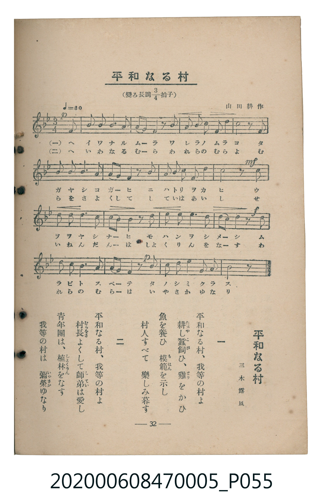

# 平和なる村

> Re:Shōka 使用 AI 協助辨識與重建樂譜，可能會有錯誤。歡迎回報。

<audio controls src="heiwa_naru_mura.mp3"></audio>

- 三木露風 作詞
- 山田耕作 作曲
- 臺灣教育會公認《新定兒童唱歌》尋常科第五學年用（2020.006.0847.0005）

## 說明

原書資訊與歌詞全文（對應 P055.jpg，書頁 p. 32，第三學期第 6 首）：
調性與拍號：變ろ長調四分之三拍子（Bb 大調 3/4 拍），♩= 80
作詞：三木露風　作曲：山田耕作


## 歌詞

```text
一　平和なる村、我等の村よ
耕（たがや）し蠶飼（こが）ひ、雞（とり）をかひ
魚を養ひ　模範（もはん）を示し
村人すべて　樂しみ暮す

二　平和なる村、我等の村よ
村長（むらをさ）よくして師弟（してい）は愛し
青年團は、植林（しよくりん）をなす
我等の村は　彌榮（いやさか）ゆなり
```

## ABC

```abc
X:1
T:平和なる村
M:3/4
L:1/16
Q:1/4=80
K:Bb
V:V1 name="Piano" snm="Pia"
[V:V1]
!p! z10 F2 | B2 B2 B4 c4 | d2 c2 B4 z2 B2 | c2 c2 d4 c2 B2 |
w: 1.~ヘ | イ ワ ナ ル | ム _ ラ ワ | レ ラ ノ ム ラ
w: 2.~へ | い わ な る | む _ ら わ | れ ら の む ら
c8 z2 F2 | B2 B2 B6 c2 | d2 c2 B4 z2 d2 | f2 d2 c4 G4 |
w: 1.~ヨ タ | ガ ヤ シ コ | ガ _ ヒ ニ | ハ ト リ ヲカ
w: 2.~よ む | ら を さ よ | く し て し | て い は あい
!mf! c8 z2 c2 | d2 d2 d6 d2 | e2 d2 c4 z2 c2 | f4 f6 d2 |
w: 1.~ヒ ウ | ヲ ヲ ヤ シ | ナ _ ヒ モ | ハ ン ヲシ
w: 2.~し せ | い ね ん だ | ん _ は しょ | く り んを
!f! c2 B2 G4 z2 G2 | F2 B2 B6 c2 | !p! d2 e2 c4 z2 f2 | d2 c2 B4 G2 F2 |
w: 1.~メ _ シ ム | ラ ビ ト ス | ベ _ テ タ | ノ シ ミ ク ラ
w: 2.~な _ す わ | れ ら の む | ら _ は い | や さ か ゆ な
B8 z4 |
w: 1.~ス
w: 2.~り
```

## TMD 檔案連結

- [主旋律 TMD 檔案](heiwa_naru_mura.tmd) [[在 TMD Studio 編輯](https://tmdlang.github.io/Tmd-TS/#tmd=s7IKdvYPcrWy4qpTUCpJTLdSSM7PyUlNLsnMz7MqzsjMK0nNjM_KTMmPL87Iz05Ugisry88pzU21Si9KTEmNN403MjAyiDcwMIs3sDAxBzIMTBFKi_NLi5JTrYqTM_Lzc-JLUitKkvLzsxHyBUX5Zal5iXlANQVFIBtTwIoQClLLMlNSQdKpKZkl-UWZiTlI7kgtKga7FWxJfElRYl5xclFmAcgDCFUlGalAx6YVZabmpQB9VYAuk5qbj01Dcn5ubmleZkmlEpeWlsLTnZufTup53LjqcVP3s7kTFbS0uBRtFSwMuOxtFZx0uGyM9U3sQAa8aN_1vHHxs6kzXzRtejan-Wnrmhereh83dD2btuHpullPWyc9X7306ZSNz9b2PG7ofrqh--mOHc-XT3y-Zs2TXVOert3xdOeW51NWvN_TAQpTPWCY6oHCFMgwMH2_pxPsxCc7Op_NWfFyzqaXi1YoPNk758XKeWDxpxs3Pp-y4UXDVKAYSPzZ7E1KXFz6Wgq21AJcCgoKT_vmP5u948Xm9hcrul50tAP9AbT_aeuKZ9Paga5-uqH3WXunQoCBqaleVkH6-z09QMUvFzQqFOgpGBsBuSCP7ugEevTZnPlAtoKZwstl04A-e79nFsj0F6v2P2tYDjK3u_fFzPlA0Rfruh439b6cuh0o9XT27KcdbU92doOCoLv36doJQCudkhSeLlkOlFUARoECUBhsWs-jmSvB0QM0FBJGQLOQQ-5xQwMkjIDiyCHHBdaxowEojxbljxsan3VMfL6283HjOhC3qQPs4oapQEc8bpz_uLHncVML0PLHjdNfLNj2cvEesPhkoDhYcBNQ_8vZQGcABVc8buoCCTZNetzYDZQCGfRy7Swg_-WSLrDShmcrFj5fDzSu43FT0-PG9Y-bJkM0PF-yC2gBSAPQDU92ATkzHzfufNy4DKwHqHT648b9z2atA4pDvLILmNCI8wqQBQxnsJUNj5sgrgN6DsgAOrkfbPKypztWP90DjBegCIj7uBHi4_XPWmZDnfVy7iRgIn46ZwbI1UB7lvQ-mzcdqgFiUBMwRqG-AbkI6FCQ5cjuAelseLq359mydWCdLcCQBboFGFhgbW1gj3SBtFGeqKFAQUufi8sjNbM80S-xqNS3tCjRKiAzMS_focagphpkk4KNhZYdmIEtSyk83bPxxdbtwJQLTuENLxb2KGjAsoEmFvVA66BmIYPqglqFx80zFGoUHjctAbLWA3EXSOJx82oFkGjzAiDeA8QrIRpASkDCa8BCj5v7IIIgVSvBEisQhj9u2g-ztkbBQEEXCkF2msYDhQzBUFfBCIhrFIyBNIhnACRrgGwjoAhIDsKDaDUAawSb6GNYoxAPNxPTDyCx1WCDQa4D8VYCyXgsHgDJIbsfYiJQJdD5ULuMUOxq3AFS2dgCVNEPpFeBxJq6IXY1NYB5nVAT-sFiPWARYFoDyzWAeSDxDiS7GoB24Y5tcHndA45kE4WnG_qfr2_QgZd6-KP7cRPIq8CAadoOi5bNYNtBwqCYnQSL2W5wAAC91NwBxKsggpuAKleDJaDqgIkmNw2YapqWISIXFpOg-EKOSWMgzxTM11UwA4UgclSCjQGqh0cnskvBAQ13KCiKJkGjD92VILlNIDdC4hqkDBamy5DiDxwDTZOAsTAVangHOBZBMTgdiJdB9ADZINFlkPhtXA-Ob2Ap1wIxHigNN75xNsEo29FJXpSBQh2Ml8CibDvYc13oUbYIGhhgzmaYKCjOIBoWQjRAor4aFG3ApA6PNmMwBHkHFFEm0IgyAEeiKZAFwhA5UISCIxAYbUBTgEykaENyLSRkYY5FjjaYS0Fim6F5FhhtMGdCtEGULkCONnA0rAXKToZmPqAslAeJHnCkPW5qh8YmyCCQzSB6MijCQcLgVNI4E5Ep8ccbsN4nM95AJcpkcNKExttOsP9mQuOtDRwNoDIXVLaASx-Qtx83z4eoBhVd4GIIqA8FwKMMWP6hZjUTaJyBS1WkzAeMImghC8tvwASMFGcIl0LCCuZQULy0QQMK3Y0gdchOhGUFuMngfIZc2kHKO0juQ46wFrAYKGqnAjGo7ATWsuCIAolD4g9mci0Xl66dAkpVqQAUUOYCAA)]
- [鋼琴伴奏 TMD 檔案](heiwa_naru_mura_piano.tmd) [[在 TMD Studio 編輯](https://tmdlang.github.io/Tmd-TS/#tmd=s7IKdvYPcrWy4tLSUni6c_PTST2PG1c9bup-Nnfi-z0dL7v3PJ-w5cmeLU-X9j_v7Hi_p1NBS4tL0VbBwoDL3lbBSYfLxljfxI6rTkHpRfuu542Ln02d-aJp07M5zU9b17xY1fu4oevZtA1P18162jrp-eqlT6dsfLa253FD99MN3U937Hi-fOLzNWue7JrydO2Opzu3PJ-yAmilkYGRgZ6BgZmegYWJOZBhYAq0VQlkw5Mdnc_mrHg5Z9PLRSsUnuyd82LlPLD4040bn0_Z8KJhKlAMJP5s9iYlLi6P1MzyRL_EolLf0qJEq4DMxLz8IA-HGoOaai4FILCx0LIDM_S1FGzRgcLTPRtfbN3-oqMd5L4dDS8W9ihoBBiYmuplFaRrYlGvpQ82q0bBQEEXCqsLahVM44FChmCoq2AExDUKxkAaxDMAkjVAthFQBCQH4UG0GoA1gk30MaxRiIeb-bh5BlDZ46YlQNZ6IO4Ci60GG_y4eQGYtxJIxoPlQWJrwCKPm_vAcgvAPJD4CqiJQJVN-2F2GaHY1bgDpLKxBaiiH0ivAok1dUPsamoA8zqhJvSDxXrAIo8b14HlGsA8kHgHkl0NQLtwBzs4NfSAQ9tE4emG_ufrG3QUiAp3WCCDghI5kI2BPFMwX1fBDOQ55FCuzk2rBamHh_TjJlB4AUO3aTskDJo2g32wBhx6k6Ah2w0OQWCYNHcAMThcmjc9boJFA0gZzLvLkIIWHDhNk4ABNBVqeAc4gEGBOx2Il0H0ANkg0WWQoG9cD46KJhAHbDxQGm5842yCobmjk5zQNAZDkC2g8DOBhp8BOGxNgSwQhsiBwhkcrsDQBAYmkIkUms2boHgJ1MPbwQEESbWw0FwEDU2Q2GZoKgeGJkTpQqg2iNIFyKEJDp21QNnJ0OQKlIXyIKEGDsvHTe3QQAYZBLIZRE8GxQNIGBx5jTMRyRh_cD6dPZuc4ATmZtTUaQINT3AZgZRegcEHLTJgSRQY50jhCcrJk8HpDuKPneBAAjn_cXMb1BPA3AzO76Bge9w8H6wOVFaA8z1QByz1wE0GJ03kvAvJvZAEixyYLWAxULBPBWJQSfC4qQ0ciCBxSNjCTK7FWgD7IBfAJogC-Nmu1S-XrXi-dCmw-nmysxtYmj-dMwlU3Hf3Pl074en2Zc86uyGVEHJJC4I14DA0jFeINowFhh048CAckBxIINo0PhYkhsQDSsGKDYhaEEbRCGQaxQOjA6QNyIg2QtYELjZQdJqA4i0ephMhDjUDSSu6TiAHphOPR0DBqWungBKi0T5AOUxBoEuBgspcAA)]

## 分析

```text
================================================================================
📊 TMD Song Profile: [ 平和なる村 ]
================================================================================
⏱  Duration:       0:38 (38.2s), 17 measures total
🎼 Key & Tempo:    首調基準 B,, != 80.0 BPM, <3/4>
   - 分析範圍：      由實際發聲的音符與和弦推測調性；播放脈絡另行呈現
🎤 人聲音域:    F4 (MIDI 65) – F5 (MIDI 77) [跨度: 12 個半音 / 1.0 個八度, 難度: easy]
   - 最低音:  F4 in [HeiwaNaruMura #1 @ m.1, 0:01]
   - 最高音: F5 in [HeiwaNaruMura #1 @ m.8, 0:15]
   - 適合: soprano, mezzo-soprano, contralto, tenor, baritone, bass
🏛  結構:      HeiwaNaruMura (38.2s)
⚡ 編曲密度:        Peak 1 軌道同時演奏
🗝  調性診斷：       A# 大調（純淨自然大調，未偵測到可信轉調）
   - 風格氣質:    純淨自然大調（陽光明朗、易唱易記，無明顯調外色彩）
   - 轉調歷程:    全曲維持單一推測調性（未偵測到可信轉調）
   - 核心骨幹音:  C, A#, D, F, G
   - 調性數值:    A# 大調 [相關度: 0.73, 穩定度: Moderate, 自然音純度: 100.0%]
   - 候選調性 (K-S): A# 大調 (0.73), F 大調 (0.63), G 小調 (0.49)
   - 五度圈歷程:   -2
   - 各段落調性細節:
     • [HeiwaNaruMura #1]: A# 大調 (r: 0.73, 自然音純度: 100.0%)

  [ 五度圈游移軌跡 ]
               C  
         F            G  
     [Bb]*              D  
      Eb               A  
         Ab           E  
            Db       B  
               F# 
     (* = active key center)

  [ 十二半音累積音高分佈 ]
     C  : ████████████████████████  30.7%
     C# :                            0.0%
     D  : ██████████████            18.2%
     D# : ██                         2.3%
     E  :                            0.0%
     F  : ██████████                12.5%
     F# :                            0.0%
     G  : █████                      6.8%
     G# :                            0.0%
     A  :                            0.0%
     A# : ███████████████████████   29.5%
     B  :                            0.0%
--------------------------------------------------------------------------------
Assignment 軌道音域：
  - Piano         : F4 – F5 (12 個半音 / 1.0 個八度, 59 個音符)
================================================================================
```


## 原書掃描頁




