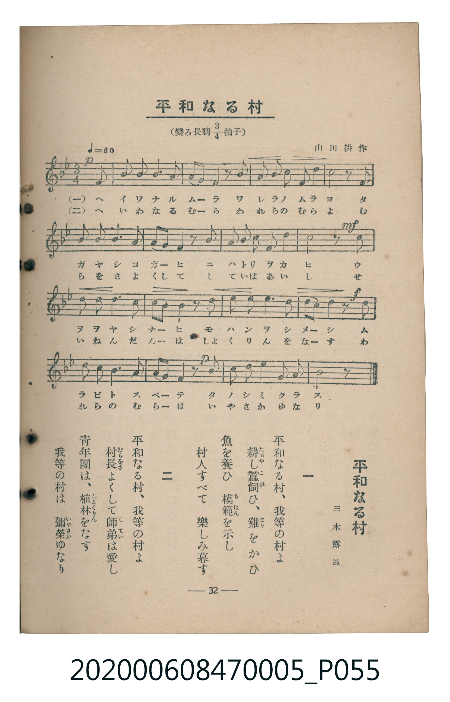

# 平和なる村

<audio controls src="heiwa_naru_mura.mp3"></audio>

- 三木露風 作詞
- 山田耕作 作曲
- 臺灣教育會公認《新定兒童唱歌》尋常科第五學年用（2020.006.0847.0005）

## 說明

原書資訊與歌詞全文（對應 P055.jpg，書頁 p. 32，第三學期第 6 首）：
調性與拍號：變ろ長調四分之三拍子（Bb 大調 3/4 拍），♩= 80
作詞：三木露風　作曲：山田耕作

## 歌詞

```text
一　平和なる村、我等の村よ
耕（たがや）し蠶飼（こが）ひ、雞（とり）をかひ
魚を養ひ　模範（もはん）を示し
村人すべて　樂しみ暮す

二　平和なる村、我等の村よ
村長（むらをさ）よくして師弟（してい）は愛し
青年團は、植林（しよくりん）をなす
我等の村は　彌榮（いやさか）ゆなり
```

## ABC

```abc
X:1
T:平和なる村
C:TMD (Chen, Chih-Han / aguai)
M:3/4
L:1/16
Q:1/4=80
K:Bb
V:V1 name="Piano" snm="Pia"
[V:V1]
!p! z10 F2 | B2 B2 B4 c4 | d2 c2 B4 z2 B2 | c2 c2 d4 c2 B2 |
c8 z2 F2 | B2 B2 B6 c2 | d2 c2 B4 z2 d2 | f2 d2 c4 G4 |
!mf! c8 z2 c2 | d2 d2 d6 d2 | e2 d2 c4 z2 c2 | f4 f6 d2 |
!f! c2 B2 G4 z2 G2 | F2 B2 B6 c2 | !p! d2 e2 c4 z2 f2 | d2 c2 B4 G2 F2 |
B8 z4 |
```

## TMD 檔案連結

- [主旋律 TMD 檔案](heiwa_naru_mura.tmd)
- [鋼琴伴奏 TMD 檔案](heiwa_naru_mura_piano.tmd)

## 分析

```text
================================================================================
📊 TMD Song Profile: [ 平和なる村 ]
================================================================================
⏱  Duration:       0:38 (38.2s), 17 measures total
🎼 Key & Tempo:    首調基準 B,, != 80.0 BPM, <3/4>
   - 分析範圍：      由實際發聲的音符與和弦推測調性；播放脈絡另行呈現
🎤 人聲音域:    F4 (MIDI 65) – F5 (MIDI 77) [跨度: 12 個半音 / 1.0 個八度, 難度: easy]
   - 最低音:  F4 in [HeiwaNaruMura #1 @ m.1, 0:01]
   - 最高音: F5 in [HeiwaNaruMura #1 @ m.8, 0:15]
   - 適合: soprano, mezzo-soprano, contralto, tenor, baritone, bass
🏛  結構:      HeiwaNaruMura (38.2s)
⚡ 編曲密度:        Peak 1 軌道同時演奏
🗝  調性診斷：       A# 大調（純淨自然大調，未偵測到可信轉調）
   - 風格氣質:    純淨自然大調（陽光明朗、易唱易記，無明顯調外色彩）
   - 轉調歷程:    全曲維持單一推測調性（未偵測到可信轉調）
   - 核心骨幹音:  C, A#, D, F, G
   - 調性數值:    A# 大調 [相關度: 0.73, 穩定度: Moderate, 自然音純度: 100.0%]
   - 候選調性 (K-S): A# 大調 (0.73), F 大調 (0.63), G 小調 (0.49)
   - 五度圈歷程:   -2
   - 各段落調性細節:
     • [HeiwaNaruMura #1]: A# 大調 (r: 0.73, 自然音純度: 100.0%)

  [ 五度圈游移軌跡 ]
               C  
         F            G  
     [Bb]*              D  
      Eb               A  
         Ab           E  
            Db       B  
               F# 
     (* = active key center)

  [ 十二半音累積音高分佈 ]
     C  : ████████████████████████  30.7%
     C# :                            0.0%
     D  : ██████████████            18.2%
     D# : ██                         2.3%
     E  :                            0.0%
     F  : ██████████                12.5%
     F# :                            0.0%
     G  : █████                      6.8%
     G# :                            0.0%
     A  :                            0.0%
     A# : ███████████████████████   29.5%
     B  :                            0.0%
--------------------------------------------------------------------------------
Assignment 軌道音域：
  - Piano         : F4 – F5 (12 個半音 / 1.0 個八度, 59 個音符)
================================================================================
```


## 原書掃描頁




