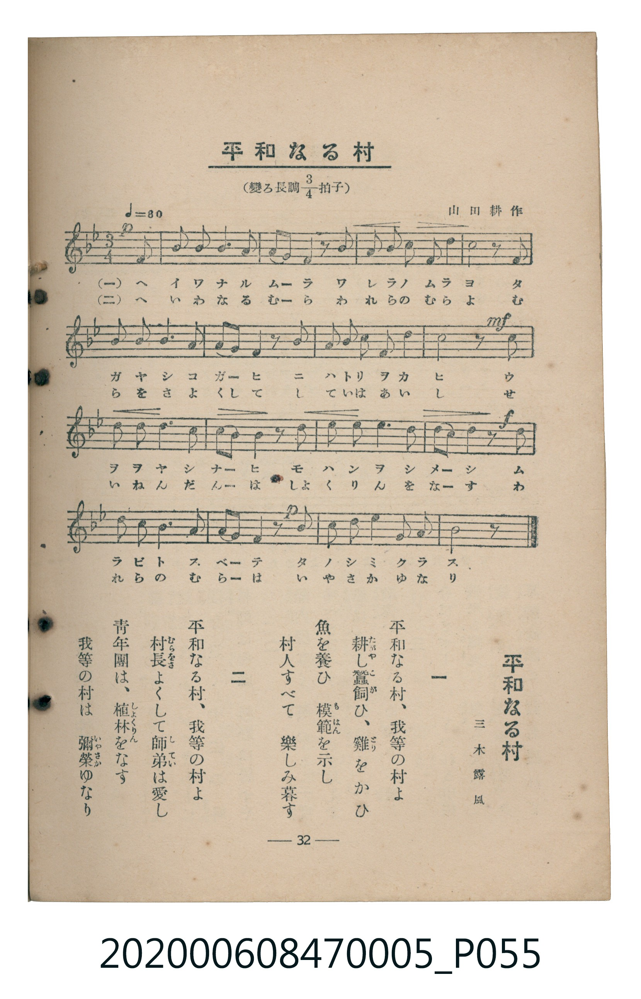

# 平和なる村

> Re:Shōka 使用 AI 協助辨識與重建樂譜，可能會有錯誤。歡迎回報。

- **鋼琴伴奏版**：<br><audio controls src="heiwa_naru_mura.mp3"></audio>
- **NEUTRINO 歌聲合成版**：<br><audio controls src="heiwa_naru_mura_neutrino.mp3"></audio>

- 三木露風 作詞
- 山田耕作 作曲
- 臺灣教育會公認《新定兒童唱歌》尋常科第五學年用（2020.006.0847.0005）

## 說明

原書資訊與歌詞全文（對應 P055.jpg，書頁 p. 32，第三學期第 6 首）：
調性與拍號：變ろ長調四分之三拍子（Bb 大調 3/4 拍），♩= 80
作詞：三木露風　作曲：山田耕作


## 歌詞

```text
一　平和なる村、我等の村よ
耕（たがや）し蠶飼（こが）ひ、雞（とり）をかひ
魚を養ひ　模範（もはん）を示し
村人すべて　樂しみ暮す

二　平和なる村、我等の村よ
村長（むらをさ）よくして師弟（してい）は愛し
青年團は、植林（しよくりん）をなす
我等の村は　彌榮（いやさか）ゆなり
```

## ABC

<div class="abc-score" data-abc-src="heiwa_naru_mura.abc" aria-label="五線譜載入中"></div>

[下載 ABC 原始檔](heiwa_naru_mura.abc)

## TMD 檔案連結

- [主旋律 TMD 檔案](heiwa_naru_mura.tmd) [[在 TMD Studio 編輯](https://tmdlang.github.io/Tmd-TS/#tmd=s7IKdvYPcrWy4qpTUCpJTLdSSM7PyUlNLsnMz7MqzsjMK0nNjM_KTMmPL87Iz05Ugisry88pzU21Si9KTEmNN403MjAyiDcwMIs3sDAxBzIMTBFKi_NLi5JTrYqTM_Lzc-JLUitKkvLzsxHyBUX5Zal5iXlANQVFIBtTwIoQClLLMlNSQdKpKZkl-UWZiTlI7kgtKga7FWxJfElRYl5xclFmAcgDCFUlGalAx6YVZabmpQB9VYAuk5qbj01Dcn5ubmleZkklQgJofXpmnlVJYiYwQECBUp4Yn5uYmZeTmJeCrKokIx8YNgUZlVYZmcUgRycn5sRnJ-YhBSHUyQWJ6alWAQamwBDT0lJ4unPz00k9jxtXPW7qfjZ3ooKWFpeirYKFAZe9rYKTDpeNsb6JHciEF-27njcufjZ15oumTc_mND9tXfNiVe_jhq5n0zY8XTfraeuk56uXPp2y8dnanscN3U83dD_dseP58onP16x5smvK07U7nu7c8nzKivd7OkARpweMOD1QxAEZBqbv93SC3fhkR-ezOSteztn0ctEKhSd757xYOQ8s_nTjxudTNrxomAoUA4k_m71JiYtLX0vBllqAS0FB4Wnf_Gezd7zY3P5iRdeLjnagP4D2P21d8WxaO9DVTzf0PmvvVACFml5WQfr7PT1AxS8XNCoU6CkYGwG5II_u6AR69Nmc-UC2gpnCy2XTgD57v2cWyPQXq_Y_a1gOMre798XM-UDRF-u6Hjf1vpy6HSj1dPbspx1tT3Z2g4Kgu_fp2glAK52SFJ4uWQ6UVQBGgQJQGGxaz6OZK8HRAzQUEkZAs5BD7nFDAySMgOLIIccF1rGjASiPFuWPGxqfdUx8vrbzceM6ELepA-zihqlARzxunP-4sedxUwvQ8seN018s2PZy8R6w-GSgOFhwE1D_y9lAZwAFVzxu6gIJNk163NgNlAIZ9HLtLCD_5ZIusNKGZysWPl8PNK7jcVPT48b1j5smQzQ8X7ILaAFIA9ANT3YBOTMfN-583LgMrAeodPrjxv3PZq0DikO8sguY0IjzCpAFDGewlQ2PmyCuA3oOyAA6uR9s8rKnO1Y_3QOMF6AIiPu4EeLj9c9aZkOd9XLuJGAifjpnBsjVQHuW9D6bNx2qAWJQEzBGob4BuQjoUJDlyO4B6Wx4urfn2bJ1YJ0twJAFugUYWGBtbWCPdIG0UZ6ooUBBS5-LyyM1szzRL7Go1Le0KNEqIDMxL9-hRtewphpklYKNhZYdmIEtTyk83bPxxdbtwKQLTuINLxb2KGjA8oEmFvVA-6BmIYPqglqFx80zFGoUHjctAbLWA3EXSOJx82oFkGjzAiDeA8QrIRpASkDCa8BCj5v7IIIgVSvBEisQhj9u2g-ztkbBQEEXCkF2msYDhQzBUFfBCIhrFIyBNIhnACRrgGwjoAhIDsKDaDUAawSb6GNYoxAPNxPTDyCx1WCDQa4D8VYCyXgsHgDJIbsfYiJQJdD5ULuMUOxq3AFS2dgCVNEPpFeBxJq6IXY1NYB5nVAT-sFiPWARYGIDyzWAeSDxDiS7GoB24Y5tcIHdA45kE4WnG_qfr2_QgRd7-KP7cRPIq8CAadoOi5bNYNtBwqCYnQSL2W5wAAC91NwBxKsggpuAKleDJaDqgIkmNw2YapqWISIXFpOg-EKOSWMgzxTM11UwA4UgclSCjQGqh0cnskvBAQ13KCiKJkGjD92VILlNIDdC4hqkDBamy5DiDxwDTZOAsTAVangHOBZBMTgdiJdB9ADZINFlkPhtXA-Ob2Ax1wIxHigNN75xNsEo29FJXpSBQh2Ml8CibDvYc13oUbYIGhhgzmaYKCjOIBoWQjRAor4aFG3ApA6PNmMwBHkHFFEm0IgyAEeiKZAFwhA5UISCIxAYbUBTgEykaENyLSRkYY5FjjaYS0Fim6F5FhhtMGdCtEGULkCONnA0rAXKToZmPqAslAeJHnCkPW5qh8YmyCCQzSB6MijCQcLgVNI4E5Ep8ccbsOInM95AJcpkcNKExttOsP9mQuOtDRwNoDIXVLaASx-Qtx83z4eoBhVd4GIIqA8FwKMMWP6hZjUTaJyBS1WkzAeMImghC8tvwASMFGcIl0LCCuZQULy0QQMK3Y0gdchOhGUFuMngfIZc2kHKO0juQ46wFrAYKGqnAjGo7ARWs-CIAolD4g9mci0Xl66dAkpdqQAUUOYCAA)]
- [鋼琴伴奏 TMD 檔案](heiwa_naru_mura_piano.tmd) [[在 TMD Studio 編輯](https://tmdlang.github.io/Tmd-TS/#tmd=s7IKdvYPcrWy4qpTUCpJTLdSyC8qychPL0osyKi0ysgsLskvykxOzInPTsxLVIIrKs4vLUpOjS9ITE-1CjAwNVXi0tJSeLpz89NJPY8bVz1u6n42d-L7PR0vu_c8n7DlyZ4tT5f2P-_seL-nU0FLi0vRVsHCgMveVsFJh8vGWN_EDmTsi_ZdzxsXP5s680XTpmdzmp-2rnmxqvdxQ9ezaRuerpv1tHXS89VLn07Z-Gxtz-OG7qcbup_u2PF8-cTna9Y82TXl6dodT3dueT5lBdBKIwMjAz0DAzM9AwsTcyDDwBRoK9jhT3Z0Ppuz4uWcTS8XrVB4snfOi5XzwOJPN258PmXDi4apQDGQ-LPZm5S4uDxSM8sT_RKLSn1LixKtAjIT8_KDPBxqdA1rqrkUgMDGQssOzNDXUrBFBwpP92x8sXX7i452kAN3NLxY2KOgAQonvayCdE0s6rX0wWbVKBgo6EJhdUGtgmk8UMgQDHUVjIC4RsEYSIN4BkCyBsg2AoqA5CA8iFYDsEawiT6GNQrxcDMfN88AKnvctATIWg_EXWCx1WCDHzcvAPNWAsl4sDxIbA1Y5HFzH1huAZgHEl8BNRGosmk_zC4jFLsad4BUNrYAVfQD6VUgsaZuiF1NDWBeJ9SEfrBYD1jkceM6sFwDmAcS70CyqwFoF-5gByeHHnBomyg83dD_fH2DjgJR4Q4LZFBQIgeyMZBnCubrKpiBPIccytW5abUg9fCQftwECi9g6DZth4RB02awD9aAQ28SNGS7wSEIDJPmDiAGh0vzpsdNsGgAKYN5dxlS0IIDp2kSMICmQg3vAAcwKHCnA_EyiB4gGyS6DBL0jevBUdEE4oCNB0rDjW-cTTA0d3SSE5rGYAiyBRR-JtDwMwCHrSmQBcIQOVA4g8MVGJrAwAQykUKzeRMUL4F6eDs4gCCpFhaai6ChCRLbDE3lwNCEKF0I1QZRugA5NMGhsxYoOxmaXIGyUB4k1MBh-bipHRrIIINANoPoyaB4AAmDI69xJiIZ4w_Op7NnkxOcwNyMmjpNoOEJLiOQ0isw-KBFBiyJAuMcKTxBOXkyON1B_LETHEgg5z9uboN6ApibwfkdFGyPm-eD1YHKCnC-B-qApR64yeCkiZx3IbkXkmCRA7MFLAYK9qlADCoJHje1gQMRJA4JW5jJtVhLYB-UEtgEUQI_27X65bIVz5cuBVZAT3Z2A8vzp3MmgQr87t6nayc83b7sWWc3pBpCLmpBsAYciIbxCtGGscDAA4cehAOSAwlEm8bHgsSQeEApWLkBUQvCKBqBTKN4YHyAtAEZ0UbImsDlBopOE1DExcN0IsShZiBpRdcJ5MB04vEIKDx17RRQgjTaByiHKQh0KVBQmQsA)]

## 分析

```text
================================================================================
📊 TMD Song Profile: [ 平和なる村 ]
================================================================================
⏱  Duration:       0:36 (36.0s), 16 measures total
🎼 Key & Tempo:    首調基準 B,, != 80.0 BPM, <3/4>
   - 分析範圍：      由實際發聲的音符與和弦推測調性；播放脈絡另行呈現
🎤 人聲音域:    F4 (MIDI 65) – F5 (MIDI 77) [跨度: 12 個半音 / 1.0 個八度, 難度: easy]
   - 最低音:  F4 in [HeiwaNaruMura #1 @ m.1, 0:01]
   - 最高音: F5 in [HeiwaNaruMura #1 @ m.8, 0:15]
   - 適合: soprano, mezzo-soprano, contralto, tenor, baritone, bass
🏛  結構:      HeiwaNaruMura (36.0s)
⚡ 編曲密度:        Peak 1 軌道同時演奏
🗝  調性診斷：       A# 大調（純淨自然大調，未偵測到可信轉調）
   - 風格氣質:    純淨自然大調（陽光明朗、易唱易記，無明顯調外色彩）
   - 轉調歷程:    全曲維持單一推測調性（未偵測到可信轉調）
   - 核心骨幹音:  C, A#, D, F, G
   - 調性數值:    A# 大調 [相關度: 0.73, 穩定度: Moderate, 自然音純度: 100.0%]
   - 候選調性 (K-S): A# 大調 (0.73), F 大調 (0.63), G 小調 (0.49)
   - 五度圈歷程:   -2
   - 各段落調性細節:
     • [HeiwaNaruMura #1]: A# 大調 (r: 0.70, 自然音純度: 100.0%)

  [ 五度圈游移軌跡 ]
               C  
         F            G  
     [Bb]*              D  
      Eb               A  
         Ab           E  
            Db       B  
               F# 
     (* = active key center)

  [ 十二半音累積音高分佈 ]
     C  : ████████████████████████  30.7%
     C# :                            0.0%
     D  : ██████████████            18.2%
     D# : ██                         2.3%
     E  :                            0.0%
     F  : ██████████                12.5%
     F# :                            0.0%
     G  : █████                      6.8%
     G# :                            0.0%
     A  :                            0.0%
     A# : ███████████████████████   29.5%
     B  :                            0.0%
--------------------------------------------------------------------------------
Assignment 軌道音域：
  - Piano         : F4 – F5 (12 個半音 / 1.0 個八度, 59 個音符)
================================================================================
```


## 原書掃描頁




