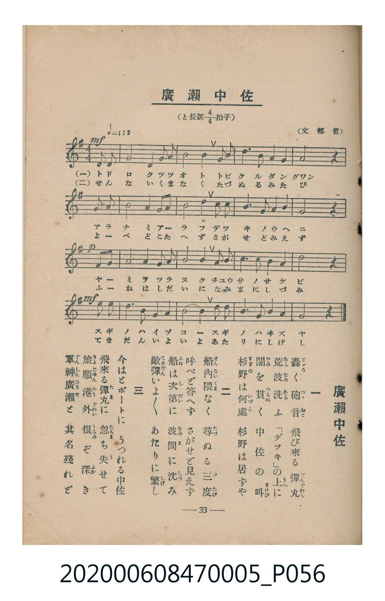

# 廣瀨中佐

> Re:Shōka 使用 AI 協助辨識與重建樂譜，可能會有錯誤。歡迎回報。

<audio controls src="hirose_chusa.mp3"></audio>

- 臺灣教育會公認《新定兒童唱歌》尋常科第五學年用（2020.006.0847.0005）

## 說明

原書資訊與歌詞全文（對應 P056.jpg，書頁 p. 33，第三學期第 7 首）：
調性與拍號：と長調四分之四拍子（G 大調 4/4 拍），♩= 112，（文部省）


## 歌詞

```text
一　轟（とゞろ）く砲音（つゝおと）　飛び來る彈丸（だんぐわん）
荒波（あらなみ）洗（あら）ふ　「デッキ」の上（うへ）に
闇（やみ）を貫（つらぬ）く　中佐の叫（さけび）
杉野（すぎの）は何處（いづこ）　杉野は居ずや

二　船内隈（せんないくま）なく　尋（たづ）ぬる三度（みたび）
呼べど答へず　さがせど見えず
船（ふね）は次第（しだい）に　波間（なみま）に沈（しづ）み
敵彈（てきだん）いよ／＼　あたりに繁（しげ）し

三　今はとボートに　うつれる中佐
飛來る彈丸（たま）に　忽（たちま）ち失（う）せて
旅順港外（りょじゅんかうぐわい）　恨（うらみ）ぞ深（ふか）き
軍神廣瀨（ぐんしんひろせ）と　其名殘れど
```

## ABC

```abc
X:1
T:廣瀨中佐
M:4/4
L:1/16
Q:1/4=112
K:G
V:V1 name="Piano" snm="Pia"
[V:V1]
!mf! z4 z4 z4 D3 D | G8 G4 A3 G | E8 D4 B3 A | G3 A B3 d e3 d B3 G |
w: 1.~ト ド | ロ ク ツ ツ | オ ト ト ビ | ク _ ル _ ダ _ ン _
w: 2.~せ ん | な い く ま | な く た づ | ぬ _ る _ み _ た _
w: 3.~い ま | は と ボ _ | ト に う つ | れ _ る _ ちゅう _ _ _
A8 z4 D3 D | G8 G4 A3 B | d8 B4 d3 d | e3 d B3 d A3 D F3 E |
w: 1.~グワン ア ラ | ナ ミ ア _ | ラ フ デ ツ | キ _ ノ _ ウ _ ヘ _
w: 2.~び よ _ | べ ど こ た | へ ず さ が | せ _ ど _ み _ え _
w: 3.~さ と び | く る た ま | に た ち ま | ち _ う _ せ _ _ _
!p! D8 z4 A3 A | A4 F4 D4 G3 A | B8 G4 B3 d | e3 e d3 B G3 A B3 B |
w: 1.~ニ ヤ _ | ミ ヲ ツ ラ _ | ヌ ク チュ ウ | サ _ ノ _ サ _ ケ _
w: 2.~ず ふ _ | ね は し だ _ | い に な み | ま _ に _ し _ づ _
w: 3.~て りょ じゅん | か う ぐわ い _ | う ら み ぞ | ふ _ か _ _ _ _ _
!mf! A8 z4 d3 B | G4 B3 d e4 d3 B | d4 B8 d3 e | d3 B G3 E D3 G B3 A |
w: 1.~ビ ス ギ | ノ ハ イ ヅ コ _ | _ _ ス ギ | ノ _ ハ _ ヰ _ ズ _
w: 2.~み て き | だ ん い よ い _ | よ _ あ た | り _ に _ し _ げ _
w: 3.~き ぐ ん | し ん ひ ろ せ と | _ _ そ の | な _ の _ こ _ れ _
G8 z4 z4 |
w: 1.~ヤ
w: 2.~し
w: 3.~ど
```

## TMD 檔案連結

- [主旋律 TMD 檔案](hirose_chusa.tmd) [[在 TMD Studio 編輯](https://tmdlang.github.io/Tmd-TS/#tmd=s7IKdvYPcrWy4qpTUCpJTLdSSM7PyUlNLsnMz7MqzsjMK0nNjM_KTMmPL87Iz05Ugisry88pzU21Si9KTEmNN403MjAyiDcwMIs3sDAxBzIMTBFKi_NLi5JTrYqTM_Lzc-JLUitKkvLzsxHyBUX5Zal5iXlANQVFIBtTwIoQClLLMlNSQdKpKZkl-UWZiTlI7kgtKga7FWxJfElRYl5xclFmAcgDCFUlGalAx2ZkFgO1V6IL52bmZJYkgsS1tBSe7l78vGHFkx1rn-ydoKClxaVoq2BoaMRlb6vgzmVjom9iB9L8on3X88bFz6bOfNG06dmc5qeta16s6n3c0PVs2oan62Y9bZ30fPXSp1M2Plvb87ih--mG7qc7djxfPvH5mjVPdk15unbH051bnk9Z8X5PByjU9IChpgcKNSDDwPT9nk4lLi59LQVbagEuBQWFp33zn83e8WJz-4sVXS862oHuerFy3tPWFc-mtQNd8XRD77P2ToUAA1MzvayC9Pd7eoCKXy5oVCjQUzA2BnJBDt_RCXT4sznzgWwFc4WXy6YBXfp-zyyQ6S9W7X_WsBxkbnfvi5nzgaKPG1e8nLodKP509uynHW1PdnYDGUDZp2snAO1zV3i6ZDlQUgEYnApAUbBJPY9mrgQHNZAJVAN02cvmFc_nNAIluUCWPNnR8Lih4cVeoPEdQOMfN8173ATS-bix__mCTS_nbwaLL3ncNPdxYxdQAUiqoeHl4tmPGzc_2df2uKn76d6OJzt2gJUteNw0-XHjhMdN_UAGyAaQL3onPdu8CCzd9LgJaO6qx437gXLPtkyHC4Lt2wo093FDz-Pm9sfNzY-b1j5u6H3cuO7Jji6wsrbHjUA7gMpWgwx9OR0UwI-bWiBmPW6a9GLTaphLgYrWQHwANBGS4oAGPe2HKJj6uHEi0O1Q1z2b2_myvQ8sMfNxYx9QHVjn-id7p76YORUsDrRj6eNGkHeAxkHUAxU83dj6uHEW0AWQUNwFTJENLzp2Pm1rfTmrA6xvNjgwgL4FGtD_uHEf2GAgF-QqYNoFq5kPNBssvgYYkKC0sGsZWHw_WArmyKcT9zxu3Pm4ceXztVOAwQCyFxhUIJ_0gKxpXPliWffjRqA2SLLp2Ak2Y-vjxrUQzzxbsxCYvMCC00GR1NgCCUmQfzYvejkN6DegFCheYM5c_WwTxBNA9RAH7geH1tStwNgGSyx73AiMHlCEg6VbHjcBxfvf79kDdloTyP1NwPSy-vlOYFKDGDQJrHI6NNmBQvPJbqCS9aBk1zzncfOex81AhSBXgaMbGJM94FABRSA40hfPxkhxwFCCuhgUqvv3wgQXwsQXPl2yEZKAwFxgaC0D-2R668sFbc92rH-6BJjjgCmp63FT--PGGY-bWsHRBgxPoBPAKRkSWsCgAiV-cEoEpTBwsmuc92w7xHRgYANjFCjSC46C3b3Pl86DFHlgaaBBQEOng8lNwAwGdAhY9QqQq1u3PZ3Q-2wd0G5gdK4E6ae8dIICBS19Li6PzKL84lTnjNLiRKuAzMS8fIcag5pqkD0KNoZmWnZgFraiUeHpno0vtm4HlkDgkqrhxcIeBQ1YcaaJRT3QNqhZuEB1blqtAjCeFYBEp0INkFyLkHzctB7KaG6BEEAFTauQFIA0whmPmyeDFQA1PW5eDSIaQMRmsOCGx83rQWwU8LhpEUjFSphDaxQMFHTBEJ0Gu9M0HswGUjUKhlAJGITxjaC8GgUziGoEhGrXVTCGqoSZYgQVMVUwg9IQPsgUiHkICHMQklvATvcxrFGAmY9Og0IHQsOCGNVMUJDBVLbAaUhYo6mEmoRsJizQYeKr4awGOGszlIUcE6gmw90KjBKInpUwnxnh8VnjbKgusCsaMdzbCPEPiNUPpffhUAmRB7HmQ-mlYJVr4C7rhqvYj6YW7LNG3H6ChRrUR8b4fASNAag7YeGKcOcKGKt5DsJueLwg1MHjobENSi8Bh38PFv8sBJVzUHUICLJ_Ki4_Qd0B8nUNuAjHXmSAG2M94JLCROHphv7n6xt04E0g_GXG4-Yu5Kw-HyXP7gH7eiWygqkwRjuisACWJo-b-0C6loFYM8C6ulFLgeoCUBG0BGIqvCTAn8GNgSpM0VRAMi0o-0JIYBEAZcGyN0QvMM-aQ4IRWEQAjUEvJ-BlDtBdEB3AogKeyUGhghbVwKCBRSkk80CSxEoMdbDIBAURhIaFEky8D27SMrjYDCQzYUkGBhFFzBKYKnimBbZR0F3QCHMTsAEFpeeDk9kODJWz4CyIq4GNG7BKSIZHNQuRHeEZDckEDLc2bkV1KzA7IrI_3AVI2QNWIECyJCxjIdwKD__GhSgqITxEFkQUWAgIUgcLawyXgpshUI3QtgjB3Lajk8zcBstgzZtgDGCtC2EA8xko9nuQshuibm4EEctAKQaUlrbCcxyI1bQRrHEyWo4D1_pNO0EK1iGyHKyug-YOpBoTVk_WwDMZDMKyJSyLwTKdGTQbGqPVsaCMi6tOhVTyMGVIOQ4ev8CggbHgFQs8n0FCCNVo5Iqx8XHzUqggLKhgUohsBxcDhhzCWEhmwZZAIFkMFIzIGW8tTB5efwBbm3DWAoTJ8PoR7mCkegNSR4KyF0jlPiwqEGZCfAYxE5YdMVwLTejAVjFK1kNkNEQ2ATW14RyYI0GK0SspYOsbrg5iMbAZDlYJD0q4BegQpKoXp2MnQM0nmOWAnW4ysxwwn0DyUD8oK4CroFZY_gK2VUFRvwfEhuYUsAAob4HVN28Aie4CCwK14gMYtRpqgxNWZyHXaugZDSJuBlcBy1jAOgyaTQ0xGrYIiN6eRs5d8MQP9BUkxJeAwwEWv4jGI_ZYRMsGWEwEsTbA1e6Cm4eotWAQvTmGnKlg2QaUIsA0MF0imnYoqRQuiuHSxiYoDa73mmB1OfZMNQlhIlyUgEvBGQpuAtylm4DsXri50EYzsAmHJ0wb50JpcJjCG8wgPowFK5YQjUqQSvR2B6ZLa7m4dO0UkPqhCkCuMhcA)]
- [鋼琴伴奏 TMD 檔案](hirose_chusa_piano.tmd) [[在 TMD Studio 編輯](https://tmdlang.github.io/Tmd-TS/#tmd=s7IKdvYPcrWy4tLSUni6e_HzhhVPdqx9snfC-z0dL7v3PJ-w5cmeLU-X9j_v7Hi_p1NBS4tL0VbB0NCIy95WwZ3LxkTfxI6rTkHpRfuu542Ln02d-aJp07M5zU9b17xY1fu4oevZtA1P18162jrp-eqlT6dsfLa253FD99MN3U937Hi-fOLzNWue7JrydO2Opzu3PJ-yAmilkYGRgZ6BgZmegYWJOZBhYAq0VYmLyyOzKL841TmjtDjRKiAzMS8_yMOhxqCmmksBCGwMzbTswCx9LQVbdKDwdM_GF1u3v-hoB1m3o-HFwh4FjQADUzO9rIJ0TSzqtfTBZtUoGCjogiE6XZ2bVqtgGg9mA6kaBUOoBAzC-EZQXo2CGUQ1AkK16yoYQ1XCTDGCipgqmEFpCB9kCsQ8BIQ5CMktYKf7GNYowMxHpx83d0DpTqCJj5vXopn5uGk9XGULnAaqbFqFrhJqErKZk8EqESashrMa4KzNUBZI5YbHzesRIjAId2vTIqielTCfGeHxWeNsqC6wKxox3NsI8Q-I1Q-l9-FQCZEHseZD6aVglWvgLuuGq9iPphbss0bcfoKFGtRHxvh8BI0BqDth4Ypw5woYq3kOwm54vCDUweOhsQ1KLwGHfw8W_yx83NQKU4eAIPun4vIT1B0gX9dw4c6J4PzeA86AJgpPN_Q_X9-go0BUVsSfw4yBKkzRVEByDSj_QEhgHoSyYPkLoheYacwh_gDmUaAx6BkVnukLaqE6gHkVnsseN3ehqX_cDEsFsNQLiZOVGOpgofm4uR1KQ_LZWrh4H9ykZXCxGUhmwuIMBhF5fAlMFTzXPG7cie6CRpibHjdOhtLzwfG8A0PlLDgL4urHjT1glZAch2oWIj_AUzqSCRhubdyK6lZgfkDkP7gLkNInLEdC8gQsZSPcCg__xoUoKiE8RB5AlBgICFIHC2sMlzZ1PW6CRlXjDFAmARU0BJL7jk5ykjusoIemTKTqAlZJ1MATOAzCsgQsecMSvBk0CxijVTCgTIOrQoHUcDBlSKkdHrbNm-AseKkKT-MglbCSBQaRa4XGx81LoYLLwEkelgSQkzxcrGkjkrGQhIotciDJ-3HTOpREvxYmDy88HzdOh7MWIEyGVw5wByMVmpAKApS0QSr3YVGBMBPiM4iZsKyA4VpoInvc2IuS7BGJHJFEJzxuQtRGMEeCFKOX0I-bOuHqIBY_bpwHVgkPSrgF6BCkqhenYydAzSeY3J_Onk1J6Y7a8oGV3cilO3qih4ibwVXAEjmwLIdmGUOMFhYCojfskFM6PCE2Q9sKTUuA7FaYaBOiFYM9RNGSJBYTQawNcLW74OYhSm8YRG8XICdwWBIGxQ6YBqYRRBsDJcXARTFc2tgEpcHlfxOsTsOewCchTISLEnApOHHDTYC7dBOQ3Qs3F9p6A7Yl8IRp41woDQ5TeMsNxIexYEUEonUDUole_2K6tBZLN8MHuZthguhlPGva9HTx-mf7G57NaHqys_tlwyZgun82exMwAzzr7n26dsLT7cuedXZD-k7IPQoIrIGUsIbxCtGGsTCqRsEEyDBB4kMZUGFQ4wTIMo2PBTOApsCyD5oxOIw1AlJGeIwBtXBQpMAMnMbB-biMQ_Ih3Ac4nIppGziUQFGia6eAFCvRPkA5dCGgp9CFjMFCylwA)]

## 分析

```text
================================================================================
📊 TMD Song Profile: [ 廣瀨中佐 ]
================================================================================
⏱  Duration:       0:36 (36.4s), 17 measures total
🎼 Key & Tempo:    首調基準 G, != 112.0 BPM, <4/4>
   - 分析範圍：      由實際發聲的音符與和弦推測調性；播放脈絡另行呈現
🎤 人聲音域:    D4 (MIDI 62) – E5 (MIDI 76) [跨度: 14 個半音 / 1.2 個八度, 難度: moderate]
   - 最低音:  D4 in [HiroseChusa #1 @ m.1, 0:01]
   - 最高音: E5 in [HiroseChusa #1 @ m.4, 0:07]
   - 適合: soprano, mezzo-soprano, contralto, tenor, baritone, bass
🏛  結構:      HiroseChusa (36.4s)
⚡ 編曲密度:        Peak 1 軌道同時演奏
🗝  調性診斷：       G 大調（純淨自然大調，未偵測到可信轉調）
   - 風格氣質:    純淨自然大調（陽光明朗、易唱易記，無明顯調外色彩）
   - 轉調歷程:    全曲維持單一推測調性（未偵測到可信轉調）
   - 核心骨幹音:  D, G, B, A, E
   - 調性數值:    G 大調 [相關度: 0.85, 穩定度: Moderate, 自然音純度: 100.0%]
   - 候選調性 (K-S): G 大調 (0.85), D 大調 (0.81), B 小調 (0.72)
   - 五度圈歷程:   +1
   - 各段落調性細節:
     • [HiroseChusa #1]: G 大調 (r: 0.85, 自然音純度: 100.0%)

  [ 五度圈游移軌跡 ]
               C  
         F           [G ]*
      Bb               D  
      Eb               A  
         Ab           E  
            Db       B  
               F# 
     (* = active key center)

  [ 十二半音累積音高分佈 ]
     C  :                            0.0%
     C# :                            0.0%
     D  : ████████████████████████  27.1%
     D# :                            0.0%
     E  : █████████                 10.4%
     F  :                            0.0%
     F# : ███                        2.9%
     G  : ████████████████████      22.9%
     G# :                            0.0%
     A  : ██████████████            15.8%
     A# :                            0.0%
     B  : ██████████████████        20.8%
--------------------------------------------------------------------------------
Assignment 軌道音域：
  - Piano         : D4 – E5 (14 個半音 / 1.2 個八度, 79 個音符)
================================================================================
```


## 原書掃描頁




