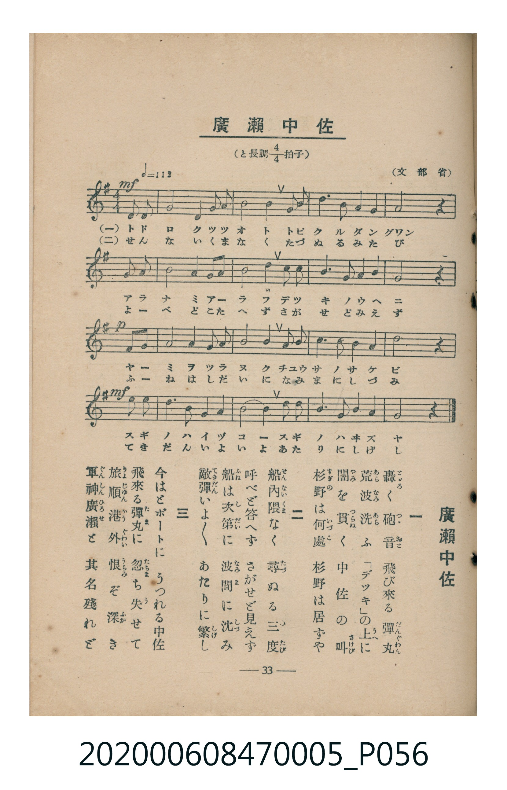

# 廣瀨中佐

<audio controls src="hirose_chusa.mp3"></audio>

- 臺灣教育會公認《新定兒童唱歌》尋常科第五學年用（2020.006.0847.0005）

## 說明

原書資訊與歌詞全文（對應 P056.jpg，書頁 p. 33，第三學期第 7 首）：
調性與拍號：と長調四分之四拍子（G 大調 4/4 拍），♩= 112，（文部省）

## 歌詞

```text
一　轟（とゞろ）く砲音（つゝおと）　飛び來る彈丸（だんぐわん）
荒波（あらなみ）洗（あら）ふ　「デッキ」の上（うへ）に
闇（やみ）を貫（つらぬ）く　中佐の叫（さけび）
杉野（すぎの）は何處（いづこ）　杉野は居ずや

二　船内隈（せんないくま）なく　尋（たづ）ぬる三度（みたび）
呼べど答へず　さがせど見えず
船（ふね）は次第（しだい）に　波間（なみま）に沈（しづ）み
敵彈（てきだん）いよ／＼　あたりに繁（しげ）し

三　今はとボートに　うつれる中佐
飛來る彈丸（たま）に　忽（たちま）ち失（う）せて
旅順港外（りょじゅんかうぐわい）　恨（うらみ）ぞ深（ふか）き
軍神廣瀨（ぐんしんひろせ）と　其名殘れど
```

## ABC

```abc
X:1
T:廣瀨中佐
C:TMD (Chen, Chih-Han / aguai)
M:4/4
L:1/16
Q:1/4=112
K:G
V:V1 name="Piano" snm="Pia"
[V:V1]
!mf! z4 z4 z4 d3 d | g8 g4 a3 g | e8 d4 b3 a | g3 a b3 d e3 d b3 g |
a8 z4 d3 d | g8 g4 a3 b | d8 b4 d3 d | e3 d b3 d a3 d f3 e |
!p! d8 z4 a3 a | a4 f4 d4 g3 a | b8 g4 b3 d | e3 e d3 b g3 a b3 b |
!mf! a8 z4 d3 b | g4 b3 d e4 d3 b | d4 b8 d3 e | d3 b g3 e d3 g b3 a |
g8 z4 z4 |
```

## TMD 檔案連結

- [主旋律 TMD 檔案](hirose_chusa.tmd)
- [鋼琴伴奏 TMD 檔案](hirose_chusa_piano.tmd)

## 分析

```text
================================================================================
📊 TMD Song Profile: [ 廣瀨中佐 ]
================================================================================
⏱  Duration:       0:36 (36.4s), 17 measures total
🎼 Key & Tempo:    首調基準 G, != 112.0 BPM, <4/4>
   - 分析範圍：      由實際發聲的音符與和弦推測調性；播放脈絡另行呈現
🎤 人聲音域:    D4 (MIDI 62) – E5 (MIDI 76) [跨度: 14 個半音 / 1.2 個八度, 難度: moderate]
   - 最低音:  D4 in [HiroseChusa #1 @ m.1, 0:01]
   - 最高音: E5 in [HiroseChusa #1 @ m.4, 0:07]
   - 適合: soprano, mezzo-soprano, contralto, tenor, baritone, bass
🏛  結構:      HiroseChusa (36.4s)
⚡ 編曲密度:        Peak 1 軌道同時演奏
🗝  調性診斷：       G 大調（純淨自然大調，未偵測到可信轉調）
   - 風格氣質:    純淨自然大調（陽光明朗、易唱易記，無明顯調外色彩）
   - 轉調歷程:    全曲維持單一推測調性（未偵測到可信轉調）
   - 核心骨幹音:  D, G, B, A, E
   - 調性數值:    G 大調 [相關度: 0.85, 穩定度: Moderate, 自然音純度: 100.0%]
   - 候選調性 (K-S): G 大調 (0.85), D 大調 (0.81), B 小調 (0.72)
   - 五度圈歷程:   +1
   - 各段落調性細節:
     • [HiroseChusa #1]: G 大調 (r: 0.85, 自然音純度: 100.0%)

  [ 五度圈游移軌跡 ]
               C  
         F           [G ]*
      Bb               D  
      Eb               A  
         Ab           E  
            Db       B  
               F# 
     (* = active key center)

  [ 十二半音累積音高分佈 ]
     C  :                            0.0%
     C# :                            0.0%
     D  : ████████████████████████  27.1%
     D# :                            0.0%
     E  : █████████                 10.4%
     F  :                            0.0%
     F# : ███                        2.9%
     G  : ████████████████████      22.9%
     G# :                            0.0%
     A  : ██████████████            15.8%
     A# :                            0.0%
     B  : ██████████████████        20.8%
--------------------------------------------------------------------------------
Assignment 軌道音域：
  - Piano         : D4 – E5 (14 個半音 / 1.2 個八度, 79 個音符)
================================================================================
```


## 原書掃描頁




