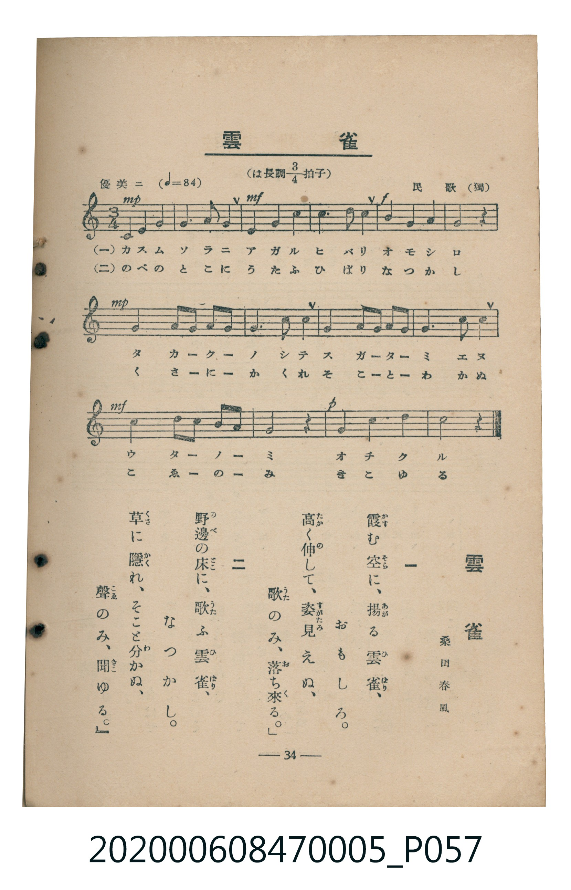

# 雲雀

> Re:Shōka 使用 AI 協助辨識與重建樂譜，可能會有錯誤。歡迎回報。

<audio controls src="hibari.mp3"></audio>

- 臺灣教育會公認《新定兒童唱歌》尋常科第五學年用（2020.006.0847.0005）

## 說明

原書資訊與歌詞全文（對應 P057.jpg，書頁 p. 34，參考教材第 1 首）：
調性與拍號：は長調四分之三拍子（C 大調 3/4 拍），優美ニ（♩= 84）
出處與作歌：民歌（獨）、桑田春風


## 跨冊／重複收錄參照

> 同曲＋同名異曲（《公學校唱歌》與《新定兒童唱歌》第二學年〈ヒバリ〉為同曲；《新定兒童唱歌》五年級與《共益商社唱歌教科書》卷一〈雲雀〉為同名異曲）

- **[同名異曲]** 《共益商社唱歌教科書》卷一・生徒用（明治38年／1905）：[**〈雲雀〉**](../../../kyoeki_shoka/kan_1_854862/6_hibari/index.md)（`C` / `2/4` — [原始 TMD](../../../kyoeki_shoka/kan_1_854862/6_hibari/hibari.tmd)）
- **[同名異曲]** 《新定兒童唱歌》尋常科第二學年用（2020.006.0847.0002）：[**〈ヒバリ（雲雀）〉**](../../grade_2_2020.006.0847.0002/4_01_hibari/index.md)（`F` / `2/4` — [原始 TMD](../../grade_2_2020.006.0847.0002/4_01_hibari/hibari.tmd)）
- 總表：[跨冊重複與同名歌曲總索引](../../../duplicate_songs.md)

## 歌詞

```text
一　霞（かす）む空（そら）に、揚（あが）る雲雀（ひばり）、
おもしろ。
高（たか）く伸（の）して、姿（すがた）見（み）えぬ、
「歌（うた）のみ、落（お）ち來（く）る。」

二　野邊（のべ）の床（とこ）に、歌（うた）ふ雲雀（ひばり）、
なつかし。
草（くさ）に隱（かく）れ、そこと分（わ）かぬ、
『聲（こゑ）のみ、聞（き）こゆる。』
```

## ABC

```abc
X:1
T:雲雀
M:3/4
L:1/16
Q:1/4=84
K:C
V:V1 name="Piano" snm="Pia"
[V:V1]
C4 E4 G4 | G6 E2 C4 | A4 c4 A4 | G6 E2 C4 |
w: 1.~カ ス ム | ソ ラ ニ | ア ガ ル | ヒ バ リ
w: 2.~の べ の | と こ に | う た ふ | ひ ば り
d4 B4 G4 | G8 z4 | G4 A2 G2 F2 E2 | D6 E2 F4 |
w: 1.~オ モ シ | ロ | タ カ _ ク _ | ノ シ テ
w: 2.~な つ か | し | く さ _ に _ | か く れ
F4 G2 F2 E2 D2 | C6 D2 E4 | A4 B4 c2 A2 | G8 z4 |
w: 1.~ス ガ _ タ _ | ミ エ ヌ | ウ タ ノ _ | ミ
w: 2.~そ こ _ と _ | わ か ぬ | こ ゑ の _ | み
G4 G4 B4 | c8 z4 |
w: 1.~オ チ ク | ル
w: 2.~き こ ゆ | る
```

## TMD 檔案連結

- [主旋律 TMD 檔案](hibari.tmd) [[在 TMD Studio 編輯](https://tmdlang.github.io/Tmd-TS/#tmd=s7IKdvYPcrWy4qpTUCpJTLdSSM7PyUlNLsnMz7MqzsjMK0nNjM_KTMmPL87Iz05Ugisry88pzU21Si9KTEmNN403MjAyiDcwMIs3sDAxBzIMTBFKi_NLi5JTrYqTM_Lzc-JLUitKkvLzsxHyBUX5Zal5iXlANQVFIBtTwIoQClLLMlNSQdKpKZkl-UWZiTlI7kgtKga7FWxJfElRYl5xclFmAcgDCFUlGalAxybmZeaC9GppKbycvenl7AYFLS0uRVsFCxMue1sFZy4bY30TO5CeF-27njcufjZ15oumTc_mND9tXfNiVe_jhq5n0zY8XTfraeuk56uXPp2y8dnanscN3U83dD_dseP58onP16x5smvK07U7nu7c8nzKivd7OkChogcMFT1QqAAZBqbv93QqcXHpaynYUgtwKSgoPO2b_2z2jheb21-s6HrR0Q5014uV8562rng2rR3oiqcbep-1dyoEGJia62UVpL_f0wNU_HJBo0KBnoKxCZD7tL_5RUMz0LvP5k4AekLBUOHlsmlAl77fMwtk-otV-581LAeZ2937YuZ8oOjjxvUvp24Hij-dPftpR9uTnd1PdnQCZZ-unQC0z1nh6ZLlQEkFYHAqAEXBJvU8bVn1fF_f4-ZuoIpHM1eCQh0oAXZ9-64XM6cCzX-ydw7Q6UDzn22YCGZ0PO8FBmPn44bGZwsnPp-y4dmMpS8XreACaXqyo-FxQ8PLOfOAqh43dj9unAlS2NTwfOUusMjcx01AWzsfN64G6e6fBRZsetwINBWorBsS_2DBTY8bNzxu6oLYAzL6cWPX4yag0umPm4CR3gQSerl6BljtfKBVYFP7n-zZARZZB-ZOf9y4DKj76fL9YMGZQHuAioFSL5aB_Pu4ESgOVAZkrIFZ0tAD8eLjxjaIUqBZQHVA6RcT9oLFwU5qXPhkXxuY2w9xOdBFjxt6IWGwC5j-Gl62970EOR_kmMeNOyEmPd0FEVnxuHEyIhjQLdyKPxhWPW5cAg7b6dBgeNELDFOQUx43ToWY-nLWRlgEQNwHdFEjKPQbJwMtB6YNkGwTWAqkBuH7vheNm8A6Jz9umoji-0ZIlIKSDVi2DebpfpBOyjMMFCho6XNxeWQmJRZlWgVkJublO9QY1FSDrFCwMTTTsgOzsGVUBVA-39HwYmGPgoaZwtMN_c_XN-jAc5cmFg1Am6CGaQA1alopPG5aDRJ43LQTTDUvAFE1QP5eEAMstBKIu2HCiyCq10CkwHqBws2T4KonAPEqmGow43EzVNN2mOq1UNVIANlhu3pADmtcB9bVCHEYhAfU3LgCZlXjZCCGuaCxDSI2H0JthQlvgqveAHRBF0wY4rDGJRAK5rvG6TgdVgMsinTB0BhKm0LpGjgLJgtTWaNgBmUZxkEZMAF8moxgis3x2gSCBjAZsBt9DEFhvhoqBopSKAsYqzATQBGL0A-KXBDZjSS_CK5_DVwVzExIVCPrnwAmVyHph7FB0Q4zaTuS_rVofohH9YMRKB7WwXQCYx_GgolB0gCSG4DpAEQiuRGYGGBy8-GsrUjym1D0bwC7sQtJHu4HYAqBsZDCCJhOcPkBf17d1QPOqybk5tX94PQKjOLHzXuA9HowDQrUPlgyBwb142ZwXgDFBSTvACMSon4_XD04m4DlVgB5PUgJHTkH9kOyx1SIdmAIQ7VDMgxYrh9oBFg7SHguRAyYL8HqQUaD1TeBDYJmNWDRi5KvYGkalDVAbBMgBmUIYEZACmGQCEgGEgMwFrJ6kGpELgVBkAgstyLnkP2wOEXKK-sRsQsMTKTUAU67oCCFyyPyFSKHwM2EBC6yflBaBQUxijvAqbwfpgYYwjAWciqGpTiIDEg1KKwR8nPhcqAcAGHBcgYk1JH1g0wDhT1xKXVHJ2UpdRkkdUFSHChI0VMeHCDVE40QTeuhwpDqBRVgSaWTIbomQlPdOngqBecWNKsae8GqYZrgOQWWojGtQpTisPIYXJqDBPEUyHAZGA3TDEyisPIdQxNSGl0GizdEaoWnS_Q0BoLwEgilBG6Em4KcvmFpDEMvUtqEpyhguMJSEHIJDHMVFvuBQQzTgTAFOf8gp2tU-2u5uHTtFCBNIQUgS5kLAA)]
- [鋼琴伴奏 TMD 檔案](hibari_piano.tmd) [[在 TMD Studio 編輯](https://tmdlang.github.io/Tmd-TS/#tmd=s7IKdvYPcrWy4tLSUng5e9PL2Q3v93S87N7zfMKWJ3u2PF3a_7yz4_2eTgUtLS5FWwULEy57WwVnLhtjfRM7rjoFpRftu543Ln42deaLpk3P5jQ_bV3zYlXv44auZ9M2PF0362nrpOerlz6dsvHZ2p7HDd1PN3Q_3bHj-fKJz9esebJrytO1O57u3PJ8ygqgjUYGRgZ6BgZmegYWJuZAhoEp0FIlLi6PzKTEokyrgMzEvPwgD4cag5pqLgUgsDE007IDs_S1FGzRgQLIgh0NLxb2KGiYKTzd0P98fYOOQoCBqbleVkG6JhYNWvpgw2oUDBV0wdAYSptC6Ro4CyYLU1mjYAZlGcZBGTABfJqMYIrN8doEggYwGbAbfQxrFB43rYaKPW7aCWM1L4Cb8LhpL5L-x80rwWQ3kvwiuP41cFUwM4HyzZNQ9E8Ak6uQ9MPYj5sRJm1H0r8WzQ_xqH4wAqppXAfT2Qj3A1wMJL8C2Q2Nk8Ekkhsb2-By8-GsrUjym1D0bwC7sQtJHu6HxiVwFlIYNU7H6Qf8KW9XDzjlmZCW8mCxDko8ILYJEIOSDDCpILkBJAKSgbgRxkJWD1KNSMcgCBKBpWfkNLQf5muk1LQe4f_mPiQzILH7uBkW5iD98FhDpCG4mSD9sFiByIBi83FzD6o7wOmgH6amcSqchRzPsDiByIBUP26CmwMUmQuXA6URCAuWdkDuhJkPkQGZ9rgR5mJCcbmjk5y4hBUAsLwNLhlAgngyN1wGRsM0AyMTVlZgaEKKzWUwHyLiFR6D6LEBgvDUjJKbG-GmIKcEWGxg6EWKRXjYN02EsVByM8xVWOxv7IXrQJiCnNKQUwCq_bWodYQPch1hgqginraser6v7-mcyS865j0DVnOLVjxbsAcYuc-6e5-unfB0-7Jnnd2Q-u79np5n_f3Pd656NmPp85W7IHXiy9UzXi6e_XTqnpebtzzZ2f1s5nqkGiNeIdowFozROCZAjgmQA8RoMqbxQJ5pPJALIuCSBtAAJaAah26wYqh-bFYDTcdnMTAkde0UIIEZ7QMUROIZgXnKXAA)]

## 分析

```text
================================================================================
📊 TMD Song Profile: [ 雲雀 ]
================================================================================
⏱  Duration:       0:30 (30.0s), 14 measures total
🎼 Key & Tempo:    首調基準 C, != 84.0 BPM, <3/4>
   - 分析範圍：      由實際發聲的音符與和弦推測調性；播放脈絡另行呈現
🎤 人聲音域:    C4 (MIDI 60) – D5 (MIDI 74) [跨度: 14 個半音 / 1.2 個八度, 難度: moderate]
   - 最低音:  C4 in [Hibari #1 @ m.1, 0:00]
   - 最高音: D5 in [Hibari #1 @ m.5, 0:08]
   - 適合: soprano, mezzo-soprano, contralto, tenor, baritone, bass
🏛  結構:      Hibari (30.0s)
⚡ 編曲密度:        Peak 1 軌道同時演奏
🗝  調性診斷：       C 大調（純淨自然大調，未偵測到可信轉調）
   - 風格氣質:    純淨自然大調（陽光明朗、易唱易記，無明顯調外色彩）
   - 轉調歷程:    全曲維持單一推測調性（未偵測到可信轉調）
   - 核心骨幹音:  G, C, E, A, D
   - 調性數值:    C 大調 [相關度: 0.87, 穩定度: Moderate, 自然音純度: 100.0%]
   - 候選調性 (K-S): C 大調 (0.87), G 大調 (0.83), E 小調 (0.64)
   - 五度圈歷程:   +0
   - 各段落調性細節:
     • [Hibari #1]: C 大調 (r: 0.87, 自然音純度: 100.0%)

  [ 五度圈游移軌跡 ]
              [C ]*
         F            G  
      Bb               D  
      Eb               A  
         Ab           E  
            Db       B  
               F# 
     (* = active key center)

  [ 十二半音累積音高分佈 ]
     C  : ███████████████           20.5%
     C# :                            0.0%
     D  : ██████                     9.0%
     D# :                            0.0%
     E  : ████████                  11.5%
     F  : ██████                     7.7%
     F# :                            0.0%
     G  : ████████████████████████  33.3%
     G# :                            0.0%
     A  : ███████                   10.3%
     A# :                            0.0%
     B  : ██████                     7.7%
--------------------------------------------------------------------------------
Assignment 軌道音域：
  - Piano         : C4 – D5 (14 個半音 / 1.2 個八度, 41 個音符)
================================================================================
```


## 原書掃描頁




