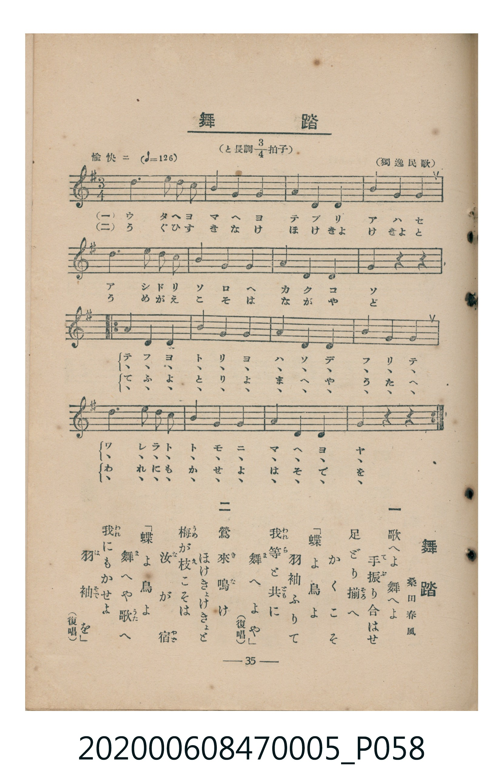

# 舞踏

> Re:Shoka 使用 AI 協助辨識與重建樂譜，可能會有錯誤。歡迎回報。

<audio controls src="buto.mp3"></audio>

- 臺灣教育會公認《新定兒童唱歌》尋常科第五學年用（2020.006.0847.0005）

## 說明

原書資訊與歌詞全文（對應 P058.jpg，書頁 p. 35，參考教材第 2 首）：
調性與拍號：と長調四分之三拍子（G 大調 3/4 拍），愉快ニ（♩= 126）
出處與作歌：（獨逸民歌）、桑田春風

## 跨冊／重複收錄參照

> 同曲＋同名異曲（《唱歌帖》P040〈無題・三拍子曲〉與 P171〈舞踏〉為同曲；《新定兒童唱歌》五年級、高女用及《唱歌帖》P230b 為同名異曲）

- **[同名異曲]** 《新定兒童唱歌》高等科女子用（2020.006.0849）：[**〈舞踏〉**](../../koto_girls_2020.006.0849/1_3_05_buto/index.md)（`G` / `4/4` — [原始 TMD](../../koto_girls_2020.006.0849/1_3_05_buto/buto.tmd)）
- **[同名異曲]** 楊金土手抄《唱歌帖》第 3 冊・I（2020.006.0843）：[**〈無題・三拍子曲〉**](../../../shokacho/vol_03/p040_mudai/index.md)（`F` / `3/4` — [原始 TMD](../../../shokacho/vol_03/p040_mudai/mudai.tmd)）
- **[同名異曲]** 楊金土手抄《唱歌帖》第 1 冊（2020.006.0843）：[**〈舞踏〉**](../../../shokacho/vol_01/p171_buto/index.md)（`F` / `3/4` — [原始 TMD](../../../shokacho/vol_01/p171_buto/buto.tmd)）
- **[同名異曲]** 楊金土手抄《唱歌帖》第 7 冊・VII（2020.006.0843）：[**〈舞踏（舞蹈）〉**](../../../shokacho/vol_07/p230b_buto/index.md)（`B,` / `3/4` — [原始 TMD](../../../shokacho/vol_07/p230b_buto/buto.tmd)）
- 總表：[跨冊重複與同名歌曲總索引](../../../duplicate_songs.md)

## 歌詞

```text
一　歌へよ舞へよ　手振（てぶ）り合はせ
足どり揃（そろ）へ　かくこそ
「蝶よ鳥よ　羽袖ふりて
我等（われら）と共（とも）に　舞（ま）へよや」（復唱）

二　鶯來（き）鳴（な）け　ほけきょけきょと
梅（うめ）が枝（え）こそは　汝（な）が宿（やど）
「蝶よ鳥よ　舞（ま）へや歌（うた）へ
我（われ）にもかせよ　羽（は）袖（そで）を」（復唱）
```

## ABC

```abc
X:1
T:舞踏
M:3/4
L:1/16
Q:1/4=126
K:G
V:V1 name="Piano" snm="Pia"
[V:V1]
d6 e2 d4 | c4 B4 A4 | G4 E4 G4 | A4 A4 A4 |
d6 e2 d4 | c4 B4 A4 | G4 B4 A4 | G4 z4 z4 |
A6 A2 A4 | A4 B4 c4 | B6 B2 B4 | B4 c4 d4 |
d6 e2 d4 | c4 B4 A4 | G4 B4 A4 | G4 z4 z4 |
A6 A2 A4 | A4 B4 c4 | B6 B2 B4 | B4 c4 d4 |
d6 e2 d4 | c4 B4 A4 | G4 B4 A4 | G4 z4 z4 |
```

## TMD 檔案連結

- [主旋律 TMD 檔案](buto.tmd) [[在 TMD Studio 編輯](https://tmdlang.github.io/Tmd-TS/#tmd=s7IKdvYPcrWy4qpTUCpJTLdSSM7PyUlNLsnMz7MqzsjMK0nNjM_KTMmPL87Iz05Ugisry88pzU21Si9KTEmNN403MjAyiDcwMIs3sDAxBzIMTBFKi_NLi5JTrYqTM_Lzc-JLUitKkvLzsxHyBUX5Zal5iXlANQVFIBtTwIoQClLLMlNSQdKpKZkl-UWZiTlI7kgtKga7FWxJfElRYl5xclFmAcgDCFUlGalAx-aWFmcmK3FpaSm86Jj3Yke_gpYWl6KtgqGRGZe9rYI7l42xvokdSM-L9l3PGxc_mzrzRdOmZ3Oan7auebGq93FD17NpG56um_W0ddLz1UufTtn4bG3P44bupxu6n-7Y8Xz5xOdr1jzZNeXp2h1Pd255PmXF-z0doFDRA4aKHihUgAwD0_d7OpW4uPS1FGypBbgUFBSe9s1_NnvHi83tL1Z0vehoB7rrxcp5T1tXPJvWDnTF0w29z9o7FQIMTC30sgrS3-_pASp-uaBRoUBPwRjoop6n_c0vGpqB3n02dwLQEwpGCi-XTQO69P2eWSDTX6za_6xhOcjc7t4XM-cDRR83rng5dTtQ_Ons2U872p7s7H6yoxMo-3TtBKB97gpPlywHSioAg1MBKAo2qedZS-fT_asfN3cDVTyauRIc7EAZsPPbd72YORVowZO9c4BuB1oAVPO8d8XLhh3PNkwEi3Q-bmh8tnDi8ykbns1Y-nLRCi6Qvic7Gh43NIBioXHH46YOYKRCGCDBzu5nPeuBxjxuXPa4cRvIgKaupxOA3PWPG2eDfbVt8-PGlUDRZ_3NYHVzHzeBnAoyoqHhcWP348b-x42TgeIg1Y8bel7M3QY0--XmpRAbnu_b-2LRtMeNW4FGAC0BKXrWMfH5WqBfOx439T9u6nncBGQDzVvxtHUj2IYVj5uawCKrgfqBrgUL7oPaCTS0qeVxA9AJHU_3rQSmLlDggH25C5jKGl5uW_9kXxtYB8iVLzdvAbNXgXVPBLt4N4jR2Pu4qR2JsQLssEWtYNVtj5sawRp6ns2bCxbpAHNBvgSFDDDcNkLEIeb2PF23H-ydFmBQQSMLMyQwfNICjjKwfY3A5AIShAYPPGygwdDUBA7o2fAgBWsDxlsnMGyhsdK4HBx7k9DDBmgi5bkHChS09Lm4nEpL8q0CMhPz8h1qDGoUqkE2KNgYmmnZgVnYMq0CKM_vaHixsEdBw0Th6Yb-5-sbdOA5TROLBqBFUMM0gBo1rRQeNy0DCYBCtmm_wuPmGUC8AsStATLmgcWBYmAKLtwG4U-DUKugwk2LIPx-iGG7QRSydbt6QNY1gjWDVDROAOJNQDwTakBjL0QcbCAwDcGEwSZB-ZB0BRFHEQAmNSQLaxRMFXTh0AyIYfwaBRMoyxhKG8FlDGHq46EMmEANXBE6XQPOI7gjZ1cPZZEDDlNweG4HBm0ncnDvhQT3WqQ4AgmvhihfD6E2o6hGBviipqkRyOsB4g5YHEyGhPVcCAU2HCQMjaoeiK4WmPBKHJZRFi24ZQzQaEKxsqOTolhpbgNWB5CQap4KZgIzB5gG5Q5gUQIWWYUh0w_X1rQXKtkOl4QZBNMGsQNLLC2DmwIs_MFqQaUXxBRgGQ8R6cKQ2YfQBqxhwJLA8h4qCbEMWFxCaYgKeKzBQhwW-ogYgLFgcQOLxRq4CEwWxkfIwNTC0wD-WANW9pTFGrCCgcXaGiDzcfNKMAkKIuR4WwSlu-FRMw8qMgMjRpfAjERP6UgRBqxw4NEOrEobgfUyiATVwiB7gRUQJMxnY0QZxMGgSghCL4fJgGoj7PYOnhwGdCEkxp72975YBmo6QOpOHQULaAQCa1HcEUe_REffYKvl4tK1UwDV9QpAWpmLCwA)]
- [鋼琴伴奏 TMD 檔案](buto_piano.tmd) [[在 TMD Studio 編輯](https://tmdlang.github.io/Tmd-TS/#tmd=s7IKdvYPcrWy4tLSUnjRMe_Fjv73ezpedu95PmHLkz1bni7tf97Z8X5Pp4KWFpeirYKhkRmXva2CO5eNsb6JHVedgtKL9l3PGxc_mzrzRdOmZ3Oan7auebGq93FD17NpG56um_W0ddLz1UufTtn4bG3P44bupxu6n-7Y8Xz5xOdr1jzZNeXp2h1Pd255PmUF0EojAyMDPQMDMz0DCxNzIMPAFGirEheXU2lJvlVAZmJefpCHQ41BjUI1lwIQ2BiaadmBWfpaCrboQAFk_o6GFwt7FDRMFJ5u6H--vkFHIcDA1EIvqyBdE4sGLX2wYTUKpgq6cGgGxDB-jYIJlGUMpY3gMoYw9fFQBkygBq4Ina7hwu_4XT30djxuGQM0mpDbd3SS43aYvTA3INwBY8FcCPNLDVwEJgvjI2RgauEhgd_tT2fPHsrh_rihEeKDp_29L5a1AbPV030rgblPR8EC6iFQVh4EkUDfYKtFLkZ8UIoRE0Qp8mLP1Kf7Vz_bsvvZ3olPdnY_3bf96ZxuYJH4bPYmYNA-6-59unbC0-3LnnV2QwpGRKgZxitEG8aCMdBT8UCeaTyQCyLwSxKrH5VrAITwIERTjdd2ZM4QtRoYlbp2CqDYVECilbm4AA)]

## 分析

```text
================================================================================
📊 TMD Song Profile: [ 舞踏 ]
================================================================================
⏱  Duration:       0:34 (34.3s), 24 measures total
🎼 Key & Tempo:    首調基準 G, != 126.0 BPM, <3/4>
   - 分析範圍：      由實際發聲的音符與和弦推測調性；播放脈絡另行呈現
🎤 人聲音域:    E4 (MIDI 64) – E5 (MIDI 76) [跨度: 12 個半音 / 1.0 個八度, 難度: easy]
   - 最低音:  E4 in [Buto #1 @ m.3, 0:03]
   - 最高音: E5 in [Buto #1 @ m.1, 0:00]
   - 適合: soprano, mezzo-soprano, contralto, tenor, baritone, bass
🏛  結構:      Buto (34.3s)
⚡ 編曲密度:        Peak 1 軌道同時演奏
🗝  調性診斷：       G 調性不明確（純淨自然大調，未偵測到可信轉調）
   - 風格氣質:    純淨自然大調（陽光明朗、易唱易記，無明顯調外色彩）
   - 轉調歷程:    全曲維持單一推測調性（未偵測到可信轉調）
   - 核心骨幹音:  A, B, D, C, G
   - 調性數值:    G 調性不明確 [相關度: 0.64, 穩定度: Ambiguous, 自然音純度: 100.0%]
   - 候選調性 (K-S): G 大調 (0.64), D 大調 (0.63), A 小調 (0.60)
   - 五度圈歷程:   +1
   - 各段落調性細節:
     • [Buto #1]: G 調性不明確 (r: 0.64, 自然音純度: 100.0%)

  [ 五度圈游移軌跡 ]
               C  
         F           [G ]*
      Bb               D  
      Eb               A  
         Ab           E  
            Db       B  
               F# 
     (* = active key center)

  [ 十二半音累積音高分佈 ]
     C  : ███████████               12.1%
     C# :                            0.0%
     D  : ████████████████          18.2%
     D# :                            0.0%
     E  : ████                       4.5%
     F  :                            0.0%
     F# :                            0.0%
     G  : ███████████               12.1%
     G# :                            0.0%
     A  : ████████████████████████  27.3%
     A# :                            0.0%
     B  : ███████████████████████   25.8%
--------------------------------------------------------------------------------
Assignment 軌道音域：
  - Piano         : E4 – E5 (12 個半音 / 1.0 個八度, 66 個音符)
================================================================================
```


## 原書掃描頁




