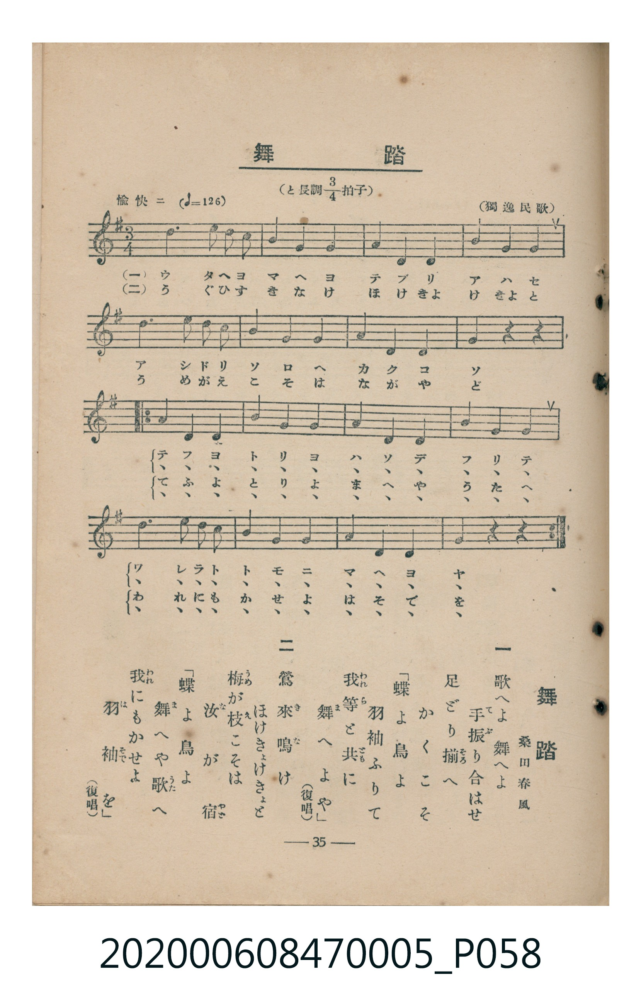

# 舞踏

> Re:Shōka 使用 AI 協助辨識與重建樂譜，可能會有錯誤。歡迎回報。

- **鋼琴伴奏版**：<br><audio controls src="buto.mp3"></audio>
- **NEUTRINO 歌聲合成版**：<br><audio controls src="buto_neutrino.mp3"></audio>

- 臺灣教育會公認《新定兒童唱歌》尋常科第五學年用（2020.006.0847.0005）

## 說明

原書資訊與歌詞全文（對應 P058.jpg，書頁 p. 35，參考教材第 2 首）：
調性與拍號：と長調四分之三拍子（G 大調 3/4 拍），愉快ニ（♩= 126）
出處與作歌：（獨逸民歌）、桑田春風


## 歌詞

```text
一　歌へよ舞へよ　手振（てぶ）り合はせ
足どり揃（そろ）へ　かくこそ
「蝶よ鳥よ　羽袖ふりて
我等（われら）と共（とも）に　舞（ま）へよや」（復唱）

二　鶯來（き）鳴（な）け　ほけきょけきょと
梅（うめ）が枝（え）こそは　汝（な）が宿（やど）
「蝶よ鳥よ　舞（ま）へや歌（うた）へ
我（われ）にもかせよ　羽（は）袖（そで）を」（復唱）
```

## ABC

<div class="abc-score" data-abc-src="buto.abc" aria-label="五線譜載入中"></div>

[下載 ABC 原始檔](buto.abc)

## TMD 檔案連結

- [主旋律 TMD 檔案](buto.tmd) [[在 TMD Studio 編輯](https://tmdlang.github.io/Tmd-TS/#tmd=s7IKdvYPcrWy4qpTUCpJTLdSSM7PyUlNLsnMz7MqzsjMK0nNjM_KTMmPL87Iz05Ugisry88pzU21Si9KTEmNN403MjAyiDcwMIs3sDAxBzIMTBFKi_NLi5JTrYqTM_Lzc-JLUitKkvLzsxHyBUX5Zal5iXlANQVFIBtTwIoQClLLMlNSQdKpKZkl-UWZiTlI7kgtKga7FWxJfElRYl5xclFmAcgDCFUlGalAx-aWFmcmIwSBJqVn5lmVpxaXpBblxeem5uSnVGJIlyRmAr0O8n55YnxuYmZeTmJeihKXlpbCi455L3b0K2hpcSnaKhgamXHZ2yq4c9kY65vYgQx50b7reePiZ1Nnvmja9GxO89PWNS9W9T5u6Ho2bcPTdbOetk56vnrp0ykbn63tedzQ_XRD99MdO54vn_h8zZonu6Y8Xbvj6c4tz6eseL-nAxS0esCg1QMFLZBhYPp-T6cSF5e-loIttQCXgoLC0775z2bveLG5_cWKrhcd7UB3vVg572nrimfT2oGueLqh91l7p0KAgamFXlZB-vs9PUDFLxc0KhToKRgDXdTztL_5RUMz0LvP5k4AekLBSOHlsmlAl77fMwtk-otV-581LAeZ2937YuZ8oOjjxhUvp24Hij-dPftpR9uTnd1PdnQCZZ-unQC0z13h6ZLlQEkFYHAqAEXBJvU8a-l8un_14-ZuoIpHM1eCgx0oA3Z--64XM6cCLXiydw7Q7UALgGqe96542bDj2YaJYJHOxw2NzxZOfD5lw7MZS18uWsEF0vdkR8PjhgZQLDTueNzUAYxUCAMk2Nn9rGc90JjHjcseN24DGdDU9XQCkLv-ceNssK-2bX7cuBIo-qy_Gaxu7uMmkFNBRjQ0PG7sftzY_7hxMlAcpPpxQ8-LuduAZr_cvBRiw_N9e18smva4cSvQCKAlIEXPOiY-Xwv0a8fjpv7HTT2Pm4BsoHkrnrZuBNuw4nFTE1hkNVA_0LVgwX1QO4GGNrU8bgA6oePpvpXA1AUKHLAvdwFTWcPLbeuf7GsD6wC58uXmLWD2KrDuiWAX7wYxGnsfN7UjMVaAHbaoFay67XFTI1hDz7N5c8EiHWAuyJegkAGG20aIOMTcnqfr9oO90wIMKmhkYYYEhk9awFEGtq8RmFxAgtDggYcNNBiamsABPRsepGBtwHjrBIYtNFYal4NjbxJ62ABNpDz3QIGClj4Xl1NpSb5VQGZiXr5DjUFNNcgCBRtDMy07MAtbnlUAZfkdDS8W9ihomCg83dD_fH2DDjyjaWLRALQHapgGUKOmlcLjpmUgAVDANu1XeNw8A4hXgLg1QMY8sDhQDEzBhdsg_GkQahVUuGkRhN8PMWw3iEK2blcPyLpGsGaQisYJQLwJiGdCDWjshYiDDQQmIZgw2CQoH5KsIOIoAsCUhmRhjYKpgi4cmgExjF-jYAJlGUNpI7iMIUx9PJQBE6iBK0Kna8DW-RiC_L8MyUpQYALJ5hmgYIMZAgpQqDQwTGEsZPk2uOg0OGsVQh4YxDDRfrhFu1GdYgQKGpg5YBXAgAaRm0AhDTcKGNgwaZgFoBBFyMOMRYhCgxqhBKsEKCJgDsKfcHf1UJZwwekNnNa2AwOkEzkp7oUkxbVI6RckvBqifD2E2oyiGhngS7ZNjUBeDxB3wNLnZEg6nAuhwIaDhKHJuAeiqwUmvBKHZZQlWdwyBmg0coqFJSdIQtoOIps7UVPcXpg0MDBhLFjahQQpTPt6OGszFv2wLAWjcaZWYPiCEhGwTu1AGAMMY1jqmgtnwSyEBDZMtAduUAuS_EqcziBQuHZSlEab24DtBki6aZ4KZgLzO5gG5XZgnQMWWYUh0w_X1rQXKtkOl4QZBNMGsQNLml0GNwXYSgCrBVVzEFOAjQGISBeGzD6ENmBTBCwJbBhAJSGWAetVKA1RAU_DsPQHS4uI9AhjwVIqLE3XwEVgsjA-QgamFp4jEGkYXmSC47x5KphELlJhqQiRrFHlYQUpJM2AkiswrJHkQSai64fZiZyIUUr_xq1g05BTMMxOYIjDWcjy-1D07wDLI6dgeNXQOB9FFcQdeFMxsJVMWSoGtsxgqXgNkPm4eSWYBCUZ5HS8CEp3w5PqPKjIDIwUvgRmJHo5iJSAgS01eDYAtkEbgQ1aEAlqvoLsBbbcIGlwNkYShjgY1HqD0MthMqBmHHZ7B6D8bYaVYJBUtQZMrkQkWdTki6j7u5HkCbUolkDZeMrfJtQsACpAQSHdCCvawUENk26cDVeInHrhhT9S-bwcId80CaczCJW_wPiCpN-n_b0vloF6IJAmuI6CBTQ5AxvjuJPxaJEEiw56F0mjmQrhDHpnqlouLl07BVCHUgFIK3MBAA)]
- [鋼琴伴奏 TMD 檔案](buto_piano.tmd) [[在 TMD Studio 編輯](https://tmdlang.github.io/Tmd-TS/#tmd=s7IKdvYPcrWy4tLSUnjRMe_Fjv73ezpedu95PmHLkz1bni7tf97Z8X5Pp4KWFpeirYKhkRmXva2CO5eNsb6JHVedgtKL9l3PGxc_mzrzRdOmZ3Oan7auebGq93FD17NpG56um_W0ddLz1UufTtn4bG3P44bupxu6n-7Y8Xz5xOdr1jzZNeXp2h1Pd255PmUF0EojAyMDPQMDMz0DCxNzIMPAFGirEheXU2lJvlVAZmJefpCHQ41BTTWXAhDYGJpp2YFZ-loKtuhAAWT8joYXC3sUNEwUnm7of76-QUchwMDUQi-rIF0TiwYtfbBhNQqmCrpwaAbEMH6NggmUZQyljeAyhjD18VAGTKAGrgidrgFb52NYo_C4aRmSlY-b9oPI5hmPm1fADXncPA8m3TwDzkKWb4OLToOzViHkmxbBRfvhFu1GdYoRUF0jzBywisYJYHLT48aZCKMae-HSMAseN05EkocZixAF6nnc1I6kBKvE40a4h7jwR-yuHnpHLG4ZAzQaOV5hgQ4J7u0gsrkTNV72wqSb18JZsBgGya-Ga18PZ23Goh-W8GA0zjhtagSRjT2PGzsQxjROhkk3zoWzYBaC5BEx3QM3qAVJfiVOZxDIop3kxCQsFmAxgogVGAsWX7CYrYGLwGRhfIQMTC08XSBiEp69wD5vngomkbMfLCwRkYsqD8t0kJADRdrjZqQMATYRXT_MTuSoRCkpGreCTUOOR5idj5u64Cxk-X0o-neA5ZHjEV6MNM5HUQVxB964fDp79pDIlc2wdA0J5TVgciUiClGjE1FudiPJEyqNl0DZeHJlE2qSAGWrx02djxthGR4UGzArHzfOhitEjk14kYCUa5cj5Jsm4XQGoVz5uKEREp9P-3tfLGsD1s5P960EVuI6ChbQ6AW1CEazKKo7BkEWHc1UCGfQO1PVIrdVfZDbqiaIpuqLPVOf7l_9bMvuZ3snPtnZ_XTf9qdzuoHN7mezNwHz3bPu3qdrJzzdvuxZZzek8Y3IUobxCtGGsWAMjOF4IM80HsgFEfglidWPyjUAQnh6QlON13ZkzhC1GhiTunYKoMiM9gFqhLONwGxlLgA)]

## 分析

```text
================================================================================
📊 TMD Song Profile: [ 舞踏 ]
================================================================================
⏱  Duration:       0:34 (34.3s), 24 measures total
🎼 Key & Tempo:    首調基準 G, != 126.0 BPM, <3/4>
   - 分析範圍：      由實際發聲的音符與和弦推測調性；播放脈絡另行呈現
🎤 人聲音域:    E4 (MIDI 64) – E5 (MIDI 76) [跨度: 12 個半音 / 1.0 個八度, 難度: easy]
   - 最低音:  E4 in [Buto #1 @ m.3, 0:03]
   - 最高音: E5 in [Buto #1 @ m.1, 0:00]
   - 適合: soprano, mezzo-soprano, contralto, tenor, baritone, bass
🏛  結構:      Buto (34.3s)
⚡ 編曲密度:        Peak 1 軌道同時演奏
🗝  調性診斷：       G 調性不明確（純淨自然大調，未偵測到可信轉調）
   - 風格氣質:    純淨自然大調（陽光明朗、易唱易記，無明顯調外色彩）
   - 轉調歷程:    全曲維持單一推測調性（未偵測到可信轉調）
   - 核心骨幹音:  A, B, D, C, G
   - 調性數值:    G 調性不明確 [相關度: 0.64, 穩定度: Ambiguous, 自然音純度: 100.0%]
   - 候選調性 (K-S): G 大調 (0.64), D 大調 (0.63), A 小調 (0.60)
   - 五度圈歷程:   +1
   - 各段落調性細節:
     • [Buto #1]: G 調性不明確 (r: 0.64, 自然音純度: 100.0%)

  [ 五度圈游移軌跡 ]
               C  
         F           [G ]*
      Bb               D  
      Eb               A  
         Ab           E  
            Db       B  
               F# 
     (* = active key center)

  [ 十二半音累積音高分佈 ]
     C  : ███████████               12.1%
     C# :                            0.0%
     D  : ████████████████          18.2%
     D# :                            0.0%
     E  : ████                       4.5%
     F  :                            0.0%
     F# :                            0.0%
     G  : ███████████               12.1%
     G# :                            0.0%
     A  : ████████████████████████  27.3%
     A# :                            0.0%
     B  : ███████████████████████   25.8%
--------------------------------------------------------------------------------
Assignment 軌道音域：
  - Piano         : E4 – E5 (12 個半音 / 1.0 個八度, 66 個音符)
================================================================================
```


## 原書掃描頁




