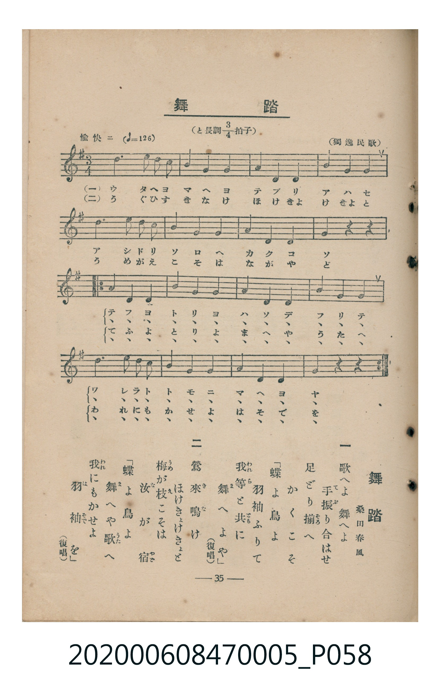

# 舞踏

> Re:Shōka 使用 AI 協助辨識與重建樂譜，可能會有錯誤。歡迎[回報](https://github.com/TMDLang/reshoka/issues)。

- **鋼琴伴奏版**：<br><audio controls src="buto.mp3"></audio>
- **NEUTRINO 歌聲合成版**：<br><audio controls src="buto_neutrino.mp3"></audio>

- 臺灣教育會公認《新定兒童唱歌》尋常科第五學年用（2020.006.0847.0005）

## 說明

原書資訊與歌詞全文（對應 P058.jpg，書頁 p. 35，參考教材第 2 首）：
調性與拍號：と長調四分之三拍子（G 大調 3/4 拍），愉快ニ（♩= 126）
出處與作歌：（獨逸民歌）、桑田春風


## 歌詞

```text
一　歌へよ舞へよ　手振（てぶ）り合はせ
足どり揃（そろ）へ　かくこそ
「蝶よ鳥よ　羽袖ふりて
我等（われら）と共（とも）に　舞（ま）へよや」（復唱）

二　鶯來（き）鳴（な）け　ほけきょけきょと
梅（うめ）が枝（え）こそは　汝（な）が宿（やど）
「蝶よ鳥よ　舞（ま）へや歌（うた）へ
我（われ）にもかせよ　羽（は）袖（そで）を」（復唱）
```

## ABC

<div class="abc-score" data-abc-src="buto.abc" aria-label="五線譜載入中"></div>

[下載 ABC 原始檔](buto.abc)

## TMD 檔案連結

- [主旋律 TMD 檔案](buto.tmd) [[在 TMD Studio 編輯](https://tmdlang.github.io/Tmd-TS/#tmd=s7IKdvYPcrWy4qpTUCpJTLdSSM7PyUlNLsnMz7MqzsjMK0nNjM_KTMmPL87Iz05Ugisry88pzU21Si9KTEmNN403MjAyiDcwMIs3sDAxBzIMTBFKi_NLi5JTrYqTM_Lzc-JLUitKkvLzsxHyBUX5Zal5iXlANQVFIBtTwIoQClLLMlNSQdKpKZkl-UWZiTlI7kgtKga7FWxJfElRYl5xclFmAcgDCFUlGalAx-aWFmcmIwSBJqVn5lmVpxaXpBblxeem5uSnVGJIlyRmAr0O8n55YnxuYmZeTmJeCrKqkox8YCgUZFRaZWQWg5yXnJgTn52YhxRYUMcVJKanWgUYmFoocWlpKbzomPdiR7-ClhaXoq2CoZEZl72tgjuXjbG-iR1I44v2Xc8bFz-bOvNF06Znc5qftq55sar3cUPXs2kbnq6b9bR10vPVS59O2fhsbc_jhu6nG7qf7tjxfPnE52vWPNk15enaHU93bnk-ZcX7PR2gmNEDxoweKGaADAPT93s6lbi49LUUbKkFuBQUFJ72zX82e8eLze0vVnS96GgHuuvFynlPW1c8m9YOdMXTDb3P2jsVQJ7XyypIf7-nB6j45YJGhQI9BWOgi3qe9je_aGgGevfZ3AlATygYKbxcNg3o0vd7ZoFMf7Fq_7OG5SBzu3tfzJwPFH3cuOLl1O1A8aezZz_taHuys_vJjk6g7NO1E4D2uSs8XbIcKKkADE4FoCjYpJ5nLZ1P969-3NwNVPFo5kpwsANlwM5v3_Vi5lSgBU_2zgG6HWgBUM3z3hUvG3Y82zARLNL5uKHx2cKJz6dseDZj6ctFK7hA-p7saHjc0ACKhcYdj5s6gJEKYYAEO7uf9awHGvO4cdnjxm0gA5q6nk4Actc_bpwN9tW2zY8bVwJFn_U3g9XNfdwEcirIiIaGx43djxv7HzdOBoqDVD9u6HkxdxvQ7Jebl0JseL5v74tF0x43bgUaAbQEpOhZx8Tna4F-7Xjc1P-4qedxE5ANNG_F09aNYBtWPG5qAousBuoHuhYsuA9qJ9DQppbHDUAndDzdtxKYukCBA_blLmAqa3i5bf2TfW1gHSBXvty8BcxeBdY9Eezi3SBGY-_jpnYkxgqwwxa1glW3PW5qBGvoeTZvLlikA8wF-RIUMsBw2wgRh5jb83TdfrB3WoBBBY0szJDA8EkLOMrA9jUCkwtIEBo88LCBBkNTEzigZ8ODFKwNGG-dwLCFxkrjcnDsTUIPG6CJlOceKFDQ0uficiotybcKyEzMy3eoMaipBlmgYGOhZQdmYMuyCqAcv6PhxcIeBQ0Thacb-p-vb9CB5zNNLBqA1kAN0wBq1LRSeNy0DCQACtem_QqPm2cA8QoQtwbImAcWB4qBKbhwG4Q_DUKtggo3LYLw-yGG7QZRyNbt6gFZ1wjWDFLROAGINwHxTKgBjb0QcbCBwBQEEwabBOVDUhVEHEUAmNCQLKxRMFXQBUIzMF2jYAIkjYHYCMwzBMnEAwkQowYsCMM1YO0-hiD_LAMbAQ0WkPdBikGBAhQEhgmIhIm1gXnTwOQqiBgwOEC8frARuxFGG4GcDlIPFIcEASgEwFqAAQASBBkA8h1EDKQVwoN6FSKMIgDyPMgC_AllVw9lCQUcv-C43Q70WCdy1O-FRP1apPQCEl4NUb4eQm1GUY0M8CWTpkYgrweIO2DpYTIk3udCKLDhIGFosumB6GqBCa_EYRnhJILKM4Bi5BQCimJQ9ILDAxHze8ExvxaeTiBBAVK4HkxuRlIHSoYgjCV1QHwO8jgkyieDY3oumAQZBPE0iNcDVt4CFVuJYiyBwqOTojTR3AasFiHx1DwVzATmCTANyhXAIhUssgpDph-urWkvVLIdLgkzCKYNYgeWNLIMbgqwEgSrBZXiEFOAdR1EpAtDZh9CG7CmBUsC6z2oJMQyYLUBpSEq4GkGlB5AqQKSLkAkKJWA0k4NmAXig2gIDyQOTl2INAMuKkAJYypS8QGKYUjyQYiBCg5QrO4FhQ1UbCqSOpA5yIkGWlo1bgX5FZoSQGYBQwBMwsT2QdXtQEox4OKrcT5UnGCqATa6KEs1wIoelmrWAJmPm1eCSVAUIaebRVC6G5405kFFZmCkqCUwI9HzOVKCAVb88GQHbNI0AttHIBLUGgLZC2wIQOJ8NkaSgTgY1BiA0MthMqBWAXZ7qVC-NINyOSiu1wDxSkgyQSQXSP3SDRXDVistQSkI4EmlCZa0gKUqMAQaQUUT2Pvg-J-NklrABRa0zFkOEWuahGIsofIFGD6Q9PK0v_fFMlADEtKC0lGwgCYfYFsKd7IZOVluJCWaWi4uXTsFUHtXAUgrcwEA)]
- [鋼琴伴奏 TMD 檔案](buto_piano.tmd) [[在 TMD Studio 編輯](https://tmdlang.github.io/Tmd-TS/#tmd=s7IKdvYPcrWy4qpTUCpJTLdSyC8qychPL0osyKi0ysgsLskvykxOzInPTsxLVIIrKs4vLUpOjS9ITE-1CjAwtVDi0tJSeNEx78WO_vd7Ol5273k-YcuTPVueLu1_3tnxfk-ngpYWl6KtgqGRGZe9rYI7l42xvokdyLQX7bueNy5-NnXmi6ZNz-Y0P21d82JV7-OGrmfTNjxdN-tp66Tnq5c-nbLx2dqexw3dTzd0P92x4_nyic_XrHmya8rTtTue7tzyfMoKoJVGBkYGegYGZnoGFibmQIaBKdBWJS4up9KSfKuAzMS8_CAPhxqDmmouBSCwsdCyAzP0tRRs0YECyPQdDS8W9ihomCg83dD_fH2DjgLIl3pZBemaWDRo6YMNq1EwVdAFQjMwXaNgAiSNgdgIzDMEycQDCRCjBiwIwzVg7T6GNQqPm5aBjXjctF_hcfOMx80rwIofN88DCTbPAJMwsTYwbxqYXAURa1oE5vWDjdiNMNoIKNcIUg8Ub5wAxJseN86EaGnsBQuCDHjcOBEqBtIK4QHlHze1Q4VRBB43gh3ChT8gd_XQIiBReQZQjByOoIAABcJ2YHB0IsJnLzh81sJDEyS2GqxwPZjcjKQOFFkgjCUMmxqB7J7HjR3QgJkMDo-5YBJkEEgMEqI9YOUtULGVKMYSSIKd5IQcKFRAYQMJHRAJCitQCNaAWSA-iIbwQOLgMEaEHDhZgYJnKlJSA_kTEogIMVAiA_ltL5ANTSBAPQh1IHOQgw6ashu3AvXAwg1k1uOmLjAJE9sHVbcDKdzASb1xPlScYNg9nT17QFJdMyjuQX5fA8QrIcGGCD5I3uyGimHL0UtQkgc86JpgQd0DxJ2PG0EJFhQqIKMeN85GCT1wMoamxOUQsaZJKMYSSnWPGxoh4fe0v_fFsjZg4fp030pgGayjYAENTlCBPpoER1SiqUWuSn2Qq1ITRFX6Ys_Up_tXP9uy-9neiU92dj_dt_3pnG5gq-DZ7E3AdPWsu_fp2glPty971tkNaRsgkoxhvEK0YSwYA0M0HsgzjQdyQQR-SWL1o3INgBAef2iq8dqOzBmiVgNjUtdOARSZ0T5AjXC2EZitzAUA)]

## 分析

```text
================================================================================
📊 TMD Song Profile: [ 舞踏 ]
================================================================================
⏱  Duration:       0:34 (34.3s), 24 measures total
🎼 Key & Tempo:    首調基準 G, != 126.0 BPM, <3/4>
   - 分析範圍：      由實際發聲的音符與和弦推測調性；播放脈絡另行呈現
🎤 人聲音域:    E4 (MIDI 64) – E5 (MIDI 76) [跨度: 12 個半音 / 1.0 個八度, 難度: easy]
   - 最低音:  E4 in [Buto #1 @ m.3, 0:03]
   - 最高音: E5 in [Buto #1 @ m.1, 0:00]
   - 適合: soprano, mezzo-soprano, contralto, tenor, baritone, bass
🏛  結構:      Buto (34.3s)
⚡ 編曲密度:        Peak 1 軌道同時演奏
🗝  調性診斷：       G 調性不明確（純淨自然大調，未偵測到可信轉調）
   - 風格氣質:    純淨自然大調（陽光明朗、易唱易記，無明顯調外色彩）
   - 轉調歷程:    全曲維持單一推測調性（未偵測到可信轉調）
   - 核心骨幹音:  A, B, D, C, G
   - 調性數值:    G 調性不明確 [相關度: 0.64, 穩定度: Ambiguous, 自然音純度: 100.0%]
   - 候選調性 (K-S): G 大調 (0.64), D 大調 (0.63), A 小調 (0.60)
   - 五度圈歷程:   +1
   - 各段落調性細節:
     • [Buto #1]: G 調性不明確 (r: 0.64, 自然音純度: 100.0%)

  [ 五度圈游移軌跡 ]
               C  
         F           [G ]*
      Bb               D  
      Eb               A  
         Ab           E  
            Db       B  
               F# 
     (* = active key center)

  [ 十二半音累積音高分佈 ]
     C  : ███████████               12.1%
     C# :                            0.0%
     D  : ████████████████          18.2%
     D# :                            0.0%
     E  : ████                       4.5%
     F  :                            0.0%
     F# :                            0.0%
     G  : ███████████               12.1%
     G# :                            0.0%
     A  : ████████████████████████  27.3%
     A# :                            0.0%
     B  : ███████████████████████   25.8%
--------------------------------------------------------------------------------
Assignment 軌道音域：
  - Piano         : E4 – E5 (12 個半音 / 1.0 個八度, 66 個音符)
================================================================================
```


## 原書掃描頁




