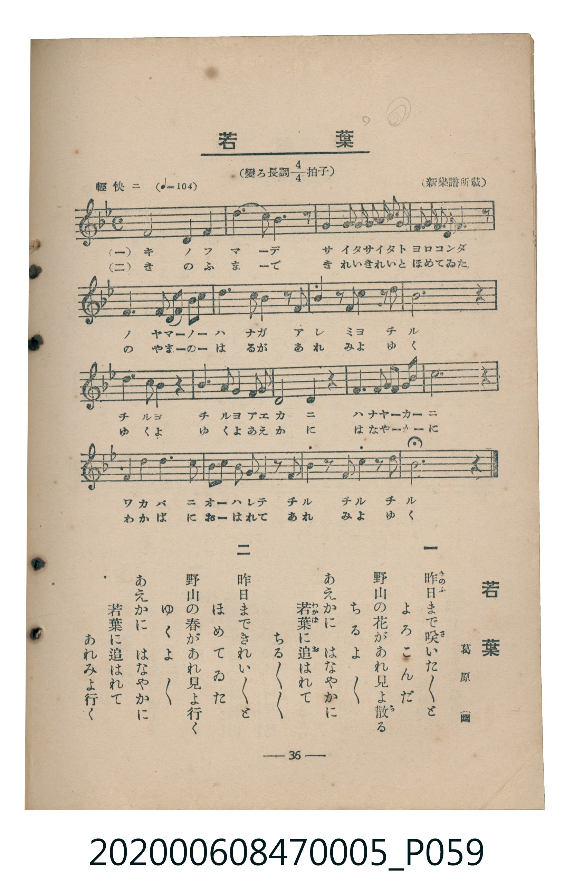

# 若葉

> Re:Shoka 使用 AI 協助辨識與重建樂譜，可能會有錯誤。歡迎回報。

<audio controls src="wakaba.mp3"></audio>

- 臺灣教育會公認《新定兒童唱歌》尋常科第五學年用（2020.006.0847.0005）

## 說明

原書資訊與歌詞全文（對應 P059.jpg，書頁 p. 36，參考教材第 3 首）：
調性與拍號：變ろ長調四分之四拍子（Bb 大調 4/4 拍），輕快ニ（♩= 104）
出處與作歌：（新樂譜所載）、葛原𦱳

## 歌詞

```text
一　昨日（きのふ）まで咲（さ）いた〳〵と
よろこんだ
野山の花があれ見よ散（ち）る
ちるよ　ちるよ
あえかに　はなやかに
若葉（わかば）に追（お）はれて
ちる　ちる　ちる

二　昨日（きのふ）まできれい〳〵と
ほめてゐた
野山の春があれ見よ行く
ゆくよ　ゆくよ
あえかに　はなやかに
若葉に追はれて
あれみよ行く
```

## ABC

```abc
X:1
T:若葉
M:4/4
L:1/16
Q:1/4=104
K:Bb
V:V1 name="Piano" snm="Pia"
[V:V1]
F8 F4 G4 | B4 d4 B6 z2 | c4 c2 d2 c2 d2 c2 A2 | F2 G2 A2 F2 B6 z2 |
G4 G4 G2 A2 B2 c2 | d4 B8 z2 d2 | d4 z2 c2 c4 z2 B2 | d12 z4 |
c6 A2 F4 z4 | d6 B2 G2 F2 G2 A2 | F12 z4 | F4 G4 A2 B2 c2 d2 |
d12 z4 | F2 F4 F8 G2 | G2 A2 B2 c2 d4 z2 d2 | d4 z2 c2 c4 z2 A2 |
B12 z4 |
```

## TMD 檔案連結

- [主旋律 TMD 檔案](wakaba.tmd) [[在 TMD Studio 編輯](https://tmdlang.github.io/Tmd-TS/#tmd=s7IKdvYPcrWy4qpTUCpJTLdSSM7PyUlNLsnMz7MqzsjMK0nNjM_KTMmPL87Iz05Ugisry88pzU21Si9KTEmNN403MjAyiDcwMIs3sDAxBzIMTBFKi_NLi5JTrYqTM_Lzc-JLUitKkvLzsxHyBUX5Zal5iXlANQVFIBtTwIoQClLLMlNSQdKpKZkl-UWZiTlI7kgtKga7FWxJfElRYl5xclFmAcgDCFUlGalAxxbkJOYBjdXSUnjRvfTFxE4FLS0uRVsFQwMTLntbBackLhsTfRM7kKYX7bueNy5-NnXmi6ZNz-Y0P21d82JV7-OGrmfTNjxdN-tp66Tnq5c-nbLx2dqexw3dTzd0P92x4_nyic_XrHmya8rTtTue7tzyfMqK93s6QMGiBwwWPVCwABkGpu_3dCpxcelrKdhSC3ApKCg87Zv_bPaOF5vbX6zoetHRDnTXi5XznraueDatHeiKpxt6n7V3KgQYmFrqZRWkv9_TA1T8ckGjQoGegrEZkPu0v_lFQzPQu8_mTgB6QsFY4eWyaUCXvt8zC2T6i1X7nzUsB5nb3fti5nyg6It1XY-bel9O3Q6Uejp79tOOtic7u4EMoIKnaycArXRKUni6ZDlQVgEYpApAYbBpPS_2TH26f_Xj5m6gkkczV4LDHigD9kL7rhczpwItebJ3DtD9QEuAaoDh_WxF04u1c551NrwAmdD5uKHxxcTZQP9-WLZxMxdI45MdDY8bGp7NWPFs-lKglseNvY8b1z1u3ApS3LjvcePyp5M2gcWngkVaHjfOf9yw-XHD1seNK0D6Hzd1AP3yuHHy46bJjxsXgIRetvc93bgRaMyLLiDZ87ix6XFTz4tl3UClz6YuBhu2EGRYUzfYgMaFQBbImIYGOBsi0fS4Eai2-3HjarDc-seNqx43AV0AEgGHLDgdggxs6geLbgC7cfWL_XvBtnSBueuBtj9uXIZkF9wiGAMSEruAyRFfSIBEQEa1oAZA4-7HTY1ACx43TQAGDkoAPJuxFC0AXiwEcvshAdcGZEH9DWOT4m-IR9H8B7LpceN-FJsozyRQoKClz8UVnpidmJRoFZCZmJfvUGNQo1ANskPBxtBMyw7MwpY7FUCZe0cD0E0KGiYKTzf0P1_foAPPUppYNACtghqmAdSoaQUMr7UgAQh43NwHoaaCqBogYx6EvwdCtSOUAiWbtoJFm5YA8X4wF85u7gDrXgHEa4Eim4E0CDcg9CM7ZFcPyCGNvUgOaVwHocBWAI1q3IfskMblKA6B6ARGEZDZAuYi2CvACnYDRRqB9DIgPQFIz8dwSI2CabyCLgqEC5jBGDUKhlCWMZSG8UHQAKzCCMoD0SBVyLQ5yCCoTWBDwQJgLoZB4MyDO9Z39VAU67CIXgKh5oGDFiQKofvB0dcFCdY1iMAC8xeBJWGij5vng2MaxmsEy65G0YMe2MixDonophYwBYxmsAOAohB6PTihdUMke1Ad0tgEloSJAvMnqNiEO7MNHPP9eB1Sg4hbVAY4YkBxAoq2GqzRDYspkBxCBUgEpAeWDEB8kC6ECnQIUgFOXARifEcnOMZNyY3xRljIACMHEWHgQMCUBMXy4yYQvRosD44BTACSAocwLLEAExQ44oDaQDQerZhJARhjUEcAYw0RkxBrMCRB0Q8s0IG4GxzROFIcSGo9RN8qMAVMaZCk1Q1zIS6t8DQCi0sQRORYlLhDiV1QfINTEVpGx1LGYCQCLKUOSlpETW1kpiVgo4iy0mM9OIZBwdk8ARFgoLgGRdUqeCkCKiYeN8OjDq1wAPFReSQVHU1A84GxCNLauAHJFcD4BMVqF7wIgdQGy-Dy1Cg3wNEEjyuMeAVHHrR0wYg_WEwRLjmgyQa92MGM7louLl07BUgjQgHIUubiAgA)]
- [鋼琴伴奏 TMD 檔案](wakaba_piano.tmd) [[在 TMD Studio 編輯](https://tmdlang.github.io/Tmd-TS/#tmd=s7IKdvYPcrWy4tLSUnjRvfTFxM73ezpedu95PmHLkz1bni7tf97Z8X5Pp4KWFpeirYKhgQmXva2CUxKXjYm-iR1XnYLSi_ZdzxsXP5s680XTpmdzmp-2rnmxqvdxQ9ezaRuerpv1tHXS89VLn07Z-Gxtz-OG7qcbup_u2PF8-cTna9Y82TXl6dodT3dueT5lBdBOIwMjAz0DAzM9AwsTcyDDwBRorRIXV3hidmJSolVAZmJefpCHQ41BjUI1lwIQ2BiaadmBWfpaCrboQAFkw46GFwt7FDRMFJ5u6H--vkFHIcDA1FIvqyBdE4sGLX2wYTUKpvEKuigQLmAGY9QoGEJZxlAaxgdBA7AKIygPRINUIdPmIIOgNoENBQuAuRgGceH3464ecvwI9wkqA-wMkAtAjqzB6jmYu0ByCBUgEZAemKdBfJAuhAp0CFIBDkoC_tvRCfafKWn-g7kDBBFhi2IvistAbgWHAFqUYEkNGB7Akj5QwhE1pMgMh6ezZ5OdluHuw_AL2MHQ1IDhZpjrCMc0NKjQkwmmF2tR87MPSn42QWTnF3umPt2_-tmMvmdzpj_Z2Q30_LPu3qdrJzzdvuxZZzekYHq_B5jyVzzv3_ds1rpnM5a-mLD3RdfGFx3tTzvmPl3SDyx-nm9b8GTXkmez9wNNeD5l_rOV85HDJV4h2jQ-FsEAOh_IMowFUQY4VMCZEDXwvAQUNYvPjUVioZsG5eGyDZurkLSZACkTFAfAFBD0Bx7_Qk0l0oXAqNO1U4DEngIKS5mLCwA)]

## 分析

```text
================================================================================
📊 TMD Song Profile: [ 若葉 ]
================================================================================
⏱  Duration:       0:39 (39.2s), 17 measures total
🎼 Key & Tempo:    首調基準 B,, != 104.0 BPM, <4/4>
   - 分析範圍：      由實際發聲的音符與和弦推測調性；播放脈絡另行呈現
🎤 人聲音域:    F4 (MIDI 65) – D5 (MIDI 74) [跨度: 9 個半音 / 0.8 個八度, 難度: easy]
   - 最低音:  F4 in [Wakaba #1 @ m.1, 0:00]
   - 最高音: D5 in [Wakaba #1 @ m.2, 0:02]
   - 適合: soprano, mezzo-soprano, contralto, tenor, baritone, bass
🏛  結構:      Wakaba (39.2s)
⚡ 編曲密度:        Peak 1 軌道同時演奏
🗝  調性診斷：       D 調性不明確（純淨自然大調，未偵測到可信轉調）
   - 風格氣質:    純淨自然大調（陽光明朗、易唱易記，無明顯調外色彩）
   - 轉調歷程:    全曲維持單一推測調性（未偵測到可信轉調）
   - 核心骨幹音:  D, F, A#, C, G
   - 調性數值:    D 調性不明確 [相關度: 0.83, 穩定度: Ambiguous, 自然音純度: 100.0%]
   - 候選調性 (K-S): D 小調 (0.83), A# 大調 (0.80), F 大調 (0.77)
   - 五度圈歷程:   +2
   - 各段落調性細節:
     • [Wakaba #1]: D 調性不明確 (r: 0.83, 自然音純度: 100.0%)

  [ 五度圈游移軌跡 ]
               C  
         F            G  
      Bb              [D ]*
      Eb               A  
         Ab           E  
            Db       B  
               F# 
     (* = active key center)

  [ 十二半音累積音高分佈 ]
     C  : ██████████████            14.4%
     C# :                            0.0%
     D  : ████████████████████████  25.4%
     D# :                            0.0%
     E  :                            0.0%
     F  : █████████████████████     22.0%
     F# :                            0.0%
     G  : ███████████               11.9%
     G# :                            0.0%
     A  : ██████                     6.8%
     A# : ██████████████████        19.5%
     B  :                            0.0%
--------------------------------------------------------------------------------
Assignment 軌道音域：
  - Piano         : F4 – D5 (9 個半音 / 0.8 個八度, 64 個音符)
================================================================================
```


## 原書掃描頁




