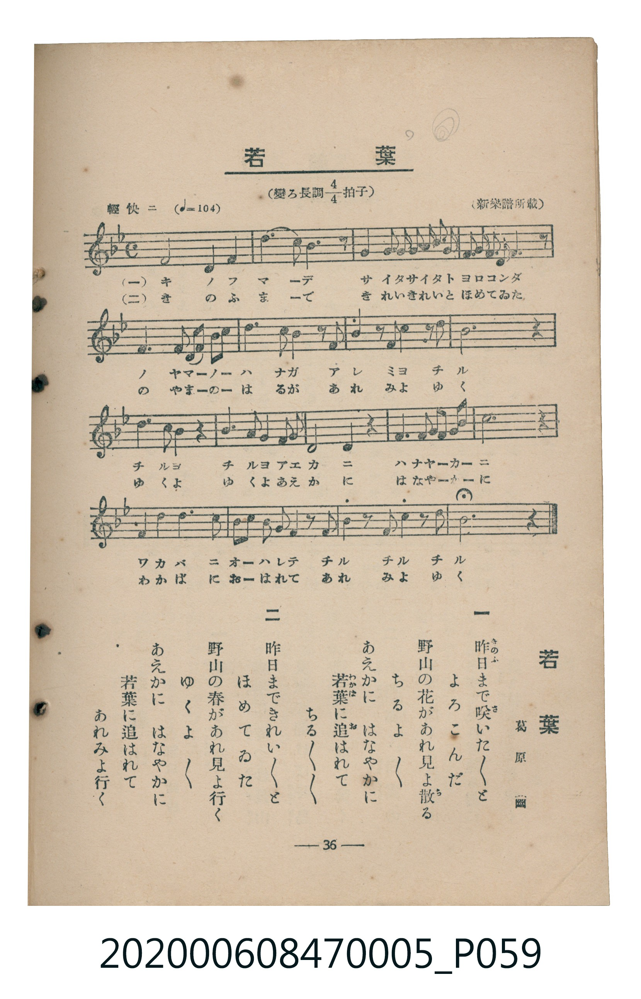

# 若葉

> Re:Shōka 使用 AI 協助辨識與重建樂譜，可能會有錯誤。歡迎回報。

- **鋼琴伴奏版**：<br><audio controls src="wakaba.mp3"></audio>
- **NEUTRINO 歌聲合成版**：<br><audio controls src="wakaba_neutrino.mp3"></audio>

- 臺灣教育會公認《新定兒童唱歌》尋常科第五學年用（2020.006.0847.0005）

## 說明

原書資訊與歌詞全文（對應 P059.jpg，書頁 p. 36，參考教材第 3 首）：
調性與拍號：變ろ長調四分之四拍子（Bb 大調 4/4 拍），輕快ニ（♩= 104）
出處與作歌：（新樂譜所載）、葛原𦱳


## 歌詞

```text
一　昨日（きのふ）まで咲（さ）いた〳〵と
よろこんだ
野山の花があれ見よ散（ち）る
ちるよ　ちるよ
あえかに　はなやかに
若葉（わかば）に追（お）はれて
ちる　ちる　ちる

二　昨日（きのふ）まできれい〳〵と
ほめてゐた
野山の春があれ見よ行く
ゆくよ　ゆくよ
あえかに　はなやかに
若葉に追はれて
あれみよ行く
```

## ABC

<div class="abc-score" data-abc-src="wakaba.abc" aria-label="五線譜載入中"></div>

[下載 ABC 原始檔](wakaba.abc)

## TMD 檔案連結

- [主旋律 TMD 檔案](wakaba.tmd) [[在 TMD Studio 編輯](https://tmdlang.github.io/Tmd-TS/#tmd=s7IKdvYPcrWy4qpTUCpJTLdSSM7PyUlNLsnMz7MqzsjMK0nNjM_KTMmPL87Iz05Ugisry88pzU21Si9KTEmNN403MjAyiDcwMIs3sDAxBzIMTBFKi_NLi5JTrYqTM_Lzc-JLUitKkvLzsxHyBUX5Zal5iXlANQVFIBtTwIoQClLLMlNSQdKpKZkl-UWZiTlI7kgtKga7FWxJfElRYl5xclFmAcgDCFUlGalAxxbkJOYhGQs0KT0zz6okMRPoN5D_yhPjcxMz84CqUpS4tLQUXnQvfTGxU0FLi0vRVsHQwITL3lbBKYnLxkTfxA5kyov2Xc8bFz-bOvNF06Znc5qftq55sar3cUPXs2kbnq6b9bR10vPVS59O2fhsbc_jhu6nG7qf7tjxfPnE52vWPNk15enaHU93bnk-ZcX7PR2gwNMDBp4eKPCADAPT93s6lbi49LUUbKkFuBQUFJ72zX82e8eLze0vVnS96GgHuuvFynlPW1c8m9YOdMXTDb3P2jsVAgxMLfWyCtLf7-kBKn65oFGhQE_B2AzIfdrf_KKhGejdZ3MnAD2hYKzwctk0oEvf75kFMv3Fqv3PGpaDzO3ufTFzPlD0xbqux029L6duB0o9nT37aUfbk53dQAZQwdO1E4BWOiUpPF2yHCirAAxSBaAw2LSeF3umPt2_-nFzN1DJo5krwWEPlAF7oX3Xi5lTgZY82TsH6H6gJUA1wPB-tqLpxdo5zzobXoBM6Hzc0Phi4mygfz8s27iZC6TxyY6Gxw0Nz2aseDZ9KVDL48bex43rHjduBSlu3Pe4cfnTSZvA4lPBIi2PG-c_btj8uGHr48YVIP2PmzqAfnncOPlx0-THjQtAQi_b-55u3Ag05kUXkOx53Nj0uKnnxbJuoNJnUxeDDVsIMqypG2xA40IgC2RMQwOcDZFoetwIVNv9uHE1WG7948ZVj5uALgCJgEMWnA5BBjb1g0U3gN24-sX-vWBbusDc9UDbHzcuQ7ILbhGMAQmJXcDkiC8kQCIgo1pQA6Bx9-OmRqAFj5smAAMHJQCezViKFgAvFgK5_ZCAawOyoP6GsUnxN8SjaP4D2fS4cT-KTZRnEihQ0NLn4gpPzE5MSrQKyEzMy3eoMaipBlmhYGNopmUHZmHLnAqgvL2jAegkBQ0Thacb-p-vb9CB5yhNLBqANkEN0wBq1LQCBtdakAAEPG7ug1BTQVQNkDEPwt8DodoRSoGSTVvBok1LgHg_mAtnN3eAda8A4rVAkc1AGoQbEPqRHbKrB-SQxl4khzSug1BgK4BGNe5DdkjjchSHQHQCYwjIbAFzEewVYAW7gSKNQHoZkJ4ApOdjOKRGwTReQRcFwgXMYIwaBUMoyxhKw_ggaABWYQTlgWiQKmTaHGQQ1CawoWABMBfDILCrfAxB4bwWzWGgaIKxpsKdBoosdHXtSDyI3aBogsoCIwtE7geTIFEUEWAUQkxdAeaB3ACKSBAbQjagmw1xsREkQtBcAoxPGAtmPyRW0dUtx3Qx3DRQrILUtIBJkCiqCMilkNgGyTSCxZaB2RPA7PkYLsafs3b1UJSzYJlpCYSaB06-IFEI3Q8O3S5I0l2DSJBg_iKwJEz0cfN8cETAeI1g2dUoetATNHLOgmSmphYwBQx0sAOAohB6PThZdEMke1Ad0tgEloSJAotAUM0Ed2YbOLz78TqkBpF_UBngxA9K96CsUYM1S4EgKDeA5BAqQCIgPbCsBuKDdCFUoEOQCnCaQ-QqpDwESvUQFiwHQWRBcQTJA10wcWBEoZoM8gMouiDqYLJgUWCkgUhQqkSIgVIlJPKwuxRe1CDlJnjeAcYglAXPORBZUCRCcnc3XByUMzBcCoxPiDqYLEQUUgaAcjzCT20QlcDYJeRSAvVTJzgXmZKbixphqQ0YZohMAE5YmJKgqHjcBKJXg-XBqRoTgKTAqRaWAYFpAJwZgNpANB6tmNkLGFJQRwDDCpE7INZgSIKiANgOAeJucPDiyMUgqfUQfavAFDDuIdm1G-ZCXFrh-Q6WP0AQUdOAIDw_oOQYUB4C50y0CgpL3QiDCIMwa0uU_I2ag3Eag5Q_QTkFBiH5BTUvQazFrQ6SK0GJAUSCxCGxSiA1Q3M9xDR4vkeUEWCTYCoJmobIxeD8BHcnOFeh5jiomTjVQfIuKOmASJDNkDRA0D_gsgFi2iq4LxAlCcwPRJmGP68D-1qU1ZjrweELSu7NExAJGhTOoJBZBa85QSXt42Z41kKrEEF8VB5J1WUT0HxgqIC0Nm5AcgUwdEBh1AWvNiGtzGVweWrUleBsBM9LGPkOnLmgNSpG_gJB4mpLaLZGr2phEFt2BCUiROIHxQ-qHkhmgEQTTASceMGVIiiyEEkJsxpEiGITI7HCBEYgcsIGxSKaW8EJHRKZMBGI_yDNSVCjEe4CmlSZtVxcunYKkD6fApClzAUA)]
- [鋼琴伴奏 TMD 檔案](wakaba_piano.tmd) [[在 TMD Studio 編輯](https://tmdlang.github.io/Tmd-TS/#tmd=s7IKdvYPcrWy4tLSUnjRvfTFxM73ezpedu95PmHLkz1bni7tf97Z8X5Pp4KWFpeirYKhgQmXva2CUxKXjYm-iR1XnYLSi_ZdzxsXP5s680XTpmdzmp-2rnmxqvdxQ9ezaRuerpv1tHXS89VLn07Z-Gxtz-OG7qcbup_u2PF8-cTna9Y82TXl6dodT3dueT5lBdBOIwMjAz0DAzM9AwsTcyDDwBRorRIXV3hidmJSolVAZmJefpCHQ41BTTWXAhDYGJpp2YFZ-loKtuhAAWTBjoYXC3sUNEwUnm7of76-QUchwMDUUi-rIF0TiwYtfbBhNQqm8Qq6KBAuYAZj1CgYQlnGUBrGB0EDsAojKA9Eg1Qh0-Ygg6A2gQ0FC4C5GAaBXeVjWKPwuGktmsMeN_fBWVPhTnvcPA9DXTsSD2L346atMNmmJWByP5gEiaKINHdATV0B5oHc8LhpM5gNIRvQzYa42Aiop7EX3SWN6-AsmP0gdfsw1C3HdDHctMdNPWA1LWASJIoqAnIpSP1usEwjWGwZmD0BzJ6P4WL86WhXDznpCJ5aUBngqAbFMigh1GBNQCAIinuQHEIFSASkB5awQHyQLoQKdAhSAQ5hRBpCSjGgOIawYOkFIvu4uR9s6uPmLph40xo0k0F-eNy0CKoOJgsWbQaFLiS1IMRAcQBSuRqHS-EZCyntwFNKEyhWwSx4OoHIPm5cDzG3qRsuDkoHGC5tbIKqg8lCRCEpHpS-EX5qg6hsBIUBfpcSKHs6wWnGlLQ0A4tbEESUCSAIj0uU2AbFPzhVoRUlWEoxGEQYhFmuoaRN1NSH0xiktAWKZRiExDVqOoBYi1sdJEU9boKwQeIg1bC4xRkT0BQLMQ2eZhHpG2wSTCVB0xApEJwW4O4EpwjU1AI1E6c6SLp73Ahhg2wGpSyCeQCariGmrYL7ApELYH4gyjT86fTp7Nlk15Hw9IOR1sAJCloCYqQpECSudIMmZfSiEQaxJUFQwCEi_HEzqMBHhpAEAIo0eMCCEw-kEHvcDItK7MUWQhSbGIkFXBPYXnhkPm7cgO5WcOSCIhmeqMEJA1bZgao0uAtoUsTVoja_fJCbXyaI1teLPVOf7l_9bEbfsznTn-zsBqapZ929T9dOeLp92bPObkgz8v0eYCW64nn_vmez1j2bsfTFhL0vuja-6Gh_2jH36ZJ-YGPx-bYFT3YteTZ7P9CE51PmP1s5Hzm5xStEm8bHIhjAVAFkGcaCKAMcKuBMiBp4tQwUNYvPjUVioZsG5eGyDZurkLSZACkTFAfAFBD0Bx7_Qk0l0oXAmNO1U4BEXrQPUByJZwTmKXMBAA)]

## 分析

```text
================================================================================
📊 TMD Song Profile: [ 若葉 ]
================================================================================
⏱  Duration:       0:39 (39.2s), 17 measures total
🎼 Key & Tempo:    首調基準 B,, != 104.0 BPM, <4/4>
   - 分析範圍：      由實際發聲的音符與和弦推測調性；播放脈絡另行呈現
🎤 人聲音域:    F4 (MIDI 65) – D5 (MIDI 74) [跨度: 9 個半音 / 0.8 個八度, 難度: easy]
   - 最低音:  F4 in [Wakaba #1 @ m.1, 0:00]
   - 最高音: D5 in [Wakaba #1 @ m.2, 0:02]
   - 適合: soprano, mezzo-soprano, contralto, tenor, baritone, bass
🏛  結構:      Wakaba (39.2s)
⚡ 編曲密度:        Peak 1 軌道同時演奏
🗝  調性診斷：       D 調性不明確（純淨自然大調，未偵測到可信轉調）
   - 風格氣質:    純淨自然大調（陽光明朗、易唱易記，無明顯調外色彩）
   - 轉調歷程:    全曲維持單一推測調性（未偵測到可信轉調）
   - 核心骨幹音:  D, F, A#, C, G
   - 調性數值:    D 調性不明確 [相關度: 0.83, 穩定度: Ambiguous, 自然音純度: 100.0%]
   - 候選調性 (K-S): D 小調 (0.83), A# 大調 (0.80), F 大調 (0.77)
   - 五度圈歷程:   +2
   - 各段落調性細節:
     • [Wakaba #1]: D 調性不明確 (r: 0.83, 自然音純度: 100.0%)

  [ 五度圈游移軌跡 ]
               C  
         F            G  
      Bb              [D ]*
      Eb               A  
         Ab           E  
            Db       B  
               F# 
     (* = active key center)

  [ 十二半音累積音高分佈 ]
     C  : ██████████████            14.4%
     C# :                            0.0%
     D  : ████████████████████████  25.4%
     D# :                            0.0%
     E  :                            0.0%
     F  : █████████████████████     22.0%
     F# :                            0.0%
     G  : ███████████               11.9%
     G# :                            0.0%
     A  : ██████                     6.8%
     A# : ██████████████████        19.5%
     B  :                            0.0%
--------------------------------------------------------------------------------
Assignment 軌道音域：
  - Piano         : F4 – D5 (9 個半音 / 0.8 個八度, 64 個音符)
================================================================================
```


## 原書掃描頁




