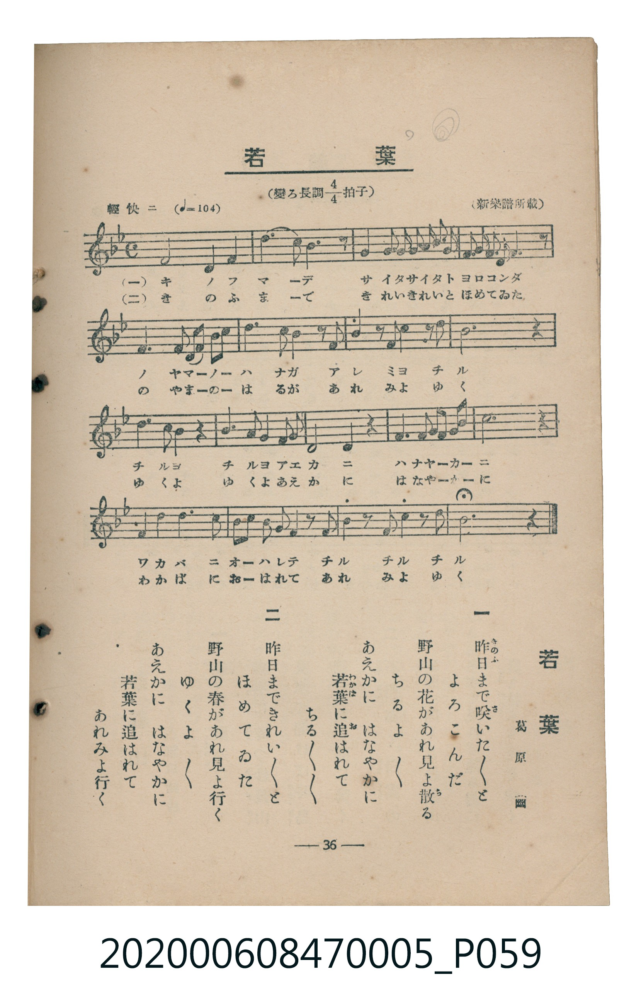

# 若葉

> Re:Shōka 使用 AI 協助辨識與重建樂譜，可能會有錯誤。歡迎回報。

- **鋼琴伴奏版**：<br><audio controls src="wakaba.mp3"></audio>
- **NEUTRINO 歌聲合成版**：<br><audio controls src="wakaba_neutrino.mp3"></audio>

- 臺灣教育會公認《新定兒童唱歌》尋常科第五學年用（2020.006.0847.0005）

## 說明

原書資訊與歌詞全文（對應 P059.jpg，書頁 p. 36，參考教材第 3 首）：
調性與拍號：變ろ長調四分之四拍子（Bb 大調 4/4 拍），輕快ニ（♩= 104）
出處與作歌：（新樂譜所載）、葛原𦱳


## 歌詞

```text
一　昨日（きのふ）まで咲（さ）いた〳〵と
よろこんだ
野山の花があれ見よ散（ち）る
ちるよ　ちるよ
あえかに　はなやかに
若葉（わかば）に追（お）はれて
ちる　ちる　ちる

二　昨日（きのふ）まできれい〳〵と
ほめてゐた
野山の春があれ見よ行く
ゆくよ　ゆくよ
あえかに　はなやかに
若葉に追はれて
あれみよ行く
```

## ABC

<div class="abc-score" data-abc-src="wakaba.abc" aria-label="五線譜載入中"></div>

[下載 ABC 原始檔](wakaba.abc)

## TMD 檔案連結

- [主旋律 TMD 檔案](wakaba.tmd) [[在 TMD Studio 編輯](https://tmdlang.github.io/Tmd-TS/#tmd=s7IKdvYPcrWy4qpTUCpJTLdSSM7PyUlNLsnMz7MqzsjMK0nNjM_KTMmPL87Iz05Ugisry88pzU21Si9KTEmNN403MjAyiDcwMIs3sDAxBzIMTBFKi_NLi5JTrYqTM_Lzc-JLUitKkvLzsxHyBUX5Zal5iXlANQVFIBtTwIoQClLLMlNSQdKpKZkl-UWZiTlI7kgtKga7FWxJfElRYl5xclFmAcgDCFUlGalAxxbkJOYhGQs0KT0zz6okMRPoN5D_yhPjcxMz84CqUpBVlWTkA71ZkFFplZFZDLI_OTEnPjsxDyk0oLYXJKanWgUYmFoqcWlpKbzoXvpiYqeClhaXoq2CoYEJl72tglMSl42JvokdSOeL9l3PGxc_mzrzRdOmZ3Oan7auebGq93FD17NpG56um_W0ddLz1UufTtn4bG3P44bupxu6n-7Y8Xz5xOdr1jzZNeXp2h1Pd255PmXF-z0doLDXA4a9HijsgQwD0_d7OpW4uPS1FGypBbgUFBSe9s1_NnvHi83tL1Z0vehoB7rrxcp5T1tXPJvWDnTF0w29z9o7FUC-18sqSH-_pweo-OWCRoUCPQVjMyD3aX_zi4ZmoHefzZ0A9ISCscLLZdOALn2_ZxbI9Ber9j9rWA4yt7v3xcz5QNEX67oeN_W-nLodKPV09uynHW1PdnYDGUAFT9dOAFrplKTwdMlyoKwCMEgVgMJg03pe7Jn6dP_qx83dQCWPZq4Ehz1QBuyF9l0vZk4FWvJk7xyg-4GWANUAw_vZiqYXa-c862x4ATKh83FD44uJs4H-_bBs42YukMYnOxoeNzQ8m7Hi2fSlQC2PG3sfN6573LgVpLhx3-PG5U8nbQKLTwWLtDxunP-4YfPjhq2PG1eA9D9u6gD65XHj5MdNkx83LgAJvWzve7pxI9CYF11AsudxY9Pjpp4Xy7qBSp9NXQw2bCHIsKZusAGNC4EskDENDXA2RKLpcSNQbffjxtVgufWPG1c9bgK6ACQCDllwOgQZ2NQPFt0AduPqF_v3gm3pAnPXA21_3LgMyS64RTAGJCR2AZMjvpAAiYCMakENgMbdj5sagRY8bpoADByUAHg2YylaALxYCOT2QwKuDciC-hvGJsXfEI-i-Q9k0-PG_Sg2UZ5JoEBBS5-LKzwxOzEp0SogMzEv36HGoKYaZIWCjYWWHZiBLW8qgLL2jgagixQ0TBSebuh_vr5BB56hNLFoAFoENUwDqFHTChhaa0ECEPC4uQ9CTQVRNUDGPAh_D4RqRygFSjZtBYs2LQHi_WAunN3cAda9AojXAkU2A2kQbkDoR3bIrh6QQxp7kRzSuA5Cga0AGtW4D9khjctRHALRCYwgILMFzEWwV4AV7AaKNALpZUB6ApCej-GQGgXTeAVdMAQzzEBEjYIhkDQGYhCtq2AAFDEC0kZAMQg2j4foBCoHMoEMuEKwqT6GoHBaCzUYFLwgcirYaFDgwsTbwTTILFAwAkVIClSoXoiNRpAAgZoMDEcQCTITEoow8eUIG8GqSQs9mI34U-auHopSJiwxLoFQ88DRDxKF0P3g0OiCRP0aRISC-YvAkjDRx83zwQEH4zWCZVej6EFPEMgpE5IYm1rAFDAQwQ4AikLo9eBo64ZI9qA6pLEJLAkTBZYgoIId7sw2cPj243VIDSQtwghgMjMEJrwapGQJSm_GUBEDoBwoiRoA5SAiMGgASgOIVAlNi0vAJCglQkIWFqqgFLEGqjMeKUDBPGhwQtiwwETYBM46SKkRnAaBoQdKd6AUCA46eLCB-D0Im-AhBuFBwgviBlhoodtEoHzsBKdCU3JTYSMstoB-RCQicMRgSoIC6nETiF4NlgenCkwAkgLHOiwBA-MBnJiA2kA0Hq2YyRMYLlBHAMMGkbog1mBIggIYWA0CcTc4OHHkApDUeoi-VWAKGH-Q5N4NcyEurfB0C0qHutByEZr-oCnSEJSS4cUmUtkLT6hIpTA0xcNSOK703AgWhUUENG1giGNGEFpqAscMSD04D0DyB1AtRAZDNSKVAwMaUrJCghluGpo4ZvBj2A8Md5D6VWCbIbkGZC9W1fjTPrDpS1kJvB7sd1D0N09ARDAoHEA-WwUviUElw-NmeFJDK2BBfFQeScVvE9B8YAiAtDZuQHIFMDRAYdIFL4Yh9dYyuDw1yl5gMgSnRHgKBSZJcIkMT5XYS19wsoYVz9iSKyRoQUlsAlQFIlhBbESgohezEB4ym0ABDA1AUELaALMLHnggNiLoyC2Ca7m4dO0UIE1YBSBLmQsA)]
- [鋼琴伴奏 TMD 檔案](wakaba_piano.tmd) [[在 TMD Studio 編輯](https://tmdlang.github.io/Tmd-TS/#tmd=s7IKdvYPcrWy4qpTUCpJTLdSyC8qychPL0osyKi0ysgsLskvykxOzInPTsxLVIIrKs4vLUpOjS9ITE-1CjAwtVTi0tJSeNG99MXEzvd7Ol5273k-YcuTPVueLu1_3tnxfk-ngpYWl6KtgqGBCZe9rYJTEpeNib6JHci4F-27njcufjZ15oumTc_mND9tXfNiVe_jhq5n0zY8XTfraeuk56uXPp2y8dnanscN3U83dD_dseP58onP16x5smvK07U7nu7c8nzKCqCdRgZGBnoGBmZ6BhYm5kCGgSnQWiUurvDE7MSkRKuAzMS8_CAPhxqDmmouBSCwsdCyAzP0tRRs0YECyPwdDS8W9ihomCg83dD_fH2DjgLIo3pZBemaWDRo6YMNq1EwjVfQBUMwwwxE1CgYAkljIAbRugoGQBEjIG0EFINg83iITqByIBPIgCsEm-pjWKPwuGkt1ODHzX1gcirY6MfN8-Di7WAaZNbjpq0gkaYlQLwfzIOzmzvAulYA8VqgyGYgDcINML0QG42Aahp7YSY3rgOTIDNB4vvg4ssRNoJVP27qAbJawDwEewVYfjdQpBFILwPSE4D0fLiN-ONhVw858QAOeRgBDFRDYDDXIEUCKHSNoSIGQDlQhBgA5SAiMGgA8jEiDqAhvwRMgsIdJPK4uR8col1g_6-B6owHsheBxUEiQF7zfHCoQ9iNYJnVSDaBEwpS2INDvKkFHMqg8AaJPG5cD47bbjC_B2FTYxNYHCQC4oFivAPqhjZw2Pdj2EQg7XeCw9yUtDAHhaEuNAVDww4amoagWIAncKRcAg9kpPwCjS1Y7OCKi0awKCgUYeEKyQ-o4qBYeNwEoleDZUFhhxIS4PgDqQfHHyRugWohMhiqETEEDFlIHuiHhzZYD5o4KG4eN4LobnBMYMQ5OFZB6leBbYbEOMherKrxx9vT2bPJLLPAoQ-PFWA0gHMQPCaw5xZwVMKyE7YoWg8NysfNE6AqQEEKCiSwZ4EBD8oej5tBQYaaLSA8ZDaBDNMENAscbI8bN8DsAgYfKBDBEQsMZEiBtAxiIhlZpha1NvFBrk1MELXJiz1Tn-5f_WxG37M505_s7AbGybPu3qdrJzzdvuxZZzekVny_B1iorXjev-_ZrHXPZix9MWHvi66NLzran3bMfbqkH1j3Pd-24MmuJc9m7wea8HzK_Gcr5yNHV7xCtGl8LIIBjAUgyzAWRIFqF2wq4EyIGngxCRQ1i8-NRWKhmwbl4bINm6uQtJkAKRMUB8AUEPQHHv9CTSXShcCY07VTgERetA9QHIlnBOYpcwEA)]

## 分析

```text
================================================================================
📊 TMD Song Profile: [ 若葉 ]
================================================================================
⏱  Duration:       0:39 (39.2s), 17 measures total
🎼 Key & Tempo:    首調基準 B,, != 104.0 BPM, <4/4>
   - 分析範圍：      由實際發聲的音符與和弦推測調性；播放脈絡另行呈現
🎤 人聲音域:    F4 (MIDI 65) – D5 (MIDI 74) [跨度: 9 個半音 / 0.8 個八度, 難度: easy]
   - 最低音:  F4 in [Wakaba #1 @ m.1, 0:00]
   - 最高音: D5 in [Wakaba #1 @ m.2, 0:02]
   - 適合: soprano, mezzo-soprano, contralto, tenor, baritone, bass
🏛  結構:      Wakaba (39.2s)
⚡ 編曲密度:        Peak 1 軌道同時演奏
🗝  調性診斷：       D 調性不明確（純淨自然大調，未偵測到可信轉調）
   - 風格氣質:    純淨自然大調（陽光明朗、易唱易記，無明顯調外色彩）
   - 轉調歷程:    全曲維持單一推測調性（未偵測到可信轉調）
   - 核心骨幹音:  D, F, A#, C, G
   - 調性數值:    D 調性不明確 [相關度: 0.83, 穩定度: Ambiguous, 自然音純度: 100.0%]
   - 候選調性 (K-S): D 小調 (0.83), A# 大調 (0.80), F 大調 (0.77)
   - 五度圈歷程:   +2
   - 各段落調性細節:
     • [Wakaba #1]: D 調性不明確 (r: 0.83, 自然音純度: 100.0%)

  [ 五度圈游移軌跡 ]
               C  
         F            G  
      Bb              [D ]*
      Eb               A  
         Ab           E  
            Db       B  
               F# 
     (* = active key center)

  [ 十二半音累積音高分佈 ]
     C  : ██████████████            14.4%
     C# :                            0.0%
     D  : ████████████████████████  25.4%
     D# :                            0.0%
     E  :                            0.0%
     F  : █████████████████████     22.0%
     F# :                            0.0%
     G  : ███████████               11.9%
     G# :                            0.0%
     A  : ██████                     6.8%
     A# : ██████████████████        19.5%
     B  :                            0.0%
--------------------------------------------------------------------------------
Assignment 軌道音域：
  - Piano         : F4 – D5 (9 個半音 / 0.8 個八度, 64 個音符)
================================================================================
```


## 原書掃描頁




