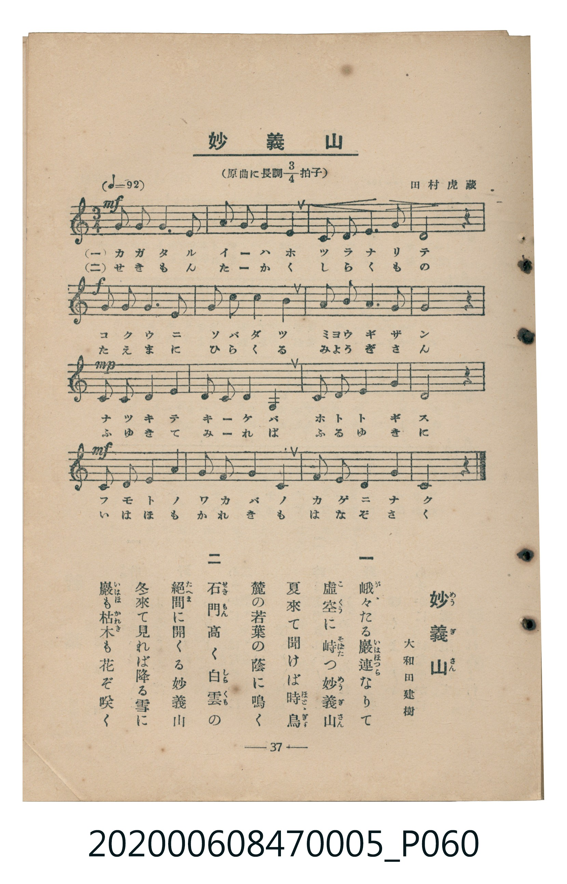

# 妙義山

> Re:Shōka 使用 AI 協助辨識與重建樂譜，可能會有錯誤。歡迎回報。

- **鋼琴伴奏版**：<br><audio controls src="myogisan.mp3"></audio>
- **NEUTRINO 歌聲合成版**：<br><audio controls src="myogisan_neutrino.mp3"></audio>

- 臺灣教育會公認《新定兒童唱歌》尋常科第五學年用（2020.006.0847.0005）

## 說明

原書資訊與歌詞全文（對應 P060.jpg，書頁 p. 37，參考教材第 4 首）：
調性與拍號：原曲に長調四分之三拍子（譜面記為は長調／C 大調 3/4 拍），♩= 92
作曲與作歌：田村虎藏、大和田建樹


## 歌詞

```text
一　峨々（がが）たる巖（いはほ）連（つら）なりて
虛空（こくう）に峙（そばだ）つ妙義山（めうぎさん）
夏來て聞けば時鳥（ほとゝぎす）
麓の若葉の蔭に鳴く

二　石門（せきもん）高く白雲（しらくも）の
絕間（たえま）に開くる妙義山
冬來て見れば降る雪に
巖（いはほ）も枯木（かれき）も花ぞ咲く
```

## ABC

```abc
X:1
T:妙義山
M:3/4
L:1/16
Q:1/4=92
K:C
V:V1 name="Piano" snm="Pia"
[V:V1]
G3 G E4 G4 | A2 G2 E4 D4 | C3 D E6 G2 | E8 z4 |
w: 1.~カ ガ タ ル | イ _ ハ ホ | ツ ラ ナ リ | テ
w: 2.~せ き も ん | た _ か く | し ら く も | の
A3 A G4 E4 | G3 A G4 E4 | D3 E G6 A2 | G8 z4 |
w: 1.~コ ク ウ ニ | ソ バ ダ ツ | ミョ ウ ギ ザ | ン
w: 2.~た え ま に | ひ ら く る | みょ う ぎ さ | ん
E3 E D4 C4 | D2 E2 D4 G,4 | C3 D E4 A4 | G8 z4 |
w: 1.~ナ ツ キ テ | キ _ ケ バ | ホ ト ト ギ | ス
w: 2.~ふ ゆ き て | み _ れ ば | ふ る ゆ き | に
A3 A G4 E4 | G3 A G4 E4 | D3 E D4 E4 | C8 z4 |
w: 1.~フ モ ト ノ | ワ カ バ ノ | カ ゲ ニ ナ | ク
w: 2.~い は ほ も | か れ き も | は な ぞ さ | く
```

## TMD 檔案連結

- [主旋律 TMD 檔案](myogisan.tmd) [[在 TMD Studio 編輯](https://tmdlang.github.io/Tmd-TS/#tmd=s7IKdvYPcrWy4qpTUCpJTLdSSM7PyUlNLsnMz7MqzsjMK0nNjM_KTMmPL87Iz05Ugisry88pzU21Si9KTEmNN403MjAyiDcwMIs3sDAxBzIMTBFKi_NLi5JTrYqTM_Lzc-JLUitKkvLzsxHyBUX5Zal5iXlANQVFIBtTwIoQClLLMlNSQdKpKZkl-UWZiTlI7kgtKga7FWxJfElRYl5xclFmAcgDCFUlGalAx-YllpQWpSJEgUalZ-ZZ5ebnJZUCvYcpkZqZlYnkYC0thafLZj7ft_Lpxo0KWlpcirYKlkZc9rYKzlw2xvomdiD9L9p3PW9c_GzqzBdNm57NaX7auubFqt7HDV3Ppm14um7W09ZJz1cvfTpl47O1PY8bup9u6H66Y8fz5ROfr1nzZNeUp2t3PN255fmUFe_3dIACVA8YoHqgAAUyDEzf7-lU4uLS11KwpRbgUlBQeNo3_9nsHS82t79Y0fWiox3orhcr5z1tXfFsWjvQFU839D5r71QIMDAz0MsqSH-_pweo-OWCRoUCPQVjcyD3aX_zi4ZmoHefzZ0A9ISCicLLZdOALn2_ZxbI9Ber9j9rWA4yt7v3xcz5QFGwfZseN65-OXU7UPbp7NlPO9qe7Ox-sqMTqObp2glAW1-snfNy7qIXK2Y8b9r1uHE9ROX7Pf3OCk-XLAcyFYCBrQBUDban59HMleB4AFr3ZO8coOFA60CMtT1A655P2fBs7sQXM_teTO9_3NAI1P90Ug9Q8OnuXc9W7OQCa9rR8Lih4enmFY8bWoGWP27sASKg0Y8b5z9u6n66HegdoGAL0CGPG3cDxV82LAaLLHncBLQeqGzV46aux43LwP6dOfv5yl1g6cmPG_sfN7aBVax-unkmWHDu48YNjxsXgAWXwNMSSKqpEaj4cWPf48apj5smAxWAI2dJ_5N9QNFlLxrnPW6cCNT8bGbTy81LwWbtfty44nET0ESgHqDpYA0vdwGtXfeie-mLiUAb1r2YshYU0pu3AN0C8esuYLJreD5_88tpDWBDZj9u7H3c1ASx8uXqGUCFz2fufTl7E1h2OtCLIG80NYFdvA5kxPOtU19OA6oGSs9_3Agk90G8-HJaN1hpN9xbYB-0rYH6YFn34yZgyG54ORNoYffL2auAesAqMAIYaN2zeeufzQFlg8eNEG2guAaKv-ja-Lhx3tNJwATUD9JMeR6AAgUtfS4u38r89MzixDyrgMzEvHyHGoOaapAlCjaGZlp2YBa23KcAyrw7Gl4s7FHQMFF4uqH_-foGHXiW0cSiAWgX1DANoEZNK4XHTauB_MdNa4B4P0jqcTNIQKEGyF8C5OwB4n6I-GyoeHMLmLsSiLtAQmDeKrBMG5SPBJBt3NUDsrERZBAwXIE2NIE1N02Gmtw4H2JjYzdYvBFsMUh8OlhZJ0wIzGsCy6zDaWONgqmCLhCaKhiDaRALQtcomEF5MBkjuIwhlA-TgemrQREBQQOYHrBtPoagEFsNFoGFJkQeFKAw00FhChPth7NmI-SBYQsRg4QuwjZQCENUtKG5Ix7VHUagUIGYCAtjqAnAYIbbAwxpqCgwrGEsmIsgIQ7RAwlzJHeAzYOEPC534E-vu3ooS6-bwbG_HoiXQZIeOLGAwnYvmDsBiBsgMqCECg6z-Y-bl4M1PG6CJZjHTdvAUiDjsCcg5CQ7H6SjsQOI94E1N8IySeMmsFnwpAksYGAy-x83tQOpNiDug1naOBXsUnCCx2opJG3qAklYaoWlO1h6xiYDSb_GcBmIOoQeBMSWajdDYxYSprD0BksXkJCFiEHCFqYCklYhqRIcwhBjIKGMnGS2QRVBLMKWZMCOASddSMKEhTUsaSJlIWCIYyZNULAjVIBDHqIREvpIjgHGAMRPsNyA6RgC5W0nRekXXGaCwu5x01pwkoAUmiAXrYWUfk0bIeIToOLggvdxMzBAgBicxMBpGKRjJ850hJx4t4I1gUKiF5IIwRkHHFBQG3sg4htg4hAd3WBdYBmwRpAMON1jtRFWQhrDS1NIWQpLnyBZmIwpPLAxClxI8icy6UKLSFhwwhImrIiEBCoshWyEy09AyEMLX1jwwtTC0i8kkHElFLA7wKl2K1QfJJBhSQ2WmSBBDTO7By6_AUkeZgIk0GEqYGZBgh6XO_AmWGA7l7IEOxWc_BbBk18zuDQDhd16cDJZDUurCBloo2ITrHSGthRAMiA92BMQcpIFNzEagQVS426wfkhLARQKIPNAYQhLzAgZsGsaVwHxPLAMMKdDZWCNBkw7KStuYckZIQNL8jCILc2CCiBQioOEKDSmgUEHj2lguELSAiRksaiANzQgIQxTAWswQMIZV2oBuwScaqGNDWg4Q02BNxggoQ0Rg4Q3NhVQt0LDHaoCXMjCVCA3H1BdUsvFpWunAGv7KgDZylwA)]
- [鋼琴伴奏 TMD 檔案](myogisan_piano.tmd) [[在 TMD Studio 編輯](https://tmdlang.github.io/Tmd-TS/#tmd=s7IKdvYPcrWy4tLSUni6bObzfSufbtz4fk_Hy-49zydsebJny9Ol_c87O97v6VTQ0uJStFWwNOKyt1Vw5rIx1jex46pTUHrRvut54-JnU2e-aNr0bE7z09Y1L1b1Pm7oejZtw9N1s562Tnq-eunTKRufre153ND9dEP30x07ni-f-HzNmie7pjxdu-Ppzi3Pp6wA2mhkYGSgZ2BgpmdgYWIOZBiYAi1V4uLyrcxPzyxOzLMKyEzMyw_ycKgxqKnmUgACG0MzLTswS19LwRYdKICs2NHwYmGPgoaJwtMN_c_XN-goBBiYGehlFaRrYtGgpQ82rEbBVEEXCE0VjME0iAWhaxTMoDyYjBFcxhDKh8nA9NWgiICgAUwP2DYfwxqFx02rwSKPm9YA8X6o_ONmiCjIjMdNS-Ci_XDWbIR8cwtUbCUQdyHZ9rh5FVRFG5o74lHdYQRU0wgx8XFjL9DGJpgJTZMR9jTOh4k2dsNZMBeB5KdD9XQiiUNEQOaBVKzD6Q78cbmrh5y4BMWYLpCExSEsNmCxjE0GEqvGcBmIOoQeBMQWl5uh_l0PxMtgvm-GhRZIxV6o2AQgboCrgMQgJK7mP25eDjVmGRAjB9njpm1QRRCLsAUkIkIh0fW4sQOI98FMaERKWI2boKYiR9jjJiTnNu5_3NQO1dgGxH3IjmmcCvUTLI1gOoZADu0kJ1YhcWUMz3-Q3AeLO5AsTMYU7hCMLApJGkRGKzRTgaLpcdNamPfhmQoUBHDRpo1w-QkIeWh2fdwMjAsghqmFxS3IhJ1o7sAWo1uh-kBR0QszpRGW0MDxBTe7By6_AUkeZkI32BSYCphZIBWw9IHpDryR-XT2bHpnUVg0I2RgSQEGscUlKNGCYmIRckw0wxI2SMV6aBitRopDFBXwInsTUuZGFL0gFRAzsIUiIjahxXYjsLBo3A0zBV70glRAzAbFJVJ8o6iAurVxFRDPg6kAZ0yYCuSCGNUltegVrA9yBWuCqF9fzm55tmPf85UrnzYufbKzG5hvn3X3Pl074en2Zc86uyENhfd7el4sXf-scwa8JfF0afvT7dNeNG5-vrr7cUMjMIE8Xbv46eL1L3dNBxrybOZ6RCowjFeINowF4xoFEyjHNB7EQ5GCcgygwQhRa4ImC-EYATlGuUAeiACmpnggH2QiQi-Kcrg8mrVAw0myFoc5IK3A4Na1U4CFeLQPUBiFbwTmK3MBAA)]

## 分析

```text
================================================================================
📊 TMD Song Profile: [ 妙義山 ]
================================================================================
⏱  Duration:       0:31 (31.3s), 16 measures total
🎼 Key & Tempo:    首調基準 C, != 92.0 BPM, <3/4>
   - 分析範圍：      由實際發聲的音符與和弦推測調性；播放脈絡另行呈現
🎤 人聲音域:    G3 (MIDI 55) – A4 (MIDI 69) [跨度: 14 個半音 / 1.2 個八度, 難度: moderate]
   - 最低音:  G3 in [Myogisan #1 @ m.10, 0:18]
   - 最高音: A4 in [Myogisan #1 @ m.2, 0:01]
   - 適合: mezzo-soprano, contralto, tenor, baritone, bass
🏛  結構:      Myogisan (31.3s)
⚡ 編曲密度:        Peak 1 軌道同時演奏
🗝  調性診斷：       E 小調（純淨自然小調，未偵測到可信轉調）
   - 風格氣質:    純淨自然小調（陰鬱抒情、旋律集中，無明顯調外色彩）
   - 轉調歷程:    全曲維持單一推測調性（未偵測到可信轉調）
   - 核心骨幹音:  G, E, D, C, A
   - 調性數值:    E 小調 [相關度: 0.81, 穩定度: Moderate, 自然音純度: 100.0%]
   - 候選調性 (K-S): E 小調 (0.81), G 大調 (0.75), C 大調 (0.65)
   - 五度圈歷程:   +4
   - 各段落調性細節:
     • [Myogisan #1]: E 小調 (r: 0.81, 自然音純度: 100.0%)

  [ 五度圈游移軌跡 ]
               C  
         F            G  
      Bb               D  
      Eb               A  
         Ab          [E ]*
            Db       B  
               F# 
     (* = active key center)

  [ 十二半音累積音高分佈 ]
     C  : ███████                   10.2%
     C# :                            0.0%
     D  : ██████████                14.8%
     D# :                            0.0%
     E  : ██████████████████████    30.7%
     F  :                            0.0%
     F# :                            0.0%
     G  : ████████████████████████  34.1%
     G# :                            0.0%
     A  : ███████                   10.2%
     A# :                            0.0%
     B  :                            0.0%
--------------------------------------------------------------------------------
Assignment 軌道音域：
  - Piano         : G3 – A4 (14 個半音 / 1.2 個八度, 52 個音符)
================================================================================
```


## 原書掃描頁




