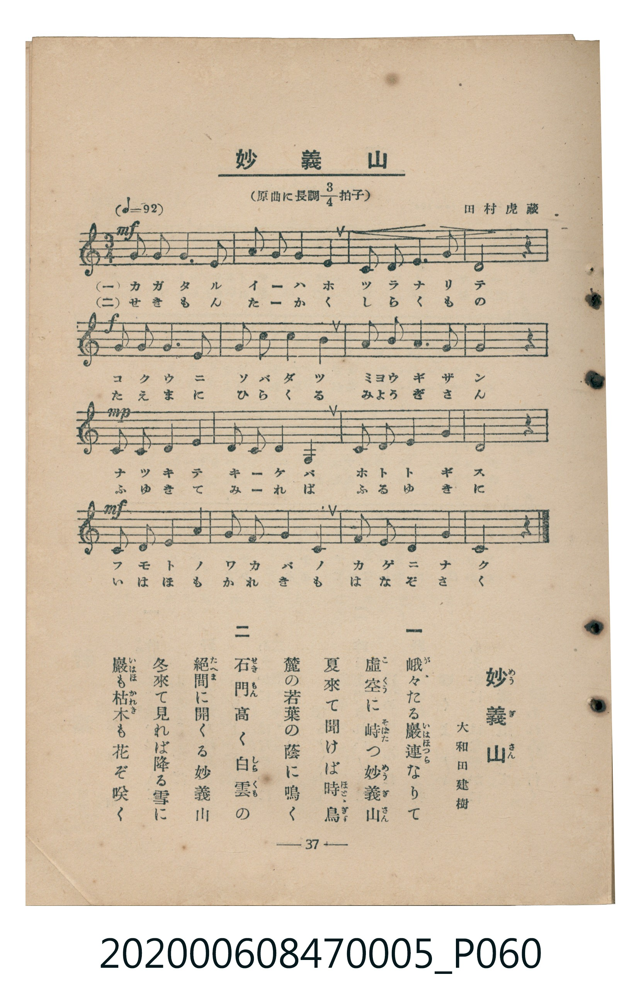

# 妙義山

<audio controls src="myogisan.mp3"></audio>

- 臺灣教育會公認《新定兒童唱歌》尋常科第五學年用（2020.006.0847.0005）

## 說明

原書資訊與歌詞全文（對應 P060.jpg，書頁 p. 37，參考教材第 4 首）：
調性與拍號：原曲に長調四分之三拍子（譜面記為は長調／C 大調 3/4 拍），♩= 92
作曲與作歌：田村虎藏、大和田建樹

## 歌詞

```text
一　峨々（がが）たる巖（いはほ）連（つら）なりて
虛空（こくう）に峙（そばだ）つ妙義山（めうぎさん）
夏來て聞けば時鳥（ほとゝぎす）
麓の若葉の蔭に鳴く

二　石門（せきもん）高く白雲（しらくも）の
絕間（たえま）に開くる妙義山
冬來て見れば降る雪に
巖（いはほ）も枯木（かれき）も花ぞ咲く
```

## 原書掃描頁



## 分析

```text
================================================================================
📊 TMD Song Profile: [ 妙義山 ]
================================================================================
⏱  Duration:       0:31 (31.3s), 16 measures total
🎼 Key & Tempo:    首調基準 C, != 92.0 BPM, <3/4>
   - 分析範圍：      由實際發聲的音符與和弦推測調性；播放脈絡另行呈現
🎤 人聲音域:    G3 (MIDI 55) – A4 (MIDI 69) [跨度: 14 個半音 / 1.2 個八度, 難度: moderate]
   - 最低音:  G3 in [Myogisan #1 @ m.10, 0:18]
   - 最高音: A4 in [Myogisan #1 @ m.2, 0:01]
   - 適合: mezzo-soprano, contralto, tenor, baritone, bass
🏛  結構:      Myogisan (31.3s)
⚡ 編曲密度:        Peak 1 軌道同時演奏
🗝  調性診斷：       E 小調（純淨自然小調，未偵測到可信轉調）
   - 風格氣質:    純淨自然小調（陰鬱抒情、旋律集中，無明顯調外色彩）
   - 轉調歷程:    全曲維持單一推測調性（未偵測到可信轉調）
   - 核心骨幹音:  G, E, D, C, A
   - 調性數值:    E 小調 [相關度: 0.81, 穩定度: Moderate, 自然音純度: 100.0%]
   - 候選調性 (K-S): E 小調 (0.81), G 大調 (0.75), C 大調 (0.65)
   - 五度圈歷程:   +4
   - 各段落調性細節:
     • [Myogisan #1]: E 小調 (r: 0.81, 自然音純度: 100.0%)

  [ 五度圈游移軌跡 ]
               C  
         F            G  
      Bb               D  
      Eb               A  
         Ab          [E ]*
            Db       B  
               F# 
     (* = active key center)

  [ 十二半音累積音高分佈 ]
     C  : ███████                   10.2%
     C# :                            0.0%
     D  : ██████████                14.8%
     D# :                            0.0%
     E  : ██████████████████████    30.7%
     F  :                            0.0%
     F# :                            0.0%
     G  : ████████████████████████  34.1%
     G# :                            0.0%
     A  : ███████                   10.2%
     A# :                            0.0%
     B  :                            0.0%
--------------------------------------------------------------------------------
Assignment 軌道音域：
  - Piano         : G3 – A4 (14 個半音 / 1.2 個八度, 52 個音符)
================================================================================
```

## ABC

```abc
X:1
T:妙義山
C:TMD (Chen, Chih-Han / aguai)
M:3/4
L:1/16
Q:1/4=92
K:C

V:V1 name="Piano" snm="Pia"

[V:V1]
g3 g e4 g4 | a2 g2 e4 d4 | c3 d e6 g2 | e8 z4 |
a3 a g4 e4 | g3 a g4 e4 | d3 e g6 a2 | g8 z4 |
e3 e d4 c4 | d2 e2 d4 G4 | c3 d e4 a4 | g8 z4 |
a3 a g4 e4 | g3 a g4 e4 | d3 e d4 e4 | c8 z4 |
```

- [主旋律 TMD 檔案](myogisan.tmd)
- [鋼琴伴奏 TMD 檔案](myogisan_piano.tmd)
