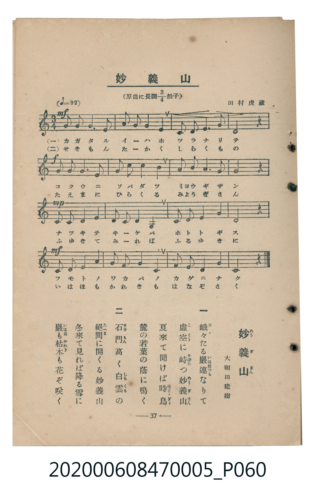

# 妙義山

> Re:Shōka 使用 AI 協助辨識與重建樂譜，可能會有錯誤。歡迎[回報](https://github.com/TMDLang/reshoka/issues)。

- **鋼琴伴奏版**：<br><audio controls src="myogisan.mp3"></audio>
- **NEUTRINO 歌聲合成版**：<br><audio controls src="myogisan_neutrino.mp3"></audio>

- 臺灣教育會公認《新定兒童唱歌》尋常科第五學年用（2020.006.0847.0005）

## 說明

原書資訊與歌詞全文（對應 P060.jpg，書頁 p. 37，參考教材第 4 首）：
調性與拍號：原曲に長調四分之三拍子（譜面記為は長調／C 大調 3/4 拍），♩= 92
作曲與作歌：田村虎藏、大和田建樹


## 歌詞

```text
一　峨々（がが）たる巖（いはほ）連（つら）なりて
虛空（こくう）に峙（そばだ）つ妙義山（めうぎさん）
夏來て聞けば時鳥（ほとゝぎす）
麓の若葉の蔭に鳴く

二　石門（せきもん）高く白雲（しらくも）の
絕間（たえま）に開くる妙義山
冬來て見れば降る雪に
巖（いはほ）も枯木（かれき）も花ぞ咲く
```

## ABC

<div class="abc-score" data-abc-src="myogisan.abc" aria-label="五線譜載入中"></div>

[下載 ABC 原始檔](myogisan.abc)

## TMD 檔案連結

- [主旋律 TMD 檔案](myogisan.tmd) [[在 TMD Studio 編輯](https://tmdlang.github.io/Tmd-TS/#tmd=s7IKdvYPcrWy4qpTUCpJTLdSSM7PyUlNLsnMz7MqzsjMK0nNjM_KTMmPL87Iz05Ugisry88pzU21Si9KTEmNN403MjAyiDcwMIs3sDAxBzIMTBFKi_NLi5JTrYqTM_Lzc-JLUitKkvLzsxHyBUX5Zal5iXlANQVFIBtTwIoQClLLMlNSQdKpKZkl-UWZiTlI7kgtKga7FWxJfElRYl5xclFmAcgDCFUlGalAx-YllpQWpSJEgUalZ-ZZ5ebnJZUCvYcpkZqZlYnFwflFJRn5QJ8XZFRaZWQWg5yUnJgTn52YhxRAUAcVJKanWgUYmBkocWlpKTxdNvP5vpVPN25U0NLiUrRVsDTisrdVcOayMdY3sQNpfdG-63nj4mdTZ75o2vRsTvPT1jUvVvU-buh6Nm3D03WznrZOer566dMpG5-t7Xnc0P10Q_fTHTueL5_4fM2aJ7umPF274-nOLc-nrHi_pwMUH3rA-NADxQeQYWD6fk-nEheXvpaCLbUAl4KCwtO--c9m73ixuf3Fiq4XHe1Ad71YOe9p64pn09qBrni6ofdZe6cCyPt6WQXp7_f0ABW_XNCoUKCnYGwO5D7tb37R0Az07rO5E4CeUDBReLlsGtCl7_fMApn-YtX-Zw3LQeZ2976YOR8oCrZv0-PG1S-nbgfKPp09-2lH25Od3U92dALVPF07AWjri7VzXs5d9GLFjOdNux43roeofL-n31nh6ZLlQKYCMLAVgKrB9vQ8mrkSHA9A657snQM0HGgdiLG2B2jd8ykbns2d-GJm34vp_Y8bGoH6n07qAQo-3b3r2YqdXGBNOxoeNzQ83bzicUMr0PLHjT1ABDT6ceP8x03dT7cDvQMUbAE65HHjbqD4y4bFYJElj5uA1gOVrXrc1PW4cRnYvzNnP1-5Cyw9-XFj_-PGNrCK1U83zwQLzn3cuOFx4wKw4BJ4WgJJNTUCFT9u7HvcOPVx02SgAnDkLOl_sg8ouuxF47zHjROBmp_NbHq5eSnYrN2PG1c8bgKaCNQDNB2s4eUuoLXrXnQvfTERaMO6F1PWgkJ68xagWyB-3QVMdg3P529-Oa0BbMjsx429j5uaIFa-XD0DqPD5zL0vZ28Cy04HehHkjaYmsIvXgYx4vnXqy2lA1UDp-Y8bgeQ-iBdfTusGK-2Gewvsg7Y1UB8s637cBAzZDS9nAi3sfjl7FVAPWAVGAAOtezZv_bM5oGzwuBGiDRTXQPEXXRsfN857OgmYgPpBminPA1CgoKXPxeVbmZ-eWZyYZxWQmZiX71BjUFMNskTBxtBMyw7Mwpb7FECZd0fDi4U9ChomCk839D9f36ADzzKaWDQA7YIapgHUqGml8LhpNZD_uGkNEO8HST1uBgko1AD5S4CcPUDcDxGfDRVvbgFzVwJxF0gIzFsFlmmD8pEAso27ekA2NoIMAoYr0IYmsOamyVCTG-dDbGzsBos3gi0GiU8HK-uECYF5TWCZdThtrFEwVdAFQlMFYzANYkHoGgUzKA8mYwSXMYTyYTIwfTUoIiBoANMDts3HEBRiq8EisNCEyIMCFGY6KExhov1w1myEPDBsIWKQ0EXYBgphiIo2NHfEo7rDCBQqEBNhYQw1ARjMcHuAIQ0VBYY1jAVzESTEIXogYY7kDrB5kJDH5Q786XVXD2XpdTM49tcD8TJI0gMnFlDY7gVzJwBxA0QGlFDBYTb_cfNysIbHTbAE87hpG1gKZBz2BIScZOeDdDR2APE-sOZGWCZp3AQ2C540gQUMTGb_46Z2INUGxH0wSxungl0KTvBYLYWkTV0gCUutsHQHS8_YZCDp1xguA1GH0IOA2FLtZmjMQsIUlt5g6QISshAxSNjCVEDSKiRVgkMYYgwklJGTzDaoIohF2JIM2DHgpAtJmLCwhiVNpCwEDHHMpAkKdoQKcMhDNEJCH8kxwBiA-AmWGzAdQ6C87aQo_YLLTFDYPW5aC04SkEIT5KK1kNKvaSNEfAJUHFzwPm4GBggQg5MYOA2DdOzEmY6QE-9WsCZQSPRCEiE444ADCmpjD0R8A0wcoqMbrAssA9YIkgGne6w2wkpIY3hpCilLYekTJAuTMYUHNkaBC0n-RCZdaBEJC05YwoQVkZBAhaWQjXD5CQh5aOELC16YWlj6hQQyroQCdgc41W6F6oMEMiypwTITJKhhZvfA5TcgycNMgAQ6TAXMLEjQ43IH3gQLbOdSlmCngpPfInjyawaXZqCwWw9OJqthaRUhA21UbIKVztCWAkgGpAd7AkJOsuAmRiOwQGrcDdYPaSmAQgFkHigMYYkZIQN2TeMqIJ4HlgHmdKgMrNGAaSdlxS0sOSNkYEkeBrGlWVABBEpxkBCFxjQw6OAxDQxXSFqAhCwWFfCGBiSEYSpgDQZIOONKLWCXgFMttLEBDWeoKfAGAyS0IWKQ8MamAupWaLhDVYALWZgK5OYDqktqubh07RRgbV8FIFuZCwA)]
- [鋼琴伴奏 TMD 檔案](myogisan_piano.tmd) [[在 TMD Studio 編輯](https://tmdlang.github.io/Tmd-TS/#tmd=s7IKdvYPcrWy4qpTUCpJTLdSyC8qychPL0osyKi0ysgsLskvykxOzInPTsxLVIIrKs4vLUpOjS9ITE-1CjAwM1Di0tJSeLps5vN9K59u3Ph-T8fL7j3PJ2x5smfL06X9zzs73u_pVNDS4lK0VbA04rK3VXDmsjHWN7EDmfeifdfzxsXPps580bTp2Zzmp61rXqzqfdzQ9WzahqfrZj1tnfR89dKnUzY-W9vzuKH76Ybupzt2PF8-8fmaNU92TXm6dsfTnVueT1kBtNHIwMhAz8DATM_AwsQcyDAwBVqqxMXlW5mfnlmcmGcVkJmYlx_k4VBjUFPNpQAENoZmWnZglr6Wgi06UABZsaPhxcIeBQ0Thacb-p-vb9BRAHlWL6sgXROLBi19sGE1CqYKukBoqmAMpkEsCF2jYAblwWSM4DKGUD5MBqavBkUEBA1gesC2-RjWKDxuWg0Wedy0Boj3Q-UfN0NEQWY8bloCF-2Hs2Yj5JtboGIrgbgLybbHzaugKtrQ3BGP6g4joJpGiImPG3uBNjbBTGiajLCncT5MtLEbzoK5CCQ_HaqnE0kcIgIyD6RiHU534I_LXT3kxCUoxnSBJCwOYbEBi2VsMpBYNYbLQNQh9CAgtrjcDPXveiBeBvN9Myy0QCr2QsUmAHEDXAUkBiFxNf9x83KoMcuAGDnIHjdtgyqCWIQtIBERComux40dQLwPZkIjUsJq3AQ1FTnCHjchObdx_-OmdqjGNiDuQ3ZM41Son2BpBNMxBHJoJzmxCokrY3j-g-Q-WNyBZGEypnCHYGRRSNIgMlqhmQoUTY-b1sK8D89UoCCAizZthMtPQMhDs-vjZmBcADFMLSxuQSbsRHMHthjdCtUHiopemCmNsIQGji-42T1w-Q1I8jATusGmwFTAzAKpgKUPTHfgjcyns2fTO4vCohkhA0sKMIgtLkGJFhQTi5BjohmWsEEq1kPDaDVSHKKogBfZm5AyN6LoBamAmIEtFBGxCS22G4GFReNumCnwohekAmI2KC6R4htFBdStjauAeB5MBThjwlQgF8SoLqlFr2B9kCtYE0T9-nJ2y7Md-56vXPm0cemTnd3AfPusu_fp2glPty971tkNaSi839PzYun6Z50z4C2Jp0vbn26f9qJx8_PV3Y8bGoEJ5OnaxU8Xr3-5azrQkGcz1yNSgWG8QrRhLBjXKJhAOabxIB6KFJRjAA1GiFoTNFkIxwjIMcoF8kAEMDXFA_kgExF6UZTD5dGsBRpOkrU4zAFpBQa3rp0CLMSjfYDCKHwjMF-ZCwA)]

## 分析

```text
================================================================================
📊 TMD Song Profile: [ 妙義山 ]
================================================================================
⏱  Duration:       0:31 (31.3s), 16 measures total
🎼 Key & Tempo:    首調基準 C, != 92.0 BPM, <3/4>
   - 分析範圍：      由實際發聲的音符與和弦推測調性；播放脈絡另行呈現
🎤 人聲音域:    G3 (MIDI 55) – A4 (MIDI 69) [跨度: 14 個半音 / 1.2 個八度, 難度: moderate]
   - 最低音:  G3 in [Myogisan #1 @ m.10, 0:18]
   - 最高音: A4 in [Myogisan #1 @ m.2, 0:01]
   - 適合: mezzo-soprano, contralto, tenor, baritone, bass
🏛  結構:      Myogisan (31.3s)
⚡ 編曲密度:        Peak 1 軌道同時演奏
🗝  調性診斷：       E 小調（純淨自然小調，未偵測到可信轉調）
   - 風格氣質:    純淨自然小調（陰鬱抒情、旋律集中，無明顯調外色彩）
   - 轉調歷程:    全曲維持單一推測調性（未偵測到可信轉調）
   - 核心骨幹音:  G, E, D, C, A
   - 調性數值:    E 小調 [相關度: 0.81, 穩定度: Moderate, 自然音純度: 100.0%]
   - 候選調性 (K-S): E 小調 (0.81), G 大調 (0.75), C 大調 (0.65)
   - 五度圈歷程:   +4
   - 各段落調性細節:
     • [Myogisan #1]: E 小調 (r: 0.81, 自然音純度: 100.0%)

  [ 五度圈游移軌跡 ]
               C  
         F            G  
      Bb               D  
      Eb               A  
         Ab          [E ]*
            Db       B  
               F# 
     (* = active key center)

  [ 十二半音累積音高分佈 ]
     C  : ███████                   10.2%
     C# :                            0.0%
     D  : ██████████                14.8%
     D# :                            0.0%
     E  : ██████████████████████    30.7%
     F  :                            0.0%
     F# :                            0.0%
     G  : ████████████████████████  34.1%
     G# :                            0.0%
     A  : ███████                   10.2%
     A# :                            0.0%
     B  :                            0.0%
--------------------------------------------------------------------------------
Assignment 軌道音域：
  - Piano         : G3 – A4 (14 個半音 / 1.2 個八度, 52 個音符)
================================================================================
```


## 原書掃描頁




