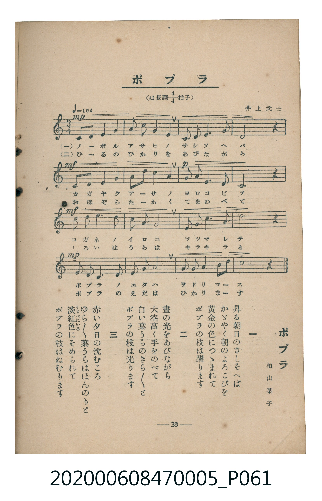

# ポプラ

> Re:Shoka 使用 AI 協助辨識與重建樂譜，可能會有錯誤。歡迎回報。

<audio controls src="popura.mp3"></audio>

- 臺灣教育會公認《新定兒童唱歌》尋常科第五學年用（2020.006.0847.0005）

## 說明

原書資訊與歌詞全文（對應 P061.jpg，書頁 p. 38，參考教材第 5 首）：
調性與拍號：標題誤植為「は長調四分之四拍子」，五線譜拍號與實際小節長度均為 C 大調 3/4 拍，♩= 104
作曲與作歌：井上武士、柏山葉子

## 歌詞

```text
一　昇る朝日のさしそへば
かゞやく朝のよろこびを
黃金の色につゝまれて
ポプラの枝は躍ります

二　晝の光をあびながら
大空高く手をのべて
白い葉うらのきら〳〵と
ポプラの枝は光ります

三　赤い夕日の沈むころ
ゆら〳〵葉うらはほんのりと
淡紅色（うすべにいろ）にそめられて
ポプラの枝はねむります
```

## ABC

```abc
X:1
T:ポプラ
M:3/4
L:1/16
Q:1/4=104
K:C
V:V1 name="Piano" snm="Pia"
[V:V1]
C4 D2 E2 F4 | G3 A G4 E4 | D2 E2 F6 E2 | D8 z4 |
C4 D2 E2 F4 | E2 F2 G4 A4 | G3 A G6 F2 | C8 z4 |
B3 A G6 G2 | A2 B2 G8 | A3 A c6 A2 | d8 z4 |
G3 A G6 E2 | F2 G2 A8 | G3 A G4 A2 B2 | c8 z4 |
```

## TMD 檔案連結

- [主旋律 TMD 檔案](popura.tmd) [[在 TMD Studio 編輯](https://tmdlang.github.io/Tmd-TS/#tmd=s7IKdvYPcrWy4qpTUCpJTLdSSM7PyUlNLsnMz7MqzsjMK0nNjM_KTMmPL87Iz05Ugisry88pzU21Si9KTEmNN403MjAyiDcwMIs3sDAxBzIMTBFKi_NLi5JTrYqTM_Lzc-JLUitKkvLzsxHyBUX5Zal5iXlANQVFIBtTwIoQClLLMlNSQdKpKZkl-UWZiTlI7kgtKga7FWxJfElRYl5xclFmAcgDCFUlGalAxxbkJOYBjdXSUnjcPPdx8_THzSsVtLS4FG0VDA1MuOxtFZy5bIz1TexA2l6073reuPjZ1JkvmjY9m9P8tHXNi1W9jxu6nk3b8HTdrKetk56vXvp0ysZna3seN3Q_3dD9dMeO58snPl-z5smuKU_X7ni6c8vzKSve7-kABYweMGD0QAEDZBiYvt_TqcTFpa-lYEstwKWgoPC0b_6z2TtebG5_saLrRUc70F0vVs572rri2bR2oCuebuh91t6pEGBgZqiXVZD-fk8PUPHLBY0KBXoKxhZA7tP-5hcNzUDvPps7AegJBVOFl8umAV36fs8skOkvVu1_1rAcZG5374uZ84Giz1bMfLmw58WqJc-W9D5v2vW4oedx4_qXU7cDVT6dPftpR9uTnd1ABlD907UTHjf0Au0Ahszz7bNerJ0DMQRo2tP1y17Omv10Q__z9Q1AvU93LXs6tx1omoKzwtMly4FGKQCjQwGoHKj70cyVkHgCOufJ3jnPZm8CGgBirO0BOufJrqlPdnQ9W7vs6eLVjxsan83vf7px44uJnUDLucA6djQ8bmh4NqP9cVP3szlzn01f-rhx3ePGqY8bpz9unPu4ccfjxg0gdY8bux83zXvc1PK4sR-oDqSoqeNxU-_jxsmPGzc_bpoEUvRyd_PL9olAuRedmx43rn7cuORxE1DpvsdNwEBYBjYGlr6Aip7NA8qtf7Gr93FTF0hR40yIi3YBU07Ds5kgO562dgKNftzYBLKjcdXjxp7HTZ3gWF2y_PnKXS9XzwA5pxPoNKAioLN3Qq15PnPv48YWoDcfN7YBdYDlgNZ0Pm7Y_Lhh6-PGFdjdArYOxS07gFoaXmxdAjTt6ZKpkNB5tgno8QaQx5t6weY0ge0AG41k5frHjbsfNwFDBxhSQDPBVj7bvvD5llZg6ACTHkhd40ywm4Eh1QI0DJiswOy5j5saQUbgCbXHjWtBboA7FqiI8uwCBQpa-lxcAfkFpUWJVgGZiXn5DjUGNQrVIDsUbAzNtOzALGz5VAGUzXc0vFjYo6BhogBJvjrwzKWJRQPQKqhhGkCNmlZAr_aBBB437wHiOUC8GsStAQbyInBQbwUKTYKoACsEyQDFmrYD8V6QAFhqBki8eQKUjwSQ7dvVA7KvcRPcvqZuIHcd1FSwODDVA4W7wCqawNaCZJqAeDMQr4LZ19gDdkcnTvtqFAwVdMHQCIiNgdgEyq8Bligg2gxKQ2QhMuhqYbIQGWRoANMDTrW442ZXD0Vx0wSOjMdNa4DhtQRIr4fFwCJoAG6FhCUsZppXgLlrgTKbYWHVPBksAw51rGGFHDeQkG_cDcTzYAEMioH5EPuAsQOW74eJLwM7bxIsGsGSO-Ey2O3DFzcwHixuzHDGGgiCVCJMIzVudnRSFjegEIZETS88rPvAsQOMKlAcNINDCwJAUdACVtICxPPgGtaAZdpwBhZy5EwHW9gLZIFMAutvXA8O7DZwXIF4yBY2rQVbsRLKgli4EqwBlE6wW1ijYI4lpEHsGnBsgGSRZSCxA4knMwXDOCRhkCAw6yALkRA_wDqbsnJtLti_08F-hvkeEj8rgKwGIAYnY3hwgbPI42ZgODaDCxpQNIFSPUjHTpzhhRRB2GwE5gtQeHcA8QKMCMIo8hr3wWxsnInTRux5AVJOwfIOLN8gYghdDywugfkHdwTVcnHp2ilAqiYFIEuZiwsA)]
- [鋼琴伴奏 TMD 檔案](popura_piano.tmd) [[在 TMD Studio 編輯](https://tmdlang.github.io/Tmd-TS/#tmd=s7IKdvYPcrWy4tLSUnjcPPdx8_THzSvf7-l42b3n-YQtT_Zsebq0_3lnx_s9nQpaWlyKtgqGBiZc9rYKzlw2xvomdlx1Ckov2nc9b1z8bOrMF02bns1pftq65sWq3scNXc-mbXi6btbT1knPVy99OmXjs7U9jxu6n27ofrpjx_PlE5-vWfNk15Sna3c83bnl-ZQVQCuNDIwM9AwMzPQMLEzMgQwDU6CtSlxcAfkFpUWJVgGZiXn5QR4ONQY1CtVcCkBgY2imZQdm6Wsp2KIDBZANOxpeLOxR0DBReLqh__n6Bh2FAAMzQ72sgnRNLBq09MGG1SgYKuiCoREQGwOxCZRfo2AKps2gNEQWIoOuFiYLkUGGBjA9XPjdvquHum6H8WBuN8PpKxAEqUSYRqrbd3SS43ZzLO4AsWvAbgXJIstA3A7xhZmCYRySMEgQGPDIQiS4_uns2eS4HlsoQlIALNRhIY5wPboemD-BIY_b8bWoecIHJU-YILLEswnTns3e_HzK_KfL9z_Z2Q2MlGfdvU_XTni6fdmzzm5I3n6_p-dZf__znauez9z7bGnXsxU7n82b-2Ji58tZK57NXPG0tfNxQ-OzmXOfTV_6oqP96ZKpz1uXA4192j0VaOCzmeuR0l28QrRhLBijcYyAHKNcIA9EAL0cD-SbxscCPVSDT68JimIwAZdEaMWhAGKUCZADNAbNKBz2YleMaS8w9HXtFCARoIDCUubiAgA)]

## 分析

```text
================================================================================
📊 TMD Song Profile: [ ポプラ ]
================================================================================
⏱  Duration:       0:27 (27.7s), 16 measures total
🎼 Key & Tempo:    首調基準 C, != 104.0 BPM, <3/4>
   - 分析範圍：      由實際發聲的音符與和弦推測調性；播放脈絡另行呈現
🎤 人聲音域:    C4 (MIDI 60) – D5 (MIDI 74) [跨度: 14 個半音 / 1.2 個八度, 難度: moderate]
   - 最低音:  C4 in [Popura #1 @ m.1, 0:00]
   - 最高音: D5 in [Popura #1 @ m.12, 0:19]
   - 適合: soprano, mezzo-soprano, contralto, tenor, baritone, bass
🏛  結構:      Popura (27.7s)
⚡ 編曲密度:        Peak 1 軌道同時演奏
🗝  調性診斷：       C 大調（純淨自然大調，未偵測到可信轉調）
   - 風格氣質:    純淨自然大調（陽光明朗、易唱易記，無明顯調外色彩）
   - 轉調歷程:    全曲維持單一推測調性（未偵測到可信轉調）
   - 核心骨幹音:  G, C, A, D, F
   - 調性數值:    C 大調 [相關度: 0.84, 穩定度: Moderate, 自然音純度: 100.0%]
   - 候選調性 (K-S): C 大調 (0.84), G 大調 (0.80), G 小調 (0.55)
   - 五度圈歷程:   +0
   - 各段落調性細節:
     • [Popura #1]: C 大調 (r: 0.84, 自然音純度: 100.0%)

  [ 五度圈游移軌跡 ]
              [C ]*
         F            G  
      Bb               D  
      Eb               A  
         Ab           E  
            Db       B  
               F# 
     (* = active key center)

  [ 十二半音累積音高分佈 ]
     C  : █████████████             17.0%
     C# :                            0.0%
     D  : ██████████                12.5%
     D# :                            0.0%
     E  : ███████                    9.1%
     F  : █████████                 11.4%
     F# :                            0.0%
     G  : ████████████████████████  30.7%
     G# :                            0.0%
     A  : ████████████              15.3%
     A# :                            0.0%
     B  : ███                        4.0%
--------------------------------------------------------------------------------
Assignment 軌道音域：
  - Piano         : C4 – D5 (14 個半音 / 1.2 個八度, 51 個音符)
================================================================================
```


## 原書掃描頁




