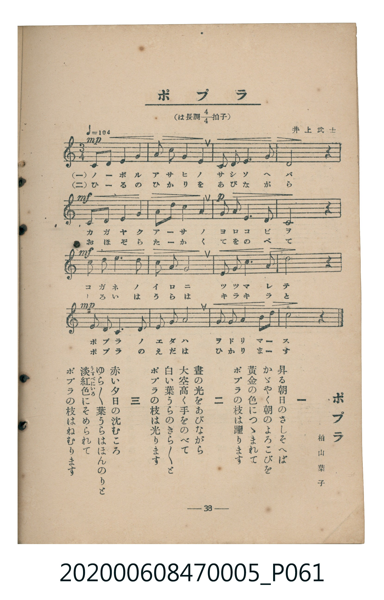

# ポプラ

> Re:Shōka 使用 AI 協助辨識與重建樂譜，可能會有錯誤。歡迎回報。

- **鋼琴伴奏版**：<br><audio controls src="popura.mp3"></audio>
- **NEUTRINO 歌聲合成版**：<br><audio controls src="popura_neutrino.mp3"></audio>

- 臺灣教育會公認《新定兒童唱歌》尋常科第五學年用（2020.006.0847.0005）

## 說明

原書資訊與歌詞全文（對應 P061.jpg，書頁 p. 38，參考教材第 5 首）：
調性與拍號：標題誤植為「は長調四分之四拍子」，五線譜拍號與實際小節長度均為 C 大調 3/4 拍，♩= 104
作曲與作歌：井上武士、柏山葉子


## 歌詞

```text
一　昇る朝日のさしそへば
かゞやく朝のよろこびを
黃金の色につゝまれて
ポプラの枝は躍ります

二　晝の光をあびながら
大空高く手をのべて
白い葉うらのきら〳〵と
ポプラの枝は光ります

三　赤い夕日の沈むころ
ゆら〳〵葉うらはほんのりと
淡紅色（うすべにいろ）にそめられて
ポプラの枝はねむります
```

## ABC

```abc
X:1
T:ポプラ
M:3/4
L:1/16
Q:1/4=104
K:C
V:V1 name="Piano" snm="Pia"
[V:V1]
C4 D2 E2 F4 | G3 A G4 E4 | D2 E2 F6 E2 | D8 z4 |
w: 1.~ノ _ ボ ル | ア サ ヒ ノ | サ シ ソ ヘ | バ
w: 2.~ひ _ る の | ひ か り を | あ び な が | ら
w: 3.~あ _ か い | ゆ う ひ の | し づ む こ | ろ
C4 D2 E2 F4 | E2 F2 G4 A4 | G3 A G6 F2 | C8 z4 |
w: 1.~カ ガ ヤ ク | ア _ サ ノ | ヨ ロ コ ビ | ヲ
w: 2.~お ほ ぞ ら | た _ か く | て を の べ | て
w: 3.~ゆ ら ゆ ら | は う ら は | ほ ん の り | と
B3 A G6 G2 | A2 B2 G8 | A3 A c6 A2 | d8 z4 |
w: 1.~コ ガ ネ ノ | イ ロ ニ | ツ ツ マ レ | テ
w: 2.~し ろ い は | う ら は | キ ラ キ ラ | と
w: 3.~う す べ に | い ろ に | そ め ら れ | て
G3 A G6 E2 | F2 G2 A8 | G3 A G4 A2 B2 | c8 z4 |
w: 1.~ポ プ ラ ノ | エ ダ ハ | ヲ ド リ マ _ | ス
w: 2.~ポ プ ラ の | え だ は | ひ か り ま _ | す
w: 3.~ポ プ ラ の | え だ は | ね む り ま _ | す
```

## TMD 檔案連結

- [主旋律 TMD 檔案](popura.tmd) [[在 TMD Studio 編輯](https://tmdlang.github.io/Tmd-TS/#tmd=s7IKdvYPcrWy4qpTUCpJTLdSSM7PyUlNLsnMz7MqzsjMK0nNjM_KTMmPL87Iz05Ugisry88pzU21Si9KTEmNN403MjAyiDcwMIs3sDAxBzIMTBFKi_NLi5JTrYqTM_Lzc-JLUitKkvLzsxHyBUX5Zal5iXlANQVFIBtTwIoQClLLMlNSQdKpKZkl-UWZiTlI7kgtKga7FWxJfElRYl5xclFmAcgDCFUlGalAxxbkJOYhGQs0KT0zz6okMRPoN5D_yhPjcxMz84CqUpS4tLQUHjfPfdw8_XHzSgUtLS5FWwVDAxMue1sFZy4bY30TO5A5L9p3PW9c_GzqzBdNm57NaX7auubFqt7HDV3Ppm14um7W09ZJz1cvfTpl47O1PY8bup9u6H66Y8fz5ROfr1nzZNeUp2t3PN255fmUFe_3dICCTw8YfHqg4AMyDEzf7-lU4uLS11KwpRbgUlBQeNo3_9nsHS82t79Y0fWiox3orhcr5z1tXfFsWjvQFU839D5r71QIMDAz1MsqSH-_pweo-OWCRoUCPQVjCyD3aX_zi4ZmoHefzZ0A9ISCqcLLZdOALn2_ZxbI9Ber9j9rWA4yt7v3xcz5QNFnK2a-XNjzYtWSZ0t6nzftetzQ87hx_cup24Eqn86e_bSj7cnObiADqP7p2gmPG3qBdgBD5vn2WS_WzoEYAjTt6fplL2fNfrqh__n6BqDep7uWPZ3bDjRNwVnh6ZLlQKMUgNGhAFQO1P1o5kpIPAGd82TvnGezNwENADHW9gCd82TX1Cc7up6tXfZ08erHDY3P5vc_3bjxxcROoOVcYB07Gh43NDyb0f64qfvZnLnPpi993LjucePUx43THzfOfdy443HjBpC6x43dj5vmPW5qedzYD1QHUtTU8bip93Hj5MeNmx83TQIperm7-WX7RKDci85NjxtXP25c8rgJqHTf4yZgICwDGwNLX0BFz-YB5da_2NX7uKkLpKhxJsRFu4App-HZTJAdT1s7gUY_bmwC2dG46nFjz-OmTnCsLln-fOWul6tngJzTCXQaUBHQ2Tuh1jyfufdxYwvQm48b24A6wHJAazofN2x-3LD1ceMK7G4BW4filh1ALQ0vti4BmvZ0yVRI6DzbBPR4A8jjTb1gc5rAdoCNRrJy_ePG3Y-bgKEDDCmgmWArn21f-HxLKzB0gEkPpK5xJtjNwJBqARoGTFZg9tzHTY0gI_CE2uPGtSA3wB0LVER5doECBS19Lq6A_ILSokSrgMzEvHyHGoOaapAVCjaGZlp2YBa2bKoAyuU7Gl4s7FHQMFGApF4deN7SxKIBaBPUMA2gRk0roE_7QAKPm_cA8RwgXg3i1gDDeBE4pLcChSZBVIAVgmSAYk3bgXgvSAAsNQMk3jwBykcCyPbt6gHZ17gJbl9TN5C7DmoqWByY6IHCXWAVTWBrQTJNQLwZiFfB7GvsAbujE6d9NQqGCrpgaATExkBsAuXXAAsUEG0GpSGyEBl0tTBZiAwyNIDpAdvmYwjyfR-SPCgoQeRquNmg8ATLQEMUpg6mCxKuIPntYHIvimkzICqAIYzqjnhUdxhBwhFJJzCIgSQwkOG2QOVhIQ1TB3MRJLxB8pvB5Cpk04DhDnFpJ353GMNMQeiEuKMFybdtUJk2JDejunQ6WGQp2H0NKKZNhprRi9Md-PPMrh6K8kwTOJM8bloDjJIlQHo9NKUC4xiSsLdC0jgsxzSvAHPXAmU2w9Jw82SwDDg3YE3DyHkGkiMadwPxPFjCB4XQfIh9wNAFy_fDxJeBnTcJlr3AkjvhMtjtw5dnYDxYnjGDy6DnJhAEqUSYBoNY8gwwHGHpbw2IBAYmiL0ekQaguQaSb6As5DwDDFmIGCRskdIIMHwhKpDzA2oaAbsDnGfg-QAYxCByHthGWCqHhDRMBSglQ1j9SPLLoK6EhDmSO4DhjqwCpztAeQaaJ2B2Q_io7gCFDSjPIItDRGEqQD4AyU5Gdwk4t4NUQMIMm0sI1DSdlOUaUNqHZJpeWKoExiXI38BMBIrBZnA6hgBQ1LWAlbQA8Ty4hjVgmTacyRg520wHW9gLLnig-oFBBQoCYKEDDD4QD9nCprVgK1ZCWRALV0LDDJeFNQrm4NBDzQMgdg04n4BkkWUg8QTJQWYKhnFIwiBBYGWDLASC2HIOJK3DQhMplsG5AxKmkHwBImFpFmE_KFgh6iHBi2wCKC9CAhlXOgG7A5xzQGU0yB2QQEYyBZwmIUENT8_wdIrkDmBIQ2yFhDqyO1ZCTcCdXsHuANc2sNpkJjTHIdwBKmNAKkCug9QYEDE0dzTOhfqkEa1-A7YKoSpw52C8-QbY-aCshTYXnA6ng0MElioh-WYFkNUAxOCCH56MwZXK42Zg-m4GN5lA8QuqJ0A6duJMx0gZB5uNwLIEFAYdQLwAI-NgNN4a98FsBMYILhux1x6QFhestoHVNIiYQtcDy2PAGoeIjAP0GiRxQTyHnNxgGQeU3EDBCiJhRTxSQoFWKLDwhemGZSFIIONKKGB3gDIObneAC21IUIN4C8AkloyDvSEHDHiEipn43QHKOFRwx1qIemATjXR31HJx6dopQPo-CkCWMhcA)]
- [鋼琴伴奏 TMD 檔案](popura_piano.tmd) [[在 TMD Studio 編輯](https://tmdlang.github.io/Tmd-TS/#tmd=s7IKdvYPcrWy4tLSUnjcPPdx8_THzSvf7-l42b3n-YQtT_Zsebq0_3lnx_s9nQpaWlyKtgqGBiZc9rYKzlw2xvomdlx1Ckov2nc9b1z8bOrMF02bns1pftq65sWq3scNXc-mbXi6btbT1knPVy99OmXjs7U9jxu6n27ofrpjx_PlE5-vWfNk15Sna3c83bnl-ZQVQCuNDIwM9AwMzPQMLEzMgQwDU6CtSlxcAfkFpUWJVgGZiXn5QR4ONQY11VwKQGBjaKZlB2bpaynYogMFkAU7Gl4s7FHQMFF4uqH_-foGHYUAAzNDvayCdE0sGrT0wYbVKBgq6IKhERAbA7EJlF-jYAqmzaA0RBYig64WJguRQYYGMD1g23wMa4Dh3ock_7h5DphcDTf7cdMiiEzTVqD4JLg6mC6Qiq1g-e1gci-KaTMgKponoLkjHtUdRkA1jZuQdTZ1g8jGdQhboPKPG7uBsl1wdTAXgVQ0geU3g8lVyKY19kBd2onfHcYwUxA6Ie5oQfJtG1SmDcnNqC6dDhZZCnZfA4ppk6Fm9OJ0B_40tauHumkKxoOlKTO4DHpqA0GQSoRpMIglTTXB0s_jpjUgsnkJmL0eEUbQVAVJV1AWcppqXgEVWwtUAYpReBg2Q8OwGTm9oIYhIk3B00njbjA5D2wjLBWAVMyHqwDFNITVjyS_DOrKSUhxDFG1E0UFTneA0hQ0zcDshvBR3QEKG1CaQhaHiMJUgHwAkp2M7hJwbgCpgIQZNpcQKKk6yUlV5mCzUVMIiF0DTkUgWWQZiC8g6ctMwTAOSRgkCCyqkIVAEFu6gqQEUKp63NyLHAbgtANSAU5pwFQDImExirD_cTMkJ4Pox82g1IAwAZRSQSpgcYUZioh0BcrhIHf0IpUNYBFwjIFUIGISEYtI7mgCuRBk60o4G-aOlVATcMcmoqyClUUzoekR4Q5QDgSpALkOUt5AxNDc0TgX6pNGtNLxcRO0zMSTvvGmqqezZ5OTqrCVO5C6DFZOwcoohC_Q9cDSH7CsIiJRNUODoHk6NPARUQFLVKCoeNwMKsofN8MKB6RAhBZFj5s7gRhW8SCSF8gE5MhBDUR4osLtDnB2B0VFB5i3AExiSVTYq8jGfUgqZuJ3ByhRUcEdayHqgZUf6e6oRW10-SA3ukwQba5nE6Y9m735-ZT5T5fvf7KzG1iGPevufbp2wtPty551dkPaju_39Dzr73--c9XzmXufLe16tmLns3lzX0zsfDlrxbOZK562dj5uaHw2c-6z6UtfdLQ_XTL1eetyoLFPu6cCDXw2cz1SBRqvEG0YC8ZoHCMgxygXyAMRwJQYD-SbxscC0xkkRHHoNUFRDCbgkgitOBRAjDIBcoDGoBmFw17sijHtBQa-rp0CJPyjfYCCSDwjFJ4xmKfMBQA)]

## 分析

```text
================================================================================
📊 TMD Song Profile: [ ポプラ ]
================================================================================
⏱  Duration:       0:27 (27.7s), 16 measures total
🎼 Key & Tempo:    首調基準 C, != 104.0 BPM, <3/4>
   - 分析範圍：      由實際發聲的音符與和弦推測調性；播放脈絡另行呈現
🎤 人聲音域:    C4 (MIDI 60) – D5 (MIDI 74) [跨度: 14 個半音 / 1.2 個八度, 難度: moderate]
   - 最低音:  C4 in [Popura #1 @ m.1, 0:00]
   - 最高音: D5 in [Popura #1 @ m.12, 0:19]
   - 適合: soprano, mezzo-soprano, contralto, tenor, baritone, bass
🏛  結構:      Popura (27.7s)
⚡ 編曲密度:        Peak 1 軌道同時演奏
🗝  調性診斷：       C 大調（純淨自然大調，未偵測到可信轉調）
   - 風格氣質:    純淨自然大調（陽光明朗、易唱易記，無明顯調外色彩）
   - 轉調歷程:    全曲維持單一推測調性（未偵測到可信轉調）
   - 核心骨幹音:  G, C, A, D, F
   - 調性數值:    C 大調 [相關度: 0.84, 穩定度: Moderate, 自然音純度: 100.0%]
   - 候選調性 (K-S): C 大調 (0.84), G 大調 (0.80), G 小調 (0.55)
   - 五度圈歷程:   +0
   - 各段落調性細節:
     • [Popura #1]: C 大調 (r: 0.84, 自然音純度: 100.0%)

  [ 五度圈游移軌跡 ]
              [C ]*
         F            G  
      Bb               D  
      Eb               A  
         Ab           E  
            Db       B  
               F# 
     (* = active key center)

  [ 十二半音累積音高分佈 ]
     C  : █████████████             17.0%
     C# :                            0.0%
     D  : ██████████                12.5%
     D# :                            0.0%
     E  : ███████                    9.1%
     F  : █████████                 11.4%
     F# :                            0.0%
     G  : ████████████████████████  30.7%
     G# :                            0.0%
     A  : ████████████              15.3%
     A# :                            0.0%
     B  : ███                        4.0%
--------------------------------------------------------------------------------
Assignment 軌道音域：
  - Piano         : C4 – D5 (14 個半音 / 1.2 個八度, 51 個音符)
================================================================================
```


## 原書掃描頁




