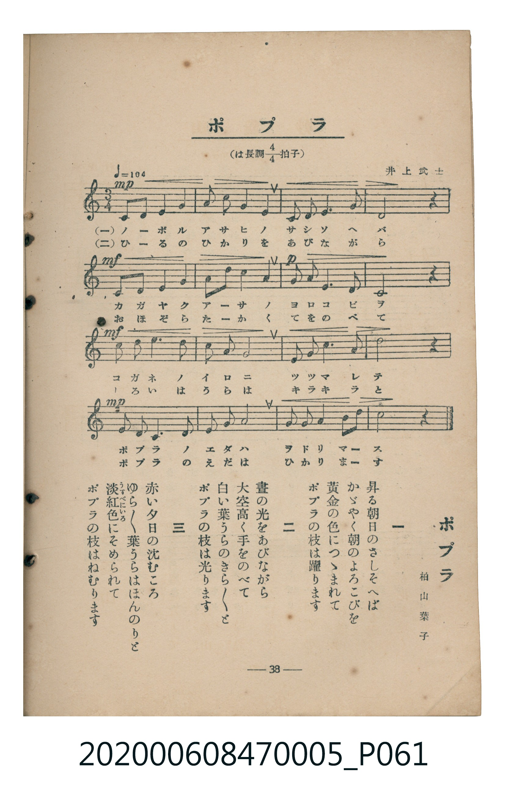

# ポプラ

> Re:Shōka 使用 AI 協助辨識與重建樂譜，可能會有錯誤。歡迎回報。

- **鋼琴伴奏版**：<br><audio controls src="popura.mp3"></audio>
- **NEUTRINO 歌聲合成版**：<br><audio controls src="popura_neutrino.mp3"></audio>

- 臺灣教育會公認《新定兒童唱歌》尋常科第五學年用（2020.006.0847.0005）

## 說明

原書資訊與歌詞全文（對應 P061.jpg，書頁 p. 38，參考教材第 5 首）：
調性與拍號：標題誤植為「は長調四分之四拍子」，五線譜拍號與實際小節長度均為 C 大調 3/4 拍，♩= 104
作曲與作歌：井上武士、柏山葉子


## 歌詞

```text
一　昇る朝日のさしそへば
かゞやく朝のよろこびを
黃金の色につゝまれて
ポプラの枝は躍ります

二　晝の光をあびながら
大空高く手をのべて
白い葉うらのきら〳〵と
ポプラの枝は光ります

三　赤い夕日の沈むころ
ゆら〳〵葉うらはほんのりと
淡紅色（うすべにいろ）にそめられて
ポプラの枝はねむります
```

## ABC

<div class="abc-score" data-abc-src="popura.abc" aria-label="五線譜載入中"></div>

[下載 ABC 原始檔](popura.abc)

## TMD 檔案連結

- [主旋律 TMD 檔案](popura.tmd) [[在 TMD Studio 編輯](https://tmdlang.github.io/Tmd-TS/#tmd=s7IKdvYPcrWy4qpTUCpJTLdSSM7PyUlNLsnMz7MqzsjMK0nNjM_KTMmPL87Iz05Ugisry88pzU21Si9KTEmNN403MjAyiDcwMIs3sDAxBzIMTBFKi_NLi5JTrYqTM_Lzc-JLUitKkvLzsxHyBUX5Zal5iXlANQVFIBtTwIoQClLLMlNSQdKpKZkl-UWZiTlI7kgtKga7FWxJfElRYl5xclFmAcgDCFUlGalAxxbkJOYhGQs0KT0zz6okMRPoN5D_yhPjcxMz84CqUpBVlWTkA71ZkFFplZFZDLI_OTEnPjsxDyk0oLYXJKanWgUYmBkqcWlpKTxunvu4efrj5pUKWlpcirYKhgYmXPa2Cs5cNsb6JnYgvS_adz1vXPxs6swXTZuezWl-2rrmxarexw1dz6ZteLpu1tPWSc9XL306ZeOztT2PG7qfbuh-umPH8-UTn69Z82TXlKdrdzzdueX5lBXv93SAQl8PGPp6oNAHMgxM3-_pVOLi0tdSsKUW4FJQUHjaN__Z7B0vNre_WNH1oqMd6K4XK-c9bV3xbFo70BVPN_Q-a-9UAPlfL6sg_f2eHqDilwsaFQr0FIwtgNyn_c0vGpqB3n02dwLQEwqmCi-XTQO69P2eWSDTX6za_6xhOcjc7t4XM-cDRZ-tmPlyYc-LVUueLel93rTrcUPP48b1L6duB6p8Onv20462Jzu7gQyg-qdrJzxu6AXaAQyZ59tnvVg7B2II0LSn65e9nDX76Yb-5-sbgHqf7lr2dG470DQFZ4WnS5YDjVIARocCUDlQ96OZKyHxBHTOk71zns3eBDQAxFjbA3TOk11Tn-zoerZ22dPFqx83ND6b3_9048YXEzuBlnOBdexoeNzQ8GxG--Om7mdz5j6bvvRx47rHjVMfN05_3Dj3ceOOx40bQOoeN3Y_bpr3uKnlcWM_UB1IUVPH46bex42THzduftw0CaTo5e7ml-0TgXIvOjc9blz9uHHJ4yag0n2Pm4CBsAxsDCx9ARU9mweUW_9iV-_jpi6QosaZEBftAqachmczQXY8be0EGv24sQlkR-Oqx409j5s6wbG6ZPnzlbterp4Bck4n0GlARUBn74Ra83zm3seNLUBvPm5sA-oAywGt6XzcsPlxw9bHjSuwuwVsHYpbdgC1NLzYugRo2tMlUyGh82wT0OMNII839YLNaQLbATYaycr1jxt3P24Chg4wpIBmgq18tn3h8y2twNABJj2QusaZYDcDQ6oFaBgwWYHZcx83NYKMwBNqjxvXgtwAdyxQEeXZBQoUtPS5uALyC0qLEq0CMhPz8h1qDGqqQVYo2BiaadmBWdiyqQIol-9oeLGwR0HDRAGSenXgeUsTiwagTVDDNIAaNa2APu0DCTxu3gPEc4B4NYhbAwzjReCQ3goUmgRRAVYIkgGKNW0H4r0gAbDUDJB48wQoHwkg27erB2Rf4ya4fU3dQO46qKlgcWCiBwp3gVU0ga0FyTQB8WYgXgWzr7EH7I5OnPbVKBgq6IKhERAbA7EJlF8DLFBAtBmUhshCZNDVwmQhMsjQAKYHbJuPIcj3fUjyoKAEkavhZoPCEywDDVGYOpguSLiC5LeDyb0ops2AqACGMKo74lHdYQQJRySdwCAGksBAhtsClYeFNEwdzEWQ8AbJbwaTq5BNA4Y7xKWd-N1hDDMFoRPijhYk37ZBZdqQ3Izq0ulgkaVg9zWgmDYZakYvTnfgzzO7eijKM03gTPK4aQ0wSpYA6fXQlAqMY0jC3gpJ47Ac07wCzF0LlNkMS8PNk8Ey4NyANQ0j5xlIjmjcDcTzYAkfFELzIfYBQxcs3w8TXwZ23iRY9gJL7oTLYLcPX56B8WB5xgwug56bQBCkEmEaDGLJM8BwhKW_NSASGJgg9npEGoDmGki-gbKQ8wwwZCFikLBFSiPA8IWoQM4PqGkE7A5wnoHnA2AQg8h5YBthqRwS0jAVoJQMYfUjyS-DuhIS5kjuAIY7sgqc7gDlGWiegNkN4aO6AxQ2oDyDLA4RhakA-QAkOxndJeDcDlIBCTNsLiFQ03RSlmtAaR-SaXphqRIYlyB_AzMRKAabwekYAkBR1wJW0gLE8-Aa1oBl2nAmY-RsMx1sYS-44IHqBwYVKAiAhQ4w-EA8ZAub1oKtWAllQSxcCQ0zXBbWKJiDQw81D4DYNeB8ApJFloHEEyQHmSkYxiEJgwSBlQ2yEAhiyzmQtA4LTaRYBucOSJhC8gWIhKVZhP2gYIWohwQvsgmgvAgJZFzpBOwOcM4BldEgd0ACGckUcJqEBDU8PcPTKZI7gCENsRUS6sjuWAk1AXd6BbsDXNvAapOZ0ByHcAeojAGpALkOUmNAxNDc0TgX6pNGtPoN2CqEqsCdg_HmG2Dng7IW2lxwOpwODhFYqoTkmxVAVgMQgwt-eDIGVyqPm4HpuxncZALFL6ieAOnYiTMdI2UcbDYCyxJQGHQA8QKMjIPReGvcB7MRGCO4bMRee0BaXLDaBlbTIGIKXQ8sjwFrHCIyDtBrkMQF8RxycoNlHFByAwUriIQV8UgJBVqhwMIXphuWhSCBjCuhgN0Byji43QEutCFBDeItAJNYMg72hhww4BEqZuJ3ByjjUMEdayHqgU000t1Ry8Wla6cA6fsoAFnKXAA)]
- [鋼琴伴奏 TMD 檔案](popura_piano.tmd) [[在 TMD Studio 編輯](https://tmdlang.github.io/Tmd-TS/#tmd=s7IKdvYPcrWy4qpTUCpJTLdSyC8qychPL0osyKi0ysgsLskvykxOzInPTsxLVIIrKs4vLUpOjS9ITE-1CjAwM1Ti0tJSeNw893Hz9MfNK9_v6XjZvef5hC1P9mx5urT_eWfH-z2dClpaXIq2CoYGJlz2tgrOXDbG-iZ2IANftO963rj42dSZL5o2PZvT_LR1zYtVvY8bup5N2_B03aynrZOer176dMrGZ2t7Hjd0P93Q_XTHjufLJz5fs-bJrilP1-54unPL8ykrgFYaGRgZ6BkYmOkZWJiYAxkGpkBblbi4AvILSosSrQIyE_PygzwcagxqqrkUgMDG0EzLDszS11KwRQcKIAt2NLxY2KOgYaLwdEP_8_UNOgogv-plFaRrYtGgpQ82rEbBUEEXDI2A2BiITaD8GgVTMG0GpSGyEBl0tTBZiAwyNIDpAdvmY1gDDPc-JPnHzXPA5Gq42Y-bFkFkmrYCxSfB1cF0gVRsBctvB5N7UUybAVHRPAHNHfGo7jACqmnchKyzqRtENq5D2AKVf9zYDZTtgquDuQikogksvxlMrkI2rbEH6tJO_O4whpmC0AlxRwuSb9ugMm1IbkZ16XSwyFKw-xpQTJsMNaMXpzvwp6ldPdRNUzAeLE2ZwWXQUxsIglQiTINBLGmqCZZ-HjetAZHNS8Ds9YgwgqYqSLqCspDTVPMKqNhaoApQjMLDsBkahs3I6QU1DBFpCp5OGneDyXlgG2GpAKRiPlwFKKYhrH4k-WVQV05CimOIqp0oKnC6A5SmoGkGZjeEj-oOUNiA0hSyOEQUpgLkA5DsZHSXgHMDSAUkzLC5hEBJ1UlOqjIHm42aQkDsGnAqAskiy0B8AUlfZgqGcUjCIEFgUYUsBILY0hUkJYBS1ePmXuQwAKcdkApwSgOmGhAJi1GE_Y-bITkZRD9uBqUGhAmglApSAYsrzFBEpCtQDge5oxepbACLgGMMpAIRk4hYRHJHE8iFIFtXwtkwd6yEmoA7NhFlFawsmglNjwh3gHIgSAXIdZDyBiKG5o7GuVCfNKKVjo-boGUmnvSNN1U9nT2bnFSFrdyB1GWwcgpWRiF8ga4Hlv6AZRURiaoZGgTN06GBj4gKWKICRcXjZlBR_rgZVjggBSK0KHrc3AnEsIoHkbxAJiBHDmogwhMVbneAszsoKjrAvAVgEkuiwl5FNu5DUjETvztAiYoK7lgLUQ-s_Eh3Ry1qo8sHudFlgmhzPZsw7dnszc-nzH-6fP-Tnd3AMuxZd-_TtROebl_2rLMb0nZ8v6fnWX__852rns_c-2xp17MVO5_Nm_tiYufLWSuezVzxtLXzcUPjs5lzn01f-qKj_emSqc9blwONfdo9FWjgs5nrkSrQeIVow1gwRuMYATlGuUAeiACmxHgg3zQ-FpjOICGKQ68JimIwAZdEaMWhAGKUCZADNAbNKBz2YleMaS8w8HXtFCDhH-0DFETiGaHwjME8ZS4A)]

## 分析

```text
================================================================================
📊 TMD Song Profile: [ ポプラ ]
================================================================================
⏱  Duration:       0:27 (27.7s), 16 measures total
🎼 Key & Tempo:    首調基準 C, != 104.0 BPM, <3/4>
   - 分析範圍：      由實際發聲的音符與和弦推測調性；播放脈絡另行呈現
🎤 人聲音域:    C4 (MIDI 60) – D5 (MIDI 74) [跨度: 14 個半音 / 1.2 個八度, 難度: moderate]
   - 最低音:  C4 in [Popura #1 @ m.1, 0:00]
   - 最高音: D5 in [Popura #1 @ m.12, 0:19]
   - 適合: soprano, mezzo-soprano, contralto, tenor, baritone, bass
🏛  結構:      Popura (27.7s)
⚡ 編曲密度:        Peak 1 軌道同時演奏
🗝  調性診斷：       C 大調（純淨自然大調，未偵測到可信轉調）
   - 風格氣質:    純淨自然大調（陽光明朗、易唱易記，無明顯調外色彩）
   - 轉調歷程:    全曲維持單一推測調性（未偵測到可信轉調）
   - 核心骨幹音:  G, C, A, D, F
   - 調性數值:    C 大調 [相關度: 0.84, 穩定度: Moderate, 自然音純度: 100.0%]
   - 候選調性 (K-S): C 大調 (0.84), G 大調 (0.80), G 小調 (0.55)
   - 五度圈歷程:   +0
   - 各段落調性細節:
     • [Popura #1]: C 大調 (r: 0.84, 自然音純度: 100.0%)

  [ 五度圈游移軌跡 ]
              [C ]*
         F            G  
      Bb               D  
      Eb               A  
         Ab           E  
            Db       B  
               F# 
     (* = active key center)

  [ 十二半音累積音高分佈 ]
     C  : █████████████             17.0%
     C# :                            0.0%
     D  : ██████████                12.5%
     D# :                            0.0%
     E  : ███████                    9.1%
     F  : █████████                 11.4%
     F# :                            0.0%
     G  : ████████████████████████  30.7%
     G# :                            0.0%
     A  : ████████████              15.3%
     A# :                            0.0%
     B  : ███                        4.0%
--------------------------------------------------------------------------------
Assignment 軌道音域：
  - Piano         : C4 – D5 (14 個半音 / 1.2 個八度, 51 個音符)
================================================================================
```


## 原書掃描頁




