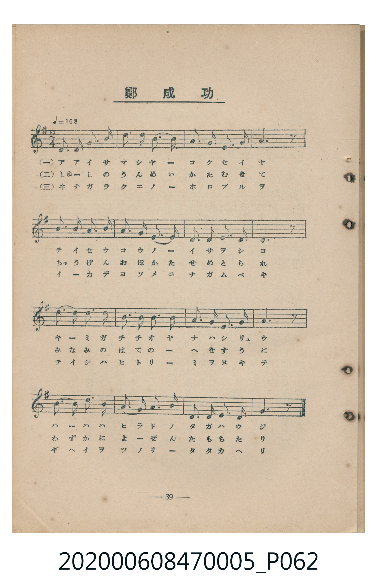
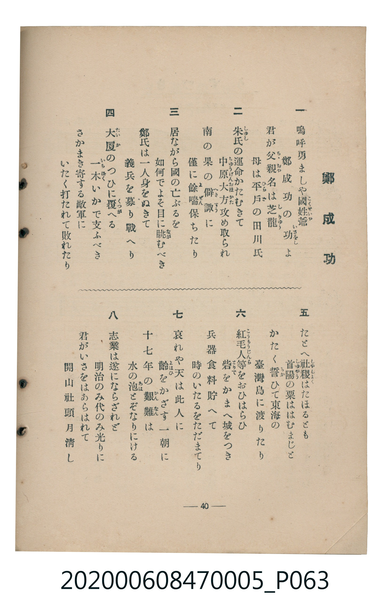

# 鄭成功

> Re:Shōka 使用 AI 協助辨識與重建樂譜，可能會有錯誤。歡迎回報。

- **鋼琴伴奏版**：<br><audio controls src="teiseiko.mp3"></audio>
- **NEUTRINO 歌聲合成版**：<br><audio controls src="teiseiko_neutrino.mp3"></audio>

- 臺灣教育會公認《新定兒童唱歌》尋常科第五學年用（2020.006.0847.0005）

## 說明

原書資訊與歌詞全文（對應 P062.jpg – P063.jpg，書頁 pp. 39–40，參考教材第 6 首）：
調性與拍號：と長調四分之二拍子（G 大調 2/4 拍），♩= 108


## 歌詞

```text
一　嗚呼勇ましや國姓爺
鄭成功の功（いさをし）よ
君が父親（ちゝおや）名は芝龍（しりゅう）
母は平戸（ひらど）の田川氏

二　朱氏（しゅし）の運命かたむきて
中原大方（ちゅうげんおほかた）攻め取られ
南の果の僻陬（へきすう）に
僅に餘喘（よぜん）保ちたり

三　居ながら國の亡ぶるを
如何でよそ目に眺（なが）むべき
鄭氏は一人身をぬきて
義兵を募り戰へり

四　大廈（たいか）のつひに覆（くつが）へる
一木（いちぼく）いかで支ふべき
さかまき寄する敵軍に
いたく打たれて敗れたり

五　たとへ社稷（しゃしょく）はたほるとも
首陽（しゅやう）の粟ははむまじと
かたく誓（ちか）ひて東海の
臺灣島に渡りたり

六　紅毛人等（こうもうじんら）をおひはらひ
砦（とりで）をかまへ城をつき
兵器食料貯へて
時のいたるをただまてり

七　哀れや天は此人に
齡（よはひ）をかざす一朝に
十七年の艱難（かんなん）は
水の泡（あわ）とぞなりにける

八　志業は遂にならざれど
明治のみ代のみ光りに
君がいさをはあらはれて
開山社頭月清し
```

## ABC

<div class="abc-score" data-abc-src="teiseiko.abc" aria-label="五線譜載入中"></div>

[下載 ABC 原始檔](teiseiko.abc)

## TMD 檔案連結

- [主旋律 TMD 檔案](teiseiko.tmd) [[在 TMD Studio 編輯](https://tmdlang.github.io/Tmd-TS/#tmd=s7IKdvYPcrWy4qpTUCpJTLdSSM7PyUlNLsnMz7MqzsjMK0nNjM_KTMmPL87Iz05Ugisry88pzU21Si9KTEmNN403MjAyiDcwMIs3sDAxBzIMTBFKi_NLi5JTrYqTM_Lzc-JLUitKkvLzs9Hl4wsS01OtAgzMjBAyBUX5Zal5iXlA3QVFILekgLUjFKSWZaakgqSLkxPz4stSizLTMlNTkFyZWlQM9gnEipKixLzi5KLMApD3EKryi0oy8oE-KciotMrILC7JL8pMTsyJz07MQ_JwSUYq0L8Q6UpkvZnpmXlWJYmZ5UAX5KelZSZnJuYocWlpKbxsWfusY8LTrvkKWlpcirYKhgYWXPa2Cu5cNkb6JnYgE16073reuPjZ1JkvmjY9m9P8tHXNi1W9jxu6nk3b8HTdrKetk56vXvp0ysZna3seN3Q_3dD9dMeO58snPl-z5smuKU_X7ni6c8vzKSve7-kAhb4eMPT1QKEPZBiYvt_TqcTFpa-lYEstwKWgoPC0b_6z2TtebG5_saLrRUc70F0vVs572rri2bR2oCuebuh91t6pAIpCvayCdIVHDZNBHGMQ5_2eHqDOlwsaFQoK9BSMLYFyJgZAwaf9zS8amoEh8GzuBKC_FMwUXi6bBnT8-z2zQBa-WLX_WcNykFXdvS9mzgeKPm5c8XLqdqD409mzn3a0PdnZ_WRXD1D26doJQCe4KzxdshwoqQAMYQWgKNiknkczV0JCH2Tkkx0Njxsank6f9XTinqfd7Y8b9z1unP64qeXpnO6nyyc_79gFUgSPuseN64Ak0OTHjS2PG6c-bpoEVA009XFTBzhAJsx-3NjzvGPbi2WrwIoWPm6a-7ixC2geUNHTCb2PG9e_6Jr7ch_QJUBZoD1AqdbHjW1AWZD-Z-tBKp7u3PysYwdYxabHTZ2PG1eCbGhc93zKhqfb5z7b0A9x-C5gKmh4NmcjUABmGtAosGsa171s7H46ce_jxu7HjfMfNzU8bgQavAzi37XAaAMGy7NpO2FOBLngceOkx02TQW5t3A3RBjTo2ZTdj5san_ZPAzmjqQfsxd7pQOOfzZsDCorm3S9nrgGbsgNsw0yIVx43rgYrbQYavPrlkhlPp80AKWoCqpsDtASo4sl-YLAsBLutCxoNnaBo2AjUsQoYhED7gBEAtOLJLqCqbY-buoFBDTZzWdOTvVMfNy4Hmzb3-ex1QCuez9kFdgRIJzgygP7dCXQQLOo29ANDFRjRT3bterFrNTjS1iBC5Pm-lU9btwJFn3aDnPOsYwPIO1B3AZMVyF1Llj_d3QG2A5gEgDHfDQnlx41LQHHUuPrFMqC_gbJAi4AiYEeAzOiGprBnc0DZEqwT6J09QHVgFSCDgF55NmX948atCCeDEhZIApgSe5-uByqaCTTp2dStL3YDnQwOWbBWoEv6n3UCowzo6h6gX55NBaYAIAMRprumAN0OVrgC6JznS_Y9X7EdllSawSQwvUOcAnQBUBkwtoH2rnjc1AQOumXTXs7ci0hbTUBLIdG77vkmoGqgnvXgsAY6dAZQG8Rl4BTX2P9iFTCewckLGljAYFr2bO7GZ1u3A_WDMzO4tHu6eRvQU892AJMhMOnB3f60dS3Q7c-3tD5bPxsYbc_XAjMu0DSgb9uArgOn1xmg9NoEFAdGODBGgbqBVgAdBLILHK8LloH1AL0DlFsOUwcJ2B1P5_eBucDoAgc6MAk8nbni5eL5z6bNfLEJ6DVgigYnj2czgdYBYxoc4uB0CPbgArAxyxDptxmUTiY3gKIAWHosWQl0y7O1S4Buh8bZy70LYZkAaPomJOdMA8YwOJEA8wQk4_Q2As0DFudAi190bnw5ezHYI0C7gf5fBclBQFPArtsAUvRsM9jsxqbHTZDoBMb3PLBSoM9XP26cCEqKEF-uBjlz__RnS9cCTXgJ1AGSByoEagLmcmDyWQk2dkbfs03AcgDo7_1Pdi-GMJ62Ap0MMhBR1CEVg0BPAa0HJyVwcgT7eVr3040bgQnv5YK1z-Z0PNsBKqBAEpTXP1CgoKXPxRWSmlmcmpmdbxWQmZiX71BjUFMNskTBxtBMyw7MwlbzKYAqzh0NLxb2KGiYKDzd0P98fYMOvLrSxKIBaBfUMA2gRk0rhcdNi0ACIOpx0xIIc6tCjcLj5nkQznYgEyLevAck3rQZIr4eiHdDmEvA6sGKEABqU41CdW5arYJpvIIuEAIpQzDDGChhChECsmEiRmCWoYIZRLUhXAgCDYC4BmyqjyHIJYvAojCnQ9gwt0N4EMdDdEPcDhGHOB7ChrkeYQ_Idqg9RkA5cNEBlQJyoPQ6kLbGNqghk4G4ESrTApbphvLmA2UaoOxesMwy7FYZg5yxAaKyuQuoaw2UvRLs9PVQXjcQ9yG81DwbKr4WiKdB2avBMpuw22MCcsN8uFsRLoX4CBqQjZuAeDXCnsZ-qPgSIO6BsneAXQbRj2GPKUhuPyzcmjug9Aywnu2PmxdDgw7IXI7kv36wPEQfyHcg38BMAPkKEukYtpmB3DgZ6q42oAlNcDZIZgbUMlA8dULZk8AyXUj-hboBqAIkgyP8zJGSHtC1j5th8QRJSNAU0bwZLAsPP1jSA8bd4-ZJKD7CEX4W4KQHdd0kIN4KZa_HG0-r4H4AFodQdg9YZiWGPfgLll09FBUswJCAlg7wgmIZcgGyDBwYSAULvPQBJV1o2QMKnxU4ChZYuQEpIrCUH0AKWMrASx6oKJAFF4VAtHIFFoVQl0PYMKfDeCiZEKn0gWU7hOOxRi64XAG1W6GxCEyxwDiGpVHkdLkbpSwByUBzPLC8AdaS8NgGOQOSLzEsA5UsUCeC1MLyUzuSAx837QWyF0JlusEyUBcAy6HHzQugMjPB9qzFbg-4ZGmBunUhEO-BssF5Gi4DLMEalyMCr3EqVHwqUhrfCZbpxW4PuGQBFhtLoY4CxROkUAXFCnr2RMqEUDbIO4g6AlyIQYsnDKvAxQosiICFMtThsMIDFjH7wIUhwkvQbNvUC1YJUQMuHnB5CVSowKIC7GpYEbEJ7B9olDVtA-KdCHtg6a65GSnVglMqvkIFqaJ63AgNKWjhDy12mzrAIgj_QMXBhQ3Uz8DQAMnAih6EPQRaK52UtVbWwkqMx83zIYXEGrB_GyHiwDzRtArChBTHXRAOMEiBGRLMXAVKOKBgWIajXKkGtVfAHjKF04jShuzWylqoOMjhkBCEuRwiCnE6LEUjZUCo4yFsJNdjjWBwwQKLrlVIbEgEQ2s4YBsENYIhiReUPIEteSgbUnNiRjC8TEEpKGEOBOd1pBoO6GSEPTCvA5P142ZoKwIYMAizMOwBlymwEgJUcuyDuxQUCtBWBdDNiHYISAe0OAD7ZwLUHki5isM_4DIFJgdvfwBbJUhRBJRH-AwcOrBWDahCgGdSSOTBqgc0e8AFCqyoQJSJkJYhqDsLFQDFOayZBYkIWJMNKAOPRnDZhatBCW6oQCO2GVi4wqOoEezAXigP1FBBrstg1QNIHJYCNyOVnhj2gBsqENNAboIlOEijA-ZBkP2wkhDSgIE20MANFVjDC6IH0z94yxTgAAdlDZV-RJkCZcISMZizEog7IUxI7bIfVvDA1ENbBztwFSigHhCs3ICUKMjlB6L9gr2tAukxQSB6UwUWJYiqDTX_QdwOYcMcDwlqiOthqReRVDCiF1SiNMFa_7OQKj1wLwOaA0H8OVDTIPkMVsg1AdnQdgWk_QKsOLDaA26lQMokUC8BUbmBq8BmaEICt5-RShS4f_YjJV1wHwOuCs0elFYKsHcG79mgZDNgUkQkRJA9MB2gKhiWMfH6B6n_Ay4hm2E9HHBmgssASw54ZQ1yNSwrAP0D9QGIjcc_SE0USEkCoSHlPZI_oeUjrOkCK06ATSF4mQpJBzj8A26iQHSBfAFtuWJpcMHKxH0olRiwLoL683HTRrAMjpIYXJzA0hioiQLrxUDSFWjgDyq5Ahxp8KCDd4l6EcEATJ5gTRhW1XJx6dopwIZdFIBsZS4A)]
- [鋼琴伴奏 TMD 檔案](teiseiko_piano.tmd) [[在 TMD Studio 編輯](https://tmdlang.github.io/Tmd-TS/#tmd=s7IKdvYPcrWy4qpTUCpJTLdSyC8qychPL0osyKi0ysgsLskvykxOzInPTsxLVIIrKs4vLUpOjS9ITE-1CjAwM9IFEsZKXFpaCi9b1j7rmPC0a_77PR0vu_c8n7DlyZ4tT5f2P-_seL-nU0FLi0vRVsHQwILL3lbBncvGSN_EDmTqi_ZdzxsXP5s680XTpmdzmp-2rnmxqvdxQ9ezaRuerpv1tHXS89VLn07Z-Gxtz-OG7qcbup_u2PF8-cTna9Y82TXl6dodT3dueT5lBdBKIwMjAz0DAzM9AwsTcyDDwBRoqxIXl2deSVG-VUBmYl5-kIdDjUFNNZcCENgYmmnZgVk1CtW5abUKpvEKukAIpAzBDGOghClECMiGiRiBWYZQGiQCUQ2BBkBcw1WLYqkPsqUmqHYaxitEG8aCDIExTOOBLNN4qJgBxLSQ1Mzi1Mxs6vvCDKLaEC6E7A2QqT6GNQqPmxaBRUH046YlUPZWoJ7HzfOgvO1ANkQGqBPI3wwVXw_Eu6HsJWAdMFUgCLIdao8RUK5x-uOmVqgUkAOl14G0NbZBDZkMxI1QmRawTDeUNx8o0wBl94JllmG3yhjkQKg3mruA7DVQ9kqw09dDed1A3IfwUvNsqPhaIJ4GZa8Gy2zCbo8JyA3z4W5FuBTiI6gLGjcB8WqEPY39UPElQNwDZe8AuwyiH8MeU5Dcfli4NXdA6RlgPdsfNy-GBh2QuRzJf_1geYg-kO9AvoGZAPIVJNIxbDMDuXEy1F1tQBOa4GyQzAyoZaB46oSyJ4FlupD8C3UDUAVIBkf4mSMlPaBrHzfD4gmSkKAponkzWBYefrCkB4y7x82TUHyEI_wswEkP6rpJQLwVyl6PN55Wwf3wuBGaHpp6wDIrMeyB5lBYBkQUHmgZEUiBigAwG0hBRYEsuCgEomVQWFgAUzUiuy1DyYjLUFMzUjaGpV9QJgaZtQJ7KIEz6EJYBgVHPTCwYJGNHMG7UTIlSAaadYAZ93EjxHho1AMDDKtlSFkUpBaWMNuRHPi4aS-QvRAq0w2WgboAmKEfNy-AyswE27MWuz3gLNoCdetCIN4DZYMzB1wGWBQ0LkcEXuNUqPhUpMSyEyzTi90ecBYF5r-lUEeB4glSOoFiBT2dI6VmKBvkHURhCy4NoPkcwypw_oQFEbB0gzoclgthEbMPXKogvARN_029YJUQNeB8hstLoNwJiwqwq2F5bRPYP9Aoa9oGxDsR9sDL3WakVAtOqfhyJ1KJDy9hoKUotPxq6gCLIPwDFQfnWqifgaEBkoHlYYQ9sPoTVH2ChU3hNCLPkl15roWKP26G1gXA5AnyL9RPQPpxE7QsgZZs0GQMClVgnoSwV4ESD8g4HJUaOHvCPL0KiQ0JJmiBC6wSUYMJkgRAkfy4cSaUDSnIMYMJnjNRihuYA8E5BqnABToZYQ_M68DE8bgZWqkBAwZhFoY94JwJy2eg_LcP7lJQKEArOaCbEdUiSAc0U4H9MwFqD6R0wuEfcM6EycGrQ2AliRRFQHmEz8ChA6tkQcUqPKlDIg9WyKLZA86WsAyHKFkgDRVgu6cdKgCKc1itD4kIWAsCKAOPRnAJgKt9A643oRHbDCyi4FHUCHZgL5QHqjeRawRYIQsSh6XAzUhlEIY94HoTYhrITbAEB6kDYR4E2Q8rTyD1KbS9AK43Ye0AiB5M_yC3bGEZEJI1sbfFsVedmC10RM0J8xuipEVNyCuBGNqOgZbUsCQCqmSgeqB1LSx60cIJlDWbYK26WUhlMLj1CE3KIP4cqGmQBAsrLZqAbGg1B6lOgeUYVnvAlSYkc4Naf4iyFlwiN0NjBNwuQsqacP_sR0oD4LYjXBWaPSiVJrDVDW-xoqRXYJwiYhRkD0wHqEaApXC8_kFq14KLmmZYyxWcKuEywCwIrztAroalKaB_oD4AsfH4B6nGhGRJCA0pOJH8CS1oYDUpLF8Ca2Z44QRJBzj8A64xIbpApuyC-gaz_ocVLvtQagNgoQ715-OmjWAZHEUaOF_C0hioxoS1TiHpCljYNEMlV4AjDR508KZuLyIYgMkTrAnDKoxuKen9XDMghrBA_VyIcpACSPcXVQWSIEIxqMYm3mhUl6AZitHn1rVTAHfiFYAMmEejfYBaUfhGaHxjNL4JGt8UjW-GxjdH41uA-cpcAA)]

## 分析

```text
================================================================================
📊 TMD Song Profile: [ 鄭成功 ]
================================================================================
⏱  Duration:       0:17 (17.8s), 16 measures total
🎼 Key & Tempo:    首調基準 G, != 108.0 BPM, <2/4>
   - 分析範圍：      由實際發聲的音符與和弦推測調性；播放脈絡另行呈現
🎤 人聲音域:    D4 (MIDI 62) – D5 (MIDI 74) [跨度: 12 個半音 / 1.0 個八度, 難度: easy]
   - 最低音:  D4 in [Teiseiko #1 @ m.1, 0:00]
   - 最高音: D5 in [Teiseiko #1 @ m.2, 0:01]
   - 適合: soprano, mezzo-soprano, contralto, tenor, baritone, bass
🏛  結構:      Teiseiko (17.8s)
⚡ 編曲密度:        Peak 1 軌道同時演奏
🗝  調性診斷：       D 大調（純淨自然大調，未偵測到可信轉調）
   - 風格氣質:    純淨自然大調（陽光明朗、易唱易記，無明顯調外色彩）
   - 轉調歷程:    全曲維持單一推測調性（未偵測到可信轉調）
   - 核心骨幹音:  D, A, B, E, G
   - 調性數值:    D 大調 [相關度: 0.85, 穩定度: High, 自然音純度: 100.0%]
   - 候選調性 (K-S): D 大調 (0.85), G 大調 (0.65), B 小調 (0.63)
   - 五度圈歷程:   +2
   - 各段落調性細節:
     • [Teiseiko #1]: D 大調 (r: 0.85, 自然音純度: 100.0%)

  [ 五度圈游移軌跡 ]
               C  
         F            G  
      Bb              [D ]*
      Eb               A  
         Ab           E  
            Db       B  
               F# 
     (* = active key center)

  [ 十二半音累積音高分佈 ]
     C  :                            0.0%
     C# :                            0.0%
     D  : ████████████████████████  29.2%
     D# :                            0.0%
     E  : ███████████               13.3%
     F  :                            0.0%
     F# :                            0.0%
     G  : ██████████                12.5%
     G# :                            0.0%
     A  : █████████████████████     25.0%
     A# :                            0.0%
     B  : ████████████████          20.0%
--------------------------------------------------------------------------------
Assignment 軌道音域：
  - Piano         : D4 – D5 (12 個半音 / 1.0 個八度, 52 個音符)
================================================================================
```


## 原書掃描頁






