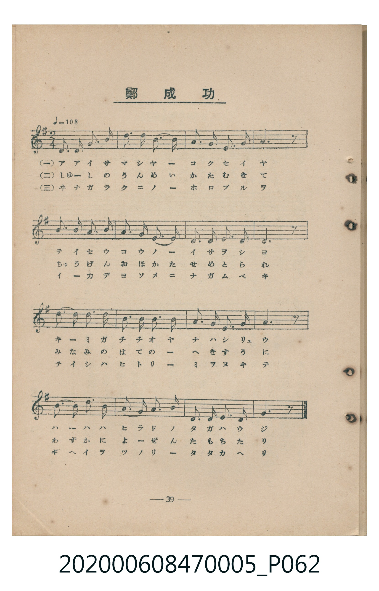
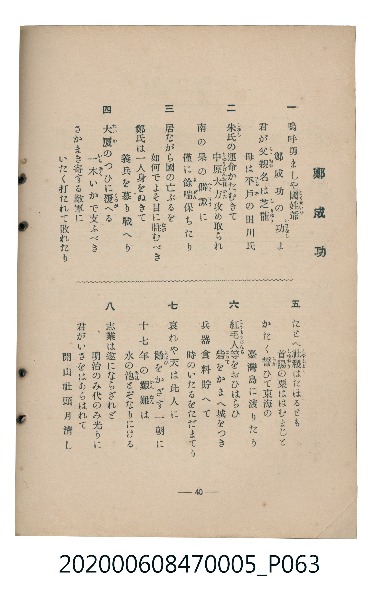

# 鄭成功

<audio controls src="teiseiko.mp3"></audio>

- 臺灣教育會公認《新定兒童唱歌》尋常科第五學年用（2020.006.0847.0005）

- note

原書資訊與歌詞全文（對應 P062.jpg – P063.jpg，書頁 pp. 39–40，參考教材第 6 首）：
調性與拍號：と長調四分之二拍子（G 大調 2/4 拍），♩= 108

## 歌詞

```text
一　嗚呼勇ましや國姓爺
鄭成功の功（いさをし）よ
君が父親（ちゝおや）名は芝龍（しりゅう）
母は平戸（ひらど）の田川氏

二　朱氏（しゅし）の運命かたむきて
中原大方（ちゅうげんおほかた）攻め取られ
南の果の僻陬（へきすう）に
僅に餘喘（よぜん）保ちたり

三　居ながら國の亡ぶるを
如何でよそ目に眺（なが）むべき
鄭氏は一人身をぬきて
義兵を募り戰へり

四　大廈（たいか）のつひに覆（くつが）へる
一木（いちぼく）いかで支ふべき
さかまき寄する敵軍に
いたく打たれて敗れたり

五　たとへ社稷（しゃしょく）はたほるとも
首陽（しゅやう）の粟ははむまじと
かたく誓（ちか）ひて東海の
臺灣島に渡りたり

六　紅毛人等（こうもうじんら）をおひはらひ
砦（とりで）をかまへ城をつき
兵器食料貯へて
時のいたるをただまてり

七　哀れや天は此人に
齡（よはひ）をかざす一朝に
十七年の艱難（かんなん）は
水の泡（あわ）とぞなりにける

八　志業は遂にならざれど
明治のみ代のみ光りに
君がいさをはあらはれて
開山社頭月清し
```

## 原書掃描頁





## 調性分析

```text
================================================================================
📊 TMD Song Profile: [ 鄭成功 ]
================================================================================
⏱  Duration:       0:17 (17.8s), 16 measures total
🎼 Key & Tempo:    首調基準 G, != 108.0 BPM, <2/4>
   - 分析範圍：      由實際發聲的音符與和弦推測調性；播放脈絡另行呈現
🎤 人聲音域:    D4 (MIDI 62) – E5 (MIDI 76) [跨度: 14 個半音 / 1.2 個八度, 難度: moderate]
   - 最低音:  D4 in [Teiseiko #1 @ m.7, 0:06]
   - 最高音: E5 in [Teiseiko #1 @ m.10, 0:10]
   - 適合: soprano, mezzo-soprano, contralto, tenor, baritone, bass
🏛  結構:      Teiseiko (17.8s)
⚡ 編曲密度:        Peak 1 軌道同時演奏
🗝  調性診斷：       D 大調（純淨自然大調，未偵測到可信轉調）
   - 風格氣質:    純淨自然大調（陽光明朗、易唱易記，無明顯調外色彩）
   - 轉調歷程:    全曲維持單一推測調性（未偵測到可信轉調）
   - 核心骨幹音:  A, D, B, G, E
   - 調性數值:    D 大調 [相關度: 0.81, 穩定度: Moderate, 自然音純度: 100.0%]
   - 候選調性 (K-S): D 大調 (0.81), G 大調 (0.70), A 大調 (0.60)
   - 五度圈歷程:   +2
   - 各段落調性細節:
     • [Teiseiko #1]: D 大調 (r: 0.81, 自然音純度: 100.0%)

  [ 五度圈游移軌跡 ]
               C  
         F            G  
      Bb              [D ]*
      Eb               A  
         Ab           E  
            Db       B  
               F# 
     (* = active key center)

  [ 十二半音累積音高分佈 ]
     C  :                            0.0%
     C# :                            0.0%
     D  : █████████████████████     23.3%
     D# :                            0.0%
     E  : █████████████             14.2%
     F  :                            0.0%
     F# :                            0.0%
     G  : ████████████████          17.5%
     G# :                            0.0%
     A  : ████████████████████████  26.7%
     A# :                            0.0%
     B  : █████████████████         18.3%
--------------------------------------------------------------------------------
Assignment 軌道音域：
  - Piano         : D4 – E5 (14 個半音 / 1.2 個八度, 52 個音符)
================================================================================
```

## ABC

```abc
X:1
T:鄭成功
C:TMD (Chen, Chih-Han / aguai)
M:2/4
L:1/16
Q:1/4=108
K:G

V:V1 name="Piano" snm="Pia"

[V:V1]
g3 g a3 b | d3 d b3 b | a3 a e3 g | a6 z2 |
b3 b a3 g | a3 a g3 e | d3 g e3 g | d6 z2 |
d3 b b3 b | d3 e d3 b | a3 a e3 g | a6 z2 |
b3 d e3 d | b3 a g3 b | d3 d e3 a | g6 z2 |
```

- [主旋律 TMD 檔案](teiseiko.tmd)
- [鋼琴伴奏 TMD 檔案](teiseiko_piano.tmd)
