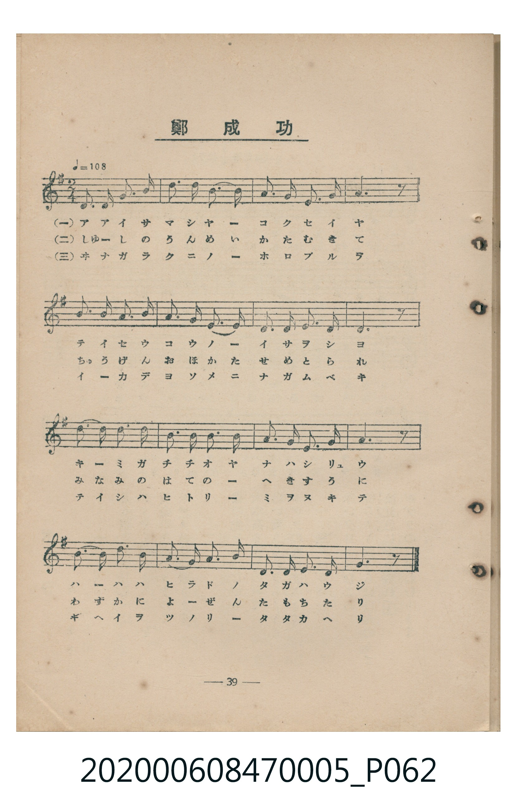
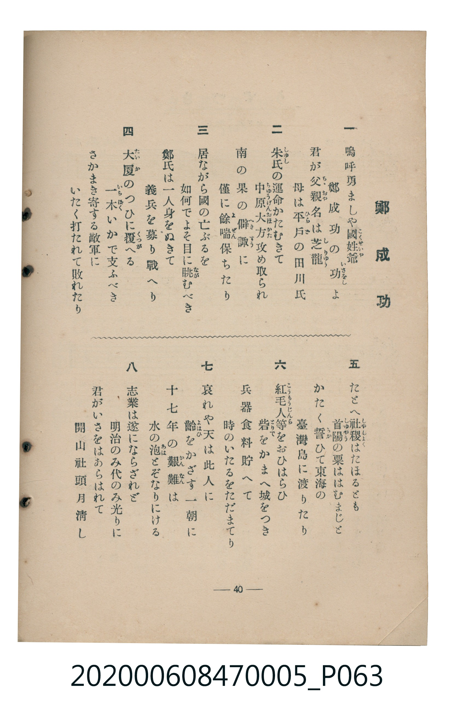

# 鄭成功

> Re:Shōka 使用 AI 協助辨識與重建樂譜，可能會有錯誤。歡迎回報。

<audio controls src="teiseiko.mp3"></audio>

- 臺灣教育會公認《新定兒童唱歌》尋常科第五學年用（2020.006.0847.0005）

## 說明

原書資訊與歌詞全文（對應 P062.jpg – P063.jpg，書頁 pp. 39–40，參考教材第 6 首）：
調性與拍號：と長調四分之二拍子（G 大調 2/4 拍），♩= 108


## 跨冊／重複收錄參照

> 同曲（〈鄭成功〉；收錄於《公學校唱歌》第五學年、《新定兒童唱歌》第五學年與《唱歌帖》P217《小公學校唱歌教材集》簡譜草稿）

- **[同曲]** 《公學校唱歌》第五學年用（昭和13年／1938）：[**〈鄭成功〉**](../../../kogakko_shoka/grade_5/10_teiseiko/index.md)（`G` / `2/4` — [原始 TMD](../../../kogakko_shoka/grade_5/10_teiseiko/teiseiko.tmd)）
- **[同曲]** 《新編小公學校唱歌教材集》第五、六學年（大正12年／1923，國臺圖 0725-41）：[**〈鄭成功〉**](../../../shoka_kyozai_shu_1923/grade_5_6/09_teiseiko/index.md)（`G` / `2/4` — [原始 TMD](../../../shoka_kyozai_shu_1923/grade_5_6/09_teiseiko/teiseiko.tmd)）
- **[同曲]** 楊金土手抄《唱歌帖》第 10 冊・X（2020.006.0843）：[**〈鄭成功 (鄭成功 - 未完成草稿)〉**](../../../shokacho/vol_10/p217_teiseiko/index.md)（`G` / `2/4` — [原始 TMD](../../../shokacho/vol_10/p217_teiseiko/teiseiko.tmd)）
- 總表：[跨冊重複與同名歌曲總索引](../../../duplicate_songs.md)

## 歌詞

```text
一　嗚呼勇ましや國姓爺
鄭成功の功（いさをし）よ
君が父親（ちゝおや）名は芝龍（しりゅう）
母は平戸（ひらど）の田川氏

二　朱氏（しゅし）の運命かたむきて
中原大方（ちゅうげんおほかた）攻め取られ
南の果の僻陬（へきすう）に
僅に餘喘（よぜん）保ちたり

三　居ながら國の亡ぶるを
如何でよそ目に眺（なが）むべき
鄭氏は一人身をぬきて
義兵を募り戰へり

四　大廈（たいか）のつひに覆（くつが）へる
一木（いちぼく）いかで支ふべき
さかまき寄する敵軍に
いたく打たれて敗れたり

五　たとへ社稷（しゃしょく）はたほるとも
首陽（しゅやう）の粟ははむまじと
かたく誓（ちか）ひて東海の
臺灣島に渡りたり

六　紅毛人等（こうもうじんら）をおひはらひ
砦（とりで）をかまへ城をつき
兵器食料貯へて
時のいたるをただまてり

七　哀れや天は此人に
齡（よはひ）をかざす一朝に
十七年の艱難（かんなん）は
水の泡（あわ）とぞなりにける

八　志業は遂にならざれど
明治のみ代のみ光りに
君がいさをはあらはれて
開山社頭月清し
```

## ABC

```abc
X:1
T:鄭成功
M:2/4
L:1/16
Q:1/4=108
K:G
V:V1 name="Piano" snm="Pia"
[V:V1]
!mf! D3 D G3 B | d3 d B3 B | A3 G E3 G | A6 z2 |
w: 1.~ア ア イ サ | マ シ ヤ _ | コ ク セ イ | ヤ
w: 2.~しゅ _ し の | う ん め い | か た む き | て
w: 3.~ヰ ナ ガ ラ | ク ニ ノ _ | ホ ロ ブ ル | ヲ
w: 4.~た い か の | つ ひ に _ | く つ が へ | る
w: 5.~タ _ ト ヘ | シャ ショ ク ハ | タ ホ ル ト | モ
w: 6.~こ う も う | じ ん ら を | お ひ は ら | ひ
w: 7.~ア ハ レ ヤ | テ ン ハ _ | コ ノ ヒ ト | ニ
w: 8.~し げ ふ は | つ ひ に _ | な ら ざ れ | ど
B3 B A3 B | A3 G E3 E | D3 D E3 D | D6 z2 |
w: 1.~テ イ セ ウ | コ ウ ノ _ | イ サ ヲ シ | ヨ
w: 2.~ちゅ う げ ん | お ほ か た | せ め と ら | れ
w: 3.~イ _ カ デ | ヨ ソ メ ニ | ナ ガ ム ベ | キ
w: 4.~い ち ぼ く | い か で _ | さ さ ふ べ | き
w: 5.~シュ ヤ ウ ノ | ア ハ ハ _ | ハ ム マ ジ | ト
w: 6.~と り で を | か ま へ _ | し ろ を つ | き
w: 7.~ヨ ハ ヒ ヲ | カ ザ ス _ | イ ッ テ ウ | ニ
w: 8.~め い ぢ の | み よ の _ | み ひ か り | に
!f! d3 d d3 d | B3 B B3 B | A3 G E3 G | A6 z2 |
w: 1.~キ _ ミ ガ | チ チ オ ヤ | ナ ハ シ リュ | ウ
w: 2.~み な み の | は て の _ | へ き す う | に
w: 3.~テ イ シ ハ | ヒ ト リ _ | ミ ヲ ヌ キ | テ
w: 4.~さ か ま き | よ す る _ | て き ぐ ん | に
w: 5.~カ _ タ ク | チ カ ヒ テ | ト ウ カ イ | ノ
w: 6.~へ _ い き | しょ く れ う | た く は へ | て
w: 7.~ジ フ シ チ | ネ ン ノ _ | カ ン ナ ン | ハ
w: 8.~き _ み が | い さ を は | あ ら は れ | て
!mf! B3 B d3 B | A3 G A3 B | D3 D E3 D | G6 z2 |
w: 1.~ハ _ ハ ハ | ヒ ラ ド ノ | タ ガ ハ ウ | ジ
w: 2.~わ ず か に | よ _ ぜ ん | た も ち た | り
w: 3.~ギ ヘ イ ヲ | ツ ノ リ _ | タ タ カ ヘ | リ
w: 4.~い た く う | た れ て _ | や ぶ れ た | り
w: 5.~タ イ ワ ン | タ ウ ニ _ | ワ タ リ タ | リ
w: 6.~と _ き の | い た る を | た だ ま て | り
w: 7.~ミ _ ヅ ノ | ア ハ ト ゾ | ナ リ ニ ケ | ル
w: 8.~か い ざ ん | しゃ と う _ | つ き き よ | し
```

## TMD 檔案連結

- [主旋律 TMD 檔案](teiseiko.tmd) [[在 TMD Studio 編輯](https://tmdlang.github.io/Tmd-TS/#tmd=s7IKdvYPcrWy4qpTUCpJTLdSSM7PyUlNLsnMz7MqzsjMK0nNjM_KTMmPL87Iz05Ugisry88pzU21Si9KTEmNN403MjAyiDcwMIs3sDAxBzIMTBFKi_NLi5JTrYqTM_Lzc-JLUitKkvLzs9Hl4wsS01OtAgzMjBAyBUX5Zal5iXlA3QVFILekgLUjFKSWZaakgqSLkxPz4stSizLTMlNTkFyZWlQM9gnEipKixLzi5KLMApD3EKryi0oy8oE-KciotMrILC7JL8pMTsyJz07MQ_JwSUYq0L8Q6UolLi0thZcta591THjaNV9BS4tL0VbB0MCCy95WwZ3LxkjfxA6k8UX7rueNi59NnfmiadOzOc1PW9e8WNX7uKHr2bQNT9fNeto66fnqpU-nbHy2tudxQ_fTDd1Pd-x4vnzi8zVrnuya8nTtjqc7tzyfsuL9ng5Q6OoBQ1cPFLpAhoHp-z2dSlxc-loKttQCXAoKCk_75j-bvePF5vYXK7pedLQD3fVi5bynrSueTWsHuuLpht5n7Z0KoCjSyypIV3jUMBnEMQZx3u_pAep8uaBRoaBAT8HYEihnYgAUfNrf_KKhGRgCz-ZOAPpLwUzh5bJpQMe_3zMLZOGLVfufNSwHWdXd-2LmfKDo48YVL6duB4o_nT37aUfbk53dT3b1AGWfrp0AdIK7wtMly4GSCsAQVgCKgk3qeTRzJST0QUY-2dHwuKHh6fRZTyfuedrd_rhx3-PG6Y-bWp7O6X66fPLzjl0gRfCoe9y4DkgCTX7c2PK4cerjpklA1UBTHzd1gANkwuzHjT3PO7a9WLYKrGjh46a5jxu7gOYBFT2d0Pu4cf2Lrrkv9wFdApQF2gOUan3c2AaUBel_th6k4unOzc86doBVbHrc1Pm4cSXIhsZ1z6dseLp97rMN_RCH7wKmgoZnczYCBWCmAY0Cu6Zx3cvG7qcT9z5u7H7cOP9xU8PjRqDByyD-XQuMNmCwPJu2E-ZEkAseN0563DQZ5NbG3RBtQIOeTdn9uKnxaf80kDOaesBe7J0ONP7ZvDmgoGje_XLmGrApO8A2zIR45XHjarDSZqDBq18umfF02gyQoiagujlAS4AqnuwHBstCsNu6oNHQCYqGjUAdq4BBCLQPGAFAK57sAqra9ripGxjUYDOXNT3ZO_Vx43KwaXOfz14HtOL5nF1gR4B0giMD6N-dQAfBom5DPzBUgRH9ZNeuF7tWgyNtDSJEnu9b-bR1K1D0aTfIOc86NoC8A3UXMFmB3LVk-dPdHWA7gEkAGPPdkFB-3LgEFEeNq18sA_obKAu0CCgCdgTIjG5oCns2B5QtwTqB3tkDVAdWATII6JVnU9Y_btyKcDIoYYEkgCmx9-l6oKKZQJOeTd36YjfQyeCQBWsFuqT_WScwyoCu7gH65dlUYAoAMhBhumsK0O1ghSuAznm-ZN_zFdthSaUZTALTO8QpQBcAlQFjG2jvisdNTeCgWzbt5cy9iLTVBLQUEr3rnm8CqgbqWQ8Oa6BDZwC1QVwGTnGN_S9WAeMZnLyggQUMpmXP5m58tnU7UD84M4NLu6ebtwE99WwHMBkCkx7c7U9b1wLd_nxL67P1s4HR9nwtMOMCTQP6tg3oOnB6nQFKr01AcWCEA2MUqBtoBdBBILvA8bpgGVgP0DtAueUwdZCA3fF0fh-YC4wucKADk8DTmSteLp7_bNrMF5uAXgOmaHDyeDYTaB0wpsEhDk6HYA8uABuzDJF-m0HpZHIDKAqApceSlUC3PFu7BOh2aJy93LsQlgmApm9Ccs40YAyDEwkwT0AyTm8j0DxgcQ60-EXnxpezF4M9ArQb6P9VkBwENAXsug0gRc82g81ubHrcBIlOYHzPAysF-nz148aJoKQI8eVqkDP3T3-2dC3QhJdAHSB5oEKgJmAuByaflWBjZ_Q92wQsB4D-3v9k92II42kr0MkgAxFFHVIxCPQU0HpwUgInR7Cfp3U_3bgRmPBeLlj7bE7Hsx2gAgokQXn9AwUKWvpcXCGpmcWpmdn5VgGZiXn5DjUGNdUgSxRsDM207MAsbDWfAqji3NHwYmGPgoaJwtMN_c_XN-jAqytNLBqAdkEN0wBq1LRSeNy0CCQAoh43LYEwtyrUKDxungfhbAcyIeLNe0DiTZsh4uuBeDeEuQSsHqwIAaA21ShU56bVKpjGK-gCIZAyBDOMgRKmECEgGyZiBGYZKphBVBvChSDQAIhrwKb6GIJcsggsCnM6hA1zO4QHcTxEN8TtEHGI4yFsmOsR9oBsh9pjBJQDFx1QKSAHSq8DaWtsgxoyGYgboTItYJluKG8-UKYByu4FyyzDbpUxyBkbICqbu4C61kDZK8FOXw_ldQNxH8JLzbOh4muBeBqUvRosswm7PSYgN8yHuxXhUoiPoAHZuAmIVyPsaeyHii8B4h4oewfYZRD9GPaYguT2w8KtuQNKzwDr2f64eTE06IDM5Uj-6wfLQ_SBfAfyDcwEkK8gkY5hmxnIjZOh7moDmtAEZ4NkZkAtA8VTJ5Q9CSzTheRfqBuAKkAyOMLPHCnpAV37uBkWT5CEBE0RzZvBsvDwgyU9YNw9bp6E4iMc4WcBTnpQ100C4q1Q9nq88bQK7gdgcQhl94BlVmLYg79g2dVDUcECDAlo6QAvKJYhFyDLwIGBVLDASx9Q0oWWPaDwWYGjYIGVG5AiAkv5AaSApQy85IGKAllwUQhEK1dgUQh1OYQNczqMh5IJkUofWLZDOB5r5ILLFVC7FRqLwBQLjGNYGkVOl7tRyhKQDDTHA8sbYC0Jj22QMyD5EsMyUMkCdSJILSw_tSM58HHTXiB7IVSmGywDdQGwHHrcvAAqMxNsz1rs9oBLlhaoWxcC8R4oG5yn4TLAEqxxOSLwGqdCxacipfGdYJle7PaASxZgsbEU6ihQPEEKVVCsoGdPpEwIZYO8g6gjwIUYtHjCsApcrMCCCFgoQx0OKzxgEbMPXBgivATNtk29YJUQNeDiAZeXQIUKLCrAroYVEZvA_oFGWdM2IN6JsAeW7pqbkVItOKXiK1SQKqrHjdCQghb-0GK3qQMsgvAPVBxc2ED9DAwNkAys6EHYQ6C10klZa2UtrMR43DwfUkisAfu3ESIOzBNNqyBMSHHcBeEAgxSYIcHMVaCEAwqGZTjKlWpQewXsIVM4jShtyG6trIWKgxwOCUGYyyGiEKfDUjRSBoQ6HsJGcj3WCAYXLLDoWoXEhkQwtIYDtkFQIxiSeEHJE9iSh7IhNSdmBMPLFJSCEuZAcF5HquGATkbYA_M6MFk_boa2IoABgzALwx5wmQIrIUAlxz64S0GhAG1VAN2MaIeAdECLA7B_JkDtgZSrOPwDLlNgcvD2B7BVghRFQHmEz8ChA2vVgCoEeCaFRB6sekCzB1ygwIoKRJkIaRmCurNQAVCcw5pZkIiANdmAMvBoBJdduBqU4IYKNGKbgYUrPIoawQ7shfJADRXkugxWPYDEYSlwM1LpiWEPuKECMQ3kJliCgzQ6YB4E2Q8rCSENGGgDDdxQgTW8IHow_YO3TAEOcFDWUOlHlClQJiwRgzkrgbgTwoTULvthBQ9MPbR1sANXgQLqAcHKDUiJglx-INov2NsqkB4TBKI3VWBRgqjaUPMfxO0QNszxkKCGuB6WehFJBSN6QSVKE6z1Pwup0gP3MqA5EMSfAzUNks9ghVwTkA1tV0DaL8CKA6s94FYKpEwC9RIQlRu4CmyGJiRw-xmpRIH7Zz9S0gX3MeCq0OxBaaUAe2fwng1KNgMmRURCBNkD0wGqgmEZE69_kPo_4BKyGdbDAWcmuAyw5IBX1iBXw7IC0D9QH4DYePyD1ESBlCQQGlLeI_kTWj7Cmi6w4gTYFIKXqZB0gMM_4CYKRBfIF9CWK5YGF6xM3IdSiQHrIqg_HzdtBMvgKInBxQksjYGaKLBeDCRdgQb-oJIrwJEGDzp4l6gXEQzA5AnWhGFVLReXrp0CbNhFAchW5gIA)]
- [鋼琴伴奏 TMD 檔案](teiseiko_piano.tmd) [[在 TMD Studio 編輯](https://tmdlang.github.io/Tmd-TS/#tmd=s7IKdvYPcrWy4tLSUnjZsvZZx4SnXfPf7-l42b3n-YQtT_Zsebq0_3lnx_s9nQpaWlyKtgqGBhZc9rYK7lw2Rvomdlx1Ckov2nc9b1z8bOrMF02bns1pftq65sWq3scNXc-mbXi6btbT1knPVy99OmXjs7U9jxu6n27ofrpjx_PlE5-vWfNk15Sna3c83bnl-ZQVQCuNDIwM9AwMzPQMLEzMgQwDU6CtSlxcnnklRflWAZmJeflBHg41BjXVXApAYGNopmUHZtUoVOem1SqYxivoAiGQMgQzjIESphAhIBsmYgRmGUJpkAhENQQaAHENVy2KpT7Ilpqg2mkYrxBtGAsyBMYwjQeyTOOhYgYQ00JSM4tTM7Op7wsziGpDuBCyN0Cm-hjWKDxuWgQWBdGPm5ZA2VuBeh43z4PytgPZEBmgTiB_M1R8PRDvhrKXgHXAVIEgyHaoPUZAucbpj5taoVJADpReB9LW2AY1ZDIQN0JlWsAy3VDefKBMA5TdC5ZZht0qY5AzNkBUNncBda2BsleCnb4eyusG4j6El5pnQ8XXAvE0KHs1WGYTdntMQG6YD3crwqUQH0EDsnETEK9G2NPYDxVfAsQ9UPYOsMsg-jHsMQXJ7YeFW3MHlJ4B1rP9cfNiaNABmcuR_NcPlofoA_kO5BuYCSBfQSIdwzYzkBsnQ93VBjShCc4GycyAWgaKp04oexJYpgvJv1A3AFWAZHCEnzlS0gO69nEzLJ4gCQmaIpo3g2Xh4QdLesC4e9w8CcVHOMLPApz0oK6bBMRboez1eONpFdwPjxuh6aGpByyzEsMeaA6FZUBE4YGWEYEUqAgAs4EUVBTIgotCIFoGhYUFMIshstsylIy4DDU1I2VjWPoFZWKQWSuwhxI4gy6EZVBw1AMDCxbZyBG8GyVTgmSgWQeYcR83QoyHRj0wwLBaBsqiUCeC1MISZjuSAx837QWyF0JlusEyUBcAM_Tj5gVQmZlge9ZitwecRVugbl0IxHugbHDmgMsAi4LG5YjAa5wKFZ-KlFh2gmV6sdsDzqLA_LcU6ihQPEFKJ1CsoKdzpNQMZYO8gyhswaUBNJ9jWAXOn7AgApZuUIfDciEsYvaBSxWEl6Dpv6kXrBKiBpzPcHkJlDthUQF2NSyvbQL7BxplTduAeCfCHli6a25GSrXglIovdyKV-I8boSEFLUWh5VdTB1gE4R-oODjXQv0MDA2QDCwPI-yB1Z-g6hMsbAqnEXmW7MpzLVT8cTO0LgAmT5B_oX4C0o-boGUJtGSDJmNQqALzJIS9CpR4QMbhqNTA2RPm6VVIbEgwQQtcYJWIGkyQJACK5MeNM6FsSEGOGUyIyhO5uIE5EJxjkApcoJMR9sC8Dkwcj5uhlRowYBBmYdgDzpmwfAbKf_vgLgWFArSSA7oZUS2CdEAzFdg_E6D2QEonHP4B50yYHLw6BFaSSFEElEf4DBw6sEoWVKzCkzok8mCFLJo94GwJy3CIkgXSUAG2e9qhAqA4h9X6kIiAtSCAMvBoBJcAuNo34HoTGrHNwCIKHkWNYAf2QnmgehO5RoAVsiBxWArcjFQGYdgDrjchpoHcBEtwkDoQ5kGQ_bDyBFKfQtsL4HoT1g6A6MH0D3LLFpYBIVkTe1sce9WJ2UJH1JwwvyFKWtSEvBKIoe0YaEkNSyKgSgaqB1rXwqIXLZxAWbMJ1qqbhVQGg1uP0KQM4s-BmgZJsLDSognIhlZzkOoUWI5htQdcaUIyN6j1hyhrwSVyMzRGwO0ipKwJ989-pDQAbjvCVaHZg1JpAlvd8BYrSnoFxikiRkH2wHSAagRYCsfrH6R2LbioaYa1XMGpEi4DzILwugPkaliaAvoH6gMQG49_kGpMSJaE0JCCE8mf0IIGVpPC8iWwZoYXTpB0gMM_4BoTogvkC2hDCkv9Dytc9qHUBsBCHerPx00bwTI4ijRwvoSlMVCNCWudQtIVsLBphkquAEcaPOjgTd1eRDAAkydYE4ZVGN1S0vu5ZkAMYYH6uRDlIAWQ7i-qCiRBhGJQjU280aguQTMUo8-ta6cA7sQrABkwj0b7ALWi8I3Q-MZofBM0vika3wyNb47GtwDzlbkA)]

## 分析

```text
================================================================================
📊 TMD Song Profile: [ 鄭成功 ]
================================================================================
⏱  Duration:       0:17 (17.8s), 16 measures total
🎼 Key & Tempo:    首調基準 G, != 108.0 BPM, <2/4>
   - 分析範圍：      由實際發聲的音符與和弦推測調性；播放脈絡另行呈現
🎤 人聲音域:    D4 (MIDI 62) – D5 (MIDI 74) [跨度: 12 個半音 / 1.0 個八度, 難度: easy]
   - 最低音:  D4 in [Teiseiko #1 @ m.1, 0:00]
   - 最高音: D5 in [Teiseiko #1 @ m.2, 0:01]
   - 適合: soprano, mezzo-soprano, contralto, tenor, baritone, bass
🏛  結構:      Teiseiko (17.8s)
⚡ 編曲密度:        Peak 1 軌道同時演奏
🗝  調性診斷：       D 大調（純淨自然大調，未偵測到可信轉調）
   - 風格氣質:    純淨自然大調（陽光明朗、易唱易記，無明顯調外色彩）
   - 轉調歷程:    全曲維持單一推測調性（未偵測到可信轉調）
   - 核心骨幹音:  D, A, B, E, G
   - 調性數值:    D 大調 [相關度: 0.85, 穩定度: High, 自然音純度: 100.0%]
   - 候選調性 (K-S): D 大調 (0.85), G 大調 (0.65), B 小調 (0.63)
   - 五度圈歷程:   +2
   - 各段落調性細節:
     • [Teiseiko #1]: D 大調 (r: 0.85, 自然音純度: 100.0%)

  [ 五度圈游移軌跡 ]
               C  
         F            G  
      Bb              [D ]*
      Eb               A  
         Ab           E  
            Db       B  
               F# 
     (* = active key center)

  [ 十二半音累積音高分佈 ]
     C  :                            0.0%
     C# :                            0.0%
     D  : ████████████████████████  29.2%
     D# :                            0.0%
     E  : ███████████               13.3%
     F  :                            0.0%
     F# :                            0.0%
     G  : ██████████                12.5%
     G# :                            0.0%
     A  : █████████████████████     25.0%
     A# :                            0.0%
     B  : ████████████████          20.0%
--------------------------------------------------------------------------------
Assignment 軌道音域：
  - Piano         : D4 – D5 (12 個半音 / 1.0 個八度, 52 個音符)
================================================================================
```


## 原書掃描頁






