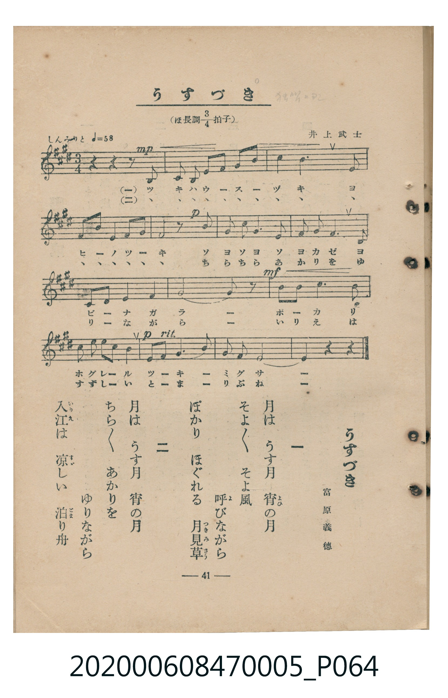

# うすづき

> Re:Shōka 使用 AI 協助辨識與重建樂譜，可能會有錯誤。歡迎回報。

- **NEUTRINO 歌聲合成版**：<br><audio controls src="usuzuki_neutrino.mp3"></audio>
- **鋼琴伴奏版**：<br><audio controls src="usuzuki.mp3"></audio>


- 臺灣教育會公認《新定兒童唱歌》尋常科第五學年用（2020.006.0847.0005）

## 說明

原書資訊與歌詞全文（對應 P064.jpg，書頁 p. 41，參考教材第 7 首）：
調性與拍號：ほ長調四分之三拍子（E 大調 3/4 拍），しんみりと（♩= 58）
作曲與作歌：井上武士、富原義德


## 歌詞

```text
一　月はうす月　宵（よひ）の月
そよ〳〵　そよ風
呼（よ）びながら
ぽかり　ほぐれる　月見草（つきみさう）

二　月はうす月　宵の月
ちら〳〵　あかりを
ゆりながら
入江（いりえ）は　涼（すゞ）しい　泊（とま）り舟（ぶね）
```

## ABC

```abc
X:1
T:うすづき
M:3/4
L:1/16
Q:1/4=58
K:E
V:V1 name="Piano" snm="Pia"
[V:V1]
z4 z4 z2 B,2 | C2 C2 E2 F2 G2 B2 | c4 c6 B2 | G2 B2 c4 c2 B2 |
w: 1.~ツ | キ ハ ウ _ ス _ | ヅ キ ヨ | ヒ _ ノ ツ _
w: 2.~つ | き は う _ す _ | づ き よ | ひ _ の つ _
E8 z2 B2 | B4 G2 F4 E2 | F2 G2 B6 G2 | F2 G2 F4 G4 |
w: 1.~キ ソ | ヨ ソ ヨ ソ | ヨ カ ゼ ヨ | ビ _ ナ ガ
w: 2.~き ち | ら ち ら あ | か り を ゆ | り _ な が
E12 | E8 z4 | c2 B2 c6 B2 | G2 A2 G2 F2 E4 |
w: 1.~ラ | _ | ポ _ カ リ | ホ グ レ _ ル
w: 2.~ら | _ | い り え は | す ず し _ い
F2 G2 A4 F4 | E2 F2 E8 | E4 z4 z4 |
w: 1.~ツ _ キ _ | ミ グ サ | _
w: 2.~と _ ま _ | り ぶ ね | _
```

## TMD 檔案連結

- [主旋律 TMD 檔案](usuzuki.tmd) [[在 TMD Studio 編輯](https://tmdlang.github.io/Tmd-TS/#tmd=s7IKdvYPcrWy4qpTUCpJTLdSSM7PyUlNLsnMz7MqzsjMK0nNjM_KTMmPL87Iz05Ugisry88pzU21Si9KTEmNN403MjAyiDcwMIs3sDAxBzIMTBFKi_NLi5JTrYqTM_Lzc-JLUitKkvLzsxHyBUX5Zal5iXlANQVFIBtTwIoQClLLMlNSQdKpKZkl-UWZiTlI7kgtKga7FWxJfElRYl5xclFmAcgDCFUlGalAx5Zk5qbG56fFpyRWoksVpyYW5-cVK3FpaSk8bmx73DjzcePSx429ClpaXIq2CqYWXPa2Cq5cNsb6JnYgrS_adz1vXPxs6swXTZuezWl-2rrmxarexw1dz6ZteLpu1tPWSc9XL306ZeOztT2PG7qfbuh-umPH8-UTn69Z82TXlKdrdzzdueX5lBXv93SAwk0PGG56oHADMgxM3-_pVOLi0tdSsKUW4FJQUHjaN__Z7B0vNre_WNH1oqMd6K4XK-c9bV3xbFo70BVPN_Q-a-9UCDAwM9HLKkh_v6cHqPjlgkaFAj0FE0Mg92l_84uGZqB3n82dAPSEgrnCy2XTgC59v2cWyPQXq_Y_a1gOMre798XM-UDRx427X07dDhR_Onv20462Jzu7n-zoBMo-XTsBaJ-rwtMly4GSCsDgVACKgk3qedw4_XHT5MeN-x83dT1uBIXOo5krQWEPlAbZ8mTvnGezNwFtATHW9gBtebJr6pMdXc_WLnu6ePXjhsan63uA_ny-b-XTfdu5wDp2NDxuaHg2p-Nx43pIrILYDQ1P120Fmv64CSi-CWj448Z1QHGQhseNc0GiDZsfN2wFqoNwXy5aAQ7CiXsgmsA6Nj9uXPW4sedxE9hpjxv3Pm7sBrkbpGn348YJj5uAct0Q218s637RC_Qh0LolwDQF8mHjVKB7QP4CO3MXMJVgdyay0xYCLUNyWhPUxqZJYOmmNnCwITnqaevSZxuBkQE0tgUsB3H5epBd28B-AabypnlgwekgNUDxzV1g8RWPG_eBxJuAiQViwrbHjWuh8UB5ioQCBS19Lq7Q4tKq0uxMq4DMxLx8hxqDmmqQHQo2hmZadmAWtqygAMpJOxpeLOxR0DBWeLqh__n6Bh14-tXEogFoFdQwDaBGTSsQBw08bm5RqAEG5Fogqx9ILwPSe4D0TjANlGluBSsDKoBpWIFi7q4eqptbo2CgoAuGyLRpPJCoUTADUWDCEIiNgNgYJAmRgyqH0SAIlgEb62NYowDSB4LINMipIN0gt4B4_SAS6GCICpCTISyIo2GiILUwCHI73BYjHLY0LoGYASxfQbz1YLINZkLjTIQtjUvhoiC1cFuaOsC24E8gu3rACcSEvATyuHkSJKKa-2CxCI0veESBY20vODRWwDhITIj446bVQLwHX5oh0qrGhWChThgHzmwCB1U3UKALiCfBndaGSEawlIGcLiApBZR2kCE4gYFlQCQIgvSCUhcIglTXoKQ1GATxEakL5CVYiuiDs0CpCxqzKKkGnjKAoQZJXaBUBIlpkAg6H6YCFLYgcg-SOegpEFjGw2Qa18FZoBQIS2PIKQuRRhdC3dkJ1wMSQeY3QfV3g8W7wCTM1xC3gtI0oVS6o5OyVDoZmnS6IHG-BhLfj5tXIlIOBIAEYckQRXAutEBaDUs4zauwpFFQ2gIpa1wFSXQ9UO2QREiMRY3AZA0ypbEDZhEw68NTKCxNwVIaiA2JIfQUCoPY0y5EBpa-cZd_oJCDpRhQ3EFibA3cBFAI4rIXXQRWukFCE2YWKG3C0wIwTFFSJTi9QNIRSAbC6kGYA09nJNkODGJ4WgQGM5L94FKWQFoENtYoS4uzgXZvANJroGkSnKJAgQIp0KDFGTR1gMTnQzQ0bSWQejCTI7CWeNw4C4inQ5NlCyyVAYtcsMA-VLvAKW8bECMVqfjsgpSZJkAMS5Ww1IZIqyBZEISlWUiKRFaLiDWYCHqFjpwiZ4NjbwOIBIYhLOXA0hEkIGGpay2GDaDghOsHBimudINeJyOXlaC6FxSuIHI6zC5wqoKlMHhJDAxgDBdAU942MInpQtwuqOXi0rVTgDYGFYBMZS4A)]
- [鋼琴伴奏 TMD 檔案](usuzuki_piano.tmd) [[在 TMD Studio 編輯](https://tmdlang.github.io/Tmd-TS/#tmd=s7IKdvYPcrWy4tLSUnjc2Pa4cebjxqWPG3vf7-l42b3n-YQtT_Zsebq0_3lnx_s9nQpaWlyKtgqmFlz2tgquXDbG-iZ2XHUKSi_adz1vXPxs6swXTZuezWl-2rrmxarexw1dz6ZteLpu1tPWSc9XL306ZeOztT2PG7qfbuh-umPH8-UTn69Z82TXlKdrdzzdueX5lBVAG40MjAz0DAzM9AwsTMyBDANToKVKXFyhxaVVpdmZVgGZiXn5QR4ONQY11VwKQGBjaKZlB2bpaynYogMFkA07Gl4s7FHQMFZ4uqH_-foGHYUAAzMTvayCdE0sGrT0wYbVKBgo6IIhMm0aDyRqFMxAFJgwBGIjIDYGSULkoMphNAiCZcDG-hjWKID0gSAy_bi5Baz7cdNaMK8fRDYtg6p43LQTygKqaG6Fi4LUwuDj5hUIW4xw2NK4BGJGYy-Ytx5MtsFMaJyJsKVxKVwUpBZuS1MH2Bb8Ab6rBxzgJqQFOCwMkUMQEqagUEaG4KgAy4BIEATpBcUDCIJU16DECgyC-Ih4eNw8CR52fXAWKB6gYYASvvAwbNoLkQWHNyRMQCLofJiKx02rweQeJHPQ4-px4yaYTOM6OAsUV7DYQI4DRGwuhLqzE64HJILMb4Lq7waLd4FJmK8hbgXFPqH43NFJTnzCYgAWLyA2xD_o8QmD2GMaIgNLDbjz1ePmyTBfNYN8CvHfGrgJj5tX4rQXXQSWa0C65sLNAsUkPOSaVyFsB8UhOHQhoQ6SgbB6EObAY4Uk2xtB6REac42gvAe3H5x7CcTc09mzyc2JJkAMiz1YrCDiFCQLgrC4hcQcslqE72Ai6AUqcszNBvtyA4hshsXY42ZYeINUwPIlZq4Eyc5H6G_aiiGPHq7w8EXKgaCy73HjLDA5HWYXOPRhMQHP3437MF0AjaFtYBLThbhdUItWt_kg120miKrt5dw5L9ZMeLZr9bP5U57s7AbmyWfdvU_XTni6fdmzzm5IFf1-D7DgXfG8f9_TJf1Pl8x5tn3hszkdT_ete7loxYuOdiD7xbLuF72dz7ftfjZlH9CQZzPXI9d3IAiq3OIVos3ic2MVog1jgXwTINcEyoEqNQQKAbkQVXAuSLMpSLNpPEyvEZBnBDIJJATTjVADFoWbBtaBZBZhi1GNB8vCNIA4YP-AAljXTgEaxtE-QElkrhGYq8wFAA)]

## 分析

```text
================================================================================
📊 TMD Song Profile: [ うすづき ]
================================================================================
⏱  Duration:       0:46 (46.6s), 15 measures total
🎼 Key & Tempo:    首調基準 E, != 58.0 BPM, <3/4>
   - 分析範圍：      由實際發聲的音符與和弦推測調性；播放脈絡另行呈現
🎤 人聲音域:    B3 (MIDI 59) – C#5 (MIDI 73) [跨度: 14 個半音 / 1.2 個八度, 難度: moderate]
   - 最低音:  B3 in [Usuzuki #1 @ m.1, 0:02]
   - 最高音: C#5 in [Usuzuki #1 @ m.3, 0:06]
   - 適合: soprano, mezzo-soprano, contralto, tenor, baritone, bass
🏛  結構:      Usuzuki (46.6s)
⚡ 編曲密度:        Peak 1 軌道同時演奏
🗝  調性診斷：       E 大調（純淨自然大調，未偵測到可信轉調）
   - 風格氣質:    純淨自然大調（陽光明朗、易唱易記，無明顯調外色彩）
   - 轉調歷程:    全曲維持單一推測調性（未偵測到可信轉調）
   - 核心骨幹音:  E, C#, B, F#, G#
   - 調性數值:    E 大調 [相關度: 0.90, 穩定度: High, 自然音純度: 100.0%]
   - 候選調性 (K-S): E 大調 (0.90), C# 小調 (0.76), B 大調 (0.59)
   - 五度圈歷程:   +4
   - 各段落調性細節:
     • [Usuzuki #1]: E 大調 (r: 0.90, 自然音純度: 100.0%)

  [ 五度圈游移軌跡 ]
               C  
         F            G  
      Bb               D  
      Eb               A  
         Ab          [E ]*
            Db       B  
               F# 
     (* = active key center)

  [ 十二半音累積音高分佈 ]
     C  :                            0.0%
     C# : █████████████             17.9%
     D  :                            0.0%
     D# :                            0.0%
     E  : ████████████████████████  32.1%
     F  :                            0.0%
     F# : ████████████              15.4%
     G  :                            0.0%
     G# : ███████████               14.1%
     A  : ███                        3.8%
     A# :                            0.0%
     B  : ████████████              16.7%
--------------------------------------------------------------------------------
Assignment 軌道音域：
  - Piano         : B3 – C#5 (14 個半音 / 1.2 個八度, 48 個音符)
================================================================================
```


## 原書掃描頁




