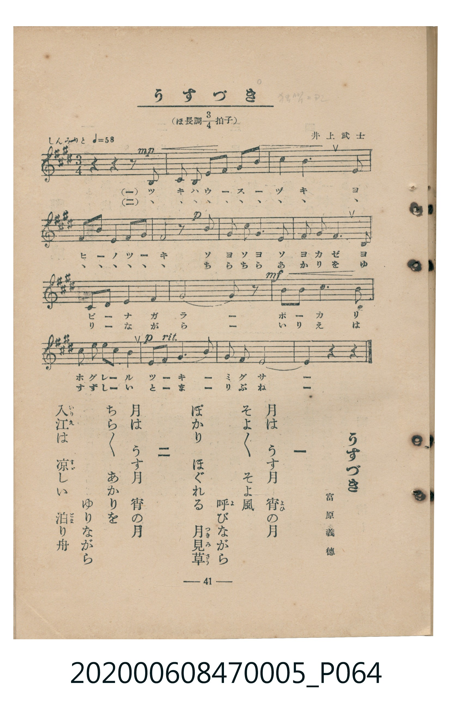

# うすづき

> Re:Shoka 使用 AI 辨識樂譜，可能會有錯誤。歡迎回報。

<audio controls src="usuzuki.mp3"></audio>

- 臺灣教育會公認《新定兒童唱歌》尋常科第五學年用（2020.006.0847.0005）

## 說明

原書資訊與歌詞全文（對應 P064.jpg，書頁 p. 41，參考教材第 7 首）：
調性與拍號：ほ長調四分之三拍子（E 大調 3/4 拍），しんみりと（♩= 58）
作曲與作歌：井上武士、富原義德

## 歌詞

```text
一　月はうす月　宵（よひ）の月
そよ〳〵　そよ風
呼（よ）びながら
ぽかり　ほぐれる　月見草（つきみさう）

二　月はうす月　宵の月
ちら〳〵　あかりを
ゆりながら
入江（いりえ）は　涼（すゞ）しい　泊（とま）り舟（ぶね）
```

## ABC

```abc
X:1
T:うすづき
M:3/4
L:1/16
Q:1/4=58
K:E
V:V1 name="Piano" snm="Pia"
[V:V1]
z4 z4 z2 B,2 | C2 C2 E2 F2 G2 B2 | c4 c6 B2 | G2 B2 c4 c2 B2 |
E8 z2 B2 | B4 G2 F4 E2 | F2 G2 B6 G2 | F2 G2 F4 G4 |
E12 | E8 z4 | c2 B2 c6 B2 | G2 A2 G2 F2 E4 |
F2 G2 A4 F4 | E2 F2 E8 | E4 z4 z4 |
```

## TMD 檔案連結

- [主旋律 TMD 檔案](usuzuki.tmd) [[在 TMD Studio 編輯](https://tmdlang.github.io/Tmd-TS/#tmd=s7IKdvYPcrWy4qpTUCpJTLdSSM7PyUlNLsnMz7MqzsjMK0nNjM_KTMmPL87Iz05Ugisry88pzU21Si9KTEmNN403MjAyiDcwMIs3sDAxBzIMTBFKi_NLi5JTrYqTM_Lzc-JLUitKkvLzsxHyBUX5Zal5iXlANQVFIBtTwIoQClLLMlNSQdKpKZkl-UWZiTlI7kgtKga7FWxJfElRYl5xclFmAcgDCFUlGalAx5Zk5qbG56fFpyRWoksVpyYW5-cVK3FpaSk8bmx73DjzcePSx429ClpaXIq2CqYWXPa2Cq5cNsb6JnYgrS_adz1vXPxs6swXTZuezWl-2rrmxarexw1dz6ZteLpu1tPWSc9XL306ZeOztT2PG7qfbuh-umPH8-UTn69Z82TXlKdrdzzdueX5lBXv93SAwk0PGG56oHADMgxM3-_pVOLi0tdSsKUW4FJQUHjaN__Z7B0vNre_WNH1oqMd6K4XK-c9bV3xbFo70BVPN_Q-a-9UCDAwM9HLKkh_v6cHqPjlgkaFAj0FE0Mg92l_84uGZqB3n82dAPSEgrnCy2XTgC59v2cWyPQXq_Y_a1gOMre798XM-UDRx427X07dDhR_Onv20462Jzu7n-zoBMo-XTsBaJ-rwtMly4GSCsDgVACKgk3qedw4_XHT5MeN-x83dT1uBIXOo5krQWEPlAbZ8mTvnGezNwFtATHW9gBtebJr6pMdXc_WLnu6ePXjhsan63uA_ny-b-XTfdu5wDp2NDxuaHg2p-Nx43pIrILYDQ1P120Fmv64CSi-CWj448Z1QHGQhseNc0GiDZsfN2wFqoNwXy5aAQ7CiXsgmsA6Nj9uXPW4sedxE9hpjxv3Pm7sBrkbpGn348YJj5uAct0Q218s637RC_Qh0LolwDQF8mHjVKB7QP4CO3MXMJVgdyay0xYCLUNyWhPUxqZJYOmmNnCwITnqaevSZxuBkQE0tgUsB3H5epBd28B-AabypnlgwekgNUDxzV1g8RWPG_eBxJuAiQViwrbHjWuh8UB5ioQCBS19Lq7Q4tKq0uxMq4DMxLx8hxqDGoVqkCUKNoZmWnZgFra8oADKSjsaXizsUdAwVni6of_5-gYdeALWxKIBaBfUMA2gRk0rEAcNPG5uUagBhuRaIKsfSC8D0nuA9E4wDZRpbgUrAyqAaViBYu6uHqqbW6NgoKALhsi0aTyQqFEwA1FgwhCIjYDYGCQJkYMqh9EgCJYBJzncgbqrBxyoJuQF6uPmSRDPNffBfA71I9xzYJ_uBXt7BYyDxISIP25aDcR78IUzkVY1LgQLdcI4cGYTSLyxGyjQBcST4E5rQwQ9LDSRwxISuqDwRobgSAHLgEgQBOkFxQgIglTXoMQPDIL4hGJkRydlMTIZGkxdEP-tgfjtcfNKRChBAEgQFuQognOhCXY1PD5WYYkPUDiClDWuggRwD1Q7JMCJsagRGIUgUxo7YBY1rkfEBiz8YKEKYoMgZmzAIPZ4gsjA4pLE_AGszyiLjdlAL24A0mugsQIOU1CAQJIvNPFCwwckPh-ioWkrgfDDjJDGmUA8C4inQyOmBRbOwAwGFtiHahc47LcBMVIGwmcXJIeYIMULLLwRsQWSBUFYrEHiBFktZmyhF3k1XLVcXLp2CtC6QgHIVObiAgA)]
- [鋼琴伴奏 TMD 檔案](usuzuki_piano.tmd) [[在 TMD Studio 編輯](https://tmdlang.github.io/Tmd-TS/#tmd=s7IKdvYPcrWy4tLSUnjc2Pa4cebjxqWPG3vf7-l42b3n-YQtT_Zsebq0_3lnx_s9nQpaWlyKtgqmFlz2tgquXDbG-iZ2XHUKSi_adz1vXPxs6swXTZuezWl-2rrmxarexw1dz6ZteLpu1tPWSc9XL306ZeOztT2PG7qfbuh-umPH8-UTn69Z82TXlKdrdzzdueX5lBVAG40MjAz0DAzM9AwsTMyBDANToKVKXFyhxaVVpdmZVgGZiXn5QR4ONQY1CtVcCkBgY2imZQdm6Wsp2KIDBZAVOxpeLOxR0DBWeLqh__n6Bh2FAAMzE72sgnRNLBq09MGG1SgYKOiCITJtGg8kahTMQBSYMARiIyA2BklC5KDKYTQIgmW48DtyVw_YkSakORJmL7KtEHeAXIYMwc4Hy4BIEATpBbkdBEGqa1B8AoMgPiG37-gkx-0w22BuALFBENPtMIjdVxAZmM9JDPens2eTG-4mSO6HuQvhK5AsCMJ8B3E7slpMX6EnuRquWrSk74OS9E0QKf_l3Dkv1kx4tmv1s_lTnuzsBkbJs-7ep2snPN2-7FlnNyQLv98DTGMrnvfve7qk_-mSOc-2L3w2p-PpvnUvF6140dEOZL9Y1v2it_P5tt3PpuwDGvJs5nrk7ACCoLQfrxBtFp8bqxBtGAvkmwC5JlAOVKkhUAjIhaiCc0GaTUGaTeNheo2APCOQSSAhmG6EGrAo3DSwDiSzCFuMajxYFqYBxAH7BxTCunYK0EBWQGUqc3EBAA)]

## 分析

```text
================================================================================
📊 TMD Song Profile: [ うすづき ]
================================================================================
⏱  Duration:       0:46 (46.6s), 15 measures total
🎼 Key & Tempo:    首調基準 E, != 58.0 BPM, <3/4>
   - 分析範圍：      由實際發聲的音符與和弦推測調性；播放脈絡另行呈現
🎤 人聲音域:    B3 (MIDI 59) – C#5 (MIDI 73) [跨度: 14 個半音 / 1.2 個八度, 難度: moderate]
   - 最低音:  B3 in [Usuzuki #1 @ m.1, 0:02]
   - 最高音: C#5 in [Usuzuki #1 @ m.3, 0:06]
   - 適合: soprano, mezzo-soprano, contralto, tenor, baritone, bass
🏛  結構:      Usuzuki (46.6s)
⚡ 編曲密度:        Peak 1 軌道同時演奏
🗝  調性診斷：       E 大調（純淨自然大調，未偵測到可信轉調）
   - 風格氣質:    純淨自然大調（陽光明朗、易唱易記，無明顯調外色彩）
   - 轉調歷程:    全曲維持單一推測調性（未偵測到可信轉調）
   - 核心骨幹音:  E, C#, B, F#, G#
   - 調性數值:    E 大調 [相關度: 0.90, 穩定度: High, 自然音純度: 100.0%]
   - 候選調性 (K-S): E 大調 (0.90), C# 小調 (0.76), B 大調 (0.59)
   - 五度圈歷程:   +4
   - 各段落調性細節:
     • [Usuzuki #1]: E 大調 (r: 0.90, 自然音純度: 100.0%)

  [ 五度圈游移軌跡 ]
               C  
         F            G  
      Bb               D  
      Eb               A  
         Ab          [E ]*
            Db       B  
               F# 
     (* = active key center)

  [ 十二半音累積音高分佈 ]
     C  :                            0.0%
     C# : █████████████             17.9%
     D  :                            0.0%
     D# :                            0.0%
     E  : ████████████████████████  32.1%
     F  :                            0.0%
     F# : ████████████              15.4%
     G  :                            0.0%
     G# : ███████████               14.1%
     A  : ███                        3.8%
     A# :                            0.0%
     B  : ████████████              16.7%
--------------------------------------------------------------------------------
Assignment 軌道音域：
  - Piano         : B3 – C#5 (14 個半音 / 1.2 個八度, 48 個音符)
================================================================================
```


## 原書掃描頁




